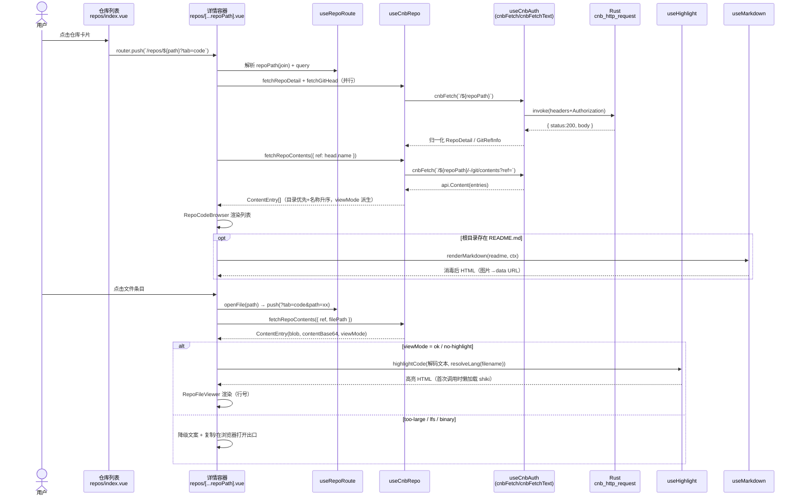
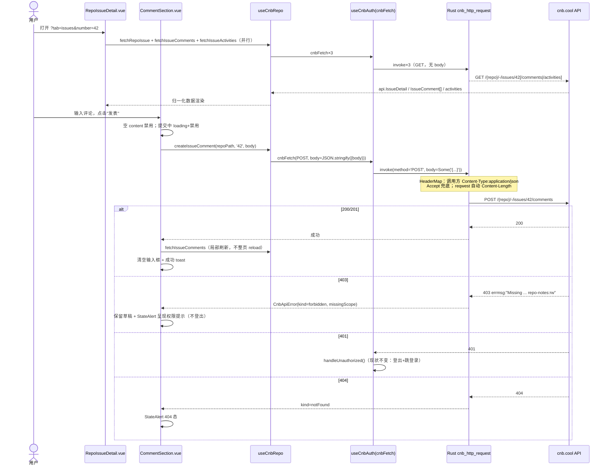
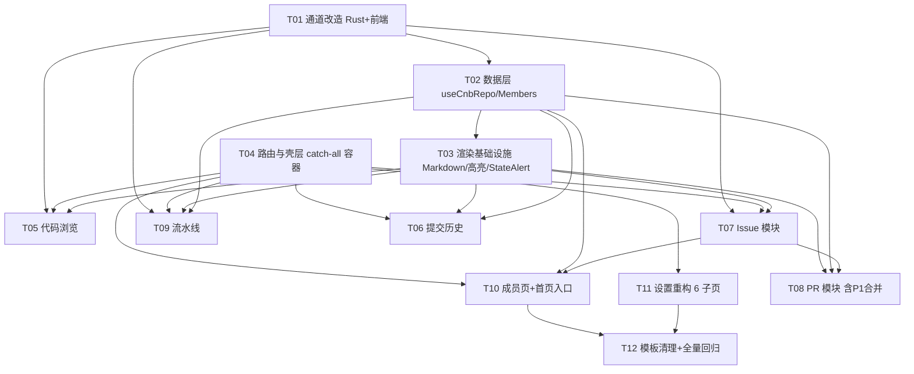

# WOCNB 增量架构设计 + 任务分解（2026-10-27）

> 上游输入：`.workbuddy/docs/prd/increment-2026-10-27.md`（PRD）。
> 本文是工程师（software-engineer）的实现蓝图：实现方案、文件清单、路由表、接口签名、调用流程、Rust 改造、有序任务、依赖包、共享约定、风险与验证。
> 所有产品级取舍（合并降 P1、日志混合方案、merge_style 默认值、令牌页只读、快捷键只列真实键位、成员页一级、首页「+」外跳、shiki + marked）**已由主理人拍板，本文直接落地，不再翻案**。
> 接口事实来源：`/tmp/cnb-swagger.json`（199 端点，本文所有端点与字段名均已逐项核对，未臆造）。

---

## 1. 实现方案总览

### 1.1 架构总览

本次增量不改变现有架构骨架（Tauri 2 + Vue 3 + Vite 8 + Nuxt UI v4 + unplugin-vue-router + vite-plugin-vue-layouts + vue-i18n + pnpm），做四层增量：

```
┌─ 页面层 ──────────────────────────────────────────────────────┐
│ repos/index.vue（列表，原地迁移）                              │
│ repos/[...repoPath].vue（详情容器：头部 + 5 页签，query 定位）  │
│ members.vue / settings/{general,appearance,language,          │
│   shortcuts,token,about}.vue                                  │
├─ 组件层（src/components/repo/）───────────────────────────────┤
│ 目录树 / 文件查看 / README / 提交 / Issue / PR diff / 构建 /   │
│ 日志抽屉 / 评论 / 弹窗（新建 Issue、合并确认）/ StateAlert     │
├─ 数据与渲染层（src/composables/）─────────────────────────────┤
│ useCnbRepo.ts（A/B/C/D 全部端点 + snake→camel 归一化，唯一出口）│
│ useCnbMembers.ts（成员/外部贡献者）                            │
│ useCnbAuth.ts（改造：cnbFetchText + 403 归一化）               │
│ useMarkdown.ts（marked + DOMPurify + 图片本地化）              │
│ useHighlight.ts（shiki 懒加载单例）                            │
│ useRepoRoute.ts（query 参数读写封装）                          │
├─ 通道层 ──────────────────────────────────────────────────────┤
│ src/composables/useCnbAuth.ts → invoke('cnb_http_request')    │
│ src-tauri/src/lib.rs（改造：body 参数 + HeaderMap/Accept 顺序）│
└───────────────────────────────────────────────────────────────┘
```

### 1.2 关键技术难点与选型

| 难点 | 选型 | 理由 |
| --- | --- | --- |
| 写请求全部不可用（Rust 命令缺 body） | 扩展 `cnb_http_request` 增加 `body: Option<String>` | 最小侵入：reqwest 的 `.body(String)` 自动处理 Content-Length；`Content-Type` 由调用方 headers 透传（前端 cnbFetch 已统一携带 `application/json`）。无 body 时行为与现状完全一致，GET 回归零风险 |
| raw 文本文件读不到（Accept 硬编码 + 前端强转 json） | Rust 侧先构建 HeaderMap、Accept 仅在调用方未指定时兜底；前端新增 `cnbFetchText` | `.header()` 是追加语义，必须改为 HeaderMap 插入式构建；`cnbFetchText` 返回 `{status, ok, text}`，供 raw 文件、阶段日志等场景使用 |
| 多级子组织仓库路径 | catch-all 路由 `src/pages/repos/[...repoPath].vue`，参数数组 `join('/')` | `/:org/:repo` 两段路由对 `org/sub/api` 失效；catch-all 之后无法再挂静态子路由，故视图定位全用 query |
| 代码高亮体积 | **shiki**（懒加载） | 主理人拍板。策略：`createHighlighterCore` 延迟创建单例，主题/语言按需动态 `import()`，仅注册 PRD 指定的 14 种语言（js/ts/vue/json/css/html/md/python/go/rust/java/sql/yaml/shell/dockerfile）；未注册语言降级为纯文本渲染。首次调用才加载（动态 import 天然分包），首屏零开销 |
| Markdown 渲染 + XSS | **marked + DOMPurify** | 主理人拍板。README / Issue 正文 / 评论 / PR 描述均为不可信内容：`marked` 解析（不开 raw HTML 透传，`sanitizer` 交给 DOMPurify），DOMPurify 消毒（去 script/iframe/event handler），链接强制 `rel="noopener"`，非 http(s) 协议链接丢弃；外链经 main.ts 既有全局拦截器自动走系统浏览器 |
| Markdown 图片相对路径 | 图片本地化管线（useMarkdown 内） | `` → 拼为 `https://cnb.cool/{repo}/-/raw/{ref}/{dir}/{img}`，经既有 `cnb_fetch_image`（useCnbImages）转 data URL；失败灰块占位，绝不弹系统浏览器 |
| 文件大小降级 | 三档阈值，集中在 useCnbRepo 归一化层判定 | `size > 1MB` 或 `type=lfs` → 不加载内容，仅元信息 + 外跳；`size > 256KB` → 加载但关闭高亮；二进制探测（解码后含 `\0`）→ "二进制文件不支持预览" |
| 日志结构未知（`pipelinesStatus` free-form） | 双路径兼容设计 | 主路径：`GET /-/build/status/{sn}` 响应里 `pipelinesStatus` 是 `Record<pipelineId, dto.PipelineStatus>`（含 `id/name/status/duration/stages[]`，`dto.Stage` 含 `id`，swagger 已核实）→ 直接取 `pipelineId + stageId` 内嵌日志；兜底路径：解析失败（结构为空/异常）→ 降级为"流水线/阶段只读列表 + 在浏览器打开日志（`buildLogUrl`/`eventUrl`）"。两条路径都实装，运行时自动选择 |
| 仓库路径校验 | repoPath 归一化单点实现 + 已知仓库校验提示 | `useCnbRepo.normalizeRepoPath()` 单点处理编码；打开仓库时与 `/repos` 缓存列表比对，非已知仓库仅提示"该仓库不在当前组织可见列表中"（不阻断，跨组织仓库可正常打开） |

### 1.3 架构模式

沿用现有模式：**组合式函数分层**（composables = 数据/服务层，pages = 路由容器，components = 视图）+ **单一网络通道**（所有请求经 `cnbFetch`/`cnbFetchText` → Rust 命令）。页面组件**禁止**直接 `fetch`/`axios`/拼 API URL。

---

## 2. 文件清单

### 2.1 新增（N）

| 文件（仓库相对路径） | 职责 |
| --- | --- |
| `src/composables/useCnbRepo.ts` | A/B/C/D 模块全部 CNB 端点封装 + snake_case→camelCase 归一化 + 大小/二进制降级判定 + cnb.cool 站点 URL 拼接工具（issue/pull/build/raw） |
| `src/composables/useCnbMembers.ts` | `GET /{group}/-/members`、`GET /{slug}/-/outside-collaborators` 封装与归一化 |
| `src/composables/useMarkdown.ts` | marked + DOMPurify 渲染管线：`renderMarkdown(md, ctx)` 单入口；图片相对路径本地化（经 cnb_fetch_image 转 data URL）；链接消毒加固 |
| `src/composables/useHighlight.ts` | shiki 懒加载单例：`highlightCode(code, lang)`、`resolveLang(filename)`；未注册语言/超阈值返回纯文本 |
| `src/composables/useRepoRoute.ts` | 仓库详情 query 参数读写封装（tab/ref/path/number/sn/state/page/keyword/sha），页签 replace / 下钻 push 的语义化方法 |
| `src/components/repo/StateAlert.vue` | 统一三态+权限组件：loading 骨架 / empty / error / 403（缺 scope 提示 + 管理令牌 + 外跳）/ 404 |
| `src/components/repo/MarkdownView.vue` | Markdown 渲染容器（内部用 useMarkdown，带渲染中骨架与失败态） |
| `src/components/repo/RepoHeader.vue` | 详情头部：返回按钮、path 面包屑、可见性徽标、语言色点、元信息条、"在浏览器打开" |
| `src/components/repo/RepoTabs.vue` | 五页签（代码/提交/Issue/合并请求/流水线），replace 语义 |
| `src/components/repo/RepoBranchSelect.vue` | 分支/标签分组下拉（USelect/U.popover），选中写回 `?ref=` |
| `src/components/repo/RepoCodeBrowser.vue` | 目录浏览 + 面包屑路径 + README 渲染（根目录时） |
| `src/components/repo/RepoFileViewer.vue` | 文件视图：行号 + 语法高亮 + 三档降级 + 复制/外跳原始文件 |
| `src/components/repo/RepoCommits.vue` | 提交历史列表（分页）+ 提交详情展开（父提交可点） |
| `src/components/repo/RepoIssueList.vue` | Issue 列表：open/closed 分段 + 关键词搜索 + 分页 |
| `src/components/repo/RepoIssueDetail.vue` | Issue 详情：正文 Markdown、标签/处理人/优先级、时间线、评论区、关闭/重开 |
| `src/components/repo/CommentSection.vue` | 通用评论区（Issue 与 PR 共用）：列表 + 发表（loading 禁用 / 失败保草稿） |
| `src/components/repo/IssueTimeline.vue` | Issue 动态时间线（activities 尽力解析，payload 异常只显示类型名） |
| `src/components/repo/NewIssueModal.vue` | 新建 Issue 表单（title 必填 1–200、body、labels、assignees、priority） |
| `src/components/repo/RepoPullList.vue` | PR 列表：state 筛选（open/closed/all）+ 分页 |
| `src/components/repo/RepoPullDetail.vue` | PR 详情：描述、base←head、评审人状态、提交列表、变更文件、评论；P1 合并入口 |
| `src/components/repo/PullDiffView.vue` | unified diff 着色（新增绿/删除红/hunk 灰）、单文件折叠、`patch` 空显示"无文本差异" |
| `src/components/repo/MergePullModal.vue` | （P1）合并确认弹窗：merge_style（默认取仓库设置）/commit_title/commit_message，明示目标分支 |
| `src/components/repo/RepoBuildList.vue` | 构建历史列表：状态徽标、sn、提交标题、触发人、耗时、状态筛选 |
| `src/components/repo/RepoBuildDetail.vue` | 构建详情：pipeline→stage 两级树（内嵌日志路径）/ 降级只读列表（外跳路径） |
| `src/components/repo/BuildLogDrawer.vue` | 阶段日志抽屉：等宽按行渲染、>2000 行默认尾 2000 行可展开、复制全文、浏览器外跳 |
| `src/pages/repos/[...repoPath].vue` | 仓库详情容器（catch-all 路由），组装 Header + Tabs + 各页签视图；非法参数"未找到"态 |
| `src/pages/repos/index.vue` | 仓库列表页（自 `src/pages/repos.vue` 迁移，内容不变） |
| `src/pages/members.vue` | 组织成员页：成员 / 外部贡献者双页签，search/role，403 降级 |
| `src/pages/settings/general.vue` | 设置·通用：登录用户与当前组织只读摘要 + 跳转入口 |
| `src/pages/settings/appearance.vue` | 设置·外观：useColorMode 系统/浅/深 |
| `src/pages/settings/language.vue` | 设置·语言：与 localePref 同源的四选项 |
| `src/pages/settings/shortcuts.vue` | 设置·快捷键：**只列真实键位**（Cmd/Ctrl+K 搜索、Cmd/Ctrl+R 刷新当前列表、Esc 关闭抽屉/弹窗、Cmd/Ctrl+, 打开设置） |
| `src/pages/settings/token.vue` | 设置·令牌：脱敏展示（前 4 后 4）、退出登录、外跳 CNB 令牌管理页；**不做应用内替换令牌** |
| `src/pages/settings/about.vue` | 设置·关于：Tauri `getVersion()`、开源仓库、CNB 反馈、许可证 |
| `docs/sequence-diagram.mermaid`、`docs/class-diagram.mermaid` | 本文第 4/5 节图的独立副本（供渲染器直接消费） |

### 2.2 修改（M）

| 文件 | 变更 |
| --- | --- |
| `src-tauri/src/lib.rs` | `cnb_http_request` 增加 `body: Option<String>`；改为 HeaderMap 构建 + Accept 兜底；补 Rust 单测（HeaderMap 顺序、白名单回归） |
| `src/composables/useCnbAuth.ts` | `httpFetch` 透传 `body`；新增 `cnbFetchText`；`CnbApiError` 增加 `kind`（unauthorized/forbidden/notFound/network）与 `missingScope`（解析 403 errmsg 中的 `xxx:r`）；401 逻辑保持不变 |
| `src/pages/repos.vue` | **删除**（迁至 `src/pages/repos/index.vue`） |
| `src/layouts/default.vue` | 侧边栏：移除 收件箱/客户，新增 成员（`/members`，`i-lucide-users`）；Settings 子项改为 6 项；清理 cookie 演示 toast |
| `src/pages/index.vue` | 「+」下拉移除假条目，改为"在浏览器新建 Issue"外跳；确认工具栏/假组件不再引用 |
| `src/components/HomeRepos.vue` | 仓库卡片点击改为 `router.push('/repos/<path>?tab=code')`（保留头部外跳）；可见性徽标逻辑抽到共享工具供复用 |
| `src/components/HomeIssueList.vue` | 条目点击改为应用内跳转 `router.push('/repos/<repoPath>?tab=issues&number=<n>')` |
| `src/pages/settings.vue` | 子项导航改为 6 项（general 为 `/settings/general`），文案三语化 |
| `src/locales/zh-CN.ts` / `zh-TW.ts` / `en.ts` | 新增全部模块文案（键结构三语一致）；删除 inbox/customers/旧 settings 相关键 |
| `src/utils/index.ts` | 移除模板遗留 randomInt/randomFrom（若清理后无引用）；新增 `formatRelativeTime`/`formatDateTime`（date-fns，复用点） |

### 2.3 删除（D）

| 文件/目录 | 说明 |
| --- | --- |
| `src/pages/inbox.vue`、`src/pages/customers.vue` | 假数据页 |
| `src/components/inbox/`（InboxList.vue、InboxMail.vue）、`src/components/customers/`（AddModal、DeleteModal） | 仅服务上述页面 |
| `src/pages/settings/members.vue`、`notifications.vue`、`security.vue`、`src/components/settings/SettingsMembersList.vue` | 假/无用设置页（由新 6 子页 + `/members` 替代） |
| `src/components/home/`（HomeChart、HomeDateRangePicker、HomePeriodSelect、HomeSales） | 模板遗留（删除前先 grep 确认 index.vue 未引用，见 T12 验收） |
| `src/types/index.d.ts` 中仅供删除页使用的假类型 | 逐个确认后删除 |
| `src/composables/useDashboard.ts` | 仅当 grep 确认 NotificationsSlideover / index.vue 不再引用其字段后删除；否则保留被引用部分 |

---

## 3. 路由表

> 生成规则：`unplugin-vue-router` 页面即路由；`src/pages/repos/index.vue` → `/repos`，`src/pages/repos/[...repoPath].vue` → `/repos/:repoPath(.*)*`。布局除 login/blank 外均为 `default`（`<RouterView />` 渲染，禁止 `<slot />`）。

**优先级与冲突（确定写法）**：vue-router 静态段评分高于可重复参数段，`/repos` 精确匹配 `repos/index.vue`，`/repos/org/repo` 仅命中 catch-all——两者共存无冲突。**验证方式**：① 查看 `src/route-map.d.ts` 生成的两条记录；② `pnpm dev` 后依次访问 `/repos`（列表）、`/repos/cnb`（组织路径而非仓库 → 详情页 404 态）、`/repos/org/sub/api?tab=code`（多级子组织命中详情）。

| # | 路由 | 页面文件 | 关键 query | 空态 / 错误态 |
| --- | --- | --- | --- | --- |
| 1 | `/repos` | `src/pages/repos/index.vue` | — | 无仓库空态 / 加载失败重试（现状不变） |
| 2 | `/repos/:repoPath(.*)*` | `src/pages/repos/[...repoPath].vue` | `tab`（默认 code）/ `ref` / `path` / `number` / `sn` / `state` / `page` / `keyword` / `sha` | repoPath 为空或 `GET /{repo}` 404 → 未找到态；tab 非法 → 归一到 code |
| 3 | `/members` | `src/pages/members.vue` | `tab=members\|outsiders`（默认 members）/ `keyword` / `page` | 403 → 权限提示 + 外跳；空列表区分无成员/无搜索结果 |
| 4 | `/settings` | 重定向 `/settings/general` | — | — |
| 5 | `/settings/general` | `src/pages/settings/general.vue` | — | 静态页 |
| 6 | `/settings/appearance` | `src/pages/settings/appearance.vue` | — | 静态页 |
| 7 | `/settings/language` | `src/pages/settings/language.vue` | — | 静态页 |
| 8 | `/settings/shortcuts` | `src/pages/settings/shortcuts.vue` | — | 静态页 |
| 9 | `/settings/token` | `src/pages/settings/token.vue` | — | 未登录被路由守卫拦截（现状） |
| 10 | `/settings/about` | `src/pages/settings/about.vue` | — | 静态页 |

**query 参数语义（仓库详情页，唯一定义处 = `useRepoRoute.ts`）**：

| 参数 | 取值 | 读 | 写（导航语义） |
| --- | --- | --- | --- |
| `tab` | `code`(默认)/`commits`/`issues`/`pulls`/`builds`；非法值归一为 code | 切页签 | `router.replace` |
| `ref` | 分支名/标签名/SHA，缺省取 `git/head.name` | 代码/提交页签数据源 | 切换 ref：`replace` 且清空 `path`/`sha` |
| `path` | 文件或目录完整路径，缺省为根 | 目录下钻 | 目录/面包屑：`push`；返回上级由用户点面包屑（push） |
| `number` | Issue/PR 编号（正整数） | 详情视图 | 列表→详情 `push`；详情→列表 `push`（保留下拉筛选态） |
| `sn` | 构建序号 | 构建详情 | 列表→详情 `push` |
| `state` | issues: `open`/`closed`；pulls: `open`/`closed`/`all`；builds: `pending/success/error/cancel` | 列表筛选 | `replace` 且重置 `page=1` |
| `page` | ≥1 整数 | 分页 | `replace` |
| `keyword` | Issue 搜索词（回车触发） | 列表搜索 | `replace` 且重置 `page=1` |
| `sha` | 提交详情 SHA | 提交详情展开 | `push` |

**非法参数处理**：`number`/`sn` 非正整数 → 直接渲染"未找到"态（不发请求）；请求后 404 → "资源不存在，或当前令牌无权访问" + 返回列表按钮；403 → 权限不足态（见 §9）。

---

## 4. 数据结构与接口签名

> 归一化约定：API 原始响应均为 snake_case，composable 层负责转为 camelCase 并兜底空值（沿用 `fetchCnbGroupRepos` 的既有范式）。以下为**新增**的对外签名（`(R)=` 后为对应 CNB 端点，均已核对 swagger）。

```ts
// ============ useCnbAuth.ts（改造） ============
/** 错误类别：401 登出（现有逻辑不变）；403/404/网络 由页面经 StateAlert 呈现 */
export type CnbApiErrorKind = 'unauthorized' | 'forbidden' | 'notFound' | 'network'
export class CnbApiError extends Error {
  status?: number
  kind: CnbApiErrorKind          // 由 status 归一：401→unauthorized、403→forbidden、404→notFound、其余→network
  missingScope?: string          // 403 时从 errmsg 解析形如 "repo-code:r" 的 scope（正则 /[a-z-]+:r[w]?/）
}
/** 文本通道：不 response.json()，Accept 可覆盖（Rust 侧不再强写死） */
export async function cnbFetchText(path: string, options?: {
  accept?: string                // 如 'text/plain'（GET /{repo}/-/git/raw/{ref_with_path}）
  headers?: Record<string, string>
}): Promise<{ status: number, ok: boolean, text: string }>

// ============ useCnbRepo.ts（新增，A/B/C/D 全部端点唯一出口） ============
// —— 归一化前端类型（节选关键字段；原始字段名见 swagger） ——
export interface RepoDetail {          // (R) GET /{repo} → dto.Repos4User
  path: string; name: string; description: string; webUrl: string
  visibility: 'Private' | 'Public' | 'Secret'
  starCount: number; forkCount: number; issueCount: number; prCount: number
  language: string; languageColor: string; license: string
  updatedAt: string; createdAt: string
}
export interface GitRefInfo {          // (R) GET /{repo}/-/git/head → openapi.HeadRef
  name: string; protected: boolean
}
export interface ContentEntry {        // (R) GET /-/git/contents[/{file_path}]?ref= → api.Content
  name: string; path: string; type: 'tree' | 'blob' | 'lfs' | 'empty' | 'link' | 'submodule'
  size: number; sha: string
  entries?: ContentEntry[]              // type=tree 时
  contentBase64?: string               // type=blob 且 encoding=base64 时
  lfsDownloadUrl?: string; lfsSize?: number
  /** 派生判定（composable 内完成，页面不再判断）：'ok' | 'too-large'(>1MB) | 'no-highlight'(>256KB) | 'lfs' | 'binary' */
  viewMode: FileViewMode
}
export interface BranchItem { name: string; sha: string; protected: boolean; locked: boolean } // (R) GET /-/git/branches → api.Branch
export interface TagItem   { name: string; sha: string }                                      // (R) GET /-/git/tags
export interface CommitItem {           // (R) GET /-/git/commits?sha=&page= → api.Commit
  sha: string; title: string; message: string
  authorName: string; authorTime: string
  parents: { sha: string }[]
}
export interface RepoIssue {            // (R) GET /-/issues → api.Issue；GET /-/issues/{number} → api.IssueDetail
  number: string; title: string; state: 'open' | 'closed'
  body?: string                          // 仅详情
  authorName: string; authorUsername: string
  labels: { name: string; color: string }[]
  assignees: { username: string; nickname: string; avatar: string }[]
  priority: string; commentCount: number
  createdAt: string; updatedAt: string; closedAt?: string
}
export interface RepoComment {          // (R) GET/POST /-/issues|pulls/{number}/comments → api.IssueComment / api.PullRequestComment
  id: string; body: string; authorName: string; authorUsername: string
  createdAt: string; updatedAt: string
}
export interface IssueActivity {        // (R) GET /-/issues/{number}/activities
  id: string; type: string; actorName: string; createdAt: string
  payload: unknown                       // 未定型，P0 尽力解析
}
export interface RepoPull {             // (R) GET /-/pulls → api.PullRequest；GET /-/pulls/{number} → api.Pull
  number: string; title: string; state: 'open' | 'closed' | 'merged'
  body?: string
  isWip: boolean; isMerged: boolean
  mergeableState: 'checking' | 'mergeable' | 'merging' | 'merged' | 'conflict' | 'no-merge-base'
  blockedOn?: string
  baseRef: string; baseRepoPath: string; headRef: string; headRepoPath: string
  authorName: string; commentCount: number
  reviewers: { username: string; nickname: string; reviewState: 'pending' | 'commented' | 'approved' | 'changes_requested' | 'dismissed' }[]
  labels: { name: string; color: string }[]
  createdAt: string; updatedAt: string
}
export interface PullFile {             // (R) GET /-/pulls/{number}/files → api.PullFile
  filename: string; status: 'add' | 'modify' | 'delete' | 'rename' | 'copy'
  additions: number; deletions: number; patch: string
}
export interface BuildLogItem {         // (R) GET /-/build/logs → dto.BuildLogsResult.data[] (dto.LogInfo，注意此结构本身是 camelCase)
  sn: string; status: string; commitTitle: string; sha: string
  nickName: string; sourceRef: string; event: string
  durationMs: number; createTime: string
  buildLogUrl: string; eventUrl: string
  pipelineTotalCount: number; pipelineSuccessCount: number; pipelineFailCount: number
}
export interface PipelineStage {        // dto.Stage
  id: string; name: string; status: string; durationMs: number
}
export interface BuildStatus {          // (R) GET /-/build/status/{sn} → dto.BuildStatusResult
  status: string
  pipelines: { id: string; name: string; status: string; durationMs: number; stages: PipelineStage[] }[]
  /** false = pipelinesStatus 解析失败，页面降级为只读列表 + 外跳 */
  parseOk: boolean
}
export interface StageLog {             // (R) GET /-/build/logs/stage/{sn}/{pipelineId}/{stageId} → dto.BuildStageResult
  name: string; status: string; durationMs: number; error: string
  lines: string[]                        // content 数组原样
}

// —— 函数签名 ——
export function normalizeRepoPath(segments: string[] | string): string   // catch-all 数组 join('/')，单点编码
export function repoSiteUrl(repoPath: string, sub = ''): string          // https://cnb.cool/{repoPath}{sub}（外跳兜底统一出口）

export async function fetchRepoDetail(repoPath: string): Promise<RepoDetail>
export async function fetchGitHead(repoPath: string): Promise<GitRefInfo>
export async function fetchRepoContents(repoPath: string, opts: { ref?: string, filePath?: string }): Promise<ContentEntry>
export async function fetchRepoBranches(repoPath: string, page?: number): Promise<BranchItem[]>
export async function fetchRepoTags(repoPath: string, page?: number): Promise<TagItem[]>
export async function fetchRepoCommits(repoPath: string, opts: { ref?: string, page?: number, pageSize?: number }): Promise<CommitItem[]>
export async function fetchRepoCommit(repoPath: string, refOrSha: string): Promise<CommitItem>
/** 超大文件/二进制兜底：经 cnbFetchText 读 raw 文本（Accept: text/plain；ref_with_path 切分规则风险见 §10-R4） */
export async function fetchRawFileText(repoPath: string, ref: string, filePath: string): Promise<string>

export async function fetchRepoIssues(repoPath: string, opts: { state: 'open' | 'closed', keyword?: string, page?: number, pageSize?: number }): Promise<RepoIssue[]>
export async function fetchRepoIssue(repoPath: string, number: string): Promise<RepoIssue>
export async function createRepoIssue(repoPath: string, form: { title: string, body?: string, labels?: string[], assignees?: string[], priority?: string }): Promise<{ number?: string }>  // (R) POST /-/issues → api.PostIssueForm；返回体未定型，取不到 number 时页面跳列表
export async function updateIssueState(repoPath: string, number: string, state: 'open' | 'closed'): Promise<void>  // (R) PATCH /-/issues/{number}
export async function fetchIssueComments(repoPath: string, number: string): Promise<RepoComment[]>
export async function createIssueComment(repoPath: string, number: string, body: string): Promise<void>   // (R) POST /-/issues/{number}/comments → { body }
export async function fetchIssueActivities(repoPath: string, number: string, page?: number): Promise<IssueActivity[]>

export async function fetchRepoPulls(repoPath: string, opts: { state: 'open' | 'closed' | 'all', page?: number, pageSize?: number }): Promise<RepoPull[]>
export async function fetchRepoPull(repoPath: string, number: string): Promise<RepoPull>
export async function fetchPullFiles(repoPath: string, number: string): Promise<PullFile[]>
export async function fetchPullCommits(repoPath: string, number: string, page?: number): Promise<CommitItem[]>
export async function fetchPullComments(repoPath: string, number: string): Promise<RepoComment[]>
export async function createPullComment(repoPath: string, number: string, body: string): Promise<void>
/** P1。mergeStyle 默认值由调用方从仓库设置推断（P0 未取到则传 'merge'）；服务端失败透出 message */
export async function mergePull(repoPath: string, number: string, form: { mergeStyle: 'merge' | 'squash' | 'rebase', commitTitle?: string, commitMessage?: string }): Promise<{ merged: boolean, sha?: string, message?: string }>

export async function fetchBuildLogs(repoPath: string, opts: { status?: string, page?: number, pageSize?: number }): Promise<{ total: number, items: BuildLogItem[] }>
export async function fetchBuildStatus(repoPath: string, sn: string): Promise<BuildStatus>   // parseOk=false 时 pipelines=[]
export async function fetchStageLog(repoPath: string, sn: string, pipelineId: string, stageId: string): Promise<StageLog>

// ============ useCnbMembers.ts ============
export interface MemberItem { username: string; nickname: string; avatar: string; accessLevel: string; joinTime: string }
export async function fetchGroupMembers(group: string, opts: { search?: string, page?: number }): Promise<MemberItem[]>          // (R) GET /{group}/-/members（group-manage:r）
export async function fetchOutsideCollaborators(slug: string, opts: { search?: string, page?: number }): Promise<MemberItem[]>   // (R) GET /{slug}/-/outside-collaborators（repo-manage:r）

// ============ useMarkdown.ts ============
export interface MarkdownContext { repoPath: string, ref: string, dir?: string }  // 图片相对路径解析基准
export function renderMarkdown(markdown: string, ctx: MarkdownContext): string    // 同步返回 HTML（图片异步替换为 data URL）
// 内部：marked 解析 → DOMPurify.sanitize（去 script/iframe/on*；<a> 强制 rel=noopener、非 http(s) href 丢弃）→  相对路径改写 → useCnbImages 转 data URL（失败灰块）

// ============ useHighlight.ts ============
export const SHIKI_LANGS = ['typescript','javascript','vue','json','css','html','markdown','python','go','rust','java','sql','yaml','shell','dockerfile'] as const
export async function highlightCode(code: string, lang: string): Promise<string /* html */>  // shiki 单例懒加载；未注册语言返回转义纯文本

// ============ useRepoRoute.ts ============
export function useRepoRoute() {
  // 返回：{ repoPath, tab, ref, path, number, sn, state, page, keyword, sha,
  //          switchTab(tab)           // replace
  //          openFile(p)/openDir(p)   // push
  //          switchRef(ref)           // replace + 清 path/sha
  //          openIssue/openPull/openBuild(n)   // push（number/sn）
  //          backToList()             // push 回列表视图（保留下拉态） }
}
```

**写请求 body 一览（P0 全量）**：

| 操作 | 端点 | body（snake_case） |
| --- | --- | --- |
| 发 Issue 评论 | `POST /{repo}/-/issues/{number}/comments` | `{ body }` |
| 发 PR 评论 | `POST /{repo}/-/pulls/{number}/comments` | `{ body }` |
| 新建 Issue | `POST /{repo}/-/issues` | `{ title, body?, labels?, assignees?, priority? }` |
| 关/重开 Issue | `PATCH /{repo}/-/issues/{number}` | `{ state: 'open'\|'closed' }` |
| 合并 PR（P1） | `PUT /{repo}/-/pulls/{number}/merge` | `{ merge_style?, commit_title?, commit_message? }` |

---

## 5. 程序调用流程

### 5.1 链路一：点仓库 → 详情页加载 → 目录浏览 → 文件查看



### 5.2 链路二：Issue 发表评论



---

## 6. Rust 侧改造（`src-tauri/src/lib.rs`）

### 6.1 新签名

```rust
#[tauri::command]
async fn cnb_http_request(
    method: String,
    url: String,
    headers: std::collections::HashMap<String, String>,
    body: Option<String>,          // 新增：JSON 序列化后的请求体；None 时行为与现状完全一致
) -> Result<CnbHttpResponse, String>
```

> Tauri 2 参数名映射：JS 侧传 `body` 即可（与 `headers` 同规则），前端无需改名。白名单**不变**（仅 `https://api.cnb.cool/` 前缀，SSRF 防护保留；`cnb_fetch_image` 的 `https://cnb.cool/` 白名单也不动）。

### 6.2 HeaderMap 构建顺序（修复 Accept 追加问题）

```rust
// 1. 先建 HeaderMap：遍历调用方 headers（跳过 host / content-length，防伪造）
// 2. Accept 兜底：仅当调用方未携带 accept（大小写不敏感比较）时，插入 "application/json"
//    —— 修复现状：.header("Accept", ...) 在调用方之前是追加语义，
//       raw 请求会同时带两个 Accept，服务端按 JSON 响应导致文本读取失败
// 3. request = client.request(method, url).headers(header_map)
// 4. 若 body = Some(text) 且 method 非 GET/HEAD：request = request.body(text)
//    —— reqwest 依据 body 自动设置 Content-Length；Content-Type 由调用方
//       headers 提供（前端 cnbFetch 恒带 application/json），Rust 不强写
```

### 6.3 行为保持与回归

- GET / 无 body 请求：请求字节与现状一致（除 Accept 兜底路径统一外无其他变化）。
- 30s 超时、`no_proxy()` 直连、native-tls：全部不动。
- 新增 Rust 单测：① 调用方指定 `accept: text/plain` 时 HeaderMap 中 Accept 唯一且为 text/plain；② 未指定时兜底 application/json；③ host/content-length 被剥离；④ 白名单拒绝（沿用现有测试风格）。
- 前端配套（`useCnbAuth.ts`）：`httpFetch` 把 `init?.body`（字符串）透传给 invoke；`cnbFetchText` 走同一通道，浏览器环境直接 `fetch` 并 `response.text()`。

---

## 7. 有序任务列表

> 粒度原则：每批任务可一次提交落地；T01/T04 起点可并行；页面任务彼此独立，仅共享依赖。P0/P1 按主理人拍板执行（合并 PR 为 P1）。

| ID | 任务名 | 涉及文件 | 依赖 | 优先级 | 验收点 |
| --- | --- | --- | --- | --- | --- |
| **T01** | 通道改造：Rust body + Accept 顺序 + 前端 cnbFetchText/403 归一化 | M `src-tauri/src/lib.rs`、`src/composables/useCnbAuth.ts`；locales 增补错误文案键 | — | P0 | `cargo build` + `cargo test` 通过（含新单测）；用真实令牌经 `cnbFetch` 发一条 `POST /user` 幂等探测（或直调 `POST /{repo}/-/issues/{n}/comments` 里程碑仓库）验证 body 到达；`cnbFetchText` 读任一 raw 文件不抛 JSON 错误；403 不触发登出（现状回归确认 401 仍登出） |
| **T02** | 数据层：useCnbRepo + useCnbMembers 全端点与归一化类型 | N `src/composables/useCnbRepo.ts`、`src/composables/useCnbMembers.ts` | T01 | P0 | 覆盖 §4 全部函数与类型；`pnpm typecheck` 通过；每个函数附 JSDoc（端点 + 所需 scope + 归一化说明），中文注释覆盖率 ≥30% |
| **T03** | 渲染基础设施：Markdown / 高亮 / 统一状态组件 / 时间格式化 | N `src/composables/useMarkdown.ts`、`useHighlight.ts`、`src/components/repo/StateAlert.vue`、`MarkdownView.vue`；M `src/utils/index.ts`（formatRelativeTime/DateTime） | T02 | P0 | XSS 用例：含 `<script>`/`onerror=`/`javascript:` 的 Markdown 渲染后全部失效；14 语言高亮命中、未知语言纯文本；图片相对路径转 data URL、失败灰块；StateAlert 六态（loading/empty/error/403/404/ok 透传）视觉验收 |
| **T04** | 路由与壳层：catch-all 容器骨架 + 列表迁移 + 侧边栏改造 | N `src/pages/repos/index.vue`、`src/pages/repos/[...repoPath].vue`（容器 + Header + Tabs 骨架）；M `src/layouts/default.vue`；D `src/pages/repos.vue` | —（与 T01/T02 并行） | P0 | `/repos` 与 `/repos/a/b/c` 均正确命中（§3 验证方式）；**default.vue 必须 `<RouterView />`**；侧边栏出现成员项；非法 tab 归一 code；容器头外跳按钮可用 |
| **T05** | 代码浏览：目录/文件/README/分支标签/降级 | N `RepoCodeBrowser.vue`、`RepoFileViewer.vue`、`RepoBranchSelect.vue` | T02 T03 T04 | P0 | ≥3 层目录下钻 + 面包屑回跳；1KB/100KB 文件高亮正确、中文不乱码；三档降级文案（>256KB 关高亮 / >1MB 不加载 / LFS 与二进制提示）；分支切换写回 `?ref=` 且内容刷新；README 含表格与代码块渲染正确 |
| **T06** | 提交历史与提交详情 | N `RepoCommits.vue` | T02 T03 T04 | P0 | 分页前进后退；空仓库空态；提交详情展示完整 message/作者/父提交（首个提交不显示父区）；父提交 SHA 可点跳转 |
| **T07** | Issue 模块：列表/详情/评论/关闭重开/时间线/新建 | N `RepoIssueList.vue`、`RepoIssueDetail.vue`、`CommentSection.vue`、`IssueTimeline.vue`、`NewIssueModal.vue` | T02 T03 T04 | P0 | P0-B1~B7 全部验收标准（三语走查）；发评论成功即现、失败保草稿；关闭/重开有确认且失败回滚；新建成功跳 `?number=<新编号>`；activities payload 异常不整块崩 |
| **T08** | PR 模块：列表/详情/diff/评论（合并为 P1 步骤） | N `RepoPullList.vue`、`RepoPullDetail.vue`、`PullDiffView.vue`、（P1）`MergePullModal.vue` | T07（复用 CommentSection） | P0 + P1 | P0-C1~C5 验收；diff ≥3 文件着色与折叠正确、`patch` 空"无文本差异"；P1：合并确认弹窗明示目标分支、成功显示返回 sha、失败透出服务端 message 且留在详情页 |
| **T09** | 流水线：构建列表/详情/阶段日志（混合方案） | N `RepoBuildList.vue`、`RepoBuildDetail.vue`、`BuildLogDrawer.vue` | T02 T03 T04 | P0 | 列表字段齐全（status 徽标/sn/commitTitle/nickName/sourceRef/event/duration/createTime）；详情 pipeline→stage 两级树；抽屉日志 >2000 行默认尾 2000 行可展开、可复制、自动滚底；**实测 `pipelinesStatus` 真实响应**——若 parseOk=false 自动降级为只读列表 + 外跳（`buildLogUrl`/`eventUrl`），两条路径均人工触发验证 |
| **T10** | 成员页 + 首页入口改造 | N `src/pages/members.vue`；M `src/components/HomeRepos.vue`、`HomeIssueList.vue`、`src/pages/index.vue` | T04 T07 | P0 | 成员/外部贡献者双页签、组织切换联动刷新、403 降级（缺 `group-manage:r` 提示 + 外跳）；仓库卡片点击进应用内详情（无网络请求落浏览器）；首页待办条目进应用内 Issue 详情；「+」无假条目，外跳 CNB 新建 Issue |
| **T11** | 设置重构（6 子页） | N `settings/{general,appearance,language,shortcuts,token,about}.vue`；M `src/pages/settings.vue` | T04 | P0 | `/settings` 重定向 general；外观/语言立即生效且重启保留；快捷键页键位与实际行为逐条一致（不写不存在的键）；令牌页脱敏（前 4 后 4）+ 退出登录 + 外跳管理页，**无替换令牌功能**；关于页显示 Tauri `getVersion()` |
| **T12** | 模板清理 + 全量回归 | D §2.3 全部；M `src/locales/*.ts`（删无用键）、`src/types/index.d.ts`、`useDashboard.ts`（按 grep 结论） | T10 T11 | P0 | `grep -r "dashboard-template.nuxt.dev\|New mail\|New customer" src/` 零结果；无未被引用组件；旧 URL（/inbox 等）404/重定向不白屏；**`pnpm typecheck` + `pnpm lint` + `pnpm build` 全绿 + `cargo build`/`cargo test` 通过**；三语逐页切语言无裸 key |

**并行说明**：T01 ∥ T04；T05/T06/T07/T08/T09 在 T02+T03+T04 就绪后可两两并行（共享 StateAlert/CommentSection，T08 依赖 T07 的评论组件先合入）；T10/T11 互不依赖可并行；T12 收尾。

**任务依赖图**：



---

## 8. 依赖包清单

| 包 | 版本 | 用途 | 是否 pnpm add |
| --- | --- | --- | --- |
| `shiki` | `^3.x`（装时取最新 3.x） | 代码语法高亮（懒加载单例，仅注册 14+1 种语言、单主题） | ✅ `pnpm add shiki` |
| `marked` | `^15.x`（装时取最新 15+） | Markdown 解析 | ✅ `pnpm add marked` |
| `dompurify` | `^3.x` | HTML 消毒（v3 自带 TS 类型，无需 @types） | ✅ `pnpm add dompurify` |
| `date-fns` | 已有 `^4.4.0` | 时间格式化（formatRelativeTime 等复用点） | ❌ |
| `@tauri-apps/api` / `plugin-opener` | 已有 | invoke / 外跳 | ❌ |
| Rust 侧 | 无新增 crate（reqwest serde 已有） | — | ❌ |

> 打包体积注意：shiki 采用 core + 动态语言 import，Vite 自动按语言分包，首屏不加载任何语言包；若 build 后主包增量异常（>200KB gzip），回退方案为改用 `shiki` 的 `codeToHtml` + `bundledLanguages` 按需子路径导入（行为一致）。

---

## 9. 共享知识（跨文件约定，工程师必读）

1. **网络唯一通道**：页面/组件一律调 `useCnbRepo`/`useCnbMembers`/`useCnbAuth` 的函数，禁止直接 `fetch`/`axios`/`invoke('cnb_http_request')`/拼 API URL。raw 文本（文件原文、日志）用 `cnbFetchText`。
2. **错误归一化**：`CnbApiError.kind`：`unauthorized`（401，全局拦截器已登出跳转，页面无需处理）；`forbidden`（403，**不登出**，StateAlert warning：「令牌缺少 `{missingScope}` 权限」+「管理令牌」外跳 `https://cnb.cool/profile/token` +「在浏览器打开」）；`notFound`（404，StateAlert：「资源不存在，或当前令牌无权访问」+ 返回列表）；`network`（error + 重试）。scope 展示文案统一在 StateAlert 内实现，页面只传 error 对象。
3. **三态组件**：所有数据区块统一用 `StateAlert`（props：`state: 'loading'|'empty'|'error'` + `error?: CnbApiError` + `emptyText` + `retry`），loading 用形状匹配的 `USkeleton`（列表 5 行/详情 3 段/diff 2 块），不整页 spinner。
4. **query 读写**：仓库详情页一律经 `useRepoRoute()`，禁止页面内散写 `router.push({ query })`，保证 replace/push 语义与参数归一（非法值清洗）单点生效。
5. **时间格式化**：统一 `src/utils/index.ts` 的 `formatDateTime`（`yyyy-MM-dd HH:mm`）与 `formatRelativeTime`（date-fns `formatDistanceToNow` + i18n locale），替换各组件内的私有 formatTime；ISO 空串返回 `''` 由调用方决定隐藏。
6. **可见性徽标**：把 `HomeRepos.vue` 的 `visibilityBadge` 抽到 `useCnbRepo.ts` 导出（Private 中性 / Public success / Secret warning / 未知按 Private），RepoHeader 与列表共用。
7. **外跳 URL**：全部经 `repoSiteUrl()` / 既有 `cnbAvatarUrl`/`cnbGroupLogoUrl` 拼接；外跳动作统一 `openUrl`（Tauri）/ `window.open` 兜底，站内 `<a target="_blank">` 由 main.ts 全局拦截器接管。
8. **i18n**：新增文案按模块建键（`repo.*`、`issues.*`、`pulls.*`、`builds.*`、`members.*`、`settings.*`），三语文件键结构一致同步补齐；缺键即切语言露 key，T12 逐页走查。
9. **注释覆盖率**：新增/修改代码中文注释 ≥30%——composable 每个导出函数写 JSDoc（端点 + scope + 归一化"为什么"），组件关键分支写"为什么"，沿用现有 lib.rs/useCnbAuth 的注释风格。
10. **写操作交互**：按钮 loading + 禁用防重复；成功 toast + 局部刷新（不整页 reload）；失败保留输入 + toast 透出 `errmsg`；危险动作（关 Issue/合并 PR）`UModal` 二次确认，确认按钮用明确动词。
11. **Markdown 安全红线**：任何用户内容渲染必须走 `useMarkdown.renderMarkdown`（DOMPurify 消毒），禁止 `v-html` 直渲染接口原始字段。
12. **大对象释放**：文件内容/diff/日志在页签切换或组件卸载时随组件销毁自然释放，不放入全局 store；列表页数据保留（页签记忆属 P1，本期可不做）。

---

## 10. 风险与验证方式

| # | 风险 | 影响 | 应对 / 验证 |
| --- | --- | --- | --- |
| R1 | Rust 改造引入回归（body 影响 GET、Accept 顺序影响 JSON 接口） | 全站请求不可用 | 单测锁定 HeaderMap 行为；T01 验收含真实令牌回归：登录、仓库列表、POST 评论三链路；`cargo build` + `cargo test` 必须通过 |
| R2 | catch-all 与 `/repos` 优先级 | 列表页被 catch-all 吞掉 | §3 验证方式（route-map.d.ts + 三条 URL 实测）；若生成器行为异常，兜底为在 `[...repoPath].vue` 内对空 repoPath `replace` 到 `/repos` |
| R3 | `ref` 含 `/`（feature/x）时 raw 接口 `ref_with_path` 切分歧义 | 分支文件外跳/raw 404 | 内容一律走 `contents?ref=`（base64，无歧义）；raw 仅用于 >1MB 文本兜底与"浏览器打开原始文件"出口；raw 失败给外跳 |
| R4 | `pipelinesStatus` 真实结构与预期不符 | 阶段日志不可用 | 双路径设计（parseOk 开关）；**T09 第一步先用真实构建抓一次响应固化类型**（PRD R10 要求，同样适用于 `activities.payload`、`postIssue` 返回体、`merge_style` 可选值——实装前各抓一次） |
| R5 | 权限 scope 大面积不足 | 页面大面积 403 | StateAlert 统一 403 体验（scope 名 + 管理令牌 + 外跳），登录页补"建议勾选权限清单"文案；403 绝不登出（回归项） |
| R6 | 依赖体积（shiki） | 首屏/包体劣化 | 懒加载 + 语言分包；§8 回退方案；`pnpm build` 后检查 `dist/assets` 分包 |
| R7 | 删除面大导致编译失败 | 阻塞交付 | T12 先 grep 引用再删，逐目录删除后即时跑 `pnpm typecheck`；旧 URL 404 兜底不白屏 |
| R8 | Secret（加密）仓库禁 raw / 目录空 entries | 页面空白或报错 | 统一走 contents；`entries` 非数组降级空态（P0-A3 验收项）；Secret 仓库隐藏 raw 入口 |
| R9 | 三语缺键 | 切语言露 key | 键结构对齐 + T12 三语走查；lint 阶段人工抽查 |

**全量验证门槛（T12 出口条件）**：`cargo build` ✅ `cargo test` ✅ `pnpm typecheck` ✅ `pnpm lint` ✅ `pnpm build` ✅，外加 PRD §11 的 P0 一句话验收人工走查（登录 → 仓库 → 目录/文件/README/分支 → 提交 → Issue 详情评论/关闭/新建 → PR 列表/详情/diff/评论 → 构建列表/详情/日志 → 假数据清零 → 设置六项）。
