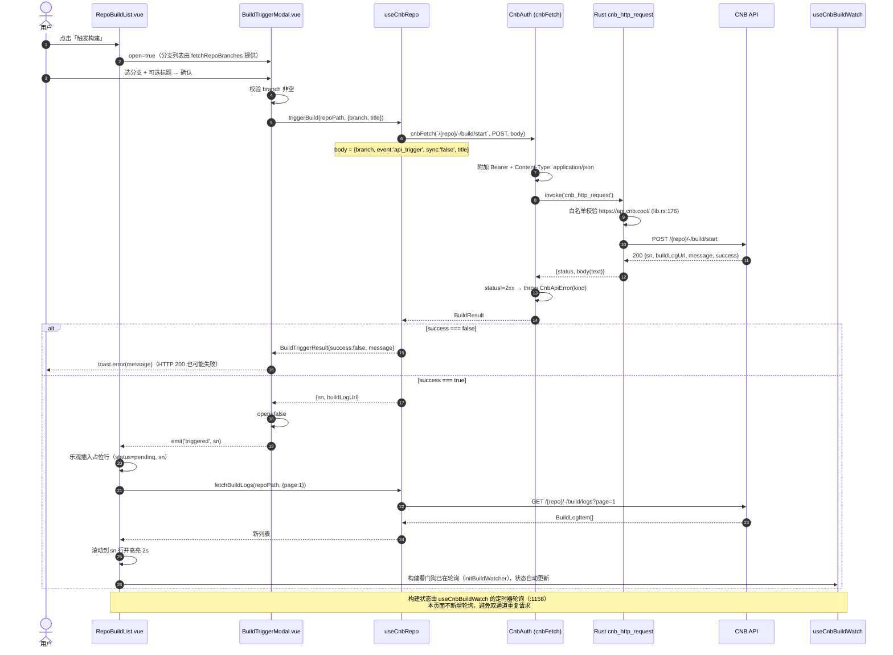
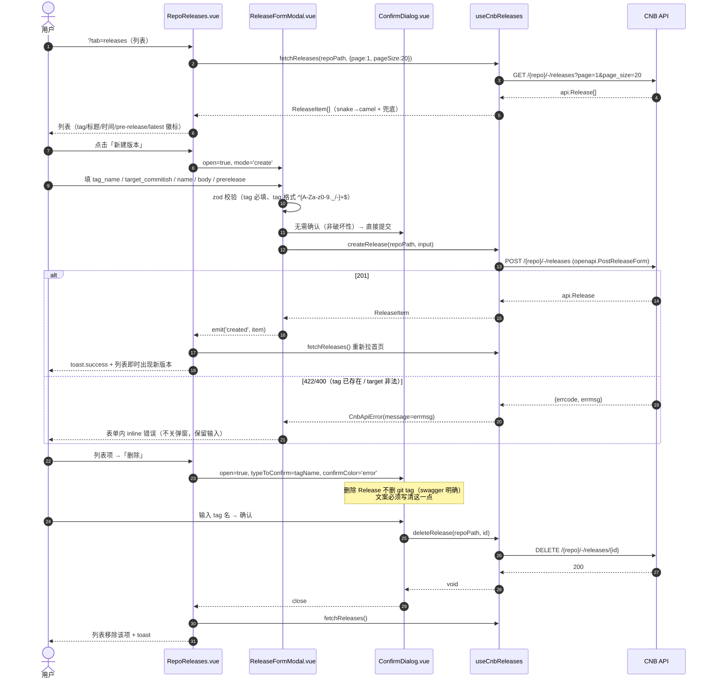
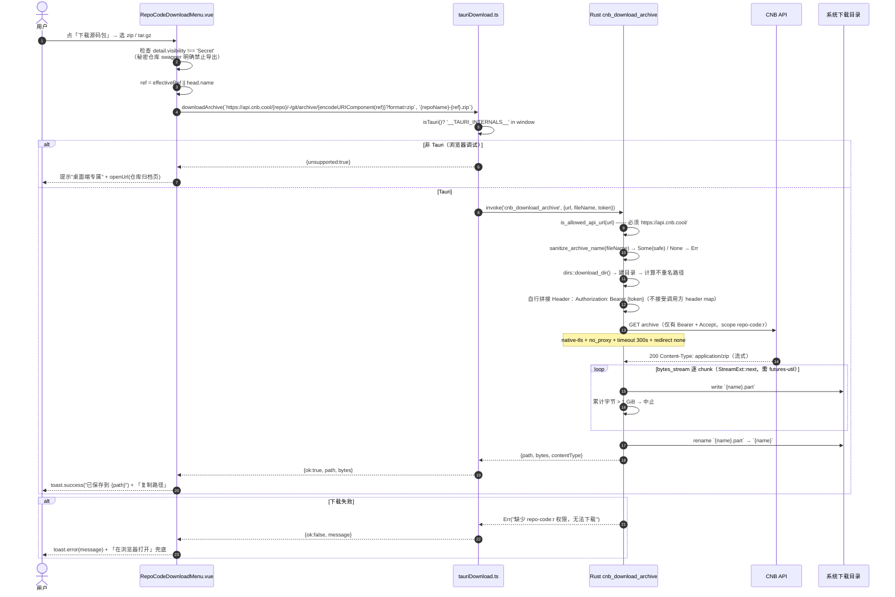
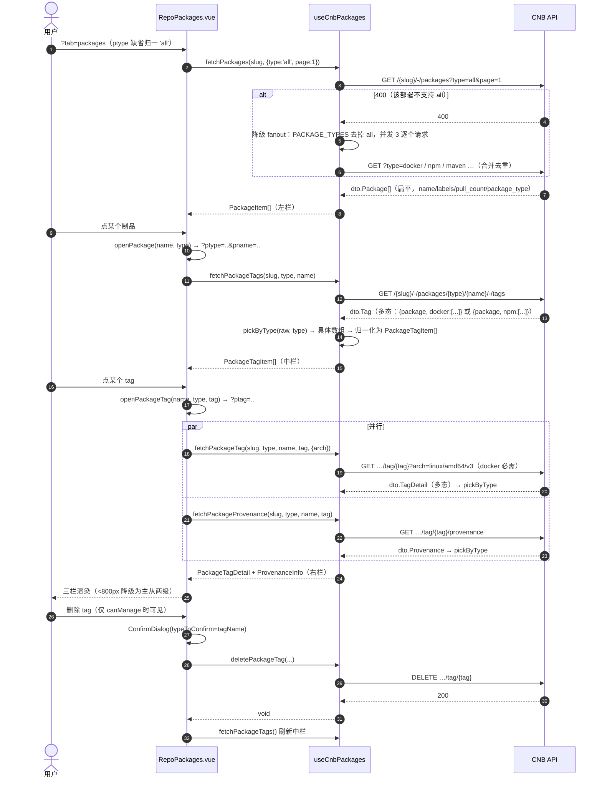
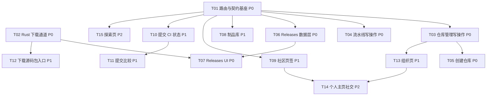

# CNB Open API 覆盖增量 · 架构设计与任务分解

| 项目 | 内容 |
|---|---|
| 项目 | wocnb（CNB.cool 桌面客户端，Tauri 2 + Vue 3 + Nuxt UI v4 + vue-i18n） |
| 文档 | 增量架构设计 + 任务分解（对应 **PRD v1.1** `docs/prd/cnb-api-coverage-prd.md`） |
| 范围 | 48 个 Open API 端点（A 组写操作 7 / B 组仓库页签 20 / C 组组织社交 21；本轮落地 47，B3 的 2 个延后）+ 8 页签 + 探索页 |
| 上游依据 | `docs/prd/cnb-api-coverage-prd.md`（v1.1）、`.workbuddy/context/cnb-swagger.json`（201 path / 268 operation）、`.workbuddy/context/cnb-missing-operations.txt` |
| 事实核对 | 本文所有端点均按 `method + path` 在 swagger 中逐条核对（含 scope / 参数必填性 / 响应 schema）；所有现有代码引用均标注 `文件:行号` |
| 状态 | **已与 PRD v1.1 对齐**。§1 的 6 处事实修正已由 PM 全部回写；§10 中 Q1/Q2/Q4 已闭，仅剩 Q3（低风险）与 Q5（待真机探测） |

---

## 0. 结论摘要

| 项 | 结论 |
|---|---|
| D1 附件上传 | **本轮不做**。不做灰色入口；附件区只读 + 外跳 Web 端。给出未来实施规格（独立命令 + 域名白名单 + 流式 PUT）。 |
| D2 源码包下载 | **新增 Rust 命令 `cnb_download_archive`，流式落盘到系统下载目录**，不经前端、不经 base64、不加 dialog/fs 插件。附件下载复用同一命令。 |
| D3 八页签路由 | **继续 query 单层**：`?tab=` 8 值 + 4 个新下钻键（`release` / `ptype` / `pname` / `ptag`）；**必须修 `switchTab` 不清下钻键的既有隐患**。 |
| D4 新命令权限 | **不需要改 `capabilities/*.json`**（自定义命令不受 capability 约束）；不加插件；需 `cargo test`；`Cargo.toml` 加 `reqwest` `stream` feature + `tokio`(fs/io-util) + `futures-util`（提供 `StreamExt`，reqwest 不重导出）。 |
| 数据层 | 新建 5 个 composable（Releases / Packages / Org / Social / Explore）+ 1 个仓库管理写操作模块；构建写操作并入 `useCnbRepo.ts`（**否决 PRD G1 的"并入 useCnbBuildWatch"**，理由见 §2.5）。 |
| 任务数 | 15 个任务 / 5 个批次 / 5 个并行波次（波次 0~4）。 |
| 版本对齐 | 已对齐 PRD **v1.1**：REQ-A6 创建仓库改为 **P0**（A 组整体 P0）；`filter_type` 枚举确认为 `all` / `followed`；端点口径 48（本轮落地 47）。 |

---

## 1. 事实核对：PRD 与 API 的 6 处偏差（必须先修正）

> 这 6 条是我按 swagger 逐字段核对后发现 PRD 无法直接落地的点。**不修正会导致工程师做出错误实现或验收标准自相矛盾**。6 处均已由 PM 在 PRD v1.1 中回写采纳，本文相应章节也已同步为最终口径。

### 1.1 `PATCH /{repo}` 无法修改可见性（影响 REQ-A4 验收标准）

- **事实**：`dto.RepoPatch` 只有 4 个字段 —— `description` / `license` / `site` / `topics`（swagger 核对）。全库 201 个 path 中**没有任何端点提供仓库可见性修改**：`PUT|DELETE /{group}` 是组织，`PUT /{slug}/-/settings` 是**组织**安全设置（`dto.GroupSettingReq`），仓库侧只有 `branch-protections` / `cloud-native-build` / `pull-request` / `push-limit`。
- **修正**：REQ-A4 编辑项收敛为 **描述 / 主页 site / 开源协议 license / 主题标签 topics**；可见性改为**只读徽标**（`visibilityBadge`，`useCnbRepo.ts:68`）+ 抽屉内「在浏览器打开设置页」外链兜底。
- **附带**：`dto.Repos4User` 有 `visibility_change_lock` 字段（只读标记），说明官方把可见性变更放在 Web 端做了锁定控制，进一步佐证 Open API 不开放。
- **注意**：可见性在**创建**时可设 —— `dto.CreateRepoReq {name, description, visibility}`，其中 `visibility` 是**小写三值** `public | private | secret`（见 §1.2 与 §3.5）。创建时的枚举与 `GET /{repo}` 返回的展示枚举大小写不同，勿混用。

### 1.2 `POST /{slug}/-/repos`（创建仓库）在 48 端点计数内但无 REQ 条目

- **事实**：PRD 附录写「A 组 7：…+ 创建仓库 ✔（REQ-A1~A5）」，但 §3.1 的 REQ-A1~A5 共 6 个端点，**没有任何 REQ 覆盖创建仓库**；用户故事 B-1 明确要求「直接在客户端创建仓库」。逐条清点 49 个端点后确认：**48 = A6 + B20 + C21 + 1 个未编号的创建仓库**，即 PRD 实际列了 49 条。
- **修正（PRD v1.1 已采纳）**：新增 **REQ-A6 创建仓库**，落点 `/repos` 页右上「新建仓库」（组织取 `selectedGroup`），表单 `name / description / visibility`，scope `group-resource:rw`，成功 toast + 列表刷新 + 跳转新仓库。任务 T05，**P0**（用户指令「A 组写操作整体 P0」）。
  - **visibility 取值是「小写三值」`public | private | secret`**（`dto.CreateRepoReq.visibility`，服务端默认 `public`），**传大写会 400**。它与 `RepoDetail.visibility` 的展示枚举（`dto.Repos4User.visibility_level`：`Private|Public|Secret` 首字母大写）**不是同一套**，两层之间必须显式转换，禁止直接透传。

### 1.3 `/search/public-repos` 没有分页，参数名是 `key` 不是 `q`

- **事实**：参数 `key` / `flags` / `flags_match` / `order_by` / `desc` / `topN`（**默认 10，上限 100**），**无 `page` / `page_size`**。
- **修正**：搜索区不提供分页，改「结果条数」选择（10/30/50/100）+ 「继续加载」不成立 → UI 文案明确"显示前 N 条，缩小关键词以精确匹配"。防抖 300ms 保留。

### 1.4 `GET /{slug}/-/packages` 的 `type` 是**必填** query

- **事实**：`type`（required）枚举 `dto.PackageType = [all, docker, helm, oci, npm, maven, ohpm, pypi, composer, nuget, conan, cargo, generic]`。
- **修正**：制品库左栏默认请求 `type=all`；顶部提供类型筛选（用该枚举）。若某部署不支持 `all`（返回 400）→ 降级为「按枚举逐类型请求并合并」，该降级写在数据层 `fetchPackages` 内（捕获 400 后走枚举 fanout，最多 12 次并发受限为 3）。
- **同族事实**：`GET /{slug}/-/stars` 的 `filter_type` 也是**必填**，枚举经 PM 复核确认为 **`all` / `followed`**（PRD v1.1 REQ-C7）。缺省传 `all`，无需 400 探测降级。
- **同族事实**：`/packages/{type}/{name}//tag/{tag}` 的 `arch` 参数**docker 制品必需**（如 `linux/amd64/v3`）→ 右栏 docker tag 详情必须先从 `dto.ContainerImage.arch` 取值回填。

### 1.5 `commit-statuses` 的状态枚举与构建状态**不同族**

- **事实**：`git_internal_app_git_service_bff_api.CommitStatus {context, state, description, target_url, created_at, updated_at}`，`state` 为 GitLab 风格 `pending / running / success / failed / canceled / skipped`。
- **现有构建状态**：`useCnbBuildWatch.ts:201` 注释明确「pending / success / error / cancel」。
- **修正**：**禁止复用** `shouldNotifyStatus`（`useCnbBuildWatch.ts:205`）与 `builds.status.*` 映射；新建独立映射 `commitStatusMeta(state)`（`failed→error 色`、`skipped→neutral`、未知→neutral）。i18n 用 `repo.commits.status.*` 独立命名空间。

### 1.6 `GET /{repo}/-/git/archive/{ref_with_path}` 未声明响应格式

- **事实**：`produces: []`、无 query 参数、**无 200 响应声明**（只有 404/500），描述里也不含 zip/tar 字样；同时明确「秘密仓库禁止使用此接口」。
- **修正**：下载命令按 `Content-Type` + `Content-Disposition` 推断扩展名（`application/zip`→`.zip`，`application/x-gzip|application/gzip`→`.tar.gz`，其余→按用户所选格式），前端默认请求 zip 并附 `?format=zip`（若服务端忽略该参数不影响，扩展名仍由响应头决定）。**秘密仓库（`Secret`）在菜单项上直接置灰并提示"秘密仓库不支持导出"**。该条列为 §9-Q5 待真机探测项。

---

## 2. 技术裁决（D1~D4）

### 2.1 D1 · Release 附件上传（REQ-B3）是否本轮做

**结论：本轮不做。** 不新增上传 Rust 命令，不在 UI 留任何入口（不做灰色按钮）。

**依据（全部可核对）**

| # | 事实 | 出处 |
|---|---|---|
| 1 | `asset-upload-url` 返回 `openapi.ReleaseAssetUploadURL {upload_url, verify_url, expires_in_sec}`，**swagger 未声明 `upload_url` 的域名**；文档只说"把文件 PUT 到上传地址" | swagger `POST /{repo}/-/releases/{release_id}/asset-upload-url` |
| 2 | 现有唯一网络出口对 URL 做前缀白名单 `https://api.cnb.cool/`，否则直接 `Err` | `src-tauri/src/lib.rs:176` |
| 3 | 请求体类型是 `Option<String>`，无字节通道；响应一律 `.text()`（二进制会被 UTF-8 破坏） | `src-tauri/src/lib.rs:171`、`lib.rs:210` |
| 4 | 项目**未安装** `tauri-plugin-dialog`，capabilities 仅 `core:default`/`opener:default`/`notification:default` → 无法选本地文件 | `src-tauri/Cargo.toml`、`src-tauri/capabilities/default.json` |
| 5 | 前端直连对象存储不可行：Webview 无 CORS 通道；且实测带 `Origin: tauri://localhost` 的请求被 CNB 网关 403（本项目已踩过） | `src-tauri/src/lib.rs:221-227` 注释 |
| 6 | 预签名域名未知时无法写"可审计的白名单"。用后缀通配（如 `*.myqcloud.com`）等于把任意 COS 桶纳入白名单，**SSRF 面过大**，不可接受 | 安全边界判断 |
| 7 | 价值受限：`bundle.targets = "app"`（不产 dmg），Release 附件的主要消费场景在桌面端偏弱 | `src-tauri/tauri.conf.json` |

**被否方案及原因**

| 方案 | 否掉的原因 |
|---|---|
| A. 新增 `cnb_upload_presigned` 二进制命令（放宽白名单 + 字节流 body） | 技术上可行，但**必须先做一次真机探测拿到真实域名**才能写白名单；探测 + 实现 + 过期重试 + 进度反馈，工作量 ≈ 本轮一个完整批次，且失败模式多（签名过期、PUT 被拒、confirmation token 解析）。本轮 48 端点已满负荷，**放到下一轮独立做**。 |
| B. 前端 `fetch` 直连对象存储 | 必失败：Webview CORS + CNB 网关对 `tauri://localhost` Origin 返回 403（见 `lib.rs:221-227` 既有踩坑记录）。 |
| C. 走 `api.cnb.cool` 代理上传 | 无此端点。swagger 里没有任何"POST 文件到 api 域"的接口。 |

**未来实施规格（下一轮直接照做，本轮只落文档）**

```rust
#[tauri::command]
async fn cnb_upload_presigned(url: String, file_path: String, content_type: String) -> Result<u64, String>
```

- 只允许 `PUT`；`url` 必须 `https://`；host 命中**显式常量白名单** `ALLOWED_UPLOAD_HOSTS: &[&str]`（先 spike 打印真实 host 后固化，**禁止后缀通配**）。
- `reqwest::redirect::Policy::none()`（预签名 URL 不能跟随重定向，防签名被重放到他域）。
- **不带 `Authorization`**（预签名自带签名，带 Bearer 反而会与签名冲突）。
- 用 `reqwest::Body::from(std::fs::File)` 流式发送，不读入内存；上限 2 GiB；超时 300s。
- 单次有效：命令不缓存 URL；前端拿 `expires_in_sec` 倒计时，过期则重新申请。
- 前端先 `tauri-plugin-dialog` 选文件 → 申请 upload-url → 调本命令 → 调 `asset-upload-confirmation/{upload_token}/{asset_path}`（`upload_token`/`asset_path` 从 `verify_url` 拆解）。

**风险**：用户对"附件上传"有预期落差 → 已在 PRD §5/§6-Q1 记录；UI 必须在附件区显示一行说明（`repo.releases.assetUploadDeferred`="当前版本仅支持查看/下载附件，上传请前往 Web 端"）+ 外跳链接。**绝不能留禁用态按钮**（会持续产生"为什么点不了"的反馈）。

---

### 2.2 D2 · 源码包下载（REQ-B10）如何落地

**结论：方案① —— 新增 Rust 命令 `cnb_download_archive`，由 Rust 侧流式下载并直接落盘到系统下载目录，返回保存路径与字节数。前端不做二进制处理。**

**依据**

| # | 事实 | 出处 |
|---|---|---|
| 1 | archive 响应是二进制且 swagger 未声明 schema → `cnbFetchText` 拿到的是被 UTF-8 解码破坏的字符串 | `useCnbAuth.ts:254`、swagger `GET /{repo}/-/git/archive/{ref_with_path}` |
| 2 | `dirs = "6"` **已是现有依赖**（当前用于 `~/.cnb/token`），`dirs::download_dir()` 可直接用，零新增依赖 | `src-tauri/Cargo.toml` 注释「dirs：定位用户主目录」 |
| 3 | 端点需 `repo-code:r` Bearer → **交给浏览器（方案③）对私有仓库必然 401**，公开仓库是否放行未声明，不能作主路径 | swagger scope 行 |
| 4 | 大文件场景：archive 可能数十 MB。方案②（base64 经 IPC）内存约 2.3×（原始字节 + base64 串 + 解码峰值），Tauri IPC 大字符串还会阻塞主线程 | 工程判断 |
| 5 | 附件下载 `GET /{repo}/-/releases/download/{tag}/{filename}` **同样在 `api.cnb.cool` 域内**，可复用同一条命令，一次实现覆盖两个需求 | swagger `/{repo}/-/releases/download/{tag}/{filename}` |

**接口设计**

```rust
/// 下载结果：保存路径 + 实际字节数 + 服务端 Content-Type（+ Content-Disposition，见要点 7）
#[derive(serde::Serialize, Debug)]
struct CnbDownloadResult {
    path: String,
    bytes: u64,
    content_type: String,
    /// 服务端原始 Content-Disposition（可能为空）。**用途见要点 7**：Q5 探测时
    /// 若 Content-Type 只有 application/octet-stream，需靠它取真实文件名/扩展名。
    content_disposition: Option<String>,
}

/// url 必须命中 API 白名单；file_name 仅允许 [A-Za-z0-9._-]，后缀限 .zip/.tar.gz/.tgz；
/// token 为调用方传入的 CNB 访问令牌（**Option**：公开资源可不传），
/// 由 Rust 侧自行拼成 `Authorization: Bearer {token}`，Some 才附加该头
#[tauri::command]
async fn cnb_download_archive(
    url: String,
    file_name: String,
    token: Option<String>,
) -> Result<CnbDownloadResult, String>
```

**Header 策略（已定稿，勿再改动）**：命令**只接受一个独立的 `token: Option<String>` 参数**（公开资源可不传），Rust 侧在 `Some` 时自行附加 `Authorization: Bearer {token}`；**不接受调用方传入自定义 header map**。

> 为什么要有 Bearer：archive 端点 scope 是 `repo-code:r`，**不带 Bearer 时私有仓库/归档仓库必然 401**。这与"不携带任何自定义 header"并不矛盾 —— 认证头由命令内部生成，调用方无法注入任意 header（`Accept` / `Origin` / `Range` 等仍不可控）。设计上一轮那句"不携带任何自定义 header"表述不精确，已按此更正。

**实现要点（逐条都是硬约束）**

1. **白名单复用**：抽纯函数 `is_allowed_api_url(url) -> bool`（`starts_with("https://api.cnb.cool/")`），与 `cnb_http_request`（`lib.rs:176`）共用同一常量，**不放松任何前缀**。
2. **文件名清洗**：抽纯函数 `sanitize_archive_name(name) -> Option<String>`；拒绝 `/ \ .. \0` 与控制字符；只保留 `[A-Za-z0-9._-]`；后缀白名单 `.zip` / `.tar.gz` / `.tgz`；长度 ≤ 120。
3. **落盘目录**：`dirs::download_dir()` → 回退 `dirs::home_dir()?.join("Downloads")` → 回退 `std::env::temp_dir()`。重名追加 ` (2)`、` (3)`（**不覆盖**），与浏览器行为一致。目录不存在则 `create_dir_all`。
4. **流式写入所需依赖（三个都要，缺一不可）**：
   - `reqwest = { version = "0.12", features = ["stream"] }` —— 提供 `response.bytes_stream()`；默认不含 `stream` feature，否则该方法不存在。
   - `tokio = { version = "1", features = ["fs", "io-util"] }` —— 提供 `tokio::fs::File` 异步逐 chunk 写盘；否则无异步文件 API。
   - `futures-util = "0.3"` —— 提供 `StreamExt::next()` 来消费 `bytes_stream()`。**`reqwest` 不重导出 `StreamExt`**：只有 `bytes_stream()` 而没有迭代方法，编译会报 "no method named `next`"。**这不是多余依赖，请勿以"未使用"为由删除。**
   - 写法：`while let Some(chunk) = stream.next().await { file.write_all(&chunk?).await?; }`
5. **原子性**：先写 `{name}.part`，成功后 `fs::rename` 为最终名；失败/中断时删除 `.part`，避免半文件被用户当成完整包解压。
6. **上限与超时**：累计字节 > 1 GiB 立即中止并删 `.part`；`timeout(Duration::from_secs(300))`。
7. **错误语义**：非 2xx → 读 body（text）并返回中文错误：`401 → "令牌已过期，请重新登录"`、`403 → "缺少 repo-code:r 权限，无法下载"`、`404 → "该引用不存在或仓库已归档"`。所有 message 中文，与既有命令风格一致。
   - **Q5 探测钩子**：返回值同时给出 `content_type` 与 `content_disposition`（原样透传），前端在首次真机下载时把两者打到 toast/日志，即为 §1.6 / §10-Q5 的答复（服务端到底认不认 `?format=`、返回什么 MIME）。**扩展名判定优先级：`Content-Disposition` 的 filename > `Content-Type` 映射 > 请求所选格式**，故这两个头都要透出，只透 `content_type` 在 `application/octet-stream` 时无法判断。
8. **通道策略与既有约定一致**：`reqwest::Client::builder().timeout(..).no_proxy().build()`（native-tls + 强制直连），与 `lib.rs:184-188`、`lib.rs:262-266` 完全同构。
9. **前端封装**：`src/utils/tauriDownload.ts` —— `downloadArchive(url, fileName, token)` 判断 `'__TAURI_INTERNALS__' in window`（既有范式 `RepoHeader.vue:37`）；非 Tauri 环境返回 `{ unsupported: true }`，UI 给出「桌面端专属功能」提示 + `openUrl(repoSiteUrl(...))` 兜底。token 取自 `useCnbAuth` 的 `cnbToken`。
10. **成功后交互**：toast 显示"已保存到 {path}"+「复制路径」。**不硬依赖 `revealItemInDir`**（`opener:default` 是否含 `allow-reveal-item-in-dir` 需一次 `pnpm tauri dev` 验证；验证通过再加按钮，避免为一个小按钮改 capability）。

**被否方案**

| 方案 | 否掉的原因 |
|---|---|
| ② `tauri-plugin-dialog` + `tauri-plugin-fs`，Rust 返回 base64 | 内存 2.3×、IPC 大字符串阻塞、新增 2 个插件 + 2 组 capability 权限；收益仅"用户自选路径"，可用「保存后再移动」补偿。 |
| ③ 前端拿链接交给 `opener` 系统浏览器 | 需 Bearer，私有仓库必 401；且无法感知成功/失败，用户体验为"跳浏览器后不知道发生了什么"。 |
| ④ 复用 `cnb_fetch_image`（`lib.rs:251`） | 上限 2 MiB，且白名单是 `https://cnb.cool/`（主站），archive 在 `api.cnb.cool` → 双重不符。 |

---

### 2.3 D3 · 八页签的路由承载

**结论：继续 query 单层（`?tab=`），扩到 8 值，新增 4 个下钻键；Releases / 制品库的二级视图用 query 表达，不引入嵌套路由。**

**依据**

- catch-all 路由之后无法再挂静态子路由，这是 `useRepoRoute.ts:4-6` 已固化的约束（当前 `/repos/:repoPath(.*)*`）。
- `?tab=` 已被 `RepoTabs.vue`、`RepoBuildList.vue:21`、`RepoCommits.vue:29`、`members.vue:41` 等 12 处依赖，改嵌套路由的影响面远大于收益。
- 下钻语义已经存在（`number` / `sn` / `sha` / `path`），扩 4 个键是**同一范式的自然延伸**，不新增概念。

**类型与常量改动**（`src/composables/useRepoRoute.ts`）

```ts
export type RepoTab =
  | 'code' | 'commits' | 'issues' | 'pulls' | 'builds'
  | 'releases' | 'packages' | 'community'

const TABS: RepoTab[] = ['code','commits','issues','pulls','builds','releases','packages','community']
```

**URL 设计**

| 视图 | URL | 导航语义 |
|---|---|---|
| Releases 列表 | `?tab=releases` | `switchTab` → `replace` |
| Release 详情 | `?tab=releases&release=<release_id>` | `openRelease()` → `push`（返回键可用） |
| Release 新建/编辑 | 同详情 + 页内 `UModal`（表单状态不入 URL） | — |
| 制品库（仅左栏） | `?tab=packages` | `replace` |
| 制品（左+中栏） | `?tab=packages&pname=<name>&ptype=<type>` | `openPackage()` → `push` |
| Tag 详情（三栏） | `?tab=packages&ptype=<type>&pname=<name>&ptag=<tag>` | `openPackageTag()` → `push` |
| 社区 | `?tab=community` | `replace` |

> 为什么制品用三个独立键而不是 `pkg=<type>/<name>/<tag>`：`name` 自身可能含 `/`（`dto.Package.is_dir` 暗示层级制品），单键需要二次编码，且无法表达"只选了类型"的中间态。三个平铺键各自可缺省，天然支持渐进式下钻。

**非法值归一规则（单点实现，禁止页面内判断）**

| 键 | 非法/缺省 | 归一结果 | 行为 |
|---|---|---|---|
| `tab` | 缺失或不在 `TABS` | `'code'` | 沿用现有 `useRepoRoute.ts:45-48` |
| `release` | 空串/缺失 | `''` | 渲染列表；存在则渲染详情，详情 404 → `StateAlert notFound`（**不自动回列表**，避免用户看不出发生了什么） |
| `ptype` | 缺失/不在 `PackageType` 枚举 | `'all'` | 左栏请求 `type=all` |
| `pname` | 空串/缺失 | `''` | 只渲染左栏 |
| `ptag` | 空串（含 `pname` 有值但 `ptag` 空） | `''` | 渲染左栏 + 中栏 |
| `ptag` 有值但 `pname` 缺失 | — | 丢弃 `ptag` | 三栏需要完整链式上下文 |

**必须同时修的既有隐患（重要，见 §6 R3）**

`navigate()`（`useRepoRoute.ts:93-110`）会**保留本次未显式覆盖的所有 query 键**，而 `switchTab()`（:113-115）只写 `tab`。现状 5 页签下已存在 `?tab=issues&sn=123` 这类脏 URL（不影响功能，因为其它 tab 不读 `sn`）；但扩到 8 页签 + 4 个新键后，**`release` / `pname` / `ptag` 会跨页签残留**，出现「从制品库切到 Releases 却直接打开某个 Release」的错误。

修正：`switchTab` 显式清空全部下钻键

```ts
function switchTab(value: RepoTab) {
  navigate({
    tab: value === 'code' ? null : value,
    number: null, sn: null, sha: null, path: null,
    release: null, pname: null, ptag: null, page: null,
  }, 'replace')
}
```

（`ptype` 保留：它是"用户偏好"而非"定位状态"，切走再切回保留筛选更合理。）

**归档仓库的 URL 行为**：归档不改变路由。写入口按 `detail.status === 1`（`constant.RepoStatus.RepoStatusArchived`）禁用 + 页头徽标。

---

### 2.4 D4 · 新 Rust 命令的 capabilities 与权限影响

**结论：不改 `capabilities/default.json`，不加插件，不改 `bundle.targets`；需改 `Cargo.toml`（`reqwest` 加 `stream` feature、`tokio` 的 `fs`/`io-util`、`futures-util`）与新增 3 个纯函数单测。**

> `futures-util = "0.3"` 是流式消费的必需依赖：`reqwest` 提供 `bytes_stream()` 但**不重导出 `StreamExt`**，没有它就没有 `.next()`，流式循环写不出来。见 §2.2 要点 4 的依赖表。

**逐项说明**

| 问题 | 结论 | 依据 |
|---|---|---|
| 是否要改 `capabilities/*.json`？ | **不需要**。capability 管的是 `core:*` 与 `plugin:*` 权限；`invoke_handler` 注册的**应用自定义命令**默认对本窗口可用（现有 `cnb_http_request` / `cnb_fetch_image` / `cnb_cli_*` 均未在 capabilities 中声明，见 `lib.rs:318-331` 与 `capabilities/default.json`） | 现状即证据 |
| 是否影响 `bundle targets=["app"]`？ | **不影响**。纯 Rust 依赖 + 命令注册，不涉及打包目标 | `tauri.conf.json` |
| 是否需要 `cargo test`？ | **需要**。新增纯函数 `is_allowed_api_url` / `sanitize_archive_name`，沿用既有 `is_allowed_image_url`（`lib.rs:246-248`）的可测范式（同为纯函数、无需网络与异步运行时） | `lib.rs:244-248` 注释「独立成纯函数便于单元测试」 |
| 通道策略 | `native-tls`（reqwest 默认 `default-tls`，**不要切 rustls** —— 本项目明确记录 rustls TLS 指纹被 CNB 风控 403，见 `lib.rs:221-227`）+ `.no_proxy()` 强制直连 + 显式超时 | 既有约定 |
| 错误信息 | 全部中文，与 `cnb_http_request`（`lib.rs:177/180/188/208`）风格一致 | 既有约定 |
| 命令注册 | `lib.rs:318` 的 `generate_handler![]` 追加 `cnb_download_archive` | — |
| 前端调用 | `@tauri-apps/api/core` 的 `invoke`（`@tauri-apps/api` 已是依赖）；浏览器环境降级 | `package.json` |

**唯一的权限不确定项**：若后续想加「在 Finder 中显示」按钮，需要 `opener:allow-reveal-item-in-dir`。**本轮不做硬依赖**（2.2 要点 10），因此权限面零变更。

---

### 2.5 附带裁决：构建写操作放在哪个 composable

**结论：`POST /-/build/start`、`POST /-/build/stop/{sn}`、`DELETE /-/build/logs/{sn}` 放 `useCnbRepo.ts`（D 段，紧跟 `fetchBuildLogs`），不并入 `useCnbBuildWatch.ts`。**（否决 PRD §3 G1 的建议）

| 理由 | 说明 |
|---|---|
| 职责不同 | `useCnbBuildWatch.ts`（1192 行）是**后台监听/通知**模块：快照对比、轮询、系统通知、localStorage 持久化（:452 `buildSnapshot`、:1158 `initBuildWatcher`）。写操作是"一次性请求 + 结果反馈"，与监听无耦合。 |
| 同源聚合 | 构建的**读**（`fetchBuildLogs` :961、`fetchBuildStatus` :1031）已在 `useCnbRepo.ts` 的 D 段。写操作与读同域、同 `encodeRepoPath` 工具、同错误处理。 |
| 文件体量 | `useCnbBuildWatch.ts` 已 1192 行，且承载着最敏感的轮询逻辑（有 4 个专项测试文件）。往里加命令会提高回归风险。 |
| 复用 | `BuildStatus` 类型（:1009）已在 `useCnbRepo.ts`，`triggerBuild` 返回的 `sn` 直接喂给 `fetchBuildStatus`。 |

---

## 3. 数据层设计

### 3.1 文件与职责总览

| 文件 | 类型 | 行数量级 | 职责 |
|---|---|---|---|
| `src/composables/useCnbReleases.ts` | 新建 | ~260 | Release 列表/详情/latest/CRUD + 附件下载 URL 拼装 |
| `src/composables/useCnbPackages.ts` | 新建 | ~320 | 制品列表/详情/tags/tag 详情/provenance/删除 + **多态归一化** |
| `src/composables/useCnbRepoManage.ts` | 新建 | ~160 | `PATCH /{repo}`、archive/unarchive、`POST /{slug}/-/repos` |
| `src/composables/useCnbOrg.ts` | 新建 | ~280 | 组织信息/子组织/仓库墙 GET+PUT/access-level ×4/继承成员 ×2 |
| `src/composables/useCnbSocial.ts` | 新建 | ~200 | 粉丝/关注/Star 列表 ×3/用户仓库墙/仓库 Star 用户 |
| `src/composables/useCnbExplore.ts` | 新建 | ~200 | 公仓搜索 + 三周期榜单 + 语言列表 |
| `src/composables/useCnbRepo.ts` | 改造 | +180 | 增 `fetchCommitStatuses` / `fetchCompare` / `triggerBuild` / `stopBuild` / `deleteBuildLogs`；`RepoDetail` 扩字段 |
| `src/composables/useRepoRoute.ts` | 改造 | +60 | `RepoTab` 8 值 + 4 个下钻键 + `switchTab` 清键 + `openRelease`/`openPackage`/`openPackageTag` |
| `src/utils/tauriDownload.ts` | 新建 | ~60 | `invoke('cnb_download_archive')` 封装 + 非 Tauri 降级 |
| `src/utils/index.ts` | 改造 | +5 | 无新增（`formatBytes` 已存在，:80） |

> **注：不新建 store。** 项目现状是"composable 导出纯函数 + 页面持有 `ref` 状态"（`[...repoPath].vue:56-92` 即范式）。本轮沿用，不引入 Pinia。

### 3.2 `useCnbRepo.ts` 的扩展（既有文件）

**`RepoDetail` 扩字段**（`useCnbRepo.ts:87-102`）—— 支撑"按权限显示写入口"与"归档态禁用"

```ts
export interface RepoDetail {
  // …existing…
  /** 仓库状态：0 正常 / 1 已归档 / 2 fork 中（constant.RepoStatus） */
  status: number
  /** 派生：status === 1 */
  archived: boolean
  /** 访问者权限级别：Guest/Reporter/Developer/Master/Owner（constant.AccessRole） */
  accessLevel: string
  /** 派生：accessLevel ∈ {Master, Owner}，用于写入口可见性预判 */
  canManage: boolean
  /** 可见性变更是否被锁定（只读字段，仅展示） */
  visibilityChangeLock: boolean
  site: string
  topics: string[]
}
```

> **这条设计是"少撞 403"的关键**：`dto.Repos4User` 自带 `access`（`constant.AccessRole`）与 `status`，此前被丢弃。有了 `canManage`，制品删除、归档、编辑等入口可以**先按权限隐藏**，403 只作兜底。PRD G2 要求的"403 不整页报错"因此从"事后兜底"升级为"事前预防 + 事后兜底"。

**新增函数签名**

```ts
/** 提交 CI 状态（GET /{repo}/-/git/commit-statuses/{commitish}，scope repo-code:r） */
export interface CommitStatusItem {
  context: string
  /** 原始 state（GitLab 风格：pending/running/success/failed/canceled/skipped） */
  state: string
  description: string
  targetUrl: string
  createdAt: string
  updatedAt: string
}
export async function fetchCommitStatuses(repoPath: string, commitish: string): Promise<CommitStatusItem[]>

/** 提交差异（GET /{repo}/-/git/compare/{base_head}，scope repo-code:r） */
export interface CompareResult {
  baseCommitSha: string
  headCommitSha: string
  mergeBaseSha: string
  totalCommits: number
  commits: CommitItem[]
  /** 复用 PullFile 结构（api.CommitDiffFilePatch → 现有归一化） */
  files: PullFile[]
}
export async function fetchCompare(repoPath: string, baseHead: string): Promise<CompareResult>

/** 触发构建（POST /{repo}/-/build/start，scope repo-cnb-trigger:rw） */
export interface BuildTriggerResult {
  sn: string
  buildLogUrl: string
  message: string
  /** 注意：HTTP 200 也可能 success=false，调用方必须判此字段 */
  success: boolean
}
export async function triggerBuild(
  repoPath: string,
  opts: { branch?: string; sha?: string; tag?: string; title?: string; env?: Record<string, string> },
): Promise<BuildTriggerResult>

/** 停止构建（POST /{repo}/-/build/stop/{sn}，scope repo-cnb-trigger:rw） */
export async function stopBuild(repoPath: string, sn: string): Promise<{ code: number; message: string }>

/** 删除构建日志（DELETE /{repo}/-/build/logs/{sn}，scope repo-cnb-trigger:rw） */
export async function deleteBuildLogs(repoPath: string, sn: string): Promise<{ code: number; message: string }>
```

**`triggerBuild` 的 3 个 swagger 陷阱（必须写进代码注释）**

1. `dto.StartBuildReq.event` 文档要求「须为 `api_trigger` 或以它开头」→ **必须固定传 `event: 'api_trigger'`**，否则被拒。
2. `dto.StartBuildReq.sync` 类型是 **string** 而非 boolean（swagger 原文 `"sync": {"type":"string"}`）→ 传 `sync: 'false'`（字符串），拿到 `sn` 立即返回。
3. 响应 `dto.BuildResult.success` 是"是否触发成功"，**HTTP 200 + success=false 是合法组合**（如分支不存在）→ 必须判该字段并把 `message` 透出给用户。

### 3.3 `useCnbReleases.ts`（新建）

```ts
/** api.Release 原始结构（snake_case，仅声明用到的字段） */
interface RawRelease {
  id?: string
  tag_name?: string
  tag_commitish?: string
  name?: string
  body?: string
  draft?: boolean
  prerelease?: boolean
  is_latest?: boolean
  created_at?: string
  published_at?: string
  updated_at?: string
  author?: { username?: string; nickname?: string; avatar?: string }
  assets?: RawReleaseAsset[]
}
/** api.ReleaseAsset 原始结构 */
interface RawReleaseAsset {
  id?: string
  name?: string
  path?: string
  size?: number
  content_type?: string
  hash_algo?: string
  hash_value?: string
  created_at?: string
  /** API 域下载地址（需 Bearer）——走 Rust 下载命令 */
  url?: string
  /** 主站地址（浏览器可访问，无鉴权语义） */
  browser_download_url?: string
  /** 拼写错误字段，即将删除，禁止使用 */
  brower_download_url?: string
}

export interface ReleaseAsset {
  id: string
  name: string
  path: string
  size: number
  contentType: string
  hashAlgo: string
  hashValue: string
  createdAt: string
  apiUrl: string
  browserUrl: string
}

export interface ReleaseItem {
  id: string
  tagName: string
  tagCommitish: string
  name: string
  body: string
  isDraft: boolean
  isPrerelease: boolean
  isLatest: boolean
  createdAt: string
  publishedAt: string
  updatedAt: string
  authorName: string
  authorAvatar: string
  assets: ReleaseAsset[]
}

/** GET /{repo}/-/releases?page=&page_size= （scope repo-release:r） */
export function fetchReleases(repoPath: string, opts?: { page?: number; pageSize?: number }): Promise<ReleaseItem[]>
/** GET /{repo}/-/releases/latest —— 无 Release 时服务端 404，本函数捕获并返回 null（不抛） */
export function fetchLatestRelease(repoPath: string): Promise<ReleaseItem | null>
/** GET /{repo}/-/releases/{release_id} */
export function fetchRelease(repoPath: string, releaseId: string): Promise<ReleaseItem>

export interface CreateReleaseInput {
  tagName: string
  /** 分支名或 commit sha（openapi.PostReleaseForm.target_commitish） */
  targetCommitish?: string
  name?: string
  body?: string
  draft?: boolean
  prerelease?: boolean
  /** 'true' | 'false' | 'legacy'（openapi.PostReleaseForm.make_latest，字符串枚举） */
  makeLatest?: 'true' | 'false' | 'legacy'
}
/** POST /{repo}/-/releases（scope repo-release:rw）→ 201 + api.Release */
export function createRelease(repoPath: string, input: CreateReleaseInput): Promise<ReleaseItem>
/** PATCH /{repo}/-/releases/{release_id}（部分更新，仅传变更字段） */
export function updateRelease(repoPath: string, releaseId: string, patch: Partial<CreateReleaseInput>): Promise<void>
/** DELETE /{repo}/-/releases/{release_id} —— 注意：不删除 git tag（swagger 明确） */
export function deleteRelease(repoPath: string, releaseId: string): Promise<void>

/** 附件下载地址（GET /{repo}/-/releases/download/{tag}/{filename}，在 api.cnb.cool 域内） */
export function releaseAssetApiUrl(repoPath: string, tagName: string, fileName: string): string
/** 归一化导出（纯函数，供单测） */
export function normalizeRelease(raw: RawRelease, repoPath: string): ReleaseItem
```

> **归一化要点**：`brower_download_url`（官方拼写错误字段）**禁止读取**（swagger 标注"即将删除"）；`assets` 缺失补 `[]`；`name` 为空回退 `tagName`；`publishedAt` 为空回退 `createdAt`。

### 3.4 `useCnbPackages.ts`（新建）—— 本轮归一化最复杂的模块

```ts
/** 制品类型枚举（dto.PackageType，swagger 已核对 13 值） */
export type PackageType =
  | 'all' | 'docker' | 'helm' | 'oci' | 'npm' | 'maven' | 'ohpm' | 'pypi'
  | 'composer' | 'nuget' | 'conan' | 'cargo' | 'generic'
export const PACKAGE_TYPES: PackageType[] = [/* 同上 */]

/** dto.Package 原始结构 */
interface RawPackage {
  name?: string
  package?: string
  description?: string
  count?: number
  labels?: string[]
  guarded?: boolean
  is_dir?: boolean
  pull_count?: number
  recent_pull_count?: number
  last_artifact_name?: string
  last_pusher?: { name?: string; nickname?: string; push_at?: string }
  package_type?: unknown   // 可能是字符串枚举或对象，复用 normalizeAccessLevel 式兼容
}

export interface PackageItem {
  name: string
  type: string
  description: string
  labels: string[]
  versionCount: number
  pullCount: number
  recentPullCount: number
  lastPusherName: string
  lastPushedAt: string
  guarded: boolean
  isDir: boolean
}

/** 中间栏 tag 列表项（dto.CommonRegistryTag / dto.ContainerTag / dto.ChartTag / dto.OCITag 统一） */
export interface PackageTagItem {
  name: string
  digest: string
  size: number          // docker 由 images[].size 求和派生
  pullCount: number
  recentPullCount: number
  hasProvenance: boolean
  guarded: boolean
  status: string
  lastPusherName: string
  lastPushedAt: string
}

/** 右栏 tag 详情（dto.CommonRegistryTagDetail / ContainerTagDetail / …统一） */
export interface PackageTagDetail extends PackageTagItem {
  address: string
  packageName: string
  gitAddress: string
  /** 类型专属的原始明细（docker 的 image/layers、npm 的 files/dependencies 等），原样保留供 UI 折叠展示 */
  raw: unknown
}

/** 溯源（dto.*Provenance 统一后的公共子集 + 原始 JSON） */
export interface ProvenanceInfo {
  digest: string
  gitAddress: string
  gitCommit: string
  registryAddress: string
  sn: string
  tag: string
  raw: unknown
}

/** GET /{slug}/-/packages?type=&page=&page_size=&name=&ordering=（scope registry-package:r） */
export function fetchPackages(
  slug: string,
  opts: { type?: PackageType; name?: string; page?: number; pageSize?: number; ordering?: string },
): Promise<PackageItem[]>
/** GET /{slug}/-/packages/{type}/{name}（多态：按 type 取子键） */
export function fetchPackageDetail(slug: string, type: PackageType, name: string): Promise<PackageItem>
/** GET /{slug}/-/packages/{type}/{name}/-/tags */
export function fetchPackageTags(
  slug: string, type: PackageType, name: string, opts?: { page?: number; pageSize?: number; tagName?: string },
): Promise<PackageTagItem[]>
/** GET /{slug}/-/packages/{type}/{name}/-/tag/{tag}（docker 需 arch） */
export function fetchPackageTag(
  slug: string, type: PackageType, name: string, tag: string, opts?: { arch?: string; sha256?: string },
): Promise<PackageTagDetail>
/** GET …/-/tag/{tag}/provenance */
export function fetchPackageProvenance(slug: string, type: PackageType, name: string, tag: string): Promise<ProvenanceInfo>
/** DELETE /{slug}/-/packages/{type}/{name}（scope registry-package-delete:rw） */
export function deletePackage(slug: string, type: PackageType, name: string): Promise<void>
/** DELETE /{slug}/-/packages/{type}/{name}/-/tag/{tag} */
export function deletePackageTag(slug: string, type: PackageType, name: string, tag: string): Promise<void>

/** 多态取键（纯函数，可单测）：raw[type] → 回退首个非空子键 → null */
export function pickByType<T>(raw: Record<string, unknown> | null | undefined, type: string): T | null
```

**多态归一化设计（本轮最容易写错的地方）**

`dto.PackageDetail` / `dto.TagDetail` / `dto.Provenance` 的结构都是 `{ cargo: {...}, composer: {...}, docker: {...}, …, npm: {...} }` —— **同一个响应里 12 个类型键并存，只有一个非空**。因此：

1. 一律 `pickByType(raw, type)`，**禁止** `raw.docker` 硬编码。
2. `type === 'all'` 时左栏来自 `dto.Package[]`（扁平数组，无多态）；进入中/右栏时 `type` 必来自用户点击的具体制品（`PackageItem.type`），不会再有 `all`。
3. 列表项用 `name` 字段，详情用 `tag` 字段（`dto.CommonRegistryTagDetail.tag`、`dto.ContainerTagDetail.tag`）→ 归一化 `tag ?? name`。
4. docker 的 `dto.ContainerTag` **没有 `size` / `digest`**（只有 `images: dto.ContainerImage[]`）→ 派生：`size = Σ images[].size`，`digest = images[0]?.digest ?? ''`，`arch = images[].arch`（右栏详情必填参数）。
5. `type=all` 返回 400 时降级 fanout（§1.4）：捕获 `CnbApiError.status === 400` → 按 `PACKAGE_TYPES`（去掉 `all`）并发 3 逐个请求并合并；结果带 `type` 字段去重。

### 3.5 `useCnbRepoManage.ts`（新建）

```ts
/** PATCH /{repo}（dto.RepoPatch，scope repo-manage:rw）—— 无 visibility 字段，见 §1.1 */
export interface RepoPatchInput {
  description?: string
  site?: string
  license?: string
  topics?: string[]
}
export function patchRepo(repoPath: string, input: RepoPatchInput): Promise<void>

/** POST /{slug}/-/settings/archive（scope repo-manage:rw,repo-code:rw） */
export function archiveRepo(slug: string): Promise<void>
/** POST /{slug}/-/settings/unarchive（同 scope） */
export function unarchiveRepo(slug: string): Promise<void>

/** 创建时的可见性枚举：**小写**，与 `dto.CreateRepoReq.visibility` 一致（swagger：`enum ["public","private","secret"]`，`default "public"`）。
 *  注意：传大写（`Public`/`Private`）会被服务端 400 —— 与 `RepoDetail.visibility` 展示用的大写枚举（`dto.Repos4User.visibility_level`）**不是同一套取值**，不要互相复用。
 *  勘误：本文档初版曾把此枚举误写为大写 `'Private' | 'Public'`（当时只看了 dto 的字段类型、未核 enum），已按 swagger 更正。
 *  UI 面（已批准的产品取舍）：创建弹窗**只暴露 `public` / `private` 两值**，默认 `private`（比服务端默认 `public` 更安全，避免误建公开仓）；
 *  `secret` 在类型层保留、UI 暂不开放（CNB 特有加密仓库，误建成本高）。若后续要开放，只改下拉选项即可，无需动类型。 */
export type CreateRepoVisibility = 'public' | 'private' | 'secret'

/** POST /{slug}/-/repos（dto.CreateRepoReq，scope group-resource:rw）→ 201 无响应体 */
export interface CreateRepoInput {
  name: string
  description?: string
  /** 创建时**可以**设置可见性（省略则由服务端默认 public） */
  visibility?: CreateRepoVisibility
}
/** slug 为组织路径；visibility 省略不传（不要传空串） */
export function createRepo(slug: string, input: CreateRepoInput): Promise<void>
```

### 3.6 `useCnbOrg.ts`（新建）

```ts
/** dto.OrganizationAccess（GET /{group}，scope group-resource:r） */
export interface OrgProfile {
  id: string
  path: string
  name: string
  description: string
  site: string
  email: string
  domain: string
  memberCount: number
  allMemberCount: number
  subGroupCount: number
  allSubGroupCount: number
  subRepoCount: number
  allSubRepoCount: number
  followCount: number
  freeze: boolean
  hasSubGroup: boolean
  accessRole: string
  createdAt: string
  updatedAt: string
}
export function fetchOrgProfile(group: string): Promise<OrgProfile>

/** dto.OrganizationUnion（GET /{slug}/-/sub-groups） */
export interface SubGroupItem { path: string; name: string; description: string; avatar: string; repoCount: number; memberCount: number }
export function fetchSubGroups(slug: string, opts?: { search?: string; page?: number; pageSize?: number }): Promise<SubGroupItem[]>

/** dto.Repos4UserBase（GET|PUT /{slug}/-/pinned-repos，scope group-manage:r / :rw） */
export interface PinnedRepoItem { path: string; name: string; description: string; language: string; starCount: number; forkCount: number; visibility: string }
export function fetchPinnedRepos(slug: string): Promise<PinnedRepoItem[]>
/** PUT 提交**全量有序列表**（body 为 string[]，元素为 repo path） */
export function updatePinnedRepos(slug: string, repoNames: string[]): Promise<PinnedRepoItem[]>

/** access-level（4 个端点） */
export interface MemberAccessItem { username: string; accessLevel: string; inherit: boolean; readPrivilege: boolean; writePrivilege: boolean }
/** GET /{group}/-/members/access-level?include_inherit=（scope group-manage:r） */
export function fetchGroupMemberAccessLevels(group: string, opts?: { includeInherit?: boolean }): Promise<MemberAccessItem[]>
/** GET /{group}/-/members/{username}/access-level */
export function fetchGroupMemberAccessLevel(group: string, username: string): Promise<string[]>
/** GET /{repo}/-/members/access-level（scope repo-manage:r） */
export function fetchRepoMemberAccessLevels(repoPath: string, opts?: { includeInherit?: boolean }): Promise<MemberAccessItem[]>
/** GET /{repo}/-/members/{username}/access-level */
export function fetchRepoMemberAccessLevel(repoPath: string, username: string): Promise<string[]>

/** dto.ListInheritMembers（GET /{group}|{repo}/-/inherit-members） */
export interface InheritMemberGroup { inheritPath: string; total: number; users: MemberItem[] }
export function fetchGroupInheritMembers(group: string, opts?: { search?: string; role?: string; page?: number; pageSize?: number }): Promise<InheritMemberGroup[]>
export function fetchRepoInheritMembers(repoPath: string, opts?: { search?: string; role?: string; page?: number; pageSize?: number }): Promise<InheritMemberGroup[]>
```

> **注意 `dto.MemberAccessLevelInSlugUnion`** 是 `{access_level, inherit, read_privilege, write_privilege}` —— **单个对象，不带用户名数组**；`dto.MemberAccessLevel` 是 `{access_level, path}[]`（按资源路径列出，才是"每个成员/资源"的形态）。因此「成员列表加权限列」的正确实现是：先 `fetchGroupMembers` 拿 username 列表，再调 `/{group}/-/members/{username}/access-level`（**每行一次，N+1**）。
> **裁决**：成员页默认**不自动批量拉权限列**（50 行 = 50 次请求，会撞限流）。改为「权限」列默认显示 `—`，行内有「查看权限」按钮按需展开（单行一次请求 + 缓存 Map）；并提供「批量加载权限」显式按钮（串行 + 200ms 间隔）。这既满足 PRD「行内可查单个成员详情」，又不制造 N+1 风暴。**此点需 PM 知悉（§9-Q3）**。

### 3.7 `useCnbSocial.ts`（新建）

```ts
/** dto.UserFollowResult（GET /users/{username}/followers|following，scope account-engage:r） */
export interface FollowUser { username: string; nickname: string; avatar: string; isFollowing: boolean; frozen: boolean; locked: boolean }
export function fetchFollowers(username: string, opts?: { page?: number; pageSize?: number }): Promise<FollowUser[]>
export function fetchFollowing(username: string, opts?: { page?: number; pageSize?: number }): Promise<FollowUser[]>

/** GET /user/stared-repos | /users/{username}/stared-repos（dto.Repos4User[]） */
export function fetchMyStarredRepos(opts?: { search?: string; page?: number; pageSize?: number }): Promise<CnbRepo[]>
export function fetchUserStarredRepos(username: string, opts?: { search?: string; page?: number; pageSize?: number }): Promise<CnbRepo[]>

/** dto.RepoStarUsers（GET /{slug}/-/stars?filter_type=，filter_type 必填，枚举 all|followed） */
export type StarFilterType = 'all' | 'followed'
export interface StarUser { username: string; nickname: string; avatar: string; staredAt: string; isFollow: boolean }
export function fetchRepoStarUsers(slug: string, opts: { filterType?: StarFilterType; page?: number; pageSize?: number }): Promise<{ total: number; users: StarUser[] }>

/** dto.Repos4User[]（GET /users/{username}/pinned-repos，scope account-engage:r） */
export function fetchUserPinnedRepos(username: string): Promise<PinnedRepoItem[]>
```

### 3.8 `useCnbExplore.ts`（新建）

```ts
/** GET /search/public-repos?key=&topN=&order_by=&desc=（scope repo-basic-info:r；无分页） */
export function searchPublicRepos(key: string, opts?: { topN?: number; orderBy?: string; desc?: boolean }): Promise<PinnedRepoItem[]>

export type RankPeriod = 'daily' | 'weekly' | 'annual'
/** dto.GetRankResult（GET /ranks/repo/{period}?language=&topN=&date=） */
export interface RankItem extends PinnedRepoItem { increaseStar: number; increaseFork: number; weightScore: number }
export function fetchRank(period: RankPeriod, opts?: { language?: string; topN?: number; date?: string }): Promise<{ items: RankItem[]; updatedAt: string }>

/** dto.RankLanguageList（GET /ranks/repo/language-list?rankType=，rankType 必填） */
export function fetchRankLanguages(rankType: string, date?: string): Promise<string[]>
```

### 3.9 类图（数据层）

```mermaid
classDiagram
  class CnbAuth {
    <<module>>
    +cnbFetch~T~(path, options) Promise~T~
    +cnbFetchText(path, options) Promise~Text~
    +CnbApiError
    +parseMissingScope(errmsg) string
  }
  class UseCnbRepo {
    <<module>>
    +fetchRepoDetail(repoPath) RepoDetail
    +fetchBuildLogs(repoPath, opts) BuildLogItemList
    +fetchBuildStatus(repoPath, sn) BuildStatus
    +fetchCommitStatuses(repoPath, commitish) CommitStatusItemList
    +fetchCompare(repoPath, baseHead) CompareResult
    +triggerBuild(repoPath, opts) BuildTriggerResult
    +stopBuild(repoPath, sn) BuildCommonResult
    +deleteBuildLogs(repoPath, sn) BuildCommonResult
  }
  class UseCnbRepoManage {
    <<module>>
    +patchRepo(repoPath, input) void
    +archiveRepo(slug) void
    +unarchiveRepo(slug) void
    +createRepo(slug, input) void
  }
  class UseCnbReleases {
    <<module>>
    +fetchReleases(repoPath, opts) ReleaseItemList
    +fetchLatestRelease(repoPath) ReleaseItem
    +fetchRelease(repoPath, releaseId) ReleaseItem
    +createRelease(repoPath, input) ReleaseItem
    +updateRelease(repoPath, releaseId, patch) void
    +deleteRelease(repoPath, releaseId) void
    +normalizeRelease(raw, repoPath) ReleaseItem
  }
  class UseCnbPackages {
    <<module>>
    +fetchPackages(slug, opts) PackageItemList
    +fetchPackageTags(slug, type, name, opts) PackageTagItemList
    +fetchPackageTag(slug, type, name, tag, opts) PackageTagDetail
    +fetchPackageProvenance(slug, type, name, tag) ProvenanceInfo
    +deletePackage(slug, type, name) void
    +deletePackageTag(slug, type, name, tag) void
    +pickByType~T~(raw, type) T
  }
  class UseCnbOrg {
    <<module>>
    +fetchOrgProfile(group) OrgProfile
    +fetchSubGroups(slug, opts) SubGroupItemList
    +fetchPinnedRepos(slug) PinnedRepoItemList
    +updatePinnedRepos(slug, names) PinnedRepoItemList
    +fetchGroupMemberAccessLevel(group, username) stringList
    +fetchGroupInheritMembers(group, opts) InheritMemberGroupList
  }
  class UseCnbSocial {
    <<module>>
    +fetchFollowers(username, opts) FollowUserList
    +fetchFollowing(username, opts) FollowUserList
    +fetchMyStarredRepos(opts) CnbRepoList
    +fetchRepoStarUsers(slug, opts) StarUserPage
    +fetchUserPinnedRepos(username) PinnedRepoItemList
  }
  class UseCnbExplore {
    <<module>>
    +searchPublicRepos(key, opts) PinnedRepoItemList
    +fetchRank(period, opts) RankResult
    +fetchRankLanguages(rankType, date) stringList
  }
  class UseRepoRoute {
    <<module>>
    +tab() RepoTab
    +release() string
    +ptype() PackageType
    +pname() string
    +ptag() string
    +switchTab(tab) void
    +openRelease(id) void
    +openPackage(name, type) void
    +openPackageTag(name, type, tag) void
  }
  class TauriDownload {
    <<module>>
    +downloadArchive(url, fileName) DownloadResult
    +isTauri() boolean
  }
  class ReleaseItem
  class ReleaseAsset
  class PackageItem
  class PackageTagItem
  class PackageTagDetail
  class ProvenanceInfo
  class OrgProfile
  class PinnedRepoItem
  class RankItem
  class CommitStatusItem
  class CompareResult
  class RepoDetail

  CnbAuth <.. UseCnbRepo : uses
  CnbAuth <.. UseCnbRepoManage : uses
  CnbAuth <.. UseCnbReleases : uses
  CnbAuth <.. UseCnbPackages : uses
  CnbAuth <.. UseCnbOrg : uses
  CnbAuth <.. UseCnbSocial : uses
  CnbAuth <.. UseCnbExplore : uses
  UseCnbReleases ..> ReleaseItem : produces
  ReleaseItem *-- ReleaseAsset
  UseCnbPackages ..> PackageItem : produces
  UseCnbPackages ..> PackageTagDetail : produces
  PackageTagDetail --|> PackageTagItem
  UseCnbOrg ..> OrgProfile : produces
  UseCnbOrg ..> PinnedRepoItem : produces
  UseCnbExplore ..> RankItem : produces
  RankItem --|> PinnedRepoItem
  UseRepoRoute ..> TauriDownload : 下载菜单使用
```



---

## 4. UI 文件清单

### 4.1 新建（21 项 = 20 个组件 + 1 个页面）

| 绝对路径 | 职责（一句话） |
|---|---|
| `/Users/megadron/Projects/wocnb/src/components/common/ConfirmDialog.vue` | 通用二次确认弹窗：`title/desc/confirmLabel/confirmColor/loading` + 可选 `typeToConfirm`（输入指定文本才能确认，仿 GitHub 删除仓库） |
| `/Users/megadron/Projects/wocnb/src/components/repo/RepoSettingsDrawer.vue` | 仓库设置抽屉：编辑描述/site/license/topics + 归档/解除归档入口（`PATCH` + archive API） |
| `/Users/megadron/Projects/wocnb/src/components/repo/BuildTriggerModal.vue` | 触发构建弹窗：分支选择（复用 `RepoBranchSelect`）+ 可选 title/env，提交后返回 `sn` |
| `/Users/megadron/Projects/wocnb/src/components/repo/CommitStatusBadge.vue` | 单提交 CI 状态徽标（独立状态映射 + hover 展开各 check 明细 + 外跳 target_url） |
| `/Users/megadron/Projects/wocnb/src/components/repo/RepoCompare.vue` | 提交差异比较：base/head 选择 + ahead/behind 计数 + 复用 `PullDiffView` 渲染 files |
| `/Users/megadron/Projects/wocnb/src/components/repo/RepoCodeDownloadMenu.vue` | 代码页「下载源码包」下拉（zip / tar.gz），调 `tauriDownload`，含秘密仓库禁用态 |
| `/Users/megadron/Projects/wocnb/src/components/repo/RepoReleases.vue` | Releases 页签容器：列表 ⇄ 详情（`?release=`），含新建/编辑/删除入口 |
| `/Users/megadron/Projects/wocnb/src/components/repo/ReleaseFormModal.vue` | Release 表单弹窗：tag / target 分支 / 标题 / changelog(Markdown 文本域) / draft / prerelease / make_latest |
| `/Users/megadron/Projects/wocnb/src/components/repo/ReleaseAssetList.vue` | Release 附件只读列表：名称/大小/哈希 + 下载（走 Rust 命令）+ 上传延后说明 |
| `/Users/megadron/Projects/wocnb/src/components/repo/RepoPackages.vue` | 制品库三栏容器：类型筛选 + 制品列表 / tag 列表 / tag 详情（窄屏降级主从两级） |
| `/Users/megadron/Projects/wocnb/src/components/repo/PackageTagPanel.vue` | 右栏 tag 详情：公共字段 + 类型专属明细折叠 + provenance（JSON 代码块） |
| `/Users/megadron/Projects/wocnb/src/components/repo/RepoCommunity.vue` | 社区页签聚合：贡献者墙 + 趋势图 + Fork 表 + Star 用户（四区块，各自独立 403 降级） |
| `/Users/megadron/Projects/wocnb/src/components/repo/ContributorTrendChart.vue` | 提交趋势柱状图（纯 SVG，不引入图表库；空数据不渲染容器） |
| `/Users/megadron/Projects/wocnb/src/components/org/PinnedRepoWall.vue` | 仓库墙组件（组织可编辑 / 用户只读两种模式）：卡片网格 + 编辑态搜索添加 + 上下移排序 + 删除 + 保存 |
| `/Users/megadron/Projects/wocnb/src/components/org/OrgOverviewCard.vue` | 组织概览卡：头像/描述/仓库数/成员数/子组织数 + 外跳 |
| `/Users/megadron/Projects/wocnb/src/components/org/SubGroupGrid.vue` | 子组织卡片网格（点击进入下级组织） |
| `/Users/megadron/Projects/wocnb/src/components/FollowListDrawer.vue` | 粉丝 / 关注 用户列表抽屉（头像 + 昵称 + 关注态，点击跳个人主页） |
| `/Users/megadron/Projects/wocnb/src/components/explore/ExploreRepoSearch.vue` | 公仓搜索：300ms 防抖 + topN 选择 + 结果列表（无分页，§1.3） |
| `/Users/megadron/Projects/wocnb/src/components/explore/ExploreRankList.vue` | 排行榜：周期 Tab（日/周/年）+ 语言下拉 + Top N 榜单项（增量 star/fork） |
| `/Users/megadron/Projects/wocnb/src/pages/explore.vue` | 探索页：搜索区 + 排行榜区（进一级导航） |
| `/Users/megadron/Projects/wocnb/src/components/ReposCreateModal.vue` | 创建仓库弹窗：name / description / visibility（**小写枚举 `public|private|secret`**，详见 §3.5） |

### 4.2 改造（17 项 / 19 个文件，其中 locales 为 3 个文件）

| 绝对路径 | 改动点 |
|---|---|
| `/Users/megadron/Projects/wocnb/src/composables/useRepoRoute.ts` | `RepoTab` 8 值；新增 `release/ptype/pname/ptag` computed；`switchTab` 清下钻键；新增 `openRelease/openPackage/openPackageTag`；`TABS` 常量同步 |
| `/Users/megadron/Projects/wocnb/src/composables/useCnbRepo.ts` | `RepoDetail` 扩 `status/archived/accessLevel/canManage/visibilityChangeLock/site/topics`（:87-206）；新增 5 个函数（§3.2） |
| `/Users/megadron/Projects/wocnb/src/components/repo/RepoTabs.vue` | 5 → 8 页签（新增 releases/packages/community 及图标） |
| `/Users/megadron/Projects/wocnb/src/components/repo/RepoHeader.vue` | 右上「在浏览器打开」左侧加设置下拉（编辑设置 / 归档 / 解除归档）；归档态加 `archived` 徽标；`detail.archived` 时禁用写按钮 |
| `/Users/megadron/Projects/wocnb/src/components/repo/RepoBuildList.vue` | 顶部「触发构建」按钮（打开 `BuildTriggerModal`）；触发成功后 3s 内刷新并高亮新 `sn` |
| `/Users/megadron/Projects/wocnb/src/components/repo/RepoBuildDetail.vue` | 运行中状态显示「停止」；日志区右上「删除日志」；两处均走 `ConfirmDialog` |
| `/Users/megadron/Projects/wocnb/src/components/repo/RepoCommits.vue` | 每行 `CommitStatusBadge`（IntersectionObserver 懒加载）；顶部「比较」入口（打开 `RepoCompare`） |
| `/Users/megadron/Projects/wocnb/src/components/repo/RepoCodeBrowser.vue` | 分支选择器旁挂 `RepoCodeDownloadMenu` |
| `/Users/megadron/Projects/wocnb/src/pages/repos/[...repoPath].vue` | 3 个新 tab 分支（releases/packages/community，:164-223 之后追加）；`release/pname/ptag` 非法态处理 |
| `/Users/megadron/Projects/wocnb/src/pages/repos/index.vue` | 右上「新建仓库」按钮 + `ReposCreateModal` + 成功后刷新列表 |
| `/Users/megadron/Projects/wocnb/src/pages/group.vue` | 概览卡 + 仓库墙（可编辑）+ 子组织网格（当前仅 `HomeGroupOverview`，:37） |
| `/Users/megadron/Projects/wocnb/src/pages/members.vue` | 成员行「权限等级」按需列 + 「继承成员」第三页签（`tab=inherited`） |
| `/Users/megadron/Projects/wocnb/src/pages/profile.vue` | 头部粉丝/关注计数（点击开 `FollowListDrawer`）+ 仓库墙（只读）+ 「我的 Star」页签 |
| `/Users/megadron/Projects/wocnb/src/layouts/default.vue` | 左侧导航在「首页」后插入「探索」（`/explore`，`links` computed 起于 :62，首页项在 :63-69）；⌘K 面板 `groups` computed 加一个「搜索公开仓库」动作项跳 `/explore?q=` |
| `/Users/megadron/Projects/wocnb/src/locales/{en,zh-CN,zh-TW}.ts` | 新增 8 个命名空间（§8.4），三语键集合必须一致 |
| `/Users/megadron/Projects/wocnb/src-tauri/src/lib.rs` | 新增 `cnb_download_archive` + `is_allowed_api_url` + `sanitize_archive_name` + 单测；`generate_handler!`（:318）注册 |
| `/Users/megadron/Projects/wocnb/src-tauri/Cargo.toml` | `reqwest` 加 `features = ["stream"]`；`tokio = { version = "1", features = ["fs", "io-util"] }`；**`futures-util = "0.3"`（`StreamExt` 必需，reqwest 不重导出，勿删）** |

> **不改造 `StateAlert.vue`**：PRD §4.3 要求「扩展 no-permission 变体」，但该组件**已实现** `errorKind === 'forbidden'` 分支（`StateAlert.vue:93-125`），含 `missingScope` 文案 + 管理令牌外跳 + 不登出。新页面只需正确传 `error` 即可满足 G2，**不需要改组件**。

---

## 5. 路由与导航变更

### 5.1 `RepoTab` 与 query 契约

| 页签 | value | 下钻键 | 图标建议（lucide） |
|---|---|---|---|
| 代码 | `code` | `ref` `path` | `folder-git-2`（既有） |
| 提交 | `commits` | `sha` | `git-commit-horizontal`（既有） |
| Issue | `issues` | `number` `state` `keyword` `page` | `circle-dot`（既有） |
| 合并请求 | `pulls` | `number` `state` `page` | `git-pull-request`（既有） |
| 流水线 | `builds` | `sn` `state` `page` | `workflow`（既有） |
| **Releases** | `releases` | `release` `page` | `tag` |
| **制品库** | `packages` | `ptype` `pname` `ptag` | `package` |
| **社区** | `community` | — | `users-round` |

### 5.2 全局导航

```
左侧导航
├─ 首页          /
├─ 探索 ★新      /explore        （搜索 + 排行榜）
├─ 组织          /group          （概览 + 仓库墙 + 子组织）
├─ 仓库          /repos          （+ 新建仓库）
├─ 成员          /members        （+ 权限列 + 继承成员）
└─ 设置          /settings
```

- `profile.vue` **不进导航**（入口维持 `UserMenu` 现状）。
- 命令面板（`UDashboardSearch`，`default.vue` 的 `groups` computed）当前是**静态条目**（导航链接 + 外链），**不做远程搜索**（远程搜索 + 防抖 + 弹层内 loading/错误态会侵入 `useOverlayUnlockGuard` 守护的弹层生命周期，风险不划算）。改为追加一个动作项：label = `explore.search.inPalette`（"搜索公开仓库：{q}"），点击 `router.push('/explore?q=' + q)`，搜索体验由探索页承担。

### 5.3 `group.vue` / `profile.vue` / `members.vue` 改造点

| 页面 | 区块顺序 | 数据源 | 403 降级粒度 |
|---|---|---|---|
| `group.vue` | 概览卡 → 仓库墙 → 子组织网格 → （月度用量，保留既有 `HomeGroupOverview`） | `GET /{group}` / `pinned-repos` / `sub-groups` | 仓库墙与子组织**各自**降级（403 只在区块内显示 `StateAlert forbidden`），概览卡保持可见 |
| `profile.vue` | 头部（头像/简介 + 粉丝·关注计数）→ 仓库墙（只读）→「资料 / 我的 Star」页签 | `users/{u}/pinned-repos` / `user/stared-repos` / `followers` / `following` | Star 页签 403 → 页签内空态；计数 403 → 显示 `—` 且不可点 |
| `members.vue` | 成员 / 外部贡献者 / 继承成员（3 页签）；成员行加「权限」列（按需） | `members` / `outside-collaborators` / `inherit-members` / `access-level` | 权限列 403 → 该列显示「无权限」+ tooltip 所需 scope（`group-manage:r`），**不影响成员主体** |

> **勘误（2026-11-11，线上 400 缺陷复盘）**：`GET /{slug}/-/outside-collaborators` 只支持**仓库**维度——
> 传组织路径会返回 `400 This feature is not supported for organizations.`（外部贡献者是「不属于组织成员
> 但拥有某仓库特定权限」的仓库级概念，组织实体上不存在该关系）。因此 `members.vue` 的外部贡献者页签
> 先拉 `GET /{group}/-/repos` 渲染**仓库选择器**（`query.repo` 深链，默认首个仓库），再用 `组织/仓库`
> 完整路径请求贡献者；组织下无仓库 → 引导空态。路径编码也必须**逐段** `encodeURIComponent`
> （整体编码会把 `/` 压成 `%2F`，网关路由不到仓库资源）。

---

## 6. 调用时序

### 6.1 触发构建（含轮询刷新）



### 6.2 Release 创建（含写操作二次确认）



### 6.3 下载链路（D2 裁决后）



### 6.4 制品库三栏加载（补充）



---

## 7. 任务分解

### 7.1 批次与并行波次

| 批次 | 目标 | 任务 | 可独立验收的交付物 |
|---|---|---|---|
| **批次 1** | 基座 + A 组写操作（全 P0）+ 流水线增强 | T01 T02 T03 T04 T05 | 8 页签可切换、URL 稳定；触发/停止/删日志可用；编辑/归档可用；创建仓库可用；下载通道可用（cargo test 绿） |
| **批次 2** | Releases 页签 | T06 T07 | Release 纯文本全生命周期（建→改→删）+ 附件只读下载 |
| **批次 3** | 制品库 + 社区页签 | T08 T09 | 制品三级浏览 + 删除（输名确认）；社区四区块 |
| **批次 4** | 提交增强 + 下载入口 | T10 T11 T12 | CI 徽标懒加载；compare 差异；源码包落盘 |
| **批次 5** | C 组组织/个人/探索 | T13 T14 T15 | 组织页全套；个人页社交；探索页搜索+榜单 |

**并行波次**

- 波次 0：`T01` ‖ `T02`（互不依赖，T02 是唯一 Rust 改动，先跑起来暴露编译风险）
- 波次 1：`T03` ‖ `T04` ‖ `T06` ‖ `T10`（均只依赖 T01）
- 波次 2：`T05`(←T03) ‖ `T07`(←T06) ‖ `T11`(←T10) ‖ `T12`(←T02)
- 波次 3：`T08`(←T01) ‖ `T09`(←T01) ‖ `T13`(←T03)
- 波次 4：`T14`(←T09) ‖ `T15`(←T01)

### 7.2 任务清单

#### T01 · 路由与契约基座（8 页签 + 通用确认框 + i18n 骨架）

- **涉及文件**：`src/composables/useRepoRoute.ts`、`src/components/repo/RepoTabs.vue`、`src/pages/repos/[...repoPath].vue`、`src/components/common/ConfirmDialog.vue`、`src/locales/{en,zh-CN,zh-TW}.ts`
- **依赖**：无　**优先级**：P0
- **验收标准**
  1. 8 页签可点击切换，3 个新页签渲染占位（`StateAlert empty` 文案"即将上线"可接受，但不得白屏/报错）。
  2. `?tab=xxx` 非法值渲染代码页签；`?tab=releases&release=` 空值渲染列表。
  3. **从 `?tab=builds&sn=1` 切到 `releases` 后 URL 不含 `sn`**（《§6 R3 隐患》回归项，须写单测）。
  4. `ConfirmDialog` 支持 `typeToConfirm`：输入不匹配时确认按钮 disabled。
  5. 三语键集合一致（新增键在 3 个文件都出现）。

#### T02 · Rust 下载通道 `cnb_download_archive`

- **涉及文件**：`src-tauri/src/lib.rs`、`src-tauri/Cargo.toml`、`src/utils/tauriDownload.ts`
- **依赖**：无　**优先级**：P0
- **验收标准**
  1. `cargo test` 通过，新增 3 个纯函数单测：`is_allowed_api_url`（拒绝 `https://evil.com/`、`http://api.cnb.cool/`、`https://api.cnb.cool.evil.com/`）、`sanitize_archive_name`（拒绝 `../x.zip`、`a/b.zip`、`x.exe`）、不重名路径生成。**← 沙箱内可完成**
  2. 【**待用户执行**】手动验证：公开仓库下载 zip 成功落盘到 `~/Downloads`，可解压；重名生成 ` (2)`。**理由：需要 Tauri GUI（Webview + IPC + 真实文件系统），沙箱内无法执行；工程师已如实标注未执行，不得视为已验收。**
  3. 【**待用户执行**】403 场景返回中文错误并可被前端 toast 展示（同上，需真实令牌 + GUI）。可作为 T02-2 同批验证。
  4. 非 Tauri 环境调用返回 `{unsupported:true}` 不抛异常。**← 可在无 GUI 环境用 vitest（mock `window`）验证**

#### T03 · 仓库管理写操作（编辑 + 归档）

- **涉及文件**：`src/composables/useCnbRepoManage.ts`、`src/components/repo/RepoSettingsDrawer.vue`、`src/components/repo/RepoHeader.vue`、`src/composables/useCnbRepo.ts`（`RepoDetail` 扩字段）
- **依赖**：T01　**优先级**：P0
- **验收标准**
  1. 抽屉可编辑描述 / site / license / topics；保存成功 200 后 `RepoHeader` 描述即时更新（无需刷新页面）。
  2. 抽屉内可见性为**只读**并附「在浏览器打开设置页」外链（PRD §1.1 修正）。
  3. 归档走 `ConfirmDialog`，成功后页头出现归档徽标，页签内写按钮禁用；菜单变「解除归档」。
  4. 无 `repo-manage:rw` 权限时：点击保存 → `StateAlert forbidden` 文案含 `repo-manage:rw`，**不登出**（红线）。

#### T04 · 流水线写操作（触发 / 停止 / 删日志）

- **涉及文件**：`src/composables/useCnbRepo.ts`、`src/components/repo/BuildTriggerModal.vue`、`src/components/repo/RepoBuildList.vue`、`src/components/repo/RepoBuildDetail.vue`、`src/locales/*`
- **依赖**：T01　**优先级**：P0
- **验收标准**
  1. 触发构建：选分支 → 提交 → 3s 内列表顶部出现新 `sn` 并滚动高亮。
  2. 请求体含 `event: 'api_trigger'` 且 `sync` 为字符串 `'false'`（用 vitest mock `cnbFetch` 断言 body）。
  3. `success: false`（HTTP 200）时 toast 显示服务端 `message`，不当作成功。
  4. 停止 / 删日志均弹确认框；成功后状态/日志区正确刷新（停止 → 轮询到 `cancel`；删日志 → 日志区空态）。

#### T05 · 创建仓库（REQ-A6，P0）

- **涉及文件**：`src/composables/useCnbRepoManage.ts`、`src/components/ReposCreateModal.vue`、`src/pages/repos/index.vue`
- **依赖**：T03（同 composable）　**优先级**：**P0**（PRD v1.1 REQ-A6；用户指令「A 组写操作整体 P0」）
- **验收标准**
  1. 弹窗表单：名称 / 描述 / 可见性（**小写三值** `public|private|secret`，默认 `public`；**禁止传大写**，否则 400）/ 所属组织（默认 `selectedGroup`，可切换）。
  2. name 校验 `^[\w.-]+$`（含长度上限）；校验失败 inline 报错不发请求。
  3. 201 后 toast + 列表刷新 + 跳转到新仓库页（`/repos/{slug}/{name}`）。
  4. 缺 `group-resource:rw` 时「新建仓库」按钮**置灰** + tooltip 注明所需权限；若绕过置灰仍触发 403，`StateAlert forbidden` 不登出（PRD REQ-A6 验收原文）。

#### T06 · Releases 数据层

- **涉及文件**：`src/composables/useCnbReleases.ts`、`src/composables/__tests__/useCnbReleases.test.ts`
- **依赖**：T01　**优先级**：P0
- **验收标准**：`normalizeRelease` 单测覆盖：`assets` 缺失 → `[]`；`name` 空 → 回退 `tagName`；`published_at` 空 → 回退 `created_at`；**断言不读取 `brower_download_url`**；`fetchLatestRelease` 在 404 时返回 `null` 而不抛。

#### T07 · Releases UI

- **涉及文件**：`src/components/repo/RepoReleases.vue`、`ReleaseFormModal.vue`、`ReleaseAssetList.vue`、`src/pages/repos/[...repoPath].vue`
- **依赖**：T01、T06（+T02 用于附件下载）　**优先级**：P0
- **验收标准**
  1. 列表分页（20/页）+ 空态「暂无版本」；pre-release / latest / draft 徽标正确。
  2. 详情用 `MarkdownView` 渲染 `body`；附件列表展示名/大小/哈希，下载走 T02 通道。
  3. 建→改→删闭环；删除弹 `ConfirmDialog(typeToConfirm=tagName)` 且文案说明「不删除 git tag」。
  4. 附件区显示上传延后说明 + 外跳（**无禁用按钮**）。
  5. 403（缺 `repo-release:r`）时列表区 `StateAlert forbidden`，页头与页签仍可用。

#### T08 · 制品库

- **涉及文件**：`src/composables/useCnbPackages.ts`、`src/components/repo/RepoPackages.vue`、`PackageTagPanel.vue`、`src/pages/repos/[...repoPath].vue`
- **依赖**：T01　**优先级**：P1
- **验收标准**
  1. `pickByType` 单测：`{package:'x', docker:[{name:'v1'}]}` + `type='docker'` → 取到数组；`type='npm'` 且无 `npm` 键 → 回退首个非空键；全空 → `null`。
  2. 左栏默认 `type=all`；类型下拉切换后左栏刷新；`all` 返回 400 时 fanout 降级生效（用 mock 断言请求次数）。
  3. 三级下钻与 URL 双向一致（`ptype/pname/ptag`）；刷新页面能恢复三栏。
  4. docker tag 详情自动带 `arch`；缺失时提示「该架构信息不可用」而非 400 白屏。
  5. 删除需输入名称确认；无 `registry-package-delete:rw` 时入口隐藏。
  6. 800px 宽度下三栏降级为主从两级（先列表 → 点进详情），无横向滚动。

#### T09 · 社区页签

- **涉及文件**：`src/composables/useCnbSocial.ts`（Star 用户部分）、`src/components/repo/RepoCommunity.vue`、`ContributorTrendChart.vue`、`src/pages/repos/[...repoPath].vue`
- **依赖**：T01　**优先级**：P1
- **验收标准**
  1. 贡献者头像墙（`top_100_contrib`）+ 提交数；`with_npc_counts` 时区分 NPC 提交。
  2. 趋势图用 `repo_data: api.Week[]`（`w` 周时间戳 / `c` 提交数 / `a` 增行 / `d` 删行）；空数组**不渲染图表容器**。
  3. Fork 表格：路径 / 用户 / 时间，点击跳转该 Fork 仓库（`router.push`）。
  4. Star 用户区块：`filter_type` 必填（枚举 `all` / `followed`，默认 `all`），提供「全部 / 仅关注」切换并生效（PRD v1.1 REQ-C7）；缺 `repo-basic-info:r` 时该区块 `StateAlert forbidden`。
  5. 四区块独立降级：任一 403 只让该区块显示 `StateAlert forbidden`。

#### T10 · 提交 CI 状态徽标

- **涉及文件**：`src/composables/useCnbRepo.ts`、`src/components/repo/CommitStatusBadge.vue`、`src/components/repo/RepoCommits.vue`
- **依赖**：T01　**优先级**：P1
- **验收标准**
  1. 列表渲染时**不为每行立即请求**；用 `IntersectionObserver` 进入视口才拉 `commit-statuses`，结果缓存 `Map<sha, CommitStatusItem[]>`。
  2. 状态映射独立：`success→绿`、`failed→红`、`running/pending→蓝/灰`、`canceled/skipped→中性`；**未知值不显示错误色**。
  3. hover 展示各 check 明细（context + description + 外跳 `target_url`）。
  4. 单测：`commitStatusMeta()` 的 state → color/i18nKey 映射表（含未知值兜底）。

#### T11 · 提交差异比较

- **涉及文件**：`src/composables/useCnbRepo.ts`（`fetchCompare`）、`src/components/repo/RepoCompare.vue`、`src/components/repo/RepoCommits.vue`
- **依赖**：T10（同文件改动顺序）　**优先级**：P1
- **验收标准**
  1. 选 base/head（各用 `RepoBranchSelect`）→ 展示 ahead/behind（`total_commits`）与文件列表。
  2. diff 复用 `PullDiffView`（`PullFile[]` 结构），二进制文件显示「无文本差异」。
  3. `base...head` 格式（三点）由组件拼装，含 `/` 的分支名需 `encodeURIComponent` 整段（不能只编码分支名内部）。
  4. 404（ref 不存在）→ 区块级 `StateAlert notFound`。

#### T12 · 下载源码包入口

- **涉及文件**：`src/components/repo/RepoCodeDownloadMenu.vue`、`src/components/repo/RepoCodeBrowser.vue`、`src/utils/tauriDownload.ts`
- **依赖**：T02　**优先级**：P1
- **验收标准**
  1. 菜单含 zip / tar.gz 两项，文件名 `{repoName}-{ref}.zip`。
  2. `visibility === 'Secret'` 时菜单项置灰 + 提示「秘密仓库不支持导出」（swagger 明确禁止）。
  3. 下载成功 toast 显示路径 + 复制路径按钮；失败显示中文原因。
  4. 分支名含 `/`（如 `feature/x`）时 URL 编码正确（整段 `encodeURIComponent`）。

#### T13 · 组织页（概览 + 仓库墙 + 子组织 + 成员权限列 + 继承成员）

- **涉及文件**：`src/composables/useCnbOrg.ts`、`src/pages/group.vue`、`src/components/org/OrgOverviewCard.vue`、`SubGroupGrid.vue`、`PinnedRepoWall.vue`、`src/pages/members.vue`
- **依赖**：T03（复用 ConfirmDialog 与写操作范式）　**优先级**：P1（成员权限列与继承成员为 P2）
- **验收标准**
  1. 概览卡展示头像/描述/仓库数/成员数/子组织数；`follow_count` 等缺失显示 `—` 不报错。
  2. 仓库墙：全员可见（Get 403 时仅该区块降级）；有 `group-manage:rw` 时进入编辑态，可搜索添加、上/下移排序、移除，保存 `PUT` 全量 `string[]`，成功后即时反映新顺序。
  3. 子组织网格点击进入下级组织（`/group` 的 slug 切换须同步 `selectedGroup`）。
  4. 成员页：权限列默认 `—`，每行「查看权限」按需请求并缓存；403 显示「无权限」tooltip。
  5. 继承成员页签：按 `inherit_path` 分区展示 + 来源路径 + 人数。

#### T14 · 个人主页社交增强

- **涉及文件**：`src/composables/useCnbSocial.ts`、`src/pages/profile.vue`、`src/components/FollowListDrawer.vue`、`src/components/org/PinnedRepoWall.vue`（只读模式复用）
- **依赖**：T09（同 composable）、T13（`PinnedRepoWall`）　**优先级**：P2
- **验收标准**
  1. 粉丝 / 关注计数点击开抽屉，列表项可点跳该用户主页（`https://cnb.cool/{username}` 外跳，应用内无用户页）。
  2. 仓库墙只读展示，与组织墙同一样式（复用同一组件 `mode="readonly"`）。
  3. 「我的 Star」页签列表渲染（`/user/stared-repos`），**无任何"点 Star"入口**（PRD §5 红线）。
  4. `account-engage:r` 缺失时计数显示 `—`、页签空态，不阻塞资料编辑（既有功能不得回归）。

#### T15 · 探索页（搜索 + 排行榜）

- **涉及文件**：`src/composables/useCnbExplore.ts`、`src/pages/explore.vue`、`src/components/explore/ExploreRepoSearch.vue`、`ExploreRankList.vue`、`src/layouts/default.vue`、`src/locales/*`
- **依赖**：T01　**优先级**：P2（导航项为 P1）
- **验收标准**
  1. 左侧导航「探索」位于首页之后，`aria-current` 高亮正确。
  2. 搜索 300ms 防抖、空关键词不请求、`topN` 可选 10/30/50/100，结果点击进仓库页。
  3. 三个周期榜单（`/ranks/repo/{daily|weekly|annual}`）切换 + 语言下拉（`language-list?rankType=`，`rankType` 必填）；语言切换后榜单刷新。
  4. 榜单展示增量（`increase_star` / `increase_fork`）与 `updated_at`。
  5. `?q=` 可从 ⌘K 动作项带入并自动触发搜索。

### 7.3 依赖图



---

## 8. 共享约定（工程师必读）

### 8.1 归一化范式（沿用 `useCnbRepo.ts:10-15` 既有约定）

```ts
// 1) 私有 raw 接口，snake_case，字段全可选，只声明用到的
interface RawXxx { foo_bar?: string }
// 2) 私有 normalize 函数（需要单测的导出）
function normalizeXxx(raw: RawXxx): Xxx { … }
// 3) 导出 camelCase 类型（字段全非可选，界面层不判空）
export interface Xxx { fooBar: string }
// 4) 数组恒返回 []，数字 ?? 0，字符串 || ''
// 5) 时间原样保留 ISO 字符串，展示用 utils/index.ts 的 formatDateTime/formatRelativeTime
// 6) 多态响应（制品）用 pickByType(raw, type)，禁止硬编码子键
```

**禁止**：在组件里读 `raw.xxx_yyy`；禁止在组件里 `?? '-'`（空值兜底在数据层）；禁止新建第二个 `encodeRepoPath`（复用 `useCnbRepo.ts:41-43` 的实现思路，导出后共用）。

### 8.2 错误分类与呈现

| 场景 | 处理 | 组件 |
|---|---|---|
| 401 | 全局拦截器登出跳登录（`useCnbAuth.ts:301-304`），页面无需处理 | — |
| 403 | **区块级** `StateAlert` forbidden 分支（`errorKind==='forbidden'`，已实现 `StateAlert.vue:93-125`），文案带 `missingScope`；**绝不登出** | `StateAlert` |
| 404 | 区块级 `StateAlert notFound` + 「返回列表」+ 外跳 | `StateAlert` |
| network | `StateAlert` error + 重试 | `StateAlert` |
| 写操作失败 | `useToast().add({color:'error', title: i18n})`，不跳页、不清空表单 | `useToast` |
| 读操作首屏 | `StateAlert loading` + 形状匹配的 `loadingVariant` | `StateAlert` |

**写入口可见性预判**：优先用 `RepoDetail.canManage`（§3.2）隐藏入口，403 只作兜底。**不要**先请求再靠 403 决定显隐。

**角色判定必须单点实现**：`Master` / `Owner` ⇒ 可管理，这条规则同时被 4 处需要 ——

| 落点 | 角色来源 | 需要的 scope 文案 |
|---|---|---|
| 仓库设置/归档/制品删除（T03/T08） | `RepoDetail.accessLevel` | `repo-manage:rw` / `registry-package-delete:rw` |
| 创建仓库（T05） | `selectedGroup.access_role` | `group-resource:rw` |
| 组织仓库墙编辑（T13） | `selectedGroup.access_role` | `group-manage:rw` |

**统一走 `export function canManageRole(role: string): boolean`**（放 `useCnbAuth.ts`，与 `parseMissingScope` 同级；纯函数、可单测），各页面禁止自行写 `role === 'Master' || role === 'Owner'` 字符串比较。

- 取值依据 `constant.AccessRole`（swagger：`Unknown / Guest / Reporter / Developer / Master / Owner`）。
- 实现建议：`role.toLowerCase()` 后比较 `'master' | 'owner'`（大小写不敏感，成本为零，防网关/normalize 层口径漂移）。
- ⚠️ **边界**：`selectedGroup === null`（未选组织 / 用户不属于任何组织）时**不要**走"无权限"文案，应单独提示"请先选择组织"——否则用户会以为权限不足去翻令牌设置。

### 8.3 二次确认组件复用

```vue
<ConfirmDialog
  v-model:open="showArchive"
  :title="t('repo.settings.archive')"
  :desc="t('repo.settings.archiveConfirm')"
  :confirm-label="t('repo.settings.archive')"
  confirm-color="error"
  :loading="archiving"
  @confirm="doArchive"
/>
<!-- 高危删除追加输入校验 -->
<ConfirmDialog … :type-to-confirm="pkg.name" :type-to-confirm-label="t('repo.packages.deleteTypeToConfirm', {name: pkg.name})" />
```

规则：
1. **一个组件、一处实现**，禁止各页面内联 `UModal` 拼确认框（现状 `RepoIssueDetail.vue:237-263` 是内联写法，本轮不动它，但新代码必须用 `ConfirmDialog`）。
2. 破坏性按钮 `confirm-color="error"`；非破坏性（如"解除归档"）用 `primary`。
3. 确认文案必须写清**后果**与**不可逆性**；删除 Release 要写明"不删除 git tag"。
4. 打开期间 `loading` 置真时禁止重复提交（按钮 `:loading`）。

### 8.4 i18n key 命名（在 PRD §3.4 基础上补充）

| 命名空间 | 新增键（示例） |
|---|---|
| `repo.tabs.*` | `releases` / `packages` / `community`（沿用既有 `repo.tabs.code` 等） |
| `repo.settings.*` | `title` `edit` `archive` `unarchive` `archiveConfirm` `unarchiveConfirm` `archivedBadge` `visibilityLocked` `openInWeb` |
| `repo.build.*` | `trigger` `triggerTitle` `branch` `title` `stop` `stopConfirm` `deleteLogs` `deleteLogsConfirm` `triggerFailed` |
| `repo.releases.*` | `title` `create` `edit` `delete` `deleteConfirm` `deleteKeepsTag` `empty` `preRelease` `latest` `draft` `assets` `assetUploadDeferred` `downloadAsset` |
| `repo.packages.*` | `title` `type` `typeAll` `empty` `tags` `tagDetail` `provenance` `size` `digest` `arch` `deletePackage` `deleteTag` `deleteTypeToConfirm` `noArch` |
| `repo.community.*` | `contributors` `trend` `forks` `starredBy` `emptyTrend` `npcCommits` `forkedAt` |
| `repo.commits.*` | `status.*`（success/failed/running/pending/canceled/skipped/unknown）`compare` `compareTitle` `base` `head` `aheadBehind` |
| `repo.download.*` | `sourceArchive` `zip` `tarGz` `saved` `saveFailed` `secretForbidden` `desktopOnly` `copyPath` |
| `group.*` | `overview` `wall` `wallEdit` `wallSave` `wallSearchPlaceholder` `subGroups` `inheritedMembers` `inheritFrom` `accessLevel` `noPermission` |
| `profile.*` | `myStars` `followers` `following` `pinned` `followEmpty` `starEmpty` |
| `explore.*` | `title` `search.placeholder` `search.empty` `search.topN` `rank.daily` `rank.weekly` `rank.annual` `rank.language` `rank.updatedAt` `search.inPalette` |
| `common.*` | `confirm` `cancel` `delete` `save` `copyPath` `copied` |

**校验方式**：`src/locales/__tests__/locales.test.ts` 新增一个用例，递归比对三个 locale 的 key 集合（缺失即 fail），纳入 `pnpm test`。

### 8.5 写操作后的数据一致性（无全局 store）

| 写操作 | 谁负责刷新 | 机制 |
|---|---|---|
| `PATCH /{repo}` / archive | `[...repoPath].vue` | `RepoSettingsDrawer` `emit('updated')` → 父页 `loadRepo()` |
| Release CUD | `RepoReleases.vue` | 本地 `reload()`（重拉当前页） |
| 制品/标签删除 | `RepoPackages.vue` | 删后重拉中栏；若删的是当前 tag 则清 `ptag` |
| 仓库墙 PUT | `PinnedRepoWall.vue` | PUT 响应即新列表，直接替换本地（**不要**再 GET 一次） |
| 触发构建 | `RepoBuildList.vue` | 乐观插入 + 重拉首屏；状态交 `useCnbBuildWatch` 轮询 |
| 停止构建 | `RepoBuildDetail.vue` | 置 `stopping` → 重拉 `fetchBuildStatus` 直到终态（最多 30s） |

**红线**：不得为"缓存同步"引入 Pinia/Vuex；不得跨组件 `provide/inject` 传 reload 函数（用 emit）。

---

## 9. 风险表

| 编号 | 风险 | 概率 | 影响 | 缓解措施 |
|---|---|---|---|---|
| **R1** | 8 页签在窄窗口（<900px）横向溢出、被截断，用户找不到 Releases/制品库 | 高 | 中 | `UTabs` 容器 `overflow-x-auto` + 隐藏滚动条；宽度 <1100px 时页签 label 与 icon 二选一（只留 icon + tooltip）；QA 必测 800×600 与 1280×800 两档。**验收纳入 T01** |
| **R2** | 制品库三栏在 800px 宽度下挤成不可用（三列各 ~250px，digest 与 provenance 换行爆炸） | 高 | 中 | 用 CSS 容器查询/`md:` 断点：≥1100px 三栏；<1100px 降级两级（左+中合并为"列表页"，右栏为"详情页"，靠 `ptag` 是否有值切换）。**验收纳入 T08-6** |
| **R3** | `switchTab` 保留旧下钻键 → 切页签后错误打开某详情（既有 `useRepoRoute.ts:93-110` 行为 + 4 个新键放大） | **必然发生**（若不修） | 高 | T01 显式清 8 个下钻键 + vitest 回归用例（构造 `?tab=builds&sn=1&release=2` 断言切换后仅剩 `tab`） |
| **R4** | 写操作成功后本地不同步（归档后仍显示写按钮；删除制品后列表仍在） | 中 | 中 | §8.5 表格逐项明确"谁刷新"；归档态由 `detail.archived` 单向下发，所有写按钮统一读该 prop |
| **R5** | 二进制/大文件损坏（误用 `cnbFetchText` 拿 archive，或用 JSON 头请求二进制） | 中 | 高 | 新增 `tauriDownload` 为唯一二进制出口；code review 检查清单加一条"archive / asset 下载禁止走 cnbFetch*" |
| **R6** | 新 Rust 命令成为 SSRF 放大面（白名单被写成后缀通配 / 允许任意 method / 跟随重定向 / 调用方可注入任意 header） | 中 | **高** | 白名单为**前缀常量**且单测覆盖 3 个伪造域；命令**只发 GET**、`redirect::Policy::none()`；**不接受调用方 header map，仅由 Rust 侧附加 `Authorization: Bearer {token}`**（见 §2.2 Header 策略）；`file_name` 严格清洗；1 GiB 上限；`cargo test` 纳入验收（T02-1） |
| **R7** | 制品多态归一化写错 → docker 制品在 npm 页签里显示或详情空白 | 高 | 中 | `pickByType` 抽成纯函数 + 5 个单测（T08-1）；`type==='all'` 时禁止进中/右栏 |
| **R8** | `commit-statuses` 每行一次请求（30 行 = 30 次）触发限流或首屏卡顿 | 高 | 中 | IntersectionObserver 懒加载 + `Map` 缓存 + 并发上限 4（T10-1）；页签切走时 `disconnect()` |
| **R9** | 成员权限列 N+1（50 行 50 次）撞限流 | 高 | 中 | §3.6 裁决：默认不自动拉，按需单行 + 缓存 + 可选"批量加载"串行 200ms |
| **R10** | 归档 REQ-A4 的"可见性编辑"无法实现，若按 PRD 原样开发会卡死 | **已确认发生** | 中 | §1.1 已修正为只读 + 外跳；**PRD 需回写** |
| **R11** | archive 响应格式/扩展名判断错误，用户拿到 `.zip` 实为 tar | 中 | 低 | 扩展名由 `Content-Type`/`Content-Disposition` 推断；两项都缺失时才用请求格式；失败不 rename（留 `.part` 并报错） |
| **R12** | i18n 三语键漂移（新页面只加 zh-CN） | 中 | 低 | T01 落地 locale 键集合一致性单测（§8.4），CI 必跑 |
| **R13** | `type=all` 在部分部署 400，制品库首页白屏 | 中 | 中 | 数据层捕获 400 → fanout 降级（并发 3）；仍失败则显示 `StateAlert error` + 重试，不白屏 |
| **R14** | ⌘K 命令面板被塞入远程搜索，破坏 `useOverlayUnlockGuard` 守护的弹层生命周期（整窗"点不动"） | 中 | 高 | §5.2 裁决：命令面板只加"跳探索页"动作项，不在面板内做请求；搜索完全由页面承担 |

---

## 10. 决策状态（PRD v1.1 对齐后）

| # | 决策点 | 状态 | 结论 |
|---|---|---|---|
| **Q1** | 创建仓库（`POST /{slug}/-/repos`）是否本轮实现？ | ✅ **已闭** | **本轮实现，P0**（PRD v1.1 新增 REQ-A6，任务 T05 已提为 P0）。依据：用户指令「A 组写操作整体 P0」+ 用户故事 B-1 + 计入 48 端点口径 |
| **Q2** | 成员权限列是否接受"按需加载"而非列表默认全量？ | ✅ **已闭** | **接受按需加载**（PM 采纳，PRD v1.1 REQ-C2）。默认列显示 `—` + 行内「查看权限」缓存；提供手动"批量加载"按钮（串行 + 200ms 间隔）。依据：API 是单成员形态 `/{group}/-/members/{username}/access-level`，50 行全量 = 50 请求 |
| **Q4** | 仓库墙排序：拖拽 vs 上下移按钮？ | ✅ **已闭** | **上下移按钮**（PM 采纳，PRD v1.1 REQ-C3），不引入 `vuedraggable`。依据：项目无拖拽库；Webview 指针事件有历史问题（`useOverlayUnlockGuard.ts` 注释） |
| **Q3** | 探索页是否做"最近搜索"本地历史？ | 待确认（低风险） | 建议**不做**；如需要后续加 `useStorage`，影响 T15 工作量约 0.3 天 |
| **Q5** | archive 下载的 `?format=zip` 参数是否被服务端支持？ | 【**待用户执行**】真机探明 | swagger 未声明任何 query。实现按 `Content-Type`/`Content-Disposition` 推断扩展名，请求附 `format` 但**不依赖**它。工程师首次真机下载（与 T02-2 同批）时打印响应头确认后回写本文档 §1.6。沙箱无 GUI 无法验证，**不得视为已验收** |

---

## 附录 A：49 端点 × scope × 落点对照表

| # | Method | Path | scope（swagger 原文） | 落点 | 需求 | 任务 |
|---|---|---|---|---|---|---|
| 1 | POST | `/{repo}/-/build/start` | `repo-cnb-trigger:rw` | 流水线·触发构建 | A1 | T04 |
| 2 | POST | `/{repo}/-/build/stop/{sn}` | `repo-cnb-trigger:rw` | 流水线详情·停止 | A2 | T04 |
| 3 | DELETE | `/{repo}/-/build/logs/{sn}` | `repo-cnb-trigger:rw` | 流水线详情·删日志 | A3 | T04 |
| 4 | PATCH | `/{repo}` | `repo-manage:rw` | 设置抽屉 | A4 | T03 |
| 5 | POST | `/{slug}/-/settings/archive` | `repo-manage:rw,repo-code:rw` | 设置抽屉 | A5 | T03 |
| 6 | POST | `/{slug}/-/settings/unarchive` | `repo-manage:rw,repo-code:rw` | 设置抽屉 | A5 | T03 |
| 7 | POST | `/{slug}/-/repos` | `group-resource:rw` | /repos·新建仓库 | A6（PRD v1.1 已补） | T05 |
| 8 | GET | `/{repo}/-/releases` | `repo-release:r` | Releases 列表 | B1 | T07 |
| 9 | GET | `/{repo}/-/releases/latest` | `repo-release:r` | Releases 列表徽标 | B1 | T07 |
| 10 | GET | `/{repo}/-/releases/{release_id}` | `repo-release:r` | Release 详情 | B1 | T07 |
| 11 | POST | `/{repo}/-/releases` | `repo-release:rw` | 新建版本 | B2 | T07 |
| 12 | PATCH | `/{repo}/-/releases/{release_id}` | `repo-release:rw` | 编辑版本 | B2 | T07 |
| 13 | DELETE | `/{repo}/-/releases/{release_id}` | `repo-release:rw` | 删除版本 | B2 | T07 |
| 14 | POST | `/{repo}/-/releases/{release_id}/asset-upload-url` | `repo-release:rw` | — | B3 | **延后（D1）** |
| 15 | POST | `…/asset-upload-confirmation/{upload_token}/{asset_path}` | `repo-release:rw` | — | B3 | **延后（D1）** |
| 16 | GET | `/{slug}/-/packages` | `registry-package:r` | 制品库左栏 | B4 | T08 |
| 17 | GET | `/{slug}/-/packages/{type}/{name}` | `registry-package:r` | 制品详情 | B4 | T08 |
| 18 | GET | `/{slug}/-/packages/{type}/{name}/-/tags` | `registry-package:r` | 中栏 | B4 | T08 |
| 19 | GET | `/{slug}/-/packages/{type}/{name}/-/tag/{tag}` | `registry-package:r` | 右栏 | B4 | T08 |
| 20 | GET | `…/-/tag/{tag}/provenance` | `registry-package:r` | 右栏溯源 | B4 | T08 |
| 21 | DELETE | `/{slug}/-/packages/{type}/{name}` | `registry-package-delete:rw` | 删除制品 | B5 | T08 |
| 22 | DELETE | `…/-/tag/{tag}` | `registry-package-delete:rw` | 删除标签 | B5 | T08 |
| 23 | GET | `/{repo}/-/forks` | `repo-basic-info:r` | 社区·Forks | B6 | T09 |
| 24 | GET | `/{slug}/-/contributor/simply` | `repo-code:r` | 社区·贡献者 | B7 | T09 |
| 25 | GET | `/{slug}/-/contributor/trend` | `repo-code:r` | 社区·趋势图 | B7 | T09 |
| 26 | GET | `/{repo}/-/git/commit-statuses/{commitish}` | `repo-code:r` | 提交·CI 徽标 | B8 | T10 |
| 27 | GET | `/{repo}/-/git/compare/{base_head}` | `repo-code:r` | 提交·比较 | B9 | T11 |
| 28 | GET | `/{repo}/-/git/archive/{ref_with_path}` | `repo-code:r` | 代码·下载源码 | B10 | T12 |
| 29 | GET | `/{group}` | `group-resource:r` | 组织·概览 | C1 | T13 |
| 30 | GET | `/{slug}/-/sub-groups` | `group-resource:r` | 组织·子组织 | C1 | T13 |
| 31 | GET | `/{slug}/-/pinned-repos` | `group-manage:r` | 组织·仓库墙 | C3 | T13 |
| 32 | PUT | `/{slug}/-/pinned-repos` | `group-manage:rw` | 组织·仓库墙编辑 | C3 | T13 |
| 33 | GET | `/{group}/-/members/access-level` | `group-manage:r` | 成员·权限 | C2 | T13 |
| 34 | GET | `/{group}/-/members/{username}/access-level` | `group-manage:r` | 成员·单行权限 | C2 | T13 |
| 35 | GET | `/{repo}/-/members/access-level` | `repo-manage:r` | 仓库成员权限 | C2 | T13 |
| 36 | GET | `/{repo}/-/members/{username}/access-level` | `repo-manage:r` | 仓库成员单行 | C2 | T13 |
| 37 | GET | `/{group}/-/inherit-members` | `group-manage:r` | 成员·继承 | C5 | T13 |
| 38 | GET | `/{repo}/-/inherit-members` | `repo-manage:r` | 仓库继承成员 | C5 | T13 |
| 39 | GET | `/users/{username}/followers` | `account-engage:r` | 个人·粉丝 | C6 | T14 |
| 40 | GET | `/users/{username}/following` | `account-engage:r` | 个人·关注 | C6 | T14 |
| 41 | GET | `/user/stared-repos` | `account-engage:r` | 个人·我的 Star | C7 | T14 |
| 42 | GET | `/users/{username}/stared-repos` | `account-engage:r` | 他人 Star | C7 | T14 |
| 43 | GET | `/{slug}/-/stars` | `repo-basic-info:r` | 社区·Star 用户 | C7 | T09 |
| 44 | GET | `/users/{username}/pinned-repos` | `account-engage:r` | 个人·仓库墙 | C8 | T14 |
| 45 | GET | `/ranks/repo/daily` | `repo-basic-info:r` | 探索·日榜 | C9 | T15 |
| 46 | GET | `/ranks/repo/weekly` | `repo-basic-info:r` | 探索·周榜 | C9 | T15 |
| 47 | GET | `/ranks/repo/annual` | `repo-basic-info:r` | 探索·年榜 | C9 | T15 |
| 48 | GET | `/ranks/repo/language-list` | `repo-basic-info:r` | 探索·语言筛选 | C9 | T15 |
| 49 | GET | `/search/public-repos` | `repo-basic-info:r` | 探索·搜索 | C4 | T15 |

**统计**：49 条 → 本轮实现 **47**（B3 两个端点延后），较 PRD 计划 48 少 2 但多 1（创建仓库）。覆盖率：34 + 47 = **81/268 ≈ 30%**（PRD v1.1 指标表已同步为 30%，差额源于 B3 的 2 个端点延后，见 §2.1）。

---

## 附录 B：新增/修改文件总览

| 类别 | 数量 | 明细 |
|---|---|---|
| 新建 composable | 6 | `useCnbReleases` / `useCnbPackages` / `useCnbRepoManage` / `useCnbOrg` / `useCnbSocial` / `useCnbExplore`（§3.1） |
| 新建工具 | 1 | `src/utils/tauriDownload.ts` |
| 新建组件 | 20 | §4.1 组件部分全部条目 |
| 新建页面 | 1 | `src/pages/explore.vue` |
| 新建测试 | 3 | `__tests__/useCnbReleases.test.ts`、`__tests__/useCnbPackages.test.ts`、`src/locales/__tests__/locales.test.ts` |
| **新建合计** | **31** | |
| 改造 | 17 项（19 文件） | §4.2 全部条目 |
| 追加测试用例 | 2 | `__tests__/useRepoRoute.test.ts`（`switchTab` 清键回归）、`__tests__/useCnbRepo.test.ts`（`commitStatusMeta` 映射） |


> `src/utils/index.ts` 无需改动：`formatBytes`（:80）、`formatDateTime`（:16）、`formatDuration`（:56）已满足新增展示需求。

