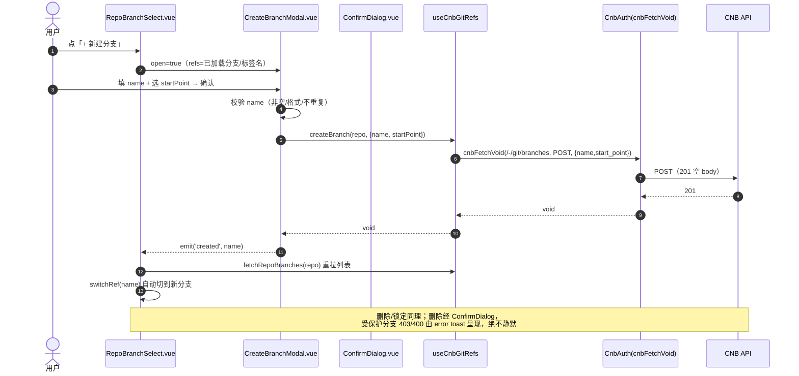
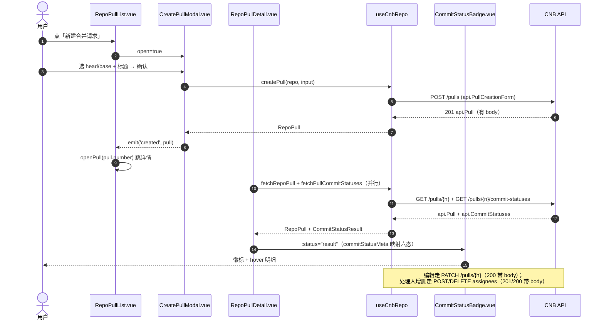
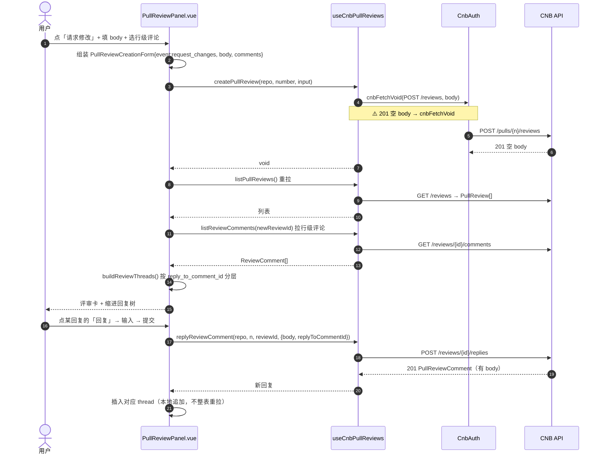
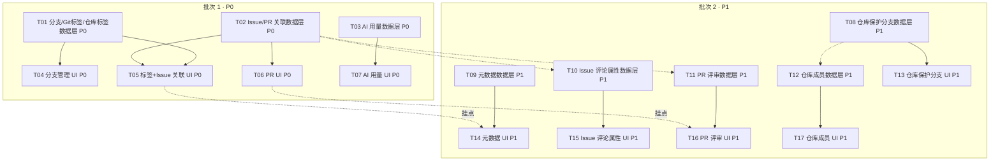

# CNB API 差距增量 · 架构设计与任务分解（第二轮）

| 项目 | 内容 |
|---|---|
| 项目 | wocnb（CNB.cool 桌面客户端，Tauri 2 + Vue 3 + Nuxt UI v4 + vue-i18n 三语） |
| 文档 | 增量架构设计 + 任务分解，对应 **增量 PRD v1.0** `docs/prd/cnb-api-gap-prd.md` |
| 本轮范围 | **P0 全量（REQ-01~06 / 32 端点）+ P1 全量（REQ-07~11 / 39 端点）= 11 条 / 71 端点** |
| 分批交付 | **批次 1 = P0**（独立交付、独立 QA）；**批次 2 = P1**（在批次 1 之上叠加） |
| 不做的范围 | P2（REQ-12~15 / 24 端点）、35 条"明确不做"、41 条 backlog —— 仅标注，不分解任务 |
| 覆盖率目标 | 97 → **168/268 ≈ 62.7%**（97 + 71） |
| 事实核对 | 本文所有端点按 `method + path` 逐条核对 `cnb-swagger.json`（201 path / 268 operation），含 **请求体 schema / 响应 schema / 写端点是否空 body / scope 原文**；所有现有代码引用标注 `文件:行号` |
| 实施状态 | P0（T01~T07）与 P1（T08~T17）已全部实施并通过 QA 两轮验收（2026-11-18），已随 v0.1.0-rc.25 发布 |
| 上游范式 | 复用 `docs/design/cnb-api-coverage-design.md`（D1~D4 / R1~R14 / 附录 A）与 `docs/design/org-features-design.md`（保护分支 / 成员写范式），**不重复设计** |

---

## 0. 结论摘要（先看这里）

| 项 | 结论 |
|---|---|
| 数据层组织 | 新建 **5 个** composable（`useCnbGitRefs` / `useCnbRepoLabels` / `useCnbBuildAi` / `useCnbAnnotations` / `useCnbPullReviews`，见 §5）+ 扩展 4 个现有（`useCnbRepo` / `useCnbMembers` / `useCnbBranchProtections` / `useRepoRoute` 下钻键）。**不引入 store**，沿用"composable 导出纯函数 + 页面持 ref"范式 |
| **写端点通道（关键）** | 并非所有写端点都空 body。逐条核对后：**约 14 个写端点返回带 body 的实体**（如 `POST /labels`→201 `api.Label`、`POST /issues/{n}/assignees`→201 `api.IssueDetail`、`POST /pulls`→201 `api.Pull`），**必须用 `cnbFetch`**；其余空 body 端点用 `cnbFetchVoid`。详见 §8.2 逐端点通道表 —— 这是本轮最易出错的地方 |
| 状态映射 | PR `commit-statuses` 复用现有 `commitStatusMeta()`（`useCnbRepo.ts:505`）与 `CommitStatusResult`（:550）—— 现有实现已是 GitLab 六态独立映射 + 未知中性兜底，**禁止复用 `useCnbBuildWatch` 构建四态**（PRD §6.1 #5） |
| 保护分支 scope 隔离 | `OrgProtectionsTab.vue` 加 `scopeLevel: 'group' \| 'repo'` prop，数据层按 scope 拼端点；新增 `useCnbBranchProtections` 的 `fetchRepoBranchProtections` 等 5 函数，与组织级函数**并列不混用**（N4） |
| 仓库成员 | 扩展 `useCnbMembers`，新增 `fetchRepoMembers` / `addRepoMember` / `removeRepoMember` 等；**必须先选完整仓库路径**（`?repo=` 下钻键）再请求，组织路径会 400（PRD §6.1 #1） |
| 路由 | `?tab=` 8 值不变；本轮复用已有下钻键 `number/sn/release`，**新增 `review` / `rcomment` 两个评审下钻键**；`switchTab` 必须把新键加入清理清单（沿用 §2.3 R3 修复） |
| 依赖包 | **无需新增任何依赖**；明确不引入拖拽库 / 图表库 / 编辑器 / 状态管理库 |
| 任务数 | **17 个任务 / 2 个批次**：批次 1（P0）7 个（T01~T07），批次 2（P1）10 个（T08~T17）。按"一个 composable 或一组相关 UI"粒度拆分，数据层与 UI 分离以便独立单测 |
| 开放问题 | 见 §10，共 3 条（均为低风险，不阻塞开工） |

---

## 1. 实现方案总览

### 1.1 整体架构与现有代码的关系

本轮是**纯增量**：不新建页面、不改路由结构、不加 Rust 命令、不改 Tauri 能力。所有能力都挂在已有的 8 页签仓库详情页、成员页、组织设置抽屉之上。

```
数据层（composable，导出纯函数 + 归一化）
├─ 新建 useCnbGitRefs.ts ............ 分支 CRUD / 分支锁 / 标签 CRUD / 标签详情   [REQ-01/02]
├─ 新建 useCnbRepoLabels.ts ......... 仓库标签 CRUD                              [REQ-03]
├─ 扩展 useCnbRepo.ts ............... Issue 处理人/标签、PR 建改/处理人/CI、评论编辑/自定义属性 [REQ-04/05/09]
├─ 新建 useCnbBuildAi.ts ............ AI 用量三端点                              [REQ-06]
├─ 扩展 useCnbBranchProtections.ts .. 仓库级保护分支（scopeLevel='repo'）         [REQ-07]
├─ 新建 useCnbAnnotations.ts ........ 提交/标签元数据 + batch                     [REQ-08]
├─ 新建 useCnbPullReviews.ts ........ 评审 CRUD / 行级评论 / 回复 / 评审人 / PR 标签 [REQ-10]
├─ 扩展 useCnbMembers.ts ............ 仓库成员 CRUD / 有效成员 / 继承成员          [REQ-11]
└─ 扩展 useRepoRoute.ts ............. 新增 review / rcomment 下钻键 + switchTab 清理

基础设施（复用，零改动）
├─ useCnbAuth.ts ..... cnbFetch / cnbFetchVoid / cnbFetchText / CnbApiError / canManageRole / 403 降级
├─ useCnbMembers.ts :: encodeSlugPath .......... 组织/多级路径逐段编码
├─ useCnbRepo.ts :: encodeRepoPath（内部） .... 仓库路径逐段编码
└─ utils/index.ts :: encodeRepoPathForRoute ... 路由路径逐段编码

UI 层（新建少量组件 + 扩展现有组件）
├─ 代码页：RepoBranchSelect（+新建/删除/锁定/解锁）、新建 CreateBranchModal
├─ Releases：RepoReleases（+新建标签/删除/详情）
├─ Issue：RepoIssueDetail 侧栏（+处理人/标签/自定义属性可编辑）、CommentSection（+评论编辑）
├─ PR：RepoPullList（+新建 PR）、CreatePullModal、RepoPullDetail（+编辑/处理人/CI 徽标/评审区）
├─ 流水线：RepoBuildDetail（+AI 用量子区）
├─ 设置：RepoSettingsDrawer（+仓库级保护分支区块，复用 OrgProtectionsTab）
└─ 成员页：members.vue（+仓库成员维度，按 ?repo= 定位）
```

**为什么这样组织（决策与理由）**

| 决策 | 理由 |
|---|---|
| 按业务域新建 composable，而非全部塞进 `useCnbRepo.ts` | `useCnbRepo.ts` 已 1425 行，承载 code/commits/issues/pulls/builds 五个域的读写。再塞入 71 个端点中的 40+ 会突破可维护阈值，且元数据（annotations）、AI 用量、评审是与现有域低耦合的新能力。按域切分后每个文件职责单一、可独立单测（沿用上一轮"新建 6 个 composable"的判断，见 coverage 设计 §3.1） |
| Issue/PR 的关联写操作（assignees/labels）扩展 `useCnbRepo.ts` 而非新建 | 这些端点与 `fetchRepoIssue` / `fetchRepoPull` 同域、共用 `encodeRepoPath` 与 `RepoIssue`/`RepoPull` 类型；且 `RepoIssueDetail`/`RepoPullDetail` 已持有详情对象，写后局部更新最自然。新建文件反而制造跨文件类型依赖 |
| 组织级与仓库级保护分支**并列函数**而非用参数合并 | 两者端点前缀不同（`/-/git-group-settings/branch-protections` vs `/-/settings/branch-protections`）、scope 不同（group-manage vs repo-manage）、响应码微差（组织 POST=200，仓库 POST=201）。并列函数 + 共享归一化/字段映射表（`normalizeBranchProtection` / `buildBranchProtectionBody`）既隔离又复用，符合 N4 |
| 不新建 store / 不引入 Pinia | 现有范式是"composable 纯函数 + 页面持 ref"，写后一致性用 `emit('updated')` 单向下发（coverage 设计 §8.5）。71 个端点无需全局状态，`cnbGroups` 那类共享状态仅在跨页面同步时才提（本轮只有侧栏组织列表已存在，无需新增） |

### 1.2 交付批次与可独立验收边界

| 批次 | 任务 | 可独立验收的交付物 | 覆盖率 |
|---|---|---|---|
| **批次 1 / P0** | T01~T07 | 分支可建/删/锁；标签可建/删/看详情；仓库标签可增删改；Issue 处理人/标签可编辑；PR 可建/改/分配处理人+CI 徽标；AI 用量三级下钻。全部可在现有页面闭环，不依赖 P1 任何代码 | 97 → **129/268 ≈ 48.1%** |
| **批次 2 / P1** | T08~T17 | 仓库级保护分支；提交/标签元数据；Issue 评论编辑+自定义属性；PR 评审+行级评论+评审人+标签；仓库成员管理 | 129 → **168/268 ≈ 62.7%** |

> 批次 1 的 7 个任务中，T01/T02/T03 为纯数据层（可先完成并单测），T04~T07 为 UI 层（分别只依赖对应的数据层任务）。批次 2 同理。**两批次之间无代码依赖**，P1 仅在 P0 的页面/组件上追加区块。

### 1.3 并行波次

- **批次 1**
  - 波次 0：`T01` ‖ `T02` ‖ `T03`（三个数据层任务互不依赖，可同时开工）
  - 波次 1：`T04`(←T01) ‖ `T05`(←T01,T02) ‖ `T06`(←T02) ‖ `T07`(←T03)
- **批次 2**
  - 波次 0：`T08` ‖ `T09` ‖ `T11`（数据层，互不依赖）
  - 波次 1：`T10`(←T02 同文件，需批次 1 合入后) ‖ `T12`(←T08 范式) ‖ `T13`(←T08) ‖ `T14`(←T09) ‖ `T16`(←T11)
  - 波次 2：`T15`(←T10) ‖ `T17`(←T12)

---

## 2. 批次 1（P0）详细设计 · REQ-01~06

> 通用约束：所有写操作按 §8.2 逐端点选通道；破坏性操作走 `ConfirmDialog`（G3）；写入口按 `canManageRole()` / `detail.canManage` 事前隐藏；403 只降级不登出（G2）。

### 2.1 REQ-01 · 分支管理 CRUD（5 端点）

**数据层：新建 `src/composables/useCnbGitRefs.ts`**（分支 + 标签同域，共用文件）

函数签名（详见 §5.1）：

```ts
export function createBranch(repoPath: string, input: { name: string, startPoint?: string }): Promise<void>
export function deleteBranch(repoPath: string, branch: string): Promise<void>
export function fetchBranchDetail(repoPath: string, branch: string): Promise<BranchDetail>
export function lockBranch(repoPath: string, branch: string): Promise<void>
export function unlockBranch(repoPath: string, branch: string): Promise<void>
```

**响应形态判定（逐条核对 swagger）**

| 端点 | 响应 | 通道 | 请求体 |
|---|---|---|---|
| `POST /{repo}/-/git/branches` | **201 空 body** | `cnbFetchVoid` | `openapi.CreateBranchForm { name, start_point? }`（swagger 无 required 声明，name 实际必填，UI 校验） |
| `DELETE /{repo}/-/git/branches/{branch}` | **200 空 body** | `cnbFetchVoid` | — |
| `GET /{repo}/-/git/branches/{branch}` | 200 `api.BranchDetail` | `cnbFetch` | — |
| `POST /{repo}/-/git/branch-locks/{branch}` | **201 空 body** | `cnbFetchVoid` | — |
| `DELETE /{repo}/-/git/branch-locks/{branch}` | **204 空 body** | `cnbFetchVoid` | — |

- `branch` 含 `/`（如 `feature/x`）→ 走路径段，必须 `encodeURIComponent(branch)`；仓库路径用现有 `encodeRepoPath`。**不要**复用 `fetchRepoBranches` 的列表响应结构 —— 详情端点返回 `api.BranchDetail`（含 commit 对象），列表项是 `api.Branch`，归一化分别定义。
- `BranchDetail` 归一化：`name`/`protected`/`locked` 同 `BranchItem`，`sha` 从 `commit.sha` 取，空值兜底。列表项 `BranchItem` 已含 `locked:boolean`（`useCnbRepo.ts:374`），**锁状态在下拉图标直接复用列表字段，不必为每条分支调详情端点**（避免 N+1）。`fetchBranchDetail` 仅在"新建后确认"等需要完整信息的场景调用。

**UI 落点：`RepoBranchSelect.vue` 扩展 + 新建 `CreateBranchModal.vue`**

| 项 | 设计 |
|---|---|
| 交互 | 下拉底部增加「+ 新建分支」按钮（`canManage` 时显示）；每个分支项右侧增加「锁/解锁」「删除」图标按钮（`canManage` 且非默认分支时显示）。当前分支不可删除（前端置灰 + tooltip） |
| 新建 | `CreateBranchModal`：`UModal` 表单，字段 `name`（校验 `^[A-Za-z0-9._/-]+$`、非空、不重复）+ `startPoint`（`USelectMenu` 或复用本组件的 ref 列表，默认当前 ref）。提交 `createBranch` → 成功 emit `created(name)` → 组件重新拉列表并 `switchRef(name)` 自动切过去 |
| 删除 | `ConfirmDialog`（`confirm-color="error"`），文案含"删除后不可恢复"；受保护分支服务端会拒绝 → `CnbApiError` 由 toast 呈现 error（**不静默吞**）。成功后若删的是当前 ref 则回默认分支 |
| 锁定 | 切换调 `lockBranch`/`unlockBranch`，成功后原地更新列表项 `locked` 字段（下拉图标 `i-lucide-lock` / `i-lucide-lock-open` 反映状态），不整表重拉 |
| 复用组件 | `ConfirmDialog`（`src/components/common/ConfirmDialog.vue`）、`UModal`/`UFormField`/`UInput`、`RepoBranchSelect` 已有的懒加载与过滤逻辑 |
| props/emit | `CreateBranchModal`: `open:boolean, repoPath:string, defaultRef:string, refs:string[]` → `emit('update:open')` / `emit('created', name)` |

**端点调用时序（新建分支）**



---

### 2.2 REQ-02 · Git 标签 CRUD（3 端点）

**数据层：同一文件 `useCnbGitRefs.ts`**

```ts
export function createTag(repoPath: string, input: { name: string, target?: string, message?: string }): Promise<TagDetail>
export function deleteTag(repoPath: string, tag: string): Promise<void>
export function fetchTagDetail(repoPath: string, tag: string): Promise<TagDetail>
```

**响应形态判定**

| 端点 | 响应 | 通道 | 请求体 |
|---|---|---|---|
| `POST /{repo}/-/git/tags` | **201 `api.Tag`（有 body！）** | **`cnbFetch`** | `api.PostTagFrom { name, target?, message? }` |
| `DELETE /{repo}/-/git/tags/{tag}` | **204 空 body** | `cnbFetchVoid` | — |
| `GET /{repo}/-/git/tags/{tag}` | 200 `api.Tag` | `cnbFetch` | — |

> ⚠️ `POST /tags` **返回实体**，与 `POST /branches`（201 空 body）不同。工程师不要因为"都是创建"就一律 `cnbFetchVoid`。创建成功后用返回的 `api.Tag` 直接插入列表（避免重拉）。

- `api.Tag` 字段：`name` / `target`（目标哈希）/ `target_type`（`commit`/`tag` 等，用于区分轻量标签与附注标签）/ `commit`（对象）/ `verification`（GPG 签名校验，可能为空）。归一化 `TagDetail { name, sha, targetType, verification }`。
- `target_type` 决定 UI 展示"轻量标签 / 附注标签"：`target_type === 'tag'` 视为附注（annotated），否则轻量（lightweight）。文案走 `repo.tags.typeAnnotated` / `repo.tags.typeLightweight`。
- 路径参数 `tag` 含特殊字符需 `encodeURIComponent`。

**UI 落点：`RepoReleases.vue` 扩展**

| 项 | 设计 |
|---|---|
| 入口 | 列表顶部「新建标签」按钮（`canManage` 时显示）；每个 tag 行「删除」图标 |
| 新建 | `UModal`：`name`（必填）+ `target`（默认当前 ref，用 `RepoBranchSelect` selectMode='emit'）+ `message`（可选，附注信息）。成功后 toast + 列表插入新项，**同时反映到 Releases 列表**（PRD 验收："新建标签后列表与 Releases 同步出现"）——即 `RepoReleases` 的 tag 区与 release 区共用一次刷新 |
| 详情 | 点 tag 名 → 页内 `UCard` 信息卡（不新增路由键）：展示 tag 类型、`target` 哈希、`commit` 摘要、`verification` 状态；正文（如有 message）用现有 `MarkdownView` 渲染 |
| 删除 | `ConfirmDialog`（danger），成功重拉 tag 列表 + release 列表。**注意**：删除 git tag ≠ 删除 Release（coverage 设计 T07 已明确"删 Release 不删 git tag"），文案要说清"此操作删除 Git 标签，与该标签关联的 Release 不受影响" |
| 复用组件 | `MarkdownView`、`RepoBranchSelect`、`ConfirmDialog`、`StateAlert` |

---

### 2.3 REQ-03 · 仓库标签管理（4 端点）

**数据层：新建 `src/composables/useCnbRepoLabels.ts`**

```ts
export interface RepoLabel { name: string, color: string, description: string, id: string }
export function listRepoLabels(repoPath: string): Promise<RepoLabel[]>
export function createRepoLabel(repoPath: string, input: { name: string, color?: string, description?: string }): Promise<RepoLabel>
export function updateRepoLabel(repoPath: string, name: string, patch: { newName?: string, color?: string, description?: string }): Promise<RepoLabel>
export function deleteRepoLabel(repoPath: string, name: string): Promise<void>
```

**响应形态判定**

| 端点 | 响应 | 通道 | 请求体 |
|---|---|---|---|
| `GET /{repo}/-/labels` | 200 `api.Label[]` | `cnbFetch` | — |
| `POST /{repo}/-/labels` | **201 `api.Label`（有 body）** | `cnbFetch` | `api.PostLabelForm { name, color?, description? }` |
| `PATCH /{repo}/-/labels/{name}` | **200 `api.Label`（有 body）** | `cnbFetch` | `api.PatchLabelForm { new_name?, color?, description? }` |
| `DELETE /{repo}/-/labels/{name}` | **204 空 body** | `cnbFetchVoid` | — |

- `name` 是路径段且可能含空格/中文（中文标签名合法）→ `encodeURIComponent(name)`。
- `PATCH` 的重命名字段叫 `new_name`（不是 `name`），请求体不含原 `name`（原 name 走路径段）。归一化统一为 `newName` 入参。
- `scope` 为 `repo-notes:r`（读）/ `repo-notes:rw`（写，swagger description 标注）：无权限时入口隐藏 + 403 降级。

**UI 落点：新建 `src/components/repo/RepoLabelManager.vue`**

| 项 | 设计 |
|---|---|
| 挂载点 | Issue 列表页 `RepoIssueList.vue` 顶部「标签管理」按钮 → 打开 `UModal`（内嵌本组件）；同时作为 Issue 详情标签下拉的数据源复用 |
| 交互 | 表格：颜色 chip + 名称 + 描述 + 编辑/删除。编辑/新建共用 `UModal` 表单（name/color/description），色值用 `UInput` + 色块预览（不引入取色器依赖） |
| 删除 | `ConfirmDialog`，文案 `repo.labels.deleteConfirm`（"删除标签 {name} 将从所有 Issue 移除，确定吗？"）；成功重拉列表并通知父组件刷新 Issue 标签选择器 |
| 色彩 chip | 复用 `RepoIssueDetail.vue:197-204` 的样式（`color` + `${color}1a` 背景） |
| props/emit | `repoPath:string, open:boolean` → `emit('update:open')` / `emit('changed')` |

---

### 2.4 REQ-04 · Issue 处理人与标签管理（10 端点）

**数据层：扩展 `useCnbRepo.ts`**（与 `fetchRepoIssue` 同域）

```ts
export interface RepoUser { username: string, nickname: string }
export function listIssueAssignees(repoPath: string, number: string): Promise<RepoUser[]>
export function canAssignIssue(repoPath: string, number: string, username: string): Promise<boolean>   // 204→true / 404→false
export function setIssueAssignees(repoPath: string, number: string, usernames: string[]): Promise<void>
export function listIssueLabels(repoPath: string, number: string): Promise<RepoLabel[]>
export function setIssueLabels(repoPath: string, number: string, labels: string[]): Promise<RepoLabel>
export function addIssueLabels(repoPath: string, number: string, labels: string[]): Promise<RepoLabel>
export function removeIssueLabel(repoPath: string, number: string, name: string): Promise<RepoLabel | void>
```

**响应形态判定（本 REQ 通道最杂，逐条列出）**

| 端点 | 响应 | 通道 | 备注 |
|---|---|---|---|
| `GET /issues/{n}/assignees` | 200 `api.UserInfo[]` | `cnbFetch` | — |
| `GET /issues/{n}/assignees/{assignee}` | **204 空 body（可分配）/ 404（不可）** | `cnbFetchVoid` + 捕获 404 | 用 status 判定布尔；`CnbApiError.kind==='notFound'` → false，其余抛出 |
| `POST /issues/{n}/assignees` | **201 `api.IssueDetail`（有 body）** | **`cnbFetch`** | body `{assignees: string[]}` |
| `PATCH /issues/{n}/assignees` | **200 `api.IssueDetail`（有 body）** | `cnbFetch` | body `{assignees: string[]}`；增量变更 |
| `DELETE /issues/{n}/assignees` | **200 `api.IssueDetail`（有 body）** | `cnbFetch` | body `{assignees: string[]}`（移除指定用户名） |
| `GET /issues/{n}/labels` | 200 `api.Label[]` | `cnbFetch` | — |
| `GET` 可分配性 → 见上（labels 无此端点） | — | — | — |
| `POST /issues/{n}/labels` | **200 `api.Label`（有 body）** | `cnbFetch` | body `{labels: string[]}` |
| `PUT /issues/{n}/labels` | **200 `api.Label`（有 body）** | `cnbFetch` | body `{labels: string[]}`（全量替换） |
| `DELETE /issues/{n}/labels` | **204 空 body** | `cnbFetchVoid` | body `{labels: string[]}`（批量移除；`cnbFetchVoid` 仍发 body） |
| `DELETE /issues/{n}/labels/{name}` | **200 `api.Label`（有 body）** | `cnbFetch` | 单个移除 |

> 关键陷阱：`DELETE /labels`（集合，带 body）是 **204 空 body**，而 `DELETE /labels/{name}`（单个）是 **200 带 body**。两者相邻但通道不同 —— 严格遵守上表，写后统一重拉详情（§8.4）。

- `RepoUser` 复用现有 `useCnbRepo.ts:655` 已定义的同名接口（含 username/nickname/avatar），不要重复定义。
- 处理人数量上限 8、标签上限 10（swagger `api.IssueDetail` 描述）→ UI 事前限制并提示。

**UI 落点：`RepoIssueDetail.vue` 侧栏改造**

| 项 | 设计 |
|---|---|
| 现状 | 标签/处理人区只读（`:195-210`），处理人仅展示 nickname 文本 |
| 改造 | 该区变为可点击编辑：`canManage` 或 `repo-issue:rw` 时显示「编辑」按钮，点击展开 `USelectMenu`（处理人，multiple，选项来自 `listRepoLabels` 无关的**成员来源**：优先 `fetchRepoMembers`（P1 T12 才实现）——**P0 阶段用 `followers`? 不行**。决策见下） |
| 处理人候选来源（P0） | **复用 `cnbUser` + Issue 已有 assignees + 通过 `canAssignIssue` 探测**：P0 无仓库成员端点，候选由「当前登录用户 + 已有处理人 + 手动输入用户名」组成；`USelectMenu` 开启 `creatable`（Nuxt UI 支持）允许输入用户名，提交前用 `canAssignIssue` 校验，不满足则 inline 提示。**P1 T12 落地 `fetchRepoMembers` 后，把候选源替换为成员列表**（在计划中标注为 P1 增强点，非 P0 阻塞） |
| 标签编辑 | `USelectMenu` multiple，选项来自 REQ-03 的 `listRepoLabels`（同一数据源，避免漂移）；增删走 `addIssueLabels` / `removeIssueLabel`；成功后原地更新侧栏 chip |
| 写后一致性 | 任一写成功后调用 `fetchRepoIssue` 重拉详情（本页已有的 `load()`），保证 assignees/labels 与服务端一致（N2） |
| 复用 | `USelectMenu`、`UFormField`、`ConfirmDialog`（移除最后一个处理人时可确认）、`MarkdownView`（正文不变） |

---

### 2.5 REQ-05 · PR 创建/编辑 + 处理人 + CI 状态（7 端点）

**数据层：扩展 `useCnbRepo.ts`**

```ts
export interface CreatePullInput { title: string, head: string, base: string, body?: string, headRepo?: string }
export function createPull(repoPath: string, input: CreatePullInput): Promise<RepoPull>
export function updatePull(repoPath: string, number: string, patch: { title?: string, body?: string, state?: string }): Promise<RepoPull>
export function listPullAssignees(repoPath: string, number: string): Promise<RepoUser[]>
export function canAssignPull(repoPath: string, number: string, username: string): Promise<boolean>
export function setPullAssignees(repoPath: string, number: string, usernames: string[]): Promise<RepoPull>
export function fetchPullCommitStatuses(repoPath: string, number: string): Promise<CommitStatusResult>
```

**响应形态判定**

| 端点 | 响应 | 通道 | 请求体 |
|---|---|---|---|
| `POST /{repo}/-/pulls` | **201 `api.Pull`（有 body）** | `cnbFetch` | `api.PullCreationForm { title, head, base, body?, head_repo? }` |
| `PATCH /{repo}/-/pulls/{number}` | **200 `api.Pull`（有 body）** | `cnbFetch` | `api.PatchPullRequest { title?, body?, state? }`（`state` 可关/开 PR） |
| `GET /pulls/{n}/assignees` | 200 `api.UserInfo[]` | `cnbFetch` | — |
| `GET /pulls/{n}/assignees/{assignee}` | **204 可分配 / 404 不可** | `cnbFetchVoid` + 捕获 404 | swagger 明确"分配前校验" |
| `POST /pulls/{n}/assignees` | **201 `api.Pull`（有 body）** | `cnbFetch` | `{assignees: string[]}` |
| `DELETE /pulls/{n}/assignees` | **200 `api.Pull`（有 body）** | `cnbFetch` | `{assignees: string[]}` |
| `GET /pulls/{n}/commit-statuses` | **200 `api.CommitStatuses`（有 body）** | `cnbFetch` | — |

- `api.Pull` / `api.PullRequest` 归一化复用现有 `fetchRepoPull` 的 `normalizePull`（`useCnbRepo.ts:901-983`），**新建 PR 返回体与详情同构**，直接复用可避免两套映射。
- `fetchPullCommitStatuses` 返回 `api.CommitStatuses {sha, state, statuses[]}` —— **与 `fetchCommitStatuses`（单提交）的 `RawCommitStatuses` 结构完全一致**。决策：`fetchPullCommitStatuses` 内部复用同一归一化，返回 `CommitStatusResult`；UI 的 CI 徽标区**直接复用 `CommitStatusBadge.vue`**，状态色走 `commitStatusMeta()`（GitLab 六态，未知中性）。⚠️ 再次强调：**不要复用 `useCnbBuildWatch` 的 `shouldNotifyStatus` 构建四态映射**（PRD §6.1 #5）。
- `api.CommitStatuses.statuses[]` 内元素的 `state` 字符串与单提交一致（swagger 两处描述均为 GitLab 风格），`commitStatusMeta` 已覆盖。

**UI 落点**

| 组件 | 改动 |
|---|---|
| 新建 `src/components/repo/CreatePullModal.vue` | `UModal` 表单：标题（必填 2~255）、源分支 `head`（`RepoBranchSelect` selectMode='emit'）、目标分支 `base`（同）、正文 `body`（`MarkdownView` 编辑态为 textarea）。提交 `createPull` → 成功 emit `created(pull)` → `RepoPullList` 跳详情（`openPull(number)`） |
| `RepoPullList.vue` | 顶部「新建合并请求」按钮（`canManage` 或 `repo-pr:rw` 时显示），挂载 `CreatePullModal` |
| `RepoPullDetail.vue` | 顶部「编辑」按钮 → `UModal`（标题/目标分支/正文）→ `updatePull`；处理人区（同 Issue 的 `USelectMenu` + `canAssignPull` 校验 + `setPullAssignees`）；**CI 状态徽标区**：详情加载时并行调 `fetchPullCommitStatuses`，用 `CommitStatusBadge` 渲染整体 state + hover 展开各 check（context/description/target_url 外跳） |
| 复用 | `RepoBranchSelect`（selectMode='emit'，避免写 `?ref=` 误清下钻键）、`CommitStatusBadge`、`MarkdownView`、`ConfirmDialog`（关闭 PR 时）、`StateAlert`（CI 区 403 只降级该区块） |

**端点调用时序（新建 PR + CI 徽标）**



---

### 2.6 REQ-06 · CI · AI 用量查询（3 端点）

**数据层：新建 `src/composables/useCnbBuildAi.ts`**

```ts
export interface AiUsageSummary { code: number, content: Record<string, unknown>, pageSize: number, pages: number }
export interface AiRequestEntry {
  requestId: string, timestamp: string, model: string, success: boolean,
  promptTokens: number, completionTokens: number, totalTokens: number,
  thinkingTokens: number, promptCachedTokens: number, promptCacheWriteTokens: number,
  milliCredit: number, originalMilliCredit: number | null, discount: number | null,
  statusCode: number, failureReason: string, hasDetail: boolean,
  responseStartDurationMs: number, responseEndDurationMs: number,
}
export interface AiRequestDetail { code: number, content: Record<string, unknown> }
export function fetchBuildAiAudit(repoPath: string, sn: string, pipelineId: string): Promise<AiUsageSummary>
export function fetchBuildAiRequests(repoPath: string, sn: string, pipelineId: string, page: number): Promise<AiRequestEntry[]>
export function fetchBuildAiRequestDetail(repoPath: string, sn: string, pipelineId: string, requestId: string): Promise<AiRequestDetail>
```

**响应形态判定**

| 端点 | 响应 | 通道 | 备注 |
|---|---|---|---|
| `GET /build/logs/ai-audit/{sn}/{pipelineId}` | 200 `dto.BuildAiAuditResult` | `cnbFetch` | `{code, content, request_log_pages, request_log_page_size}` |
| `GET /build/logs/ai-request/{sn}/{pipelineId}/{page}` | 200 `dto.BuildAiRequestResult` | `cnbFetch` | `{code, content: BuildAiRequestEntry[]}` |
| `GET /build/logs/ai-request-detail/{sn}/{pipelineId}/{requestId}` | 200 `dto.BuildAiRequestDetailResult` | `cnbFetch` | `{code, content}` |

> ⚠️ 三个响应都带 `code` 字段（**0 = 成功**）。数据层必须判 `code`：`code !== 0` 时视为业务失败/空态，不把 `content` 当有效数据渲染。这是与其他端点不同的语义（其他端点靠 HTTP status，这里 HTTP 200 也可能 code≠0）。
>
> `content` 在 audit/detail 中是**无 schema 的自由对象**（swagger `type` 为空）→ 数据层保留 `Record<string, unknown>`，UI 以"键值对折叠表 + JSON 代码块"渲染，不猜测字段。

- `page` 从 `useRepoRoute().page` 取（复用翻页键）；`sn` / `pipelineId` 从 `RepoBuildDetail` 的 props 与构建详情（`fetchBuildStatus` 返回含 pipelineId？若无则复用 `sn` + 从 `fetchBuildLogs` 项取 pipelineId，见 §10-Q2）。
- `requestId` 走 `?rrequest=`？——决策：**详情用页内 `UModal` 展开**，不新增路由键（AI 请求详情是层级最末端、无需分享深链），避免下钻键膨胀。

**UI 落点：`RepoBuildDetail.vue` 扩展 + 新建 `src/components/repo/AiUsagePanel.vue`**

| 项 | 设计 |
|---|---|
| 挂载 | `RepoBuildDetail` 底部新增「AI 用量」`UCard`（`sn`/`pipelineId` 具备时才渲染），内嵌 `AiUsagePanel` |
| 三级展示 | ①汇总：audit 的 `content` 键值对（token 总量/费用/请求数等，按 key 友好化）+ 总页数；②分页明细：`UPagination` + 表格（model/success/total_tokens/milli_credit/耗时/时间），行点击展开③；③单次详情：`UModal` 展示 detail 的 `content`（JSON 代码块 + 关键指标卡） |
| 空态 | `code !== 0` 或 `pages === 0` 或明细空数组 → `StateAlert empty`（`repo.build.aiUsage.empty`="本次构建无 AI 用量记录"），不报错 |
| 权限 | `repo-cnb-history:r` 缺失 → 该卡片内 `StateAlert forbidden`，不影响构建日志主体（区块级降级） |
| props | `AiUsagePanel { repoPath, sn, pipelineId }`；内部自管 page ref |

---

## 3. 批次 2（P1）详细设计 · REQ-07~11

> P1 的核心主题是**组织级范式向仓库级复用**（REQ-07/11）与**评审层级结构**（REQ-10）。两者都要求把组织级的既有实现用 `scopeLevel` 或并列函数隔离，避免串数据（N4）。

### 3.1 REQ-07 · 仓库级保护分支规则 CRUD（5 端点）

**数据层：扩展 `useCnbBranchProtections.ts`**（组织级已存在，见该文件 :1-383）

复用组织级的**归一化/字段映射/空规则构造**三个纯函数，新增 5 个仓库级请求函数（并列，不改组织级）：

```ts
export function fetchRepoBranchProtections(repoPath: string): Promise<BranchProtectionRule[]>
export function createRepoBranchProtection(repoPath: string, rule: BranchProtectionRule): Promise<void>
export function updateRepoBranchProtection(repoPath: string, id: string, rule: BranchProtectionRule): Promise<void>
export function deleteRepoBranchProtection(repoPath: string, id: string): Promise<void>
// 单条详情（仓库级独有，组织级未实现单条查询）
export function fetchRepoBranchProtection(repoPath: string, id: string): Promise<BranchProtectionRule>
```

**响应形态判定（与组织级的关键差异）**

| 端点 | 响应 | 通道 | 与组织级差异 |
|---|---|---|---|
| `GET /{repo}/-/settings/branch-protections` | 200 `api.BranchProtection[]` | `cnbFetch` | 路径不同，结构相同 |
| `POST /{repo}/-/settings/branch-protections` | **201 空 body** | `cnbFetchVoid` | ⚠️ 组织级是 200 空 body，仓库级是 **201** —— 但都是空 body，通道相同 |
| `GET /{repo}/-/settings/branch-protections/{id}` | 200 `api.BranchProtection` | `cnbFetch` | **仓库级独有**（组织级只实现了列表，单条走列表详情） |
| `PATCH /{repo}/-/settings/branch-protections/{id}` | 200 空 body | `cnbFetchVoid` | 同组织级 |
| `DELETE /{repo}/-/settings/branch-protections/{id}` | 200 空 body | `cnbFetchVoid` | 同组织级 |

- 复用 `normalizeBranchProtection` / `buildBranchProtectionBody`（该文件 :264/:286）—— 22 字段映射表、18 布尔 + 2 数字的归一化**一处实现**，仓库/组织共用，避免 N5（字段多、读写漂移）。
- rule 上限 10 条（`BRANCH_PROTECTION_LIMIT`）同样适用（swagger 组织/仓库描述一致）。
- 路径 `id` 走 `encodeURIComponent`；仓库路径用 `encodeRepoPath`。
- `id` 只走路径段，不进 body（沿用组织级 `buildBranchProtectionBody` 的约定）。

**组织级 vs 仓库级隔离设计（N4 核心）**

| 维度 | 组织级（`OrgProtectionsTab`） | 仓库级（本 REQ） |
|---|---|---|
| `scopeLevel` prop | `'group'` | `'repo'` |
| 定位参数 | `slug`（组织路径，可为多级） | `repoPath`（完整仓库路径 `org/repo`） |
| 端点前缀 | `/{slug}/-/git-group-settings/branch-protections` | `/{repo}/-/settings/branch-protections` |
| scope | `group-manage:r` / `:rw` | `repo-manage:r` / `:rw` |
| 权限来源 | `selectedGroup.access_role` → `canManageRole()` | `detail.accessLevel` → `detail.canManage` |
| 根组织守卫 | 子组织不发请求、引导根组织（D4） | 无此限制（仓库级无"根"概念） |
| i18n key | `org.protections.*`（已存在） | `repo.protections.*`（新增，见 §7） |

**UI 落点：`RepoSettingsDrawer.vue` 扩展 + 复用 `OrgProtectionsTab.vue`**

决策：把 `OrgProtectionsTab.vue` 的 `slug` prop 泛化为 `scopeLevel: 'group' | 'repo'`，**在组件内部按 scope 选择数据层函数与权限来源**，而不是新建一个几乎相同的组件（否则 22 字段表单要写两遍，N5 风险翻倍）。改造点：

- props 由 `{ slug, canManage }` 扩为 `{ scopeLevel?: 'group'|'repo', target: string, canManage: boolean }`（保留 `slug` 作为别名兼容组织页现有调用，或统一迁移 —— 采用**统一迁移**，`group.vue` 与 `RepoSettingsDrawer.vue` 都传 `target` + `scopeLevel`）。
- 组件内用一个 `adapter` 对象封装 4 个操作的函数引用：
  ```ts
  const api = computed(() => props.scopeLevel === 'repo'
    ? { list: fetchRepoBranchProtections, create: createRepoBranchProtection, ... }
    : { list: fetchBranchProtections, create: createBranchProtection, ... })
  ```
- 根组织守卫 `isSubGroup` 仅在 `scopeLevel === 'group'` 时生效。
- i18n：所有 `t('org.protections.X')` 改为 `t(`${i18nNs}.X`)`，`i18nNs = scopeLevel === 'repo' ? 'repo.protections' : 'org.protections'`。两套 key 三语都要有（§7）。
- `RepoSettingsDrawer.vue` 在现有"编辑设置/归档"之后挂一个折叠区块，传入 `scopeLevel='repo'`、`target=props.detail.path`、`canManage=props.detail.canManage`。
- 删除确认沿用组件已有的 `ConfirmDialog` + `typeToConfirm`（规则名），文案按 scope 走不同 i18n key。

---

### 3.2 REQ-08 · 提交/标签元数据（7 端点）

**数据层：新建 `src/composables/useCnbAnnotations.ts`**

```ts
export interface AnnotationItem { key: string, value: string, meta: Record<string, unknown> }
export interface CommitAnnotationBatch { commitHash: string, annotations: AnnotationItem[] }
export function listTagAnnotations(repoPath: string, tag: string): Promise<AnnotationItem[]>
export function putTagAnnotations(repoPath: string, tag: string, items: AnnotationItem[]): Promise<void>
export function deleteTagAnnotation(repoPath: string, tagWithKey: string): Promise<void>   // tagWithKey = `${tag}/${key}`
export function listCommitAnnotations(repoPath: string, sha: string): Promise<AnnotationItem[]>
export function putCommitAnnotations(repoPath: string, sha: string, items: AnnotationItem[]): Promise<void>
export function deleteCommitAnnotation(repoPath: string, sha: string, key: string): Promise<void>
export function listCommitAnnotationsBatch(repoPath: string, hashes: string[], keys?: string[]): Promise<CommitAnnotationBatch[]>
```

**响应形态判定**

| 端点 | 响应 | 通道 | 请求体 / 路径陷阱 |
|---|---|---|---|
| `GET /git/tag-annotations/{tag}` | 200 `web.TagAnnotation[]` | `cnbFetch` | — |
| `PUT /git/tag-annotations/{tag}` | **200 空 body** | `cnbFetchVoid` | body `{annotations: [{key, value}]}` |
| `DELETE /git/tag-annotations/{tag_with_key}` | **200 空 body** | `cnbFetchVoid` | ⚠️ `tag_with_key` 格式为 `标签名称/元数据key`（**一个 path 段内嵌 `/`**）→ 整段 `encodeURIComponent(`${tag}/${key}`)` |
| `GET /git/commit-annotations/{sha}` | 200 `web.CommitAnnotation[]` | `cnbFetch` | — |
| `PUT /git/commit-annotations/{sha}` | **200 空 body** | `cnbFetchVoid` | body `{annotations: [{key, value}]}` |
| `DELETE /git/commit-annotations/{sha}/{key}` | **200 空 body** | `cnbFetchVoid` | `sha`、`key` 各自 `encodeURIComponent`（**两个独立段**，与 tag 版不同！） |
| `POST /git/commit-annotations-in-batch` | 200 `web.CommitAnnotationInBatch[]` | `cnbFetch` | body `{commit_hashes: string[], keys?: string[]}` |

> ⚠️ tag 版 DELETE 是 `标签/key` **单段内嵌斜杠**（整体编码成 `%2F`），commit 版 DELETE 是 `{sha}/{key}` **两个段**（分别编码）。两者形态不同，写错会被网关路由到错误资源。这是本 REQ 最容易踩的坑。

- `AnnotationItem.meta` 是服务端审计信息（操作者/时间/平台），只读展示不回写；PUT 的 body 只发 `{key, value}`。
- batch 归一化：`web.CommitAnnotationInBatch {commit_hash, annotations[]}` → `CommitAnnotationBatch {commitHash, annotations}`；若干 hash 无数据也要保留条目（`annotations: []`），供 UI 对齐。

**UI 落点**

| 组件 | 改动 |
|---|---|
| 新建 `src/components/repo/AnnotationsPanel.vue` | 通用元数据折叠区：props `{ repoPath, kind: 'tag'\|'commit', refKey: string, canEdit: boolean }`。展开时按 kind 调对应 list 函数；表格展示 key/value/meta；编辑用行内 `UModal`（key/value），保存走 put；删除走 `ConfirmDialog`（danger）→ delete 函数；成功后原地刷新 |
| `RepoReleases.vue` 标签详情卡 | 嵌入 `<AnnotationsPanel kind="tag" :ref-key="selectedTag.name" />` |
| `RepoCommits.vue` 提交详情（或 `RepoFileViewer` 的 commit 区） | 嵌入 `<AnnotationsPanel kind="commit" :ref-key="sha" />` |
| 批量入口 | 提交列表页顶部「批量查看元数据」按钮 → 一次 `listCommitAnnotationsBatch(hashes, [])` → 折叠面板按 hash 分组展示（**避免对每行调 GET，N+1**）—— 这是 PRD REQ-08"批量接口避免 N+1"的落点 |
| 权限 | `repo-release:r`（tag）/ `repo-code:r`（commit）缺失 → 该折叠区 `StateAlert forbidden`，不影响主体 |

---

### 3.3 REQ-09 · Issue 评论编辑 + 自定义属性（6 端点）

**数据层：扩展 `useCnbRepo.ts`**

```ts
export function fetchIssueComment(repoPath: string, number: string, commentId: string): Promise<RepoComment>
export function updateIssueComment(repoPath: string, number: string, commentId: string, body: string): Promise<RepoComment>
export interface IssueProperty { key: string, name: string, type: 'string'|'date'|'number', value: string }
export interface RepoPropertyDef { key: string, name: string, type: 'string'|'date'|'number', visible: boolean }
export interface PropertyUpdateResult { successCount: number, failedCount: number, failedKeys: string[] }
export function listIssueProperties(repoPath: string, number: string): Promise<IssueProperty[]>
export function updateIssueProperties(repoPath: string, number: string, properties: {key:string,value:string}[]): Promise<PropertyUpdateResult>
export function listRepoProperties(repoPath: string): Promise<RepoPropertyDef[]>
export function listRepoInvisibleProperties(repoPath: string): Promise<RepoPropertyDef[]>
```

**响应形态判定**

| 端点 | 响应 | 通道 | 请求体 |
|---|---|---|---|
| `GET /issues/{n}/comments/{comment_id}` | 200 `api.IssueComment` | `cnbFetch` | — |
| `PATCH /issues/{n}/comments/{comment_id}` | **200 `api.IssueComment`（有 body）** | `cnbFetch` | `api.PatchIssueCommentForm { body }` |
| `GET /issues/{n}/property` | 200 `api.IssueProperty[]` | `cnbFetch` | — |
| `PATCH /issues/{n}/property` | **200 `api.IssuePropertyUpdateResult`（有 body）** | `cnbFetch` | `openapi.IssuePropertiesForm { properties: [{key,value}] }` |
| `GET /{repo}/-/property` | 200 `api.RepoProperty[]` | `cnbFetch` | — |
| `GET /{repo}/-/property/invisible` | 200 `api.RepoProperty[]` | `cnbFetch` | — |

- `PropertyUpdateResult` 含 `failed_count`/`failed_keys`：UI 必须展示**部分失败**（`failedCount > 0` 时 toast 警示并列出失败 key），不能只看 HTTP 200 就报全成功（N2 同类）。
- `property` 的 `type` 枚举三值 `string`/`date`/`number` → 表单按 type 选 `UInput` / `UInput type="date"` / `UInput type="number"`，值统一作为字符串提交（`api.PropertyForm.value` 是 string）。
- 隐藏属性 `/property/invisible` scope 为 `repo-issue:r`（与 visible 同），但**只有有权限者才在字典里出现**；UI 合并 visible + invisible 作为编辑候选项，并标注"仅你可见"。

**UI 落点**

| 组件 | 改动 |
|---|---|
| `CommentSection.vue` | 每条自己发的评论（作者 == `cnbUser.username`）增加「编辑」按钮 → 行内 textarea（预填 body，用 `fetchIssueComment` 保证最新）→ 保存调 `updateIssueComment` → 成功原地更新正文 + 时间戳；失败 inline 报错不关闭编辑态。kind='pulls' 时**本 REQ 不改 PR 评论**（swagger 单条 PATCH PR comment 属 P2 backlog，避免范围蔓延） |
| `RepoIssueDetail.vue` 侧栏 | 在标签/处理人区下方加「自定义属性」折叠区：展开时并行调 `listRepoProperties` + `listRepoInvisibleProperties` + `listIssueProperties`，用字典驱动表单；保存调 `updateIssueProperties`，按 `PropertyUpdateResult` 反馈 |
| 复用 | `UFormField`、`UInput`、`MarkdownView`（评论正文渲染）、`StateAlert` |

---

### 3.4 REQ-10 · PR 评审 + 行级评论 + 评审人 + 标签（13 端点）

**数据层：新建 `src/composables/useCnbPullReviews.ts`**

```ts
export type ReviewEvent = 'approve' | 'comment' | 'request_changes' | 'pending'
export interface PullReview { id: string, state: string, body: string, author: string, createdAt: string, updatedAt: string }
export interface ReviewComment {
  id: string, reviewId: string, body: string, path: string, subjectType: 'line'|'file',
  startLine: number, endLine: number, startSide: 'left'|'right', endSide: 'left'|'right',
  replyToCommentId: string, reviewState: string, author: string, createdAt: string,
}
export function listPullReviews(repoPath: string, number: string): Promise<PullReview[]>
export function createPullReview(repoPath: string, number: string, input: { body?: string, event: ReviewEvent, comments?: ... }): Promise<void>
export function updatePullReview(repoPath: string, number: string, reviewId: string, body: string): Promise<PullReview>
export function listReviewComments(repoPath: string, number: string, reviewId: string): Promise<ReviewComment[]>
export function updateReviewComment(repoPath: string, number: string, reviewId: string, commentId: string, body: string): Promise<ReviewComment>
export function replyReviewComment(repoPath: string, number: string, reviewId: string, input: { body: string, replyToCommentId: string }): Promise<ReviewComment>
export function addPullReviewers(repoPath: string, number: string, reviewers: string[]): Promise<RepoPull>
export function removePullReviewers(repoPath: string, number: string, reviewers: string[]): Promise<RepoPull>
export function listPullLabels(repoPath: string, number: string): Promise<RepoLabel[]>
export function setPullLabels(repoPath: string, number: string, labels: string[]): Promise<RepoLabel>
export function addPullLabels(repoPath: string, number: string, labels: string[]): Promise<RepoLabel>
export function removePullLabels(repoPath: string, number: string, labels?: string[]): Promise<RepoLabel | void>
export function removePullLabelByName(repoPath: string, number: string, name: string): Promise<RepoLabel>
```

**响应形态判定（本 REQ 含 4 个空 body 写端点，逐条标注）**

| 端点 | 响应 | 通道 | 请求体 |
|---|---|---|---|
| `GET /pulls/{n}/reviews` | 200 `api.PullReview[]` | `cnbFetch` | — |
| `POST /pulls/{n}/reviews` | **201 空 body** | **`cnbFetchVoid`** | `api.PullReviewCreationForm {body?, event, comments?, work_mode?}`，event ∈ `approve/comment/request_changes/pending` |
| `PATCH /pulls/{n}/reviews/{review_id}` | 200 `api.PullReview` | `cnbFetch` | `{body}` |
| `GET /reviews/{review_id}/comments` | 200 `api.PullReviewComment[]` | `cnbFetch` | — |
| `PATCH /reviews/{review_id}/comments/{cid}` | 200 `api.PullReviewComment` | `cnbFetch` | `{body}` |
| `POST /reviews/{review_id}/replies` | **201 `api.PullReviewComment`（有 body）** | `cnbFetch` | `{body, reply_to_comment_id, work_mode?}` |
| `POST /pulls/{n}/reviewers` | **201 `api.Pull`（有 body）** | `cnbFetch` | `{reviewers: string[]}` |
| `DELETE /pulls/{n}/reviewers` | **200 `api.Pull`（有 body）** | `cnbFetch` | `{reviewers: string[]}` |
| `GET /pulls/{n}/labels` | 200 `api.Label[]` | `cnbFetch` | — |
| `PUT /pulls/{n}/labels` | 200 `api.Label` | `cnbFetch` | `{labels: string[]}` |
| `POST /pulls/{n}/labels` | 200 `api.Label` | `cnbFetch` | `{labels: string[]}` |
| `DELETE /pulls/{n}/labels` | **204 空 body** | `cnbFetchVoid` | （body 可选） |
| `DELETE /pulls/{n}/labels/{name}` | 200 `api.Label` | `cnbFetch` | — |

> ⚠️ `POST /reviews` 是 **201 空 body**（用 `cnbFetchVoid`），而 `POST /replies` / `POST /reviewers` / `POST /labels` 都**有 body**。同一评审域内通道不一致，必须逐条对照上表。

- 评审状态 `state` 枚举：swagger 描述为 `approved` / `changes_requested` / `commented` / `pending`（与 `RepoPullDetail.vue:103-114` 的 `reviewColor` 已有一致映射）→ **复用现有 `reviewColor()`**，不新建映射。
- 行级评论 `subject_type` 为 `line` 时才有 start/end line/side；`file` 时忽略行号（swagger 明确）→ 渲染时按 subject_type 分支。
- `diff_hunk` 是 `api.DiffLine[]`，UI 可折叠展示上下文（复用 `PullDiffView` 的行渲染样式，但本 REQ 只做只读展示，不做新增行评论的定位交互）。

**评审层级渲染结构（N3 核心）**

```
PullReviewPanel.vue（评审区容器）
├─ 顶部操作条：「批准 / 请求修改 / 评论」按钮（ReviewEvent 三档 + pending）
│   └─ 提交 createPullReview → 成功后重拉 reviews
├─ 评审人管理：`USelectMenu` multiple（增删走 add/removePullReviewers）
├─ 标签 chip 编辑：复用 REQ-03 的标签数据源 + set/add/removePullLabels
└─ 评审列表（v-for review of reviews）
    └─ ReviewCard（state 徽标 reviewColor + body MarkdownView + 作者/时间）
        └─ 行级评论列表（listReviewComments(review.id)）
            ├─ 顶层评论（reply_to_comment_id 为空）：path + 行号 + diff_hunk 折叠 + body
            └─ 回复（reply_to_comment_id 非空）：按 parent id 收敛到对应顶层评论下方，缩进渲染
                └─ 「回复」按钮 → UModal 输入 → replyReviewComment
```

- 层级构建用纯函数 `buildReviewThreads(comments: ReviewComment[]): ReviewThread[]`（按 `reviewId` + `replyToCommentId` 分叉），**抽成可单测的纯函数**，N3 要求"层级渲染单测覆盖"。
- 下钻键：点某条评审 → `review` query（push）；点行级评论 → `rcomment` query（push）；两者都在 `switchTab` 清理清单中（§8.5）。刷新页面能按 `review`/`rcomment` 展开对应卡片。

**UI 落点：`RepoPullDetail.vue` 扩展 + 新建 `src/components/repo/PullReviewPanel.vue`**

`RepoPullDetail` 在"评审人状态"只读区（`:217-238`）之后挂 `<PullReviewPanel :repo-path :number :can-edit="pull.state==='open'" />`，原只读区保留作为概览（或移除由评审区统一展示 —— 决策：**保留**，避免改动现有验收通过的 UI，评审区作为"详细评审"补充）。

**端点调用时序（提交评审 + 行级回复）**



---

### 3.5 REQ-11 · 仓库成员管理（8 端点）

**数据层：扩展 `useCnbMembers.ts`**（组织级范式已存在，见该文件 :1-457）

复用 `encodeSlugPath`、`normalizeMember`、`MEMBER_ROLES`、`normalizeMemberAccessLevel`。新增仓库级函数：

```ts
export function fetchRepoMembers(repoPath: string, opts?: {...}): Promise<MemberItem[]>
export function addRepoMember(repoPath: string, username: string, role: MemberRole): Promise<void>
export function updateRepoMemberRole(repoPath: string, username: string, role: MemberRole): Promise<void>
export function removeRepoMember(repoPath: string, username: string): Promise<void>
export function fetchRepoMembersAccessLevel(repoPath: string, includeInherit: boolean): Promise<Map<string,string>>
export function fetchRepoMemberAccessLevel(repoPath: string, username: string): Promise<string[]>
export function fetchAllMembers(slug: string): Promise<MemberItem[]>            // /{slug}/-/list-members
export function fetchRepoInheritMembers(repoPath: string): Promise<InheritMemberGroup[]>
```

**响应形态判定**

| 端点 | 响应 | 通道 | 请求体 |
|---|---|---|---|
| `GET /{repo}/-/members` | 200 `dto.UsersWithAccessLevelInSlug[]` | `cnbFetch` | — |
| `POST /{repo}/-/members/{username}` | **200 空 body** | `cnbFetchVoid` | `dto.UpdateMembersRequest {access_level, is_outside_collaborator?}` |
| `PUT /{repo}/-/members/{username}` | **200 空 body** | `cnbFetchVoid` | 同上 |
| `DELETE /{repo}/-/members/{username}` | **200 空 body** | `cnbFetchVoid` | — |
| `GET /{repo}/-/members/access-level` | 200 `dto.MemberAccessLevelInSlugUnion` | `cnbFetch` | — |
| `GET /{repo}/-/members/{username}/access-level` | 200 `dto.MemberAccessLevel[]` | `cnbFetch` | — |
| `GET /{slug}/-/list-members` | 200 `dto.UsersWithAccessLevelInSlug[]` | `cnbFetch` | — |
| `GET /{repo}/-/inherit-members` | 200 `dto.ListInheritMembers[]` | `cnbFetch` | — |

- `fetchRepoMembersAccessLevel` 的 swagger 响应也是**单个** `dto.MemberAccessLevelInSlugUnion`（Go map 展平，同组织级 §2.6）→ **直接复用 `normalizeMemberAccessLevel`** 的三形态兼容（map/数组/单对象），单对象时返回空 Map → UI 降级逐人（N7/R9）。
- `username` 走 `encodeURIComponent`，仓库路径走 `encodeSlugPath`。
- ⚠️ PRD §6.1 #1：`/{repo}/-/members` 是**仓库维度**，传组织路径会 400。UI **必须先选定完整仓库路径**再请求。

**UI 落点：`members.vue` 扩展**

| 项 | 设计 |
|---|---|
| 维度切换 | 顶部增加「组织成员 / 仓库成员」分段控件（`USegmentedControl` 或 `UTabs`），仓库维度写 `?scope=repo`（新 query 键，`switchTab` 清理） |
| 仓库选择 | 仓库维度显示仓库选择器（复用 members.vue 已有的 `repoOptions` / `fetchCnbGroupRepos`，默认首个仓库，写 `?repo=` 下钻键，与现有 outsiders 页签共用同一选择器逻辑） |
| 成员表格 | 复用组织成员表格：角色 `USelectMenu`（`MEMBER_ROLES`）、「移除」→ `ConfirmDialog` + `typeToConfirm(username)`；新增成员 `UModal`（username + role） |
| 权限列 | 点「批量加载权限」→ `fetchRepoMembersAccessLevel(repo, false)` 一次填充；失败/空 Map → 逐人「查看权限」按需请求并缓存（沿用 R9 裁决，N7） |
| 有效/继承成员 | 仓库维度增加「有效成员（含继承）」视图（`/list-members`）与「继承来源」折叠区（`/inherit-members`，按 `inherit_path` 分区展示，`dto.ListInheritMembers {inherit_path, total, users}`） |
| 权限预判 | `canManage = canManageRole(selectedGroup.access_role)`（组织维度）**且** 仓库维度还需 `detail.accessLevel` —— 简化：仓库成员写入口按 `canManageRole(selectedGroup.access_role)` 预判（组织 Owner/Master 通常同时管仓库），403 作兜底；若需精确，后续用 `fetchRepoMemberAccessLevel` 判当前用户 |
| 复用 | 现有成员表格/角色下拉/`ConfirmDialog`（组织维度已实现）、`StateAlert` |

---

## 4. 文件清单（按批次分组）

> 路径均相对 `/Users/megadron/Projects/wocnb/`。「新建 / 改造」标注清楚，便于工程师逐文件开工。

### 4.1 批次 1（P0）

| 文件 | 类型 | 职责 | 关联 REQ |
|---|---|---|---|
| `src/composables/useCnbGitRefs.ts` | 新建 | 分支 CRUD + 分支锁 + 标签 CRUD/详情；含 `BranchDetail`/`TagDetail` 归一化 | 01/02 |
| `src/composables/useCnbRepoLabels.ts` | 新建（T01 创建，T05 消费） | 仓库标签 CRUD + `RepoLabel` 归一化 | 03 |
| `src/composables/useCnbBuildAi.ts` | 新建 | AI 用量三端点 + `code`/`content` 归一化 | 06 |
| `src/composables/useCnbRepo.ts` | 改造 | +Issue 处理人/标签 10 端点、PR 建改/处理人/CI 7 端点（§2.4/2.5 函数） | 04/05 |
| `src/components/repo/CreateBranchModal.vue` | 新建 | 新建分支弹窗（name / startPoint） | 01 |
| `src/components/repo/RepoBranchSelect.vue` | 改造 | 下拉加新建/删除/锁图标 + emit | 01 |
| `src/components/repo/RepoReleases.vue` | 改造 | 标签新建/删除/详情 + 元数据/AnnotationsPanel 挂载点 | 02（+08 挂点） |
| `src/components/repo/RepoLabelManager.vue` | 新建 | 仓库标签管理表格 + 增删改弹窗 | 03 |
| `src/components/repo/RepoIssueList.vue` | 改造 | 顶栏「标签管理」入口 | 03 |
| `src/components/repo/RepoIssueDetail.vue` | 改造 | 侧栏处理人/标签可编辑（P1 再加属性区） | 04（+09） |
| `src/components/repo/CreatePullModal.vue` | 新建 | 新建 PR 弹窗（title/head/base/body） | 05 |
| `src/components/repo/RepoPullList.vue` | 改造 | 「新建合并请求」按钮 + 挂载 CreatePullModal | 05 |
| `src/components/repo/RepoPullDetail.vue` | 改造 | 编辑 + 处理人区 + CI 徽标区（P1 再加评审区） | 05（+10） |
| `src/components/repo/RepoBuildDetail.vue` | 改造 | 底部加「AI 用量」卡片 | 06 |
| `src/components/repo/AiUsagePanel.vue` | 新建 | AI 用量三级展示（汇总/分页明细/详情） | 06 |
| `src/locales/{en,zh-CN,zh-TW}.ts` | 改造 | 补 6 个命名空间的键（§7） | 全部 |
| `src/composables/__tests__/useCnbGitRefs.test.ts` | 新建 | 分支/标签归一化 + 通道断言单测 | 01/02 |
| `src/composables/__tests__/useCnbRepo.links.test.ts` | 新建 | Issue/PR 关联写端点归一化/通道单测 | 04/05 |

### 4.2 批次 2（P1）

| 文件 | 类型 | 职责 | 关联 REQ |
|---|---|---|---|
| `src/composables/useCnbAnnotations.ts` | 新建 | 提交/标签元数据 + batch + 归一化 | 08 |
| `src/composables/useCnbPullReviews.ts` | 新建 | 评审/行级评论/回复/评审人/PR 标签 + thread 构建 | 10 |
| `src/composables/useCnbBranchProtections.ts` | 改造 | +5 个仓库级函数（复用组织级归一化/字段表） | 07 |
| `src/composables/useCnbMembers.ts` | 改造 | +8 个仓库级/有效/继承成员函数 | 11 |
| `src/composables/useCnbRepo.ts` | 改造 | +Issue 评论编辑 + 自定义属性 6 端点（§3.3） | 09 |
| `src/composables/useRepoRoute.ts` | 改造 | +`review`/`rcomment`/`scope` 下钻键 + switchTab/清理 | 10/11 |
| `src/components/org/OrgProtectionsTab.vue` | 改造 | 加 `scopeLevel`/`target` prop，组织+仓库共用 | 07 |
| `src/components/repo/RepoSettingsDrawer.vue` | 改造 | 设置抽屉加仓库级保护分支折叠区 | 07 |
| `src/components/repo/AnnotationsPanel.vue` | 新建 | 通用元数据折叠区（tag/commit） | 08 |
| `src/components/repo/RepoCommits.vue` | 改造 | 提交详情挂 AnnotationsPanel + 批量元数据入口 | 08 |
| `src/components/repo/CommentSection.vue` | 改造 | Issue 评论「编辑」按钮 + 行内编辑态 | 09 |
| `src/components/repo/RepoIssueDetail.vue` | 改造（续） | 侧栏加自定义属性折叠区 | 09 |
| `src/components/repo/PullReviewPanel.vue` | 新建 | 评审区容器 + 评审人/标签管理 + 层级渲染 | 10 |
| `src/components/repo/RepoPullDetail.vue` | 改造（续） | 挂 PullReviewPanel | 10 |
| `src/pages/members.vue` | 改造 | +仓库成员维度（scope/repo 下钻键 + 选择器 + 表格） | 11 |
| `src/locales/{en,zh-CN,zh-TW}.ts` | 改造（续） | 补 4 个命名空间键（§7） | 07~11 |
| `src/composables/__tests__/useCnbAnnotations.test.ts` | 新建 | 元数据归一化 + `tag_with_key` 编码 + batch 单测 | 08 |
| `src/composables/__tests__/useCnbPullReviews.test.ts` | 新建 | 评审归一化 + `buildReviewThreads` 层级单测 | 10 |
| `src/composables/__tests__/useCnbMembers.repo.test.ts` | 新建 | 仓库成员归一化 + 通道断言 | 11 |

> **不改造 `StateAlert.vue`**：403/404/network 分支已实现（`StateAlert.vue:93-125`），新代码只需正确传 `error`（含 `CnbApiError.missingScope`）即可满足 G2。**不加 Rust 命令 / 不动 Cargo.toml / 不动 capabilities**。

---

## 5. 数据结构与接口

### 5.1 新增类型总览（camelCase，字段全非可选，界面层不判空）

归一化范式沿用 coverage 设计 §8.1：私有 `Raw*` 接口（snake_case、全可选）→ 私有/normalize 函数 → 导出 camelCase 类型；数组恒 `[]`、数字 `?? 0`、字符串 `|| ''`、时间保留 ISO。

```ts
// —— useCnbGitRefs.ts ——
export interface BranchDetail { name: string, sha: string, protected: boolean, locked: boolean, commitMessage: string }
export interface TagDetail { name: string, sha: string, targetType: string, annotated: boolean, message: string, verified: boolean }

// —— useCnbRepoLabels.ts ——
export interface RepoLabel { name: string, color: string, description: string, id: string }

// —— useCnbBuildAi.ts ——
export interface AiUsageSummary { code: number, content: Record<string, unknown>, pageSize: number, pages: number }
export interface AiRequestEntry { /* §2.6 完整字段 */ }
export interface AiRequestDetail { code: number, content: Record<string, unknown> }

// —— useCnbAnnotations.ts ——
export interface AnnotationItem { key: string, value: string, meta: Record<string, unknown> }
export interface CommitAnnotationBatch { commitHash: string, annotations: AnnotationItem[] }

// —— useCnbPullReviews.ts ——
export type ReviewEvent = 'approve' | 'comment' | 'request_changes' | 'pending'
export interface PullReview { id: string, state: string, body: string, author: string, createdAt: string, updatedAt: string }
export interface ReviewComment { id, reviewId, body, path, subjectType, startLine, endLine, startSide, endSide, replyToCommentId, reviewState, author, createdAt }  // 字段类型见 §3.4
export interface ReviewThread { root: ReviewComment, replies: ReviewComment[] }
export function buildReviewThreads(comments: ReviewComment[]): ReviewThread[]   // 纯函数，可单测

// —— useCnbRepo.ts 扩展 ——
export interface IssueProperty { key: string, name: string, type: 'string'|'date'|'number', value: string }
export interface RepoPropertyDef { key: string, name: string, type: 'string'|'date'|'number', visible: boolean }
export interface PropertyUpdateResult { successCount: number, failedCount: number, failedKeys: string[] }
```

> **复用现有类型，禁止重复定义**：`RepoUser`（`useCnbRepo.ts:655`）、`MemberItem` / `MemberRole` / `InheritMemberGroup`（`useCnbMembers.ts`）、`BranchProtectionRule`（`useCnbBranchProtections.ts:48`）、`RepoPull` / `RepoComment`（`useCnbRepo.ts`）、`CnbApiError`（`useCnbAuth.ts:213`）。

### 5.2 关键 composable 签名汇总

见 §2.1~2.6、§3.1~3.5 各小节的函数签名块。**统一签名约定**：

- 所有函数第一个参数是资源路径（`repoPath` / `slug` / `group`），路径编码在函数内部完成（调用方传原始路径）。
- 写函数返回 `Promise<void>`（空 body）或 `Promise<Entity>`（带 body），严格按 §8.2 通道表；**不返回 `any`**。
- 探测型函数（`canAssignIssue`/`canAssignPull`）返回 `Promise<boolean>`，内部把 404 归一为 `false`，其余错误抛出。
- 归一化函数导出供单测（如 `normalizeBranchProtection` 既有惯例）。

### 5.3 类图（数据层）

```mermaid
classDiagram
  class CnbAuth {
    <<module>>
    +cnbFetch~T~(path, options) Promise~T~
    +cnbFetchVoid(path, options) Promise~void~
    +cnbFetchText(path, opts) Promise~Text~
    +CnbApiError
    +canManageRole(role) boolean
    +parseMissingScope(msg) string
  }
  class UseCnbGitRefs {
    <<module>>
    +createBranch(repo, input) void
    +deleteBranch(repo, branch) void
    +fetchBranchDetail(repo, branch) BranchDetail
    +lockBranch(repo, branch) void
    +unlockBranch(repo, branch) void
    +createTag(repo, input) TagDetail
    +deleteTag(repo, tag) void
    +fetchTagDetail(repo, tag) TagDetail
  }
  class UseCnbRepoLabels {
    <<module>>
    +listRepoLabels(repo) RepoLabelList
    +createRepoLabel(repo, input) RepoLabel
    +updateRepoLabel(repo, name, patch) RepoLabel
    +deleteRepoLabel(repo, name) void
  }
  class UseCnbRepo {
    <<module>>
    +listIssueAssignees(repo, n) RepoUserList
    +setIssueAssignees(repo, n, names) void
    +createPull(repo, input) RepoPull
    +updatePull(repo, n, patch) RepoPull
    +fetchPullCommitStatuses(repo, n) CommitStatusResult
    +updateIssueComment(repo, n, cid, body) RepoComment
    +updateIssueProperties(repo, n, props) PropertyUpdateResult
    +commitStatusMeta(state) Meta
  }
  class UseCnbBuildAi {
    <<module>>
    +fetchBuildAiAudit(repo, sn, pid) AiUsageSummary
    +fetchBuildAiRequests(repo, sn, pid, page) AiRequestEntryList
    +fetchBuildAiRequestDetail(repo, sn, pid, rid) AiRequestDetail
  }
  class UseCnbAnnotations {
    <<module>>
    +listTagAnnotations(repo, tag) AnnotationItemList
    +putTagAnnotations(repo, tag, items) void
    +deleteTagAnnotation(repo, tagWithKey) void
    +listCommitAnnotations(repo, sha) AnnotationItemList
    +listCommitAnnotationsBatch(repo, hashes, keys) CommitAnnotationBatchList
  }
  class UseCnbBranchProtections {
    <<module>>
    +fetchBranchProtections(slug) RuleList
    +fetchRepoBranchProtections(repo) RuleList
    +createRepoBranchProtection(repo, rule) void
    +updateRepoBranchProtection(repo, id, rule) void
    +deleteRepoBranchProtection(repo, id) void
    +normalizeBranchProtection(raw) Rule
    +buildBranchProtectionBody(rule) object
  }
  class UseCnbPullReviews {
    <<module>>
    +listPullReviews(repo, n) PullReviewList
    +createPullReview(repo, n, input) void
    +listReviewComments(repo, n, rid) ReviewCommentList
    +replyReviewComment(repo, n, rid, input) ReviewComment
    +addPullReviewers(repo, n, names) RepoPull
    +setPullLabels(repo, n, labels) RepoLabel
    +buildReviewThreads(comments) ReviewThreadList
  }
  class UseCnbMembers {
    <<module>>
    +fetchRepoMembers(repo, opts) MemberItemList
    +addRepoMember(repo, username, role) void
    +removeRepoMember(repo, username) void
    +fetchRepoMembersAccessLevel(repo, incl) Map
    +fetchRepoInheritMembers(repo) InheritGroupList
    +normalizeMemberAccessLevel(raw) Map
  }
  class UseRepoRoute {
    <<module>>
    +tab() RepoTab
    +number() int
    +review() string
    +rcomment() string
    +switchTab(tab) void
    +openPull(n) void
    +openReview(id) void
  }

  CnbAuth <.. UseCnbGitRefs : uses
  CnbAuth <.. UseCnbRepoLabels : uses
  CnbAuth <.. UseCnbRepo : uses
  CnbAuth <.. UseCnbBuildAi : uses
  CnbAuth <.. UseCnbAnnotations : uses
  CnbAuth <.. UseCnbBranchProtections : uses
  CnbAuth <.. UseCnbPullReviews : uses
  CnbAuth <.. UseCnbMembers : uses
  UseCnbBranchProtections ..> BranchProtectionRule : produces
  UseCnbPullReviews ..> ReviewThread : produces
  ReviewThread *-- ReviewComment
  UseCnbGitRefs ..> BranchDetail : produces
  UseCnbGitRefs ..> TagDetail : produces
```



---

## 6. 任务列表（最重要 · 有序 · 含依赖 · 按实现顺序）

> 粒度：每个任务 = 一个（或一组紧密相关的）composable + 对应的 UI 一组。工程师可照此列表直接开工。
> **验收点**列均含"通道断言"（用 vitest mock `cnbFetch`/`cnbFetchVoid` 断言调用形态），这是本轮 N2/踩坑 #3 的核心防线。

### 6.1 批次 1（P0）· 7 个任务

#### T01 · 分支 / Git 标签 / 仓库标签数据层（REQ-01/02/03）

- **批次**：1（P0）　**涉及文件**：`src/composables/useCnbGitRefs.ts`（新建）、`src/composables/useCnbRepoLabels.ts`（新建）、`src/composables/__tests__/useCnbGitRefs.test.ts`（新建）
- **前置依赖**：无（波次 0，可与 T02/T03 并行）
- **验收点**
  1. `createBranch`/`deleteBranch`/`lockBranch`/`unlockBranch` 走 `cnbFetchVoid`；`createTag`/`fetchTagDetail`/`fetchBranchDetail` 走 `cnbFetch`。用 mock 逐个断言调用的函数正确（**尤其 `createTag` 不得用 `cnbFetchVoid`**）。
  2. 仓库标签：`createRepoLabel`/`updateRepoLabel` 走 `cnbFetch`（带 body），`deleteRepoLabel` 走 `cnbFetchVoid`（204 空 body）—— mock 断言。
  3. 路径编码：`branch='feature/x'` → `/-/git/branches/feature%2Fx`；`tag='v1.0'`、`label name` 含中文/空格走 `encodeURIComponent`。
  4. `TagDetail.annotated` 由 `target_type==='tag'` 正确派生；`commit.sha`/`verification` 缺失兜底。
  5. 数组/对象响应异常时降级（列表非数组 → `[]`），不抛给 UI。

#### T02 · Issue/PR 关联写数据层（REQ-04/05）

- **批次**：1（P0）　**涉及文件**：`src/composables/useCnbRepo.ts`（改造）、`src/composables/__tests__/useCnbRepo.links.test.ts`（新建）
- **前置依赖**：无（波次 0）
- **验收点**
  1. 逐端点通道断言（N2）：`POST/PATCH/DELETE assignees` → `cnbFetch`；`POST/PUT labels` → `cnbFetch`；`DELETE /labels`（集合）→ `cnbFetchVoid`；`DELETE /labels/{name}` → `cnbFetch`；`POST /pulls` → `cnbFetch`；`GET commit-statuses` → `cnbFetch`。
  2. `canAssignIssue`/`canAssignPull`：mock 204 → `true`、404 → `false`、500 → 抛出。
  3. `fetchPullCommitStatuses` 复用 `CommitStatusResult` 归一化；单测断言 `commitStatusMeta('success'|'failed'|'weird')` 映射正确、未知值中性。
  4. 用 `RepoUser`/`RepoPull` 现有类型，无重复定义（code review 检查）。

#### T03 · AI 用量数据层（REQ-06）

- **批次**：1（P0）　**涉及文件**：`src/composables/useCnbBuildAi.ts`（新建）
- **前置依赖**：无（波次 0）
- **验收点**
  1. 三函数均走 `cnbFetch`；归一化 `snake_case → camelCase`（`request_log_pages`→`pages` 等）。
  2. `code !== 0` 时数据层返回空结构（不把 content 当有效数据）—— 单测覆盖 `code=1` 场景。
  3. `requestId`/`timestamp`/各 token 字段缺失兜底；`content` 保留原对象供 UI 折叠。

#### T04 · 分支管理 UI（REQ-01）

- **批次**：1（P0）　**涉及文件**：`src/components/repo/CreateBranchModal.vue`（新建）、`src/components/repo/RepoBranchSelect.vue`（改造）
- **前置依赖**：T01
- **验收点**
  1. 新建分支后下拉可见并自动切换（`switchRef`）；删除受保护分支服务端 400/403 → error toast，**不登出**。
  2. 锁/解锁后下拉图标即时反映；当前分支删除按钮置灰。
  3. `canManage=false` 时所有写入口隐藏（事前预判）。
  4. `name` 含 `/` 与空格校验正确；`ConfirmDialog` 用于删除。

#### T05 · 标签管理 + Issue 关联 UI（REQ-02/03/04）

- **批次**：1（P0）　**涉及文件**：`src/components/repo/RepoReleases.vue`（改造）、`src/components/repo/RepoLabelManager.vue`（新建）、`src/components/repo/RepoIssueList.vue`（改造）、`src/components/repo/RepoIssueDetail.vue`（改造）
- **前置依赖**：T01、T02
- **验收点**
  1. 新建标签后 tag 列表与 Release 列表同步出现；删除二次确认；详情展示轻量/附注类型 + 提交哈希 + `MarkdownView` 正文。
  2. 仓库标签增删改后 Issue 标签选择器即时反映（同一数据源 `listRepoLabels`）。
  3. Issue 侧栏处理人/标签增删后即时更新（写后重拉详情）；处理人候选 `USelectMenu creatable` + `canAssign` 校验。
  4. `repo-notes:rw` 无权限时标签管理入口隐藏；403 时区块降级不登出。

#### T06 · PR 创建/编辑/处理人/CI UI（REQ-05）

- **批次**：1（P0）　**涉及文件**：`src/components/repo/CreatePullModal.vue`（新建）、`src/components/repo/RepoPullList.vue`（改造）、`src/components/repo/RepoPullDetail.vue`（改造）、`src/components/repo/CommitStatusBadge.vue`（复用，可能微调 props）
- **前置依赖**：T02
- **验收点**
  1. 新建 PR 成功跳详情；编辑标题/目标分支生效；处理人增删正确。
  2. CI 徽标按 GitLab 六态映射、hover 明细、未知值中性色；**确认未使用构建四态映射**。
  3. `RepoBranchSelect` 用 `selectMode='emit'`，不写 `?ref=`。
  4. `canManage`/`repo-pr:rw` 入口预判。

#### T07 · AI 用量 UI（REQ-06）

- **批次**：1（P0）　**涉及文件**：`src/components/repo/RepoBuildDetail.vue`（改造）、`src/components/repo/AiUsagePanel.vue`（新建）
- **前置依赖**：T03
- **验收点**
  1. 三级展示（汇总→分页明细→单次详情）正确；分页用 `?page=` 或内部 ref 一致。
  2. 无用量/ `code!==0` → 空态文案，不报错。
  3. `sn`/`pipelineId` 下钻正确；`repo-cnb-history:r` 403 时区块降级。

### 6.2 批次 2（P1）· 10 个任务

#### T08 · 仓库级保护分支数据层（REQ-07）

- **批次**：2（P1）　**涉及文件**：`src/composables/useCnbBranchProtections.ts`（改造）
- **前置依赖**：T01（可并行，仅复用范式无代码依赖）
- **验收点**：5 函数路径用 `/-/settings/branch-protections`；`POST` 走 `cnbFetchVoid`（201 空 body）；复用 `normalizeBranchProtection`/`buildBranchProtectionBody`（单测断言与组织级映射一致）；`id` 与 repo 路径编码正确。

#### T09 · 元数据数据层（REQ-08）

- **批次**：2（P1）　**涉及文件**：`src/composables/useCnbAnnotations.ts`（新建）、`src/composables/__tests__/useCnbAnnotations.test.ts`（新建）
- **前置依赖**：无
- **验收点**：PUT/DELETE 四个写端点走 `cnbFetchVoid`、GET/batch 走 `cnbFetch`；`deleteTagAnnotation` 把 `${tag}/${key}` **整段编码成 `%2F`**、commit 版两段分别编码（单测断言 URL）；batch body `{commit_hashes, keys}` 正确；无法对齐的 hash 保留空 annotations。

#### T10 · Issue 评论编辑 + 自定义属性数据层（REQ-09）

- **批次**：2（P1）　**涉及文件**：`src/composables/useCnbRepo.ts`（改造）、`src/composables/__tests__/useCnbRepo.links.test.ts`（追加）
- **前置依赖**：T02（同文件，需串行以避免冲突）
- **验收点**：PATCH comment → `cnbFetch`（带 body）；PATCH property → `cnbFetch` 且 `PropertyUpdateResult` 正确归一化（含 failed_keys）；可见/隐藏属性字典端点走 `cnbFetch`；`type` 三值保留。

#### T11 · PR 评审数据层（REQ-10）

- **批次**：2（P1）　**涉及文件**：`src/composables/useCnbPullReviews.ts`（新建）、`src/composables/__tests__/useCnbPullReviews.test.ts`（新建）
- **前置依赖**：T02（复用 `RepoPull`/`RepoLabel`/`RepoUser` 类型）
- **验收点**：`POST /reviews` 走 `cnbFetchVoid`（201 空 body）、replies/reviewers/labels 写走 `cnbFetch`；`event` 四值透传；`buildReviewThreads` 单测覆盖「1 review + 2 顶层 + 3 回复」的正确分层；`subject_type=file` 时行号忽略。

#### T12 · 仓库成员数据层（REQ-11）

- **批次**：2（P1）　**涉及文件**：`src/composables/useCnbMembers.ts`（改造）、`src/composables/__tests__/useCnbMembers.repo.test.ts`（新建）
- **前置依赖**：T08（范式，无硬依赖，可并行）
- **验收点**：三个写端点走 `cnbFetchVoid`（200 空 body）；`fetchRepoMembersAccessLevel` 复用 `normalizeMemberAccessLevel` 三形态兼容；`/list-members`、`/inherit-members` 归一化；username/repo 路径编码正确；断言传组织路径时**不在这里拦截**（由 UI 保证选仓库）。

#### T13 · 仓库级保护分支 UI（REQ-07）

- **批次**：2（P1）　**涉及文件**：`src/components/org/OrgProtectionsTab.vue`（改造 scopeLevel/target）、`src/components/repo/RepoSettingsDrawer.vue`（改造）、`group.vue`（适配 prop 更名）
- **前置依赖**：T08
- **验收点**：同一组件在 `scopeLevel=group/repo` 下分别打组织/仓库端点（mock 断言 URL）；两组数据互不串；仓库无 `repo-manage:rw` 时只读；删除二次确认；三语两套 key 齐全。

#### T14 · 元数据 UI（REQ-08）

- **批次**：2（P1）　**涉及文件**：`src/components/repo/AnnotationsPanel.vue`（新建）、`src/components/repo/RepoCommits.vue`（改造）、`src/components/repo/RepoReleases.vue`（改造续）
- **前置依赖**：T09（T05 的标签详情挂点已存在）
- **验收点**：tag/commit 元数据折叠区增删改闭环；批量入口一次请求、无 N+1；删除二次确认；403 区块降级。

#### T15 · Issue 评论编辑 + 自定义属性 UI（REQ-09）

- **批次**：2（P1）　**涉及文件**：`src/components/repo/CommentSection.vue`（改造）、`src/components/repo/RepoIssueDetail.vue`（改造续）
- **前置依赖**：T10
- **验收点**：仅自己的评论有「编辑」；编辑后正文/时间更新；部分失败（`failedCount>0`）有明确提示；属性字典按 type 渲染控件；隐藏属性标注"仅你可见"。

#### T16 · PR 评审 UI（REQ-10）

- **批次**：2（P1）　**涉及文件**：`src/components/repo/PullReviewPanel.vue`（新建）、`src/components/repo/RepoPullDetail.vue`（改造续）、`src/composables/useRepoRoute.ts`（改造下钻键）
- **前置依赖**：T11
- **验收点**：批准/请求修改后徽标更新（复用 `reviewColor`）；层级渲染与回复正确（组件单测）；评审人/标签增删；`?review=`/`?rcomment=` 深链刷新可恢复；`switchTab` 清 `review`/`rcomment`。

#### T17 · 仓库成员 UI（REQ-11）

- **批次**：2（P1）　**涉及文件**：`src/pages/members.vue`（改造）、`src/composables/useRepoRoute.ts`（改造续 scope 键）
- **前置依赖**：T12
- **验收点**：必须先选完整仓库路径才请求（组织路径不发请求）；成员增删改闭环、移除输入用户名确认；权限列批量优先/逐人降级；`?scope=repo&repo=org/repo` 深链可分享；路径逐段编码（PRD §6.1 #1）。

### 6.3 任务依赖图



---

## 7. 依赖包

**本轮无需新增任何第三方依赖。**

| 候选 | 裁决 | 理由 |
|---|---|---|
| 拖拽库（`vuedraggable` 等） | 不引入 | 沿用 coverage 设计 Q4 裁决：组织仓库墙用上下移按钮而非拖拽；本轮标签/成员/评审排序均无拖拽需求 |
| 图表库（echarts/chart.js） | 不引入 | AI 用量用表格 + 关键指标卡，无图表需求；既有趋势图用纯 SVG（`ContributorTrendChart`） |
| 编辑器 / Markdown 编辑库 | 不引入 | 正文/评论编辑用原生 `textarea` + 现有 `MarkdownView` 只读渲染，与 `NewIssueModal` 范式一致 |
| 取色器 | 不引入 | 标签颜色用 `UInput` + 色块预览 |
| 状态管理（Pinia） | 不引入 | 沿用 composable + ref 范式（§1.1） |
| 日期库 | 已有 | `date-fns` 已在 `utils/index.ts` 使用，格式化复用 `formatDateTime`/`formatRelativeTime` |

---

## 8. 共享知识 / 跨文件约定（工程师必读）

### 8.1 PRD §6.1 六条踩坑 recap（违反即回归）

| # | 踩坑 | 本轮落地约定 |
|---|---|---|
| 1 | repo-scope 端点不能传组织路径 | REQ-11 必须先选完整仓库路径（`?repo=org/repo`）；`fetchRepoMembers` 等函数**不做组织路径拦截**（保持纯请求），由 UI 选择器保证。传组织路径的 400 以 StateAlert 呈现 |
| 2 | 403 只降级不登出 | 所有需 `*-manage:r` / `*-manage:rw` 的端点（REQ-07/11 等），失败由 `StateAlert forbidden`（已实现）渲染 + `missingScope`，**绝不 logout**。只有 401 触发登出（`useCnbAuth.ts:323-325`） |
| 3 | 空 body 写用 `cnbFetchVoid` | **逐端点按 §8.2 表选通道**；不可按"写操作一律 Void"推断 —— 本轮 14 个写端点返回带 body 实体，误用 Void 会丢数据、误用 `cnbFetch` 会在空 body 抛 `Unexpected end of JSON input` |
| 4 | 逐段编码路径 | 组织/多级 slug 用 `encodeSlugPath`（`useCnbMembers.ts:41`）、仓库路径用 `encodeRepoPath`（`useCnbRepo.ts:41`）、路由跳转用 `encodeRepoPathForRoute`（`utils/index.ts:70`）。**禁止整体 encodeURIComponent**（`/`→`%2F` 404）。特例：`tag_with_key` 内嵌斜杠要整体编码（§3.2） |
| 5 | commit-statuses 六态独立映射 | PR CI 状态复用 `commitStatusMeta()`（`useCnbRepo.ts:505`），**禁止复用 `useCnbBuildWatch` 构建四态**；未知值中性色 |
| 6 | ⌘K 只放静态动作 | 本轮**不往命令面板加任何远程搜索项**；如需入口只加"跳转到新建 PR/标签管理"等静态动作 |

### 8.2 写端点通道逐条表（本轮最关键的单点约定）

> 图例：**Void** = `cnbFetchVoid`，**JSON** = `cnbFetch`。工程师实现数据层时逐行对照，单测 mock 断言。

| REQ | 端点 | 响应 | 通道 |
|---|---|---|---|
| 01 | POST /git/branches | 201 空 | Void |
| 01 | DELETE /git/branches/{b} | 200 空 | Void |
| 01 | POST · DELETE /git/branch-locks/{b} | 201 / 204 空 | Void |
| 02 | **POST /git/tags** | **201 api.Tag** | **JSON** |
| 02 | DELETE /git/tags/{t} | 204 空 | Void |
| 03 | POST /labels | 201 api.Label | JSON |
| 03 | PATCH /labels/{name} | 200 api.Label | JSON |
| 03 | DELETE /labels/{name} | 204 空 | Void |
| 04 | POST · PATCH · DELETE assignees | 201/200 api.IssueDetail | JSON |
| 04 | GET assignees/{a} | 204/404 | Void（探测） |
| 04 | POST · PUT labels | 200 api.Label | JSON |
| 04 | **DELETE /labels（集合）** | **204 空** | **Void** |
| 04 | DELETE /labels/{name} | 200 api.Label | JSON |
| 05 | POST · PATCH /pulls | 201/200 api.Pull | JSON |
| 05 | POST · DELETE pull assignees | 201/200 api.Pull | JSON |
| 07 | POST · PATCH · DELETE repo branch-protections | 201/200 空 | Void |
| 08 | PUT · DELETE tag-annotations | 200 空 | Void |
| 08 | PUT · DELETE commit-annotations | 200 空 | Void |
| 09 | PATCH issue comment | 200 api.IssueComment | JSON |
| 09 | PATCH issue property | 200 IssuePropertyUpdateResult | JSON |
| 10 | **POST /reviews** | **201 空** | **Void** |
| 10 | PATCH review / review comment | 200 实体 | JSON |
| 10 | POST replies / reviewers / labels | 201/200 实体 | JSON |
| 10 | DELETE pull labels（集合） | 204 空 | Void |
| 10 | DELETE pull labels/{name} | 200 api.Label | JSON |
| 11 | POST · PUT · DELETE repo members | 200 空 | Void |

### 8.3 PRD §6.2 N1~N8 风险逐条落地约定

| # | 风险 | 落地约定 |
|---|---|---|
| N1 | 分支/标签删除不可逆 | `ConfirmDialog confirm-color="error"` + 文案写后果；受保护分支服务端拒绝 → error toast 不静默（T04/T05 验收） |
| N2 | 写端点返回形态不一 | §8.2 逐条表 + 每个数据层任务的"通道断言"单测；写后统一重拉详情（§8.4） |
| N3 | 评审层级渲染复杂 | `PullReviewPanel` 独立组件 + `buildReviewThreads` 纯函数单测；`review`/`rcomment` 下钻键（T16 验收） |
| N4 | 组织/仓库共用组件串数据 | `scopeLevel` prop + 并列数据层函数 + i18n 分命名空间（§3.1 表，T13 验收） |
| N5 | 保护分支规则字段多 | 复用 `normalizeBranchProtection`/`buildBranchProtectionBody` 单一字段表；PATCH 走增量；数字字段前端校验区间（沿用 `OrgProtectionsTab` 表单） |
| N6 | Workspace 生命周期/费用 | 本轮不做 Workspace（P2），N/A |
| N7 | N+1 请求 | 权限列批量端点优先（`fetchRepoMembersAccessLevel`）+ 逐人降级缓存；元数据用 batch；CI 徽标沿用 IntersectionObserver 懒加载（如果列表展示） |
| N8 | 范围过大做不完 | P0=批次 1 硬承诺，可独立 QA；P1=批次 2 紧随其后；P2 不分解（§9） |

### 8.4 写后数据一致性（无全局 store）

| 写操作 | 刷新责任方 | 机制 |
|---|---|---|
| 分支建/删/锁 | `RepoBranchSelect` | 本地更新列表 + `switchRef`（删当前分支时）；不整页 reload |
| 标签建/删 | `RepoReleases` | 用 `createTag` 返回体插入 + 重拉 release 列表 |
| 仓库标签 CRUD | `RepoLabelManager` | `emit('changed')` → Issue 列表/详情重拉标签选择器 |
| Issue 处理人/标签 | `RepoIssueDetail` | 调本页 `load()` 重拉详情（N2） |
| PR 建/改/处理人 | `CreatePullModal`/`RepoPullDetail` | 建成功跳详情；改后重拉 `fetchRepoPull` |
| 评审/回复 | `PullReviewPanel` | 提交后重拉 reviews + comments；回复用返回体本地插入 thread |
| Issue 属性 | `RepoIssueDetail` | 按 `PropertyUpdateResult` 反馈后重拉属性 |
| 保护分支/成员 | 对应组件/页面 | 成功后重拉列表（沿用组织级范式） |

**红线**：不引入 Pinia/Vuex；不跨组件 `provide/inject` 传 reload（用 emit）；403 只作兜底，入口按权限事前隐藏（`canManageRole` 单点 `useCnbAuth.ts:254`）。

### 8.5 路由下钻键约定（`useRepoRoute.ts`）

| 键 | 用途 | 本轮变更 |
|---|---|---|
| `number` | Issue/PR 编号 | 复用（PR 创建成功 `openPull(number)`） |
| `sn` | 构建序号 | 复用（AI 用量子区） |
| `release` | Release 详情 | 复用 |
| `page` | 翻页 | 复用（AI 明细） |
| **`review`** | 评审详情展开 | **新增**：`openReview(id)` push |
| **`rcomment`** | 行级评论定位 | **新增**：`openReviewComment(id)` push |
| **`scope`** | members 页组织/仓库维度 | **新增**：`?scope=repo` |
| `repo` | members 页仓库定位 | 复用（现有 outsiders 页签） |

`switchTab(value)` 必须显式清 `review`/`rcomment`（连同既有 8 个键）为 `null`，`scope` 属 members 页不与仓库页签混用。新增 `review`/`rcomment` computed 与 `openReview`/`openReviewComment` 导航方法，非法值（非正整数编号对应）由页面渲染"未找到"态。

### 8.6 i18n 命名规范与三语同步

**本轮涉及命名空间（PRD §5 的 13 个中，本轮用前 8 个 + common）**

| 命名空间 | 覆盖 | 关键键示例（zh-CN） |
|---|---|---|
| `repo.branches.*` | REQ-01 | `create`="新建分支"、`lockConfirm`="锁定后其他人无法推送，确定锁定 {branch} 吗？"、`deleteConfirm` |
| `repo.tags.*` | REQ-02/08 | `create`="新建标签"、`type`="标签类型"、`typeAnnotated`/`typeLightweight` |
| `repo.labels.*` | REQ-03/04/10 | `manage`="标签管理"、`deleteConfirm`="删除标签 {name} 将从所有 Issue 移除，确定吗？" |
| `repo.issues.*`（扩展） | REQ-04/09 | `assignees`="处理人"、`customProperty`="自定义属性"、`commentEdit` |
| `repo.pulls.*`（扩展） | REQ-05/10 | `create`="新建合并请求"、`review.approve`="批准"、`review.changesRequested`="请求修改"、`ciStatus` |
| `repo.build.aiUsage.*` | REQ-06 | `title`="AI 用量"、`empty`="本次构建无 AI 用量记录"、`requestId`/`milliCredit` |
| `repo.protections.*` | REQ-07 | `title`="保护分支规则"、`create`="新建规则"（与 `org.protections.*` 同结构，两套键） |
| `repo.members.*` | REQ-11 | `title`="仓库成员"、`scopeHint`="需要 repo-manage 权限"、`effective`="有效成员" |
| `common.*`（复用） | 通用 | `confirm`/`cancel`/`delete`/`save` |

> P2 的 `repo.settings.*`（扩展）/`repo.security.*`/`profile.*`（扩展）/`workspace.*` 本轮**不新增**（PRD §5 列出但属 P2）。

**三语同步要求（硬性）**

1. 每个新键由工程师在 `en.ts`/`zh-CN.ts`/`zh-TW.ts` **同时补齐**，`src/locales/__tests__/locales.test.ts` 递归比对三语键集合（缺失即 fail），纳入 `pnpm test`。
2. **消息语法陷阱**：vue-i18n 把 `@` 当 linked message 起始、`|` 当复数分隔、`{}` 当插值。字面 `@`（如邮箱占位 `name{'@'}example.com`、`@NPC`）必须写 `{'@'}`；字面花括号转义。三语消息可编译用例会自动把关。
3. 占位符用命名参数（如 `{branch}`/`{name}`），三语占位符**名称一致**。

### 8.7 归一化与编码（沿用 coverage 设计 §8.1）

- 私有 `Raw*` 接口 snake_case 全可选 → normalize → 导出 camelCase 全非可选；数组 `[]`、数字 `?? 0`、字符串 `|| ''`、时间保留 ISO。
- 禁止组件内读 `raw.xxx_yyy`、禁止组件内 `?? '-'`（兜底在数据层）。
- 三个编码函数按 §8.1 #4 分工，禁止新建第四个。

---

## 9. P2 与"不做"范围（仅标注，不分解任务）

| 范围 | 处置 | 说明 |
|---|---|---|
| REQ-12 仓库设置增强（6 端点） | **P2 backlog** | `/-/settings/{cloud-native-build,pull-request,push-limit}` 读写；本轮不实现，`RepoSettingsDrawer` 可预留位置但不加入口 |
| REQ-13 用户资料补全 + 月榜（5 端点） | **P2 backlog** | 他人主页/邮箱/GPG、`/user/repos`、月榜枚举 |
| REQ-14 安全概览（4 端点） | **P2 backlog** | security overview / code issues / artifact security |
| REQ-15 活动 + Workspace（9 端点） | **P2 backlog** | Activities/Event/Workspace；涉及环境生命周期与费用（N6），独立批次评估 |
| 35 条明确不做（PRD §3） | **不做** | 含高危写（删仓库/转移/删制品库）、二段式上传、AI 对话、知识库、Missions 等；架构与 QA 不必评估 |
| 41 条后续 backlog（PRD §2.2） | **不做** | 二进制下载类、批量查询类、边际价值类等 |

> P2 的 i18n 命名空间（§8.6 注）本轮**不添加任何键**，避免三语测试出现"有键无实现"。

---

## 10. 风险表（本轮新增 + 沿用）

| 编号 | 风险 | 概率 | 影响 | 缓解措施 |
|---|---|---|---|---|
| **A1** | 写端点通道选错（误把带 body 当空 body，或反之）——本轮 14 个写端点带 body | 高 | 高 | §8.2 逐条表 + 每个数据层任务的 mock 通道单测；code review 检查清单加一条"写端点必须对照 §8.2" |
| **A2** | `code!==0` 的 AI 用量响应被当成功渲染 | 中 | 中 | `useCnbBuildAi` 判 code 返回空结构 + T03 单测覆盖 code=1 |
| **A3** | tag 元数据 `tag_with_key` 与 commit 元数据 `{sha}/{key}` 编码形态混淆 | 高 | 中 | §3.2 明确差异 + T09 URL 单测断言 `%2F` vs 两段 |
| **A4** | `OrgProtectionsTab` 加 scopeLevel 后组织级页面回归（现有功能被破坏） | 中 | 高 | 统一迁移 `group.vue` 传 `target`+`scopeLevel`；T13 用 mock 断言两种 scope 都打对端点；回归组织页三页签 |
| **A5** | 评审层级渲染错误（回复挂错父节点） | 中 | 中 | `buildReviewThreads` 纯函数 + 「1 review+2 顶层+3 回复」单测（T11）；`rcomment` 深链可定位 |
| **A6** | 仓库成员误传组织路径导致 400 | 中 | 中 | UI 强制先选完整仓库路径（`?repo=`）；400 以 StateAlert 呈现，不静默（T17） |
| **A7** | P1 评审/元数据 UI 挂在 P0 组件上导致批次 1 回归 | 中 | 中 | 批次 1 组件只加"挂载点"（空 slot/条件渲染），P1 组件独立文件；批次 1 QA 在 P1 合入前完成 |
| **R8 沿用** | CI 徽标/成员权限 N+1 | 高 | 中 | 懒加载 + 批量端点 + 缓存（§8.3 N7） |
| **R9 沿用** | 成员权限列 N+1 | 高 | 中 | 批量优先/逐人降级（T17） |
| **R12 沿用** | i18n 三语键漂移 | 中 | 低 | locales.test.ts 键集合一致性 + 消息可编译用例，CI 必跑 |
| **PRD §6.1** | 六条踩坑回归 | — | — | §8.1 recap，逐条纳入验收 |

---

## 11. 开放问题（需主理人裁决，均低风险、不阻塞开工）

| # | 问题 | 建议默认（未裁决则按此执行） |
|---|---|---|
| **Q1** | `OrgProtectionsTab.vue` 的 prop 迁移策略：统一迁移（组织页也改传 `target`+`scopeLevel`）vs 保留 `slug` 别名向后兼容 | **建议统一迁移**（两处调用一起改，避免双轨）；若主理人担心组织页回归，可保留 `slug` 别名过渡 |
| **Q2** | AI 用量端点的 `pipelineId` 来源：`RepoBuildDetail` props 目前只有 `sn`/`buildLogUrl`/`eventUrl`，需确认 `fetchBuildStatus` 或 `fetchBuildLogs` 响应是否含 `pipelineId` | **建议实现时核对 swagger `dto.BuildLog`/状态响应**：若有则直接取；若无则用 `sn` 占位并标注需真机验证（不阻塞数据层与 UI 骨架） |
| **Q3** | REQ-04 处理人候选源：P0 无仓库成员端点（REQ-11 在 P1），P0 阶段候选如何给 | **建议 P0 用 `USelectMenu creatable` + 手动输入用户名 + `canAssignIssue` 校验**；P1 REQ-11 落地后替换为成员列表（已在 §2.4 标注增强点） |

---

## 12. 端点 × scope × 通道 × 落点 × 任务 总表（71 端点核对）

> scope 取 swagger description 原文（写端点多为 `*:rw`，读为 `*:r`）；通道按 §8.2。此表是工程师实现 + QA 验收的对照清单。

### 批次 1 / P0（32 端点）

| # | Method | Path | scope | 通道 | 落点 | REQ | 任务 |
|---|---|---|---|---|---|---|---|
| 1 | POST | `/{repo}/-/git/branches` | repo-code:rw | Void | 分支下拉·新建 | 01 | T01/T04 |
| 2 | DELETE | `/{repo}/-/git/branches/{branch}` | repo-code:rw | Void | 分支下拉·删除 | 01 | T01/T04 |
| 3 | GET | `/{repo}/-/git/branches/{branch}` | repo-code:r | JSON | 分支详情 | 01 | T01 |
| 4 | POST | `/{repo}/-/git/branch-locks/{branch}` | repo-code:rw | Void | 分支下拉·锁定 | 01 | T01/T04 |
| 5 | DELETE | `/{repo}/-/git/branch-locks/{branch}` | repo-code:rw | Void | 分支下拉·解锁 | 01 | T01/T04 |
| 6 | POST | `/{repo}/-/git/tags` | repo-release:rw | **JSON** | Releases·新建标签 | 02 | T01/T05 |
| 7 | DELETE | `/{repo}/-/git/tags/{tag}` | repo-release:rw | Void | Releases·删除标签 | 02 | T01/T05 |
| 8 | GET | `/{repo}/-/git/tags/{tag}` | repo-release:r | JSON | 标签详情 | 02 | T01/T05 |
| 9 | GET | `/{repo}/-/labels` | repo-notes:r | JSON | 标签管理 | 03 | T01/T05 |
| 10 | POST | `/{repo}/-/labels` | repo-notes:rw | JSON | 标签管理·新建 | 03 | T01/T05 |
| 11 | PATCH | `/{repo}/-/labels/{name}` | repo-notes:rw | JSON | 标签管理·编辑 | 03 | T01/T05 |
| 12 | DELETE | `/{repo}/-/labels/{name}` | repo-notes:rw | Void | 标签管理·删除 | 03 | T01/T05 |
| 13 | GET | `/{repo}/-/issues/{n}/assignees` | repo-issue:r | JSON | Issue 侧栏 | 04 | T02/T05 |
| 14 | GET | `/{repo}/-/issues/{n}/assignees/{a}` | repo-issue:r | Void(探测) | 可分配校验 | 04 | T02/T05 |
| 15 | POST | `/{repo}/-/issues/{n}/assignees` | repo-issue:rw | JSON | Issue 侧栏·加 | 04 | T02/T05 |
| 16 | PATCH | `/{repo}/-/issues/{n}/assignees` | repo-issue:rw | JSON | Issue 侧栏·改 | 04 | T02/T05 |
| 17 | DELETE | `/{repo}/-/issues/{n}/assignees` | repo-issue:rw | JSON | Issue 侧栏·删 | 04 | T02/T05 |
| 18 | GET | `/{repo}/-/issues/{n}/labels` | repo-issue:r | JSON | Issue 侧栏 | 04 | T02/T05 |
| 19 | POST | `/{repo}/-/issues/{n}/labels` | repo-issue:rw | JSON | Issue 侧栏·加 | 04 | T02/T05 |
| 20 | PUT | `/{repo}/-/issues/{n}/labels` | repo-issue:rw | JSON | Issue 侧栏·全量 | 04 | T02/T05 |
| 21 | DELETE | `/{repo}/-/issues/{n}/labels` | repo-issue:rw | Void | Issue 侧栏·批量删 | 04 | T02/T05 |
| 22 | DELETE | `/{repo}/-/issues/{n}/labels/{name}` | repo-issue:rw | JSON | Issue 侧栏·删单个 | 04 | T02/T05 |
| 23 | POST | `/{repo}/-/pulls` | repo-pr:rw | JSON | PR 列表·新建 | 05 | T02/T06 |
| 24 | PATCH | `/{repo}/-/pulls/{n}` | repo-pr:rw | JSON | PR 详情·编辑 | 05 | T02/T06 |
| 25 | GET | `/{repo}/-/pulls/{n}/assignees` | repo-pr:r | JSON | PR 详情·处理人 | 05 | T02/T06 |
| 26 | GET | `/{repo}/-/pulls/{n}/assignees/{a}` | repo-pr:r | Void(探测) | 可分配校验 | 05 | T02/T06 |
| 27 | POST | `/{repo}/-/pulls/{n}/assignees` | repo-pr:rw | JSON | PR 详情·加 | 05 | T02/T06 |
| 28 | DELETE | `/{repo}/-/pulls/{n}/assignees` | repo-pr:rw | JSON | PR 详情·删 | 05 | T02/T06 |
| 29 | GET | `/{repo}/-/pulls/{n}/commit-statuses` | repo-pr:r | JSON | PR 详情·CI 徽标 | 05 | T02/T06 |
| 30 | GET | `/{repo}/-/build/logs/ai-audit/{sn}/{pid}` | repo-cnb-history:r | JSON | AI 用量·汇总 | 06 | T03/T07 |
| 31 | GET | `/{repo}/-/build/logs/ai-request/{sn}/{pid}/{page}` | repo-cnb-history:r | JSON | AI 用量·明细 | 06 | T03/T07 |
| 32 | GET | `/{repo}/-/build/logs/ai-request-detail/{sn}/{pid}/{rid}` | repo-cnb-history:r | JSON | AI 用量·详情 | 06 | T03/T07 |

> 注：#9~#12 的仓库标签数据层在 `useCnbRepoLabels.ts`（T01 创建、T05 消费），表中 `T01/T05` 表示"T01 实现数据层、T05 实现 UI"。工程师以 §4.1 文件清单与 §6 任务列表为准。

### 批次 2 / P1（39 端点）

| # | Method | Path | scope | 通道 | 落点 | REQ | 任务 |
|---|---|---|---|---|---|---|---|
| 33 | GET | `/{repo}/-/settings/branch-protections` | repo-manage:r | JSON | 设置·保护分支 | 07 | T08/T13 |
| 34 | POST | `/{repo}/-/settings/branch-protections` | repo-manage:rw | Void(201) | 设置·新建规则 | 07 | T08/T13 |
| 35 | GET | `/{repo}/-/settings/branch-protections/{id}` | repo-manage:r | JSON | 规则详情 | 07 | T08/T13 |
| 36 | PATCH | `/{repo}/-/settings/branch-protections/{id}` | repo-manage:rw | Void | 规则编辑 | 07 | T08/T13 |
| 37 | DELETE | `/{repo}/-/settings/branch-protections/{id}` | repo-manage:rw | Void | 规则删除 | 07 | T08/T13 |
| 38 | GET | `/{repo}/-/git/tag-annotations/{tag}` | repo-release:r | JSON | 标签·元数据 | 08 | T09/T14 |
| 39 | PUT | `/{repo}/-/git/tag-annotations/{tag}` | repo-release:rw | Void | 标签元数据·写 | 08 | T09/T14 |
| 40 | DELETE | `/{repo}/-/git/tag-annotations/{tag_with_key}` | repo-release:rw | Void | 标签元数据·删 | 08 | T09/T14 |
| 41 | GET | `/{repo}/-/git/commit-annotations/{sha}` | repo-code:r | JSON | 提交·元数据 | 08 | T09/T14 |
| 42 | PUT | `/{repo}/-/git/commit-annotations/{sha}` | repo-code:rw | Void | 提交元数据·写 | 08 | T09/T14 |
| 43 | DELETE | `/{repo}/-/git/commit-annotations/{sha}/{key}` | repo-code:rw | Void | 提交元数据·删 | 08 | T09/T14 |
| 44 | POST | `/{repo}/-/git/commit-annotations-in-batch` | repo-code:r | JSON | 提交·批量元数据 | 08 | T09/T14 |
| 45 | GET | `/{repo}/-/issues/{n}/comments/{cid}` | repo-notes:r | JSON | Issue 评论·读 | 09 | T10/T15 |
| 46 | PATCH | `/{repo}/-/issues/{n}/comments/{cid}` | repo-notes:rw | JSON | Issue 评论·编辑 | 09 | T10/T15 |
| 47 | GET | `/{repo}/-/issues/{n}/property` | repo-issue:r | JSON | Issue 属性·读 | 09 | T10/T15 |
| 48 | PATCH | `/{repo}/-/issues/{n}/property` | repo-issue:rw | JSON | Issue 属性·写 | 09 | T10/T15 |
| 49 | GET | `/{repo}/-/property` | repo-issue:r | JSON | 属性字典·可见 | 09 | T10/T15 |
| 50 | GET | `/{repo}/-/property/invisible` | repo-issue:r | JSON | 属性字典·隐藏 | 09 | T10/T15 |
| 51 | GET | `/{repo}/-/pulls/{n}/reviews` | repo-notes:r | JSON | PR 评审列表 | 10 | T11/T16 |
| 52 | POST | `/{repo}/-/pulls/{n}/reviews` | repo-notes:rw | **Void(201)** | 提交评审 | 10 | T11/T16 |
| 53 | PATCH | `/{repo}/-/pulls/{n}/reviews/{rid}` | repo-notes:rw | JSON | 评审编辑 | 10 | T11/T16 |
| 54 | GET | `/{repo}/-/pulls/{n}/reviews/{rid}/comments` | repo-notes:r | JSON | 行级评论列表 | 10 | T11/T16 |
| 55 | PATCH | `/{repo}/-/pulls/{n}/reviews/{rid}/comments/{cid}` | repo-notes:rw | JSON | 行级评论编辑 | 10 | T11/T16 |
| 56 | POST | `/{repo}/-/pulls/{n}/reviews/{rid}/replies` | repo-notes:rw | JSON | 回复 | 10 | T11/T16 |
| 57 | POST | `/{repo}/-/pulls/{n}/reviewers` | repo-pr:rw | JSON | 评审人·加 | 10 | T11/T16 |
| 58 | DELETE | `/{repo}/-/pulls/{n}/reviewers` | repo-pr:rw | JSON | 评审人·删 | 10 | T11/T16 |
| 59 | GET | `/{repo}/-/pulls/{n}/labels` | repo-pr:r | JSON | PR 标签 | 10 | T11/T16 |
| 60 | PUT | `/{repo}/-/pulls/{n}/labels` | repo-pr:rw | JSON | PR 标签·全量 | 10 | T11/T16 |
| 61 | POST | `/{repo}/-/pulls/{n}/labels` | repo-pr:rw | JSON | PR 标签·加 | 10 | T11/T16 |
| 62 | DELETE | `/{repo}/-/pulls/{n}/labels` | repo-pr:rw | Void(204) | PR 标签·批量删 | 10 | T11/T16 |
| 63 | DELETE | `/{repo}/-/pulls/{n}/labels/{name}` | repo-pr:rw | JSON | PR 标签·删单个 | 10 | T11/T16 |
| 64 | GET | `/{repo}/-/members` | repo-manage:r | JSON | 成员页·仓库成员 | 11 | T12/T17 |
| 65 | POST | `/{repo}/-/members/{username}` | repo-manage:rw | Void | 仓库成员·加 | 11 | T12/T17 |
| 66 | PUT | `/{repo}/-/members/{username}` | repo-manage:rw | Void | 仓库成员·改角色 | 11 | T12/T17 |
| 67 | DELETE | `/{repo}/-/members/{username}` | repo-manage:rw | Void | 仓库成员·移除 | 11 | T12/T17 |
| 68 | GET | `/{repo}/-/members/access-level` | repo-manage:r | JSON | 权限列·批量 | 11 | T12/T17 |
| 69 | GET | `/{repo}/-/members/{username}/access-level` | repo-manage:r | JSON | 权限列·逐人 | 11 | T12/T17 |
| 70 | GET | `/{slug}/-/list-members` | repo-manage:r | JSON | 有效成员（含继承） | 11 | T12/T17 |
| 71 | GET | `/{repo}/-/inherit-members` | repo-manage:r | JSON | 继承成员 | 11 | T12/T17 |

**统计核对**：批次 1 = 32，批次 2 = 39，合计 **71** ✔；`97 + 71 = 168/268 ≈ 62.7%` ✔。P0/P1 端点无重复、不与"不做"重叠。

---

## 变更记录

| 版本 | 变更 | 依据 |
|---|---|---|
| v1.0 | 初稿：P0（32 端点 / REQ-01~06）+ P1（39 端点 / REQ-07~11）全量设计；逐条核对 swagger 响应形态与通道；17 个任务分 2 批次 | 增量 PRD v1.0 + swagger 268 operation + 现有源码扫描 + 上一轮 coverage/org 设计 |
