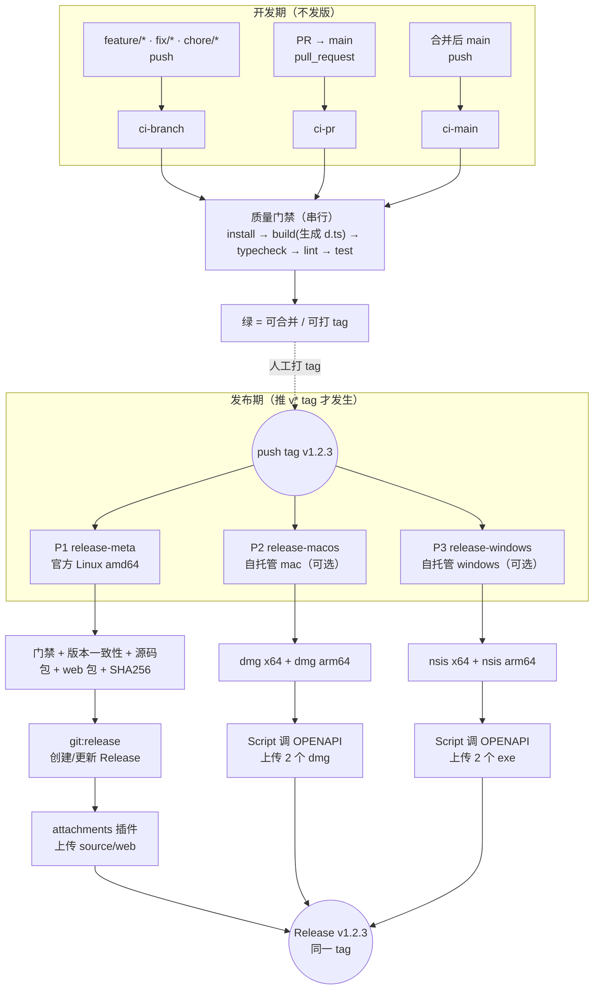
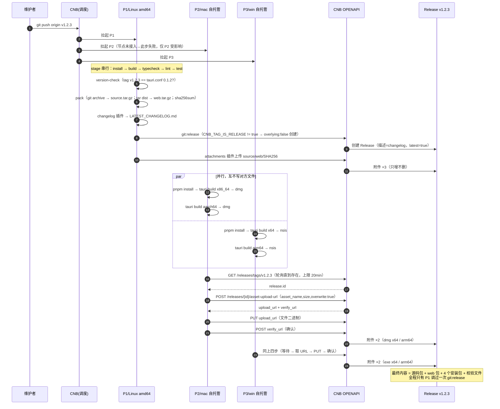

# WOCNB 分支规范 + CNB 流水线 + 制品与 Release 发布链路设计

> 版本：**v1.1 · 已冻结**（设计与实现已对齐；差异裁决见 §9.3；后续变更须走 PR 并同步修订记录）
> 作者：高见远（架构师）
> 仓库：`https://cnb.cool/jackytse/wocnb`（CNB 公网版 `cnb.cool`，默认分支 `main`）
> 目标读者：实现/维护本流水线的人
> 结论全部标注依据：`【文档】`= 官方文档明确记载；`【实测】`= 本次在本仓库/本机验证；`【推断】`= 依据文档推理但未实测；`【未验证】`= 尚无证据，必须首次接入时校准。

**修订记录**

| 版本 | 变更 |
| --- | --- |
| v1.0 | 首版设计稿（含完整 `.cnb.yml` 骨架） |
| v1.1 | 与实现对齐：①§9 改为"以 `.cnb.yml` 为权威 + 结构骨架 + 8 条差异裁决"；②镜像 `node:24`→`node:22`（更正原依据：`package.json` 无 `engines`）；③PR 校验改为 `main` 与 `$` 两个 key 并存（规避匹配对象歧义，D2）；④缓存卷类型 `copy-on-write`→`copy-on-write-read-only`（D5）；⑤预发布拆成 4 个互斥 `git:release`（D3，附判定矩阵）；⑥结案 R4/R10/R12，新增 R14；⑦附录 B 补充 6 条官方文档核对记录 |
| **v1.1（冻结·终校）** | 冻结后最后一轮修正（不再改动 §9 与任何 YAML）：①**修 §10.1 checklist 与 §13 R3 的指令冲突**（QA-R2）——原文"实测哪条命中后可按 §13 R3 删掉冗余那份"会让照做者删掉双 key 之一，直接复活 B1（PR 状态检查不上报 → 保护分支永久卡死），已改为"**保持双 key 不动，不要按命中结果删任何一份**"；②**新增 R15**（QA-R1）：`v*` 是 glob 键且优先级高于 `$` 兜底 → **分支名以 `v` 开头则该分支 push 完全不跑 CI**，处置=分支命名禁止以 `v` 开头，§2.1 约定细则同步补一条明文约束（并标注依据等级为【推导】、可用 `v-test` 分支实测确认）；③§3.2 补记**首次发版决策：直接打 `v0.1.0`，不走 `-rc` 隔离**，失败只走「重新构建」；④按工程师复核意见**拆开"changelog 为空"与"changelog 是全量历史"两种产物**：R11 收窄为"空/缺失（已兜底、有护栏）"，新增 **R16** 记"全量历史（`[ ! -s ]` 放行、无护栏、未验证）"，§11 第 8 行与 D9 同步标注边界——避免排错时把"描述爆炸"读成"设计内行为"而放过；⑤R16 的观测点从阈值型（"> ~200 行"）改为**判定型**（出现仓库首个提交 / 出现 `上一个tag..HEAD` 之外的提交，两条任一命中即定性），阈值降级为粗分诊；R15 的 `v-test` 实测**排到 `v0.1.0` 发布之后**，首发前不引入额外变量 |
①D2 双 key 并存**批准执行**，补入"代价不对称"论证与"故意的冗余、不得合并"约束；②R14 改为**已评估、接受风险**（保持 `node:22`）；③按"设计稿不复述 `cat .cnb.yml` 就能看到的内容"尺度自检，砍掉 §9.1 的字面命令与 §11 的重复代码块（契约改为 4 条行为约定）；④文档**冻结**，后续变更必须走 PR 并同步修订本表；⑤冻结后补记 **D9**（`ensure-changelog` 兜底，修的正是 §9.2 里"changelog 可能为空"这个被设计稿低估的风险），D2/R3 状态改为"已实现并校验"；⑥**更正 §3.3 的重试建议**：原写"删 tag 重打"，实际应优先用「重新构建」（幂等、走 `update` 分支、不脏 changelog 基线），且明确"一次性 tag 做 dry run 不可行"（会被 `version-check` 卡死）；⑦QA 复核发现的三处"设计稿 vs 实现"不一致已清：附录 A 速查图的 `node:24`→`node:22`、`wait-release` 独立 stage→`upload（内含轮询）`、补入 `ensure-changelog`；并把 D1 里"建议收紧 node tag"改为"已评估不做"（与 R14 一致）。保留在修订记录与 D1「设计稿」列的 `node:24` 属**历史记录**，非残留 |

---

## 1. 背景与约束

### 1.1 项目现状（事实）

| 项 | 值 | 来源 |
| --- | --- | --- |
| 产品 | WOCNB —— CNB.cool 的 macOS / Windows 桌面客户端 | README |
| 技术栈 | Vue 3 + Vite 8 + Nuxt UI v4 + Tailwind 4 + vue-router 5 + vue-i18n 11 + **Tauri 2** | `package.json` |
| 包管理 | pnpm（`packageManager: pnpm@12.14.0`） | `package.json` |
| npm scripts | `dev` / `tauri` / `build`(vite build) / `preview` / `lint`(eslint src) / `typecheck`(vue-tsc) / `test`(vitest run) | `package.json` |
| 版本号 | `src-tauri/tauri.conf.json` → `version: 0.1.0`（**Tauri 以它为准**，未设置时才回落到 `Cargo.toml` 的 `package.version`） | 【文档】v2.tauri.app/reference/cli、/distribute |
| bundle 配置 | `active: true`、`targets: "app"` | `src-tauri/tauri.conf.json` |
| CI 现状 | 仅有 `.github/workflows/ci.yml`（GitHub Actions，本平台不生效）；**无 `.cnb.yml`** | 【实测】`ls -a` |
| 历史 | 只有 1 个提交 `3855ae1 init project.`，**无 tag**，几乎无历史可 diff | 【实测】`git log` |

本次实测补齐的质量门禁基线（macOS / Node 22.22 / pnpm 12.14 / rustc 1.99）：

| 命令 | 结果 | 本地耗时 |
| --- | --- | --- |
| `pnpm build` | ✅ 通过，同时**生成** `auto-imports.d.ts`、`components.d.ts`、`src/route-map.d.ts` 与 `dist/` | 2.1s |
| `pnpm typecheck` | ✅ 0 error（**前提是上一步已生成 d.ts**，见 1.3 陷阱 A） | 19s |
| `pnpm lint` | ✅ 0 error（仅 warning） | 8.6s |
| `pnpm test` | ✅ 14 files / 181 passed | 8.5s |

### 1.2 硬约束：官方构建节点没有 macOS / Windows（决定整个架构）

| tags | 架构 | 说明 |
| --- | --- | --- |
| `cnb:arch:amd64` | amd64 | Linux 容器，1~64 核，默认 8 核 |
| `cnb:arch:arm64:v8` | arm64/v8 | Linux 容器，1~16 核 |
| `cnb:arch:amd64:gpu(:L40)` | amd64 | GPU 节点 |

【文档】docs.cnb.build/zh/build/build-node.html《构建节点 · 可用节点》

**影响：Tauri 打 macOS `.dmg` 需要 Xcode 工具链、打 Windows `.exe/.msi` 需要 MSVC，官方 Linux 节点两者都没有 → 桌面安装包必须跑在「根组织自托管 Runner」（Mac / Windows 构建机）上。**

自托管 Runner 的官方限制【文档】同上「限制」节，全部直接影响本设计：

1. 支持 Mac / Windows / Linux 构建机；**Linux 自托管机仅支持 arm64，不接受 x86_64**。
2. 新接入节点默认「离线」，需在构建机上执行「连接指引」脚本后转「在线」。
3. **默认不开 Docker，脚本直接跑在宿主机** → `runner.cpus` 无效、`pipeline.docker.image` 不生效、`docker.volumes` 不生效、OverlayFS 秒级克隆降级为普通 clone。
4. 节点离线/被禁用/资源达上限时，平台会尝试重分配其它可用节点；**始终没有可用节点则流水线失败**。
5. Windows 自托管机上的 stage 脚本**默认走 PowerShell**（官方示例用 `cmd /c ver` 才能查系统版本）。
6. 自托管 Runner 仅限「云原生构建」，不能用于「云原生开发」。

### 1.3 三个必须绕开的坑

**陷阱 A：`typecheck` 单独跑会失败（本次实测推翻了原假设）**

`tsconfig.app.json` 的 `include` 里显式列了 `auto-imports.d.ts`、`components.d.ts`，而这两个文件（以及 `src/route-map.d.ts`）被 `.gitignore` 忽略、由 Vite 插件在 `build`/`dev` 时生成。在干净克隆的仓库里直接跑 `pnpm typecheck`：

```
src/pages/login.vue(25,15): error TS2304: Cannot find name 'useToast'.
src/composables/useDashboard.ts(12,3): error TS2552: Cannot find name 'defineShortcuts'.
... 共 11 处
```

【实测】删掉三个生成物后 `pnpm typecheck` 报 11 个 TS2304/TS2552；`pnpm build` 后三个文件全部重建，`typecheck` 恢复 0 error。

→ **CI 中 `build` 必须排在 `typecheck` 之前**（详见 §5.2、§8 注释）。这与「typecheck → lint → test → build」的直觉顺序相反，但直觉顺序在干净克隆上根本跑不绿。

**陷阱 B：`dev` 与 `build` 并发会写坏生成物（TS1128）**

三个 `*.d.ts` 是同一批插件的输出，dev server 与 build 同时写会产出语法损坏文件。→ CI 里**只跑 `build`，绝不起 dev server**，且门禁步骤**严格串行**（不要用 `jobs:` 的对象形式，对象形式=并行）。

**陷阱 C：不能依赖「上个 tag 的 diff」**

仓库只有 1 个提交、0 个 tag。→ changelog 必须允许「首个版本无历史可对比」；任何「增量发布」假设都要去掉。

### 1.4 用户需求（不可收窄）

1. 可执行的分支规范（类型 / 命名 / 从哪切 / 往哪合 / 保护规则 / PR 要求 / tag 规范）。
2. 提交代码后**自动构建**。
3. 制品：**源码包**、**macOS 安装包（x86_64 + arm64）**、**Windows 安装包（x64 + arm64）**。
4. **只有推 `v*` tag 才生成 Release**；平时 push / PR 只做 CI 校验。

---

## 2. 分支规范

### 2.1 分支模型（主干 + 短生命周期分支）

| 分支类型 | 命名规则 | 从哪切 | 合并目标 | 生命周期 | 保护规则 | 触发哪条流水线（`.cnb.yml` 一级 key） |
| --- | --- | --- | --- | --- | --- | --- |
| 主干 | `main` | — | — | 永久 | **强保护**（见 2.3） | `main: push`（校验）+ `main: pull_request`（PR 校验） |
| 功能 | `feat/<slug>` 或 `feature/<slug>` | `main` | `main`（PR，Squash） | ≤ 7 天，合并即删 | 不保护 | `$: push`（校验） |
| 修复 | `fix/<slug>` | `main` | `main`（PR，Squash） | ≤ 7 天 | 不保护 | `$: push` |
| 杂务 | `chore/<slug>`、`refactor/<slug>`、`docs/<slug>`、`test/<slug>`、`ci/<slug>` | `main` | `main`（PR） | ≤ 7 天 | 不保护 | `$: push` |
| 紧急修复 | `hotfix/<slug>` | `main`（或出问题的 tag） | `main`（PR）→ 再打 patch tag | ≤ 2 天 | 不保护 | `$: push` |
| 预发布/维护（可选，暂不启用） | `release/<major>.<minor>` | `main` | `main` | 视维护窗口 | 建议与 `main` 同级保护 | `$: push`（或新增 `release/**` key） |

约定细则：

- **`<slug>` 用小写 kebab-case**，如 `feat/tray-menu-i18n`，禁止中文/空格/下划线。
- 分支名只允许 `[a-z0-9._-]` 与单个 `/`；**不要用多级斜杠**（`feat/a/b`）——`glob` 的 `*` 不跨 `/`，多级要写 `**`，容易踩坑。`$` 兜底可覆盖任意分支名，所以即使出现多级斜杠也不会漏跑。
- ⚠️ **分支名禁止以 `v` 开头**（如 `v2-feature`）。原因：`.cnb.yml` 顶层已有 `v*:` 键（只挂 `tag_push`），而 glob 优先级高于 `$` 兜底 —— 以 `v` 开头的分支 push 会命中 `v*` 这个 key 从而**完全不跑 CI**，且不会回落 `$: push`。现象是"提交后什么都没发生"，与"自动触发没开"无法从界面上区分。详见 §13 R15（**推导结论，未实测**，可用 `v-test` 分支一次 push 验证）。
- 直接推 `main` 只允许仓库管理员（保护规则强制）；日常开发一律 PR。
- 合并方式：主干建议**只允许 Squash**（历史线性、便于 changelog 收敛），PR 标题即最终 commit message，因此**PR 标题必须符合 Conventional Commits**（见 2.4）。

> 【文档】`glob` 规则：`*` 不跨 `/`，`**` 跨 `/`；匹配优先级「先 glob，后 `$` 兜底」；**多条 glob 同时命中会并行执行多条流水线**（docs.cnb.build/zh/build/trigger-rule.html《触发规则》）。因此本设计**只用 `main` + `$` 两个 key**，绝不写互相重叠的 glob（例如不要同时写 `**` 和 `main`，否则一次 push 会跑两条）。

### 2.2 分支 → `.cnb.yml` 映射表

| 场景 | 平台事件 | 命中的配置 | 结果 |
| --- | --- | --- | --- |
| 推 `feature/*`、`fix/*` 等 | `push` | `$: push` | 跑质量门禁，**不发版** |
| 向 `main` 提 PR / 源分支更新 | `pull_request` | `main: pull_request`（主路径）**与** `$: pull_request`（兜底，两者互斥，见 §9.3 D2） | 跑质量门禁，作为 PR 状态检查，**不发版** |
| 向非 `main` 分支提 PR | `pull_request` | `$: pull_request` | 同上 |
| PR 合并进 `main` | `push`（合并后提交） | `main: push` | 跑质量门禁，**不发版** |
| 推 `v1.2.3` tag | `tag_push`（key 匹配 **tag 名**） | `v*: tag_push` | 门禁 → 制品 → **创建/更新 Release** → 上传附件 |
| 推非 `v*` tag（如 `nightly-2026`） | `tag_push` | 无匹配（**故意不配 `$: tag_push`**） | 不触发任何流水线 |
| 删分支 | `branch.delete` | 无配置 | 不触发 |

> 【文档】`tag_push` 的 key「支持精确 Tag 名、glob 模式和 `$` 兜底」，官方示例即 `v*: tag_push`；合并类事件的 `CNB_BRANCH` 取**目标分支名**（《默认环境变量》），且《触发规则》有「PR 的**目标分支**配置了该事件流水线，触发该事件时才会有对应流水线执行」的表述 —— 两处都指向"目标分支"，但**没有一句直言"PR 的 key 就是这个目标分支名"**【推断】。因此 PR 配置**在两个 key 下各放一份**：`$` 仅在"未被 glob 匹配"时生效，`main` 与 `$` 互斥，所以任意语义下都恰好跑一次。

### 2.3 保护规则（平台侧，非 YAML）

CNB 的分支保护是**平台设置**，`.cnb.yml` 里无法声明保护规则。

仓库级入口：`仓库 → 设置 → 分支保护 → 新建保护规则`（匹配分支 `main`，可再建 `release/**`）。可勾选项【文档】docs.cnb.build 代码仓库章节 + 腾讯云 CNB 操作指南 PDF：

| 可勾选项 | 本项目取值 | 说明 |
| --- | --- | --- |
| 需要合并请求（Require pull request before merging） | **开** | 禁止本地直推被绕过 |
| 需要评审人批准（Require reviewer approval） | **开** | 至少 1 人；`main` 单人仓库阶段可临时关（见 §10 待确认） |
| 评审通过率 > 50% | 开（默认随上一项） | — |
| 至少一个仓库管理员批准 | 关 | 单人协作开销过大 |
| 需要通过状态检查（Require status checks） | **开** | 状态来自 `main: pull_request` 流水线，**这是门禁真正生效的关键**（否则门禁只是"参考"） |
| 仅允许线性历史 | 开 | 配合 Squash |
| 仅允许自动合并 | 关 | 保留人工合并 |
| 禁止创建保护分支 / 禁止推送 / 禁止强制推送 / 禁止删除分支 | **全开**（除管理员） | 防误删误改 |
| 组织级分支保护 | 视情况 | **⚠️ 一旦组织开启，组织下所有仓库的仓库级设置全部失效**【文档】——开启前必须先确认组织级规则与本节一致，否则本节的勾选项会静默失效 |

**tag 保护**：【未验证】文档中未见「Tag 保护」规则。缓解：约定只有维护者能打 `v*` tag；配合 Release 的 `latest` 标记由 CI 决定，人为误打会被 §8 的版本一致性校验拦住（tag 与 `tauri.conf.json` 不一致直接失败）。

### 2.4 提交 / PR 规范（服务于 changelog）

- 提交信息、PR 标题使用 Conventional Commits：`feat: …`、`fix: …`、`chore: …`、`refactor: …`、`docs: …`、`perf: …`、`test: …`、`ci: …`。
- 因主干只允许 Squash，**PR 标题就是 changelog 的一行**，必须写清用户可见的变化。
- changelog 由 `cnbcool/changelog` 插件基于 tag 之间的提交生成【文档】。
- 首个 `v*` tag 之前没有历史可比，changelog 可能为空或含全部历史 —— 属预期，不要为它加特判。

---

## 3. 版本与 tag 规范

### 3.1 语义

- 格式：`v<MAJOR>.<MINOR>.<PATCH>`，例 `v0.1.0`、`v1.0.0`。
- 预发布：`v<MAJOR>.<MINOR>.<PATCH>-rc.<N>` / `-beta.<N>`（如 `v0.2.0-rc.1`）。
- `MAJOR`：不兼容变更 / 大版本发布；`MINOR`：新功能；`PATCH`：修 bug。
- 0.x 阶段（现在）：`MINOR` 可含不兼容变更，`PATCH` 只修 bug。

### 3.2 一致性铁律

**tag 名去掉 `v` 必须严格等于 `src-tauri/tauri.conf.json` 的 `version`。**

理由：Tauri 以 `tauri.conf.json > version` 为产物版本（写进 `.dmg`/`.exe` 的元数据与安装目录），若 tag 是 `v0.2.0` 而配置还是 `0.1.0`，用户装到的就是 0.1.0 —— 这种「静默错版」比构建失败危险得多。

执行方式：`release-meta` 流水线里一个独立 stage `version-check`（脚本 `scripts/ci/check-version.sh`），不一致直接 fail（`exit 1`）。mac/win 流水线**不重复校验**：它们的上传依赖"Release 已存在"，而 Release 只由 `release-meta` 在校验通过后创建 —— 校验失败时 Release 不存在，原生流水线会在等待超时后失败（`allowFailure`），不会把错版安装包发出去。这是刻意设计，不是遗漏。

### 3.3 打 tag 的时机与方式

```bash
# 1) 确认 main 最新提交已通过 CI
git switch main && git pull --ff-only
# 2) 改版本（PR 走一遍 CI）
#    src-tauri/tauri.conf.json  version -> 0.2.0
# 3) 出 PR → 评审 → 合并
# 4) 打 annotated tag 并推送（触发发布）
git tag -a v0.2.0 -m "WOCNB v0.2.0"
git push origin v0.2.0
```

- **tag 必须打在 `main` 的提交上**（`hotfix` 例外：打在其 PR 合并后的 `main` 提交上）。
- **tag 名必须与 tag 所指 commit 里的 `tauri.conf.json.version` 严格相等**（`version-check` stage 强制）。这条约束决定了"无法用一次性 tag 做 dry run"：假设 conf 是 `0.1.0`，`v0.1.0-rc.0` / `v0.0.1-ci-test` 都会在 `version-check` 这一步红，Release 根本不会被创建，`git:release` / changelog / attachments 三个真正想验的东西**一个都跑不到**。要用预发布 tag 试跑，必须**先把 conf 改成 `0.1.0-rc.1` 并合入 main** 再打 tag。
- **首次发版的决策：直接打 `v0.1.0`（不走 `-rc` 隔离）**。理由与上一条同源：`conf` 当前就是 `0.1.0`，打 `v0.1.0` 一次即可全链路通过（含 `release-create`→`upload-meta`）；改 `conf` 换 rc"演练"要额外一次 PR + 一次 tag，而演练能证伪的东西（options 解析、changelog 生成、附件上传）在正式这一次里同样会暴露，且**失败可原地重试**（见下条），没有"演练能提前发现、正式发就发现不了"的增量信息。因此首个 Release 若失败，处置只有一条：修好后点「重新构建」，**不要删 tag 重打、更不要改 conf 追一个 rc**。

**发布失败如何重试（按代价从低到高，别跳级）**：

1. **首选：点构建页的「重新构建」**。它重跑当前构建、不改 git、不动 tag，且**天然幂等**——两个分支都覆盖了：失败在 `release-create` 之前（门禁/版本/pack）→ Release 不存在 → 重跑仍走 `create`；失败在之后（changelog/upload）→ Release 已存在 → 重跑自动走 `update`（`overlying: true`，**只更新字段、不删附件**）。
2. **次选：`git push --delete origin v0.2.0` 后重打**。仅当**必须换 commit**（产物本身有问题）时才用，代价是 changelog 基线会脏——`cnbcool/changelog` 按「当前 tag vs 上一个 tag」算区间，删掉再重打会让相邻版本的区间错位。
3. **禁止：`git tag -f` 后强推移动已发布 tag**。用户已下载的产物会对不上 tag 指向。

---

## 4. 流水线总体架构

### 4.1 三条流水线族



### 4.2 为什么是「1 + 2」三条发布流水线（而不是一条）

- Pipeline 的 `runner` 是 **pipeline 级**配置，一条 pipeline 只能落在一种节点上；mac / win / Linux 必须分属不同的 pipeline。
- 三条 pipeline 由**同一个 `tag_push` 事件**并行拉起（同一次"构建"），共享同一个 Release 作为制品汇聚点。
- Linux 一条承担"权威创建者 + 门禁 + 源码类制品"，mac / win 两条只做"原生构建 + 上传"，职责单一，失败边界清晰。

### 4.3 发布时序（含并发安全）



### 4.4 制品汇聚与"谁都不许删"原则

**唯一权威规则：`git:release` 在整个仓库里只允许出现在 P1，且最多执行一次；其它任何地方只能"上传附件"。**

`git:release` 的 `overlying` 默认 `false` = **先删后建**，会把该 Release 已有附件全部清空【文档】internal-steps/git/release.html。三条 pipeline 并发时，任何一条在别人上传后执行"先删后建"，都会造成附件随机丢失 —— 这正是本设计要规避的核心风险。详见 §7。

---

## 5. 各流水线详解

### 5.1 `ci-branch` / `ci-pr` / `ci-main`（校验线，P0）

| 项 | 内容 |
| --- | --- |
| 触发 | `main: push` / `main: pull_request` / `$: push` / `$: pull_request`（PR 两个 key 并存，原因见 §9.3 D2） |
| runner | 官方节点 `tags: cnb:arch:amd64`，`docker.image: node:22`（理由见 §9.3 D1） |
| stages（**串行**） | `install` → `build` → `typecheck` → `lint` → `test` |
| 缓存 | pnpm store + `/root/.cache` 两个卷；PR/分支用 `copy-on-write-read-only`（官方标注适用「PR 场景」：只读、变更结束后丢弃），主干/发布用 `read-write` |
| 预期耗时 | 冷缓存 ~2.5~3.5 min（install 60~120s + 门禁 40s）；热缓存 ~60~80s |
| 失败边界 | 任一 stage 失败即该 pipeline 红 → 阻止合并（保护分支勾了「需要通过状态检查」时） |

### 5.2 门禁顺序为什么是 `build` 在前（关键更正）

```
install → build(生成 d.ts + 产出 dist) → typecheck → lint → test
```

- `build` 排第一**不是**为了产物，而是为了**生成 `auto-imports.d.ts` / `components.d.ts` / `src/route-map.d.ts`**（见 §1.3 陷阱 A，【实测】11 个 TS2304）。
- 仍满足"必须串行"的硬约束：5 个 stage 顺序执行，`jobs` 用**数组**（串行）而非对象（并行）；任何一个 stage 失败即终止，不会出现两进程并发写同一批 `*.d.ts`。
- **不得**在任何 stage 里执行 `pnpm dev` / `pnpm tauri dev`。
- `pnpm lint` 当前有 2 个 warning，**不要**加 `--max-warnings 0`，否则门禁立刻红。
- `pnpm build` 只有 2s，重复一次成本可忽略；若后续 build 变慢，可把它拆成 `gen-types`（生成声明）与 `build`（产物）两步，但不建议现在做。

### 5.3 `ci-pr` 的两个"不要"

1. **不要加 `ifModify: ["**", "!(**/*.md)"]` 之类的跳过规则。** 文档变更的 PR 若流水线被整体跳过，"状态检查"永远不会上报，保护分支会永久卡住该 PR。
2. **不要在 PR 线上做任何写操作**（不建 Release、不写 store 缓存）。PR 属「不可信事件」，`CNB_TOKEN` 权限受限且限定当前仓库【文档】。

### 5.4 `release-meta`（发布元数据 + 源码类制品，P0）

| 项 | 内容 |
| --- | --- |
| 触发 | `v*: tag_push` |
| runner | 官方 `cnb:arch:amd64`（可用 Docker → 能用 `cnbcool/*` 插件） |
| stages（串行） | `install` → `build` → `typecheck` → `lint` → `test` → `version-check` → `pack` → `changelog` → **`release-create` / `release-create-prerelease` / `release-update` / `release-update-prerelease`（四条互斥，见 §9.2）** → `upload-meta` |
| 产物 | `wocnb-<ver>-source.tar.gz`、`wocnb-<ver>-web.tar.gz`、`SHA256SUMS-meta.txt` |
| 预期耗时 | ~2.5~4 min |
| 失败边界 | 门禁/版本不一致 → **不建 Release**（下游 mac/win 因等不到 Release 而失败但不红整体，见 §6.3）→ Release 不存在，符合"坏提交不发布" |

四条 `git:release` 的判定是**两个维度**的组合（完整 YAML 见 §9.2）：

- 维度一「是否已有 Release」用内置变量 `CNB_TAG_IS_RELEASE`：`!= "true"` → `overlying: false`（首次创建）；`== "true"` → `overlying: true`（**只更新，不删附件**，解决重建/重试时附件被清空）。
- 维度二「是否预发布」用 **tag 名是否含 `-`**（`v1.2.3-rc.1` 含 `-`）。**不能用 `CNB_TAG_IS_PRE_RELEASE`**：它的取值规则要求"已存在对应 Release"，首次创建 rc 时恒为 `false`，会把 rc 当正式版并抢走 `latest`。

### 5.5 `release-macos`（原生 dmg，P1，可关断）

| 项 | 内容 |
| --- | --- |
| 触发 | `v*: tag_push` |
| runner | `namespace: group`（根组织自托管）+ `tags: [mac, arm64]` |
| 环境 | **宿主机直跑**：无 Docker、`docker.image` 无效、`cpus` 无效 |
| stages（串行） | `install` → `build-x64`（dmg）→ `build-arm64`（dmg）→ `checksums` → `upload`（upload 内部先轮询等 Release 出现，再直传） |
| 产物 | `wocnb-<ver>-macos-x64.dmg`、`wocnb-<ver>-macos-arm64.dmg`、`SHA256SUMS-macos.txt` |
| 预期耗时 | 首次（冷 target）：20~35 min；热缓存：6~10 min |
| 降级 | `allowFailure: true`（节点临时离线不红整体）+ 未接入期直接注释整段（见 §6） |

### 5.6 `release-windows`（原生 nsis，P1，可关断）

| 项 | 内容 |
| --- | --- |
| 触发 | `v*: tag_push` |
| runner | `namespace: group` + `tags: [windows, x64]` |
| 环境 | PowerShell（**不是 bash**），无 Docker |
| stages（串行） | `install` → `build-x64` → `build-arm64` → `checksums` → `upload`（同 mac） |
| 产物 | `wocnb-<ver>-windows-x64-setup.exe`、`wocnb-<ver>-windows-arm64-setup.exe`、`SHA256SUMS-windows.txt` |
| 预期耗时 | 首次 25~40 min；热缓存 8~12 min |
| 降级 | 同 mac |

### 5.7 失败边界矩阵（重要：讲清"看起来降级、实际整体失败"的坑）

| 场景 | P1 release-meta | P2 mac | P3 win | 整体构建状态 | Release 内容 |
| --- | --- | --- | --- | --- | --- |
| 正常（节点已接入） | 成功 | 成功 | 成功 | 绿 | 源码+web+4 安装包+3 校验文件 |
| **节点未接入且未注释**（现状） | 成功 | **分配失败** | **分配失败** | **取决于 `allowFailure` 是否覆盖"节点分配失败"【未验证】** | 源码+web（发布仍可用） |
| 节点未接入 + **注释掉 P2/P3**（推荐现状做法） | 成功 | 不存在 | 不存在 | **必绿**（确定性） | 源码+web |
| 门禁失败 | 失败 | 构建成功后等不到 Release → 超时失败 | 同左 | P1 红（构建红是**期望行为**） | **不创建** |
| 版本不一致 | 失败 | 超时失败 | 超时失败 | 红 | 不创建 |
| mac 构建失败（如缺 Xcode） | 成功 | 失败 | 成功 | 绿（`allowFailure`） | 源码+web+win 安装包 |
| 上传 API 失败 | 成功 | 失败 | 成功 | 绿 | 缺 mac 包 |

> 上表第 2 行是**必须明确告知用户的灰色地带**：`allowFailure` 的语义是"失败状态不上报"【文档】，但"分配不到节点"发生在任务真正执行之前，是否同样被 `allowFailure` 吞掉**文档未说明、本次无法验证【未验证】**。因此**未接入期的默认交付形态是"注释掉 P2/P3"**，它是 100% 确定的降级；`allowFailure: true` 是接入之后"节点临时离线"的兜底。

---

## 6. 自托管节点未接入时的降级方案（设计难题 2）

### 6.1 结论

**做法：把 P2/P3 两条 pipeline 作为 `v*: tag_push` 列表的第 2、3 项直接写在同一个 `.cnb.yml` 里；未接入节点期间它们被注释掉（或整段删除）；接入后取消注释即自动生效。**

被否掉的两个做法及原因：

| 方案 | 为什么不选 |
| --- | --- |
| 只靠 `allowFailure: true` | 见 §5.7 第 2 行：**"分配不到节点"能否被 `allowFailure` 覆盖未经验证**，存在"看起来降级、实际整体红灯"的风险；而且每次 tag 都会向不存在的节点发起一轮调度尝试，日志噪音大 |
| 用 `if:` / `ifModify` 在 stage 里做开关 | **无效**：节点分配发生在 job 执行之前，`if`/`ifModify` 最多让 stage 跳过，但节点已在 Prepare 阶段被要求过；`ifModify` 还会因为"本次 tag 未改 `src-tauri/**`"而误跳过本该发布的构建 |
| 拆成 `include` 的独立文件，注释 `include` 行 | 可行，但引入 `include` 合并语义（数组追加/对象合并/本地覆盖）这层不必要的不确定性【文档】；单文件注释更直观、零风险 |

### 6.2 开关形式（已落地在 `.cnb.yml` 顶部与文件末尾）

```yaml
# 【开关】自托管 Runner 是否已接入：
#   未接入（当前状态）→ P2 / P3 以注释块形式存在于文件末尾，不参与 YAML 解析，推 v* tag 必定绿
#   已接入            → 从「↓↓↓ 取消注释从这里开始 ↓↓↓」标记行到文件末尾，
#                       把所有行行首的一个「# 」去掉（说明文字写成「# # …」双重注释，
#                       取消一层后变成普通 YAML 注释，不会破坏解析）
```

> 工艺要点（实现阶段补充，已机械验证）：**用 `# #` 做双重注释**，取消一层注释后说明文字仍以 `#` 开头，所以"整体去掉一个 `# `"这个动作不会因为把中文说明放开而让 YAML 崩掉。这比"整段删除"和"手工挑行取消注释"都可靠。

### 6.3 降级期的语义

- 降级期推 `v*`：产出**源码包 + web 包 + Release**，完全满足"自动构建 / 生成源码制品 / 生成 Release"三项需求；只缺 4 个安装包。
- 降级期不要把手动构建的安装包"补传"进同一个 Release 后忘记（可以补，但要有记录；`overwrite: true` 的同名覆盖是安全的）。
- 接入节点后**回填**历史 Release：重新推送同一 tag 会被拒绝（tag 已存在），正确做法是建一个 `web_trigger` 手动事件（Phase 2 可选）或用「重新构建」重跑该次构建【推断】。

---

## 7. Release 编排（设计难题 1：并发不互相覆盖）

### 7.1 职责划分

| 动作 | 谁做 | 机制 | 为什么 |
| --- | --- | --- | --- |
| 创建 Release（标题/描述/latest/预发布） | **只有 P1** | `type: git:release` | 平台内置、免 Token、能直接吃 changelog 文件 |
| 更新 Release（重试/重发场景） | **只有 P1** | `git:release` + `overlying: true` | 只更新字段，不删附件 |
| 上传 Linux 侧附件 | P1 | `cnbcool/attachments` 插件 | Linux 有 Docker，插件可用 |
| 上传原生附件 | P2 / P3 | 直接调 OPENAPI（`asset-upload-url` → PUT → 确认） | 自托管机无 Docker，**插件任务大概率跑不起来**（见 7.4） |
| 删除 Release / 删除附件 | **没有任何 pipeline 做** | — | 删除是人工操作 |

### 7.2 时序与并发安全（三条硬规则）

1. **`git:release` 只出现在 P1 的 4 个互斥 job 里**（`release-create` / `release-create-prerelease` / `release-update` / `release-update-prerelease`，见 §9.2 判定矩阵，任一时刻恰好一个执行）。
   → 只要 P1 不在附件上传后执行 `overlying: false`，就没有任何东西能清空附件。
2. **P1 的 `git:release` 一定早于 P2/P3 的第一次上传。**
   保证方式：P2/P3 上传前先 `GET /{repo}/-/releases/tags/{tag}` **轮询**，只有拿到 `id` 才继续（`scripts/ci/release-upload.sh|ps1` 内置，最长等 20 min，间隔 10s）。轮询是纯 HTTP，不依赖任何平台特性（不依赖 `cnb:await`、不依赖 Docker）。
3. **附件名全局唯一**（含版本 + 平台 + 架构，见 §8.1），且上传用 `overwrite: true` → 同名覆盖是"替换自己"，不会影响他人。

> 曾考虑用 `cnb:await` / `cnb:resolve` 做时序同步（官方"多流水线协作"内置任务）。**最终不采用**：① 它只能协调同一事件的多条 pipeline，跨 Runner 是否可用【未验证】；② P1 失败时 await 方会走死锁检测抛异常，等价于失败，收益不大；③ 轮询方案不依赖任何平台内部机制，失败模式更容易理解。

### 7.3 为什么 P2/P3 不用 `git:release`（即使带 `overlying: true`）

- `overlying: true` 的官方描述是"本次仅为编辑或更新 Release"，**Release 不存在时是否会自动创建，文档没说**【未验证】。若不能创建，P2/P3 在 P1 慢一拍时就会失败；若能创建，它们就会和 P1 争抢 `latest`/描述字段，产生不确定的最终状态。
- 结论：创建职责单一化，P2/P3 只走 OPENAPI 的"上传附件"三个接口，语义最窄。

### 7.4 为什么 P2/P3 必须用 OPENAPI 直传，而不是 `cnbcool/attachments`

`cnbcool/attachments` 是**插件任务**（`image: ...` + `settings`），而 CNB 的执行模型是"Docker 容器作为构建运行时"，自托管 Runner **默认不开 Docker、`docker.image` 不生效**【文档】。据此推断插件任务在纯宿主机直跑的自托管节点上无法运行【推断，需首次接入时实测：先跑一个 `image: cnbcool/attachments` 的空任务验证】。

因此设计里 **P2/P3 完全不使用任何 `image:` 任务**，只用宿主机脚本 + curl/PowerShell 调 OPENAPI。

接口契约已按官方 swagger（`https://api.cnb.cool/swagger.json`）核对【实测】：

| 步骤 | 方法 & 路径 | 关键字段 |
| --- | --- | --- |
| 查 Release | `GET /{repo}/-/releases/tags/{tag}` | 返回含 `id`、`assets[]` |
| 取上传地址 | `POST /{repo}/-/releases/{release_id}/asset-upload-url` | 请求 `{asset_name, size, overwrite: true, ttl?}`；**201** 返回 `{upload_url, verify_url, expires_in_sec}` |
| 上传字节 | `PUT {upload_url}` | `Content-Type: application/octet-stream`，body 为文件流 |
| 确认 | `POST {verify_url}` | `verify_url` 里已含 `upload_token` / `asset_path`，无需自行拼接 |
| 下载（校验用） | `GET /{repo}/-/releases/download/{tag}/{filename}` | — |

必须带上 `Authorization: Bearer ${CNB_TOKEN}` 与 `Accept: application/vnd.cnb.api+json`。可信事件（`tag_push`）下 `CNB_TOKEN` 具备 `repo-release:rw` 权限【文档】，足够上传。

### 7.5 可选的收尾步骤（Phase 2，不建议首版做）

想产出"覆盖全部 4 个安装包的统一 `SHA256SUMS`"，需要一条 Linux 收尾流水线：等 P2/P3 完成 → 用 `cnbcool/attachments` 的 `type: DOWNLOAD` 把全部附件拉下来 → 合并校验和 → 再上传。代价是引入跨流水线同步（回到 `cnb:await` 的不确定性）与二次下载带宽。**首版用"每平台各自一份 SHA256SUMS"代替**，信息量等价。

---

## 8. 制品清单与命名

### 8.1 命名规范

`wocnb-<version>-<platform>-<arch>[-<kind>].<ext>`，version 不含 `v`。

| 制品 | 文件名 | 产出节点 | 内容 |
| --- | --- | --- | --- |
| 源码包 | `wocnb-0.1.0-source.tar.gz` | P1 | `git archive --format=tar.gz --prefix=wocnb-0.1.0/ HEAD`（含 `src-tauri`、构建脚本、`.cnb.yml`；不含 `node_modules`/`dist`/`target`） |
| Web 产物 | `wocnb-0.1.0-web.tar.gz` | P1 | `dist/` 打包（可直接给 Vercel/静态托管） |
| macOS x86_64 | `wocnb-0.1.0-macos-x64.dmg` | P2 | `--target x86_64-apple-darwin --bundles dmg` |
| macOS arm64 | `wocnb-0.1.0-macos-arm64.dmg` | P2 | `--target aarch64-apple-darwin --bundles dmg` |
| Windows x64 | `wocnb-0.1.0-windows-x64-setup.exe` | P3 | `--target x86_64-pc-windows-msvc --bundles nsis` |
| Windows arm64 | `wocnb-0.1.0-windows-arm64-setup.exe` | P3 | `--target aarch64-pc-windows-msvc --bundles nsis` |
| 校验和 | `SHA256SUMS-meta.txt` / `-macos.txt` / `-windows.txt` | 各自节点 | `sha256sum` / `Get-FileHash -Algorithm SHA256` 的 `hash  filename` 两列格式，**相对文件名** |

小写、`-` 分隔的原因：CDN/浏览器下载名保持稳定、`SHA256SUMS` 里可直接用 `sha256sum -c` 校验、避免 Tauri 默认名（`WOCNB_0.1.0_aarch64.dmg`）里的下划线与大小写混用。

### 8.2 校验方式

```bash
# 用户在 macOS/Linux
sha256sum -c SHA256SUMS-macos.txt
# 用户在 Windows PowerShell
Get-FileHash .\wocnb-0.1.0-windows-x64-setup.exe -Algorithm SHA256
```

Release 列表页还应给出 `SHA256SUMS-*.txt` 的下载链接，方便用户在无法执行校验命令时肉眼比对。

### 8.3 产物路径（Tauri 实际输出位置，写脚本时按此取文件）

| 平台 | 路径 |
| --- | --- |
| macOS 交叉 | `src-tauri/target/<triple>/release/bundle/dmg/*.dmg` |
| Windows 交叉 | `src-tauri\target\<triple>\release\bundle\nsis\*-setup.exe` |
| 不指定 target（本机架构） | `src-tauri/target/release/bundle/...` |

`--target` 与 `--bundles` 的语义与输出目录【文档】v2.tauri.app/reference/cli、/distribute/windows-installer。

---

## 9. `.cnb.yml` 目标骨架（以仓库实现文件为准）

> **权威来源 = 仓库根目录的 `.cnb.yml`**（工程师实现，已通过 pyyaml 解析验证，逐段与本设计核对）。
> 首版设计稿在本节的完整骨架已与实现合并落盘为该文件。为**避免"文档里的骨架"和"仓库里的真实配置"长出两份真相**，本节只保留四样东西：结构骨架（9.1）、最易错片段的完整 YAML（9.2）、设计稿 ↔ 实现的差异裁决（9.3）、逐段依据与风险标注（9.4）。逐行细节以 `.cnb.yml` 为准，该文件内的注释已按本节结构逐段标注依据。

### 9.1 结构骨架

| 一级 key | 二级事件 | 流水线名 | runner | stages（严格串行，`jobs` 全用数组） | 产出 |
| --- | --- | --- | --- | --- | --- |
| `main` | `push` | `ci-main` | 官方 `cnb:arch:amd64` · `node:22` | install → build-generate → typecheck → lint → test | 无（门禁） |
| `main` | `pull_request` | `ci-pr` | 同上（缓存 `copy-on-write-read-only`） | 同上 | 无（**PR 状态检查**） |
| `$` | `push` | `ci-branch` | 同上（`copy-on-write-read-only`） | 同上 | 无（门禁） |
| `$` | `pull_request` | `ci-pr` | 同上 | 同上 | 无（非 `main` 目标分支 PR 的兜底） |
| `v*` | `tag_push` | `release-meta` | 官方 `cnb:arch:amd64` · `node:22` | install → build-generate → typecheck → lint → test → version-check → pack → changelog → **release-create / release-create-prerelease / release-update / release-update-prerelease（四选一）** → upload-meta | 源码包 + web 包 + `SHA256SUMS-meta.txt` + **唯一** Release |
| `v*` | `tag_push` | `release-macos`（**当前整段注释**） | `namespace: group` + `tags: [mac, arm64]` | install → build-x64 → build-arm64 → checksums → upload | `dmg×2` + `SHA256SUMS-macos.txt` |
| `v*` | `tag_push` | `release-windows`（**当前整段注释**） | `namespace: group` + `tags: [windows, x64]` | 同构（脚本为 PowerShell） | `exe×2` + `SHA256SUMS-windows.txt` |

三条通用约定（每条 pipeline 都遵守，**字面内容见 `.cnb.yml`，此处只记"为什么"**）：

- `env` 里的 `COREPACK_*` 两个变量是为了让 corepack 在 CI 里**不弹交互确认**（否则会静默卡到超时），并把 pnpm 版本缓存挂进 `/root/.cache`。
- `install` 的 corepack 兜底是为了**让"环境问题"和"代码问题"在日志上可分**：镜像裁剪/签名校验失败不该表现为门禁红。
- 所有 script 首行 `set -euo pipefail`（Windows 段 `$ErrorActionPreference = 'Stop'`），保证多行脚本**首条失败即中断**，不会"跑完最后一行才算成功"。

### 9.2 最易错片段的完整 YAML：四个互斥的 `git:release`

这是整个仓库唯一会出现 `git:release` 的地方，四条互斥执行（`if` 退出码 0 才执行）。`title` 一律不写 → 默认取 tag 名（更干净，同时不再依赖 `options` 变量替换行为）。

```yaml
# release-meta 的末尾 4 个 stage（数组 = 串行；四条中恰好一条真正执行）
- name: release-create
  type: git:release
  if: |
    if [ "${CNB_TAG_IS_RELEASE}" = "true" ]; then exit 1; fi
    case "${CNB_BRANCH}" in *-*) exit 1 ;; esac
    exit 0
  options:
    descriptionFromFile: LATEST_CHANGELOG.md
    preRelease: false
    latest: "true"
    overlying: false

- name: release-create-prerelease
  type: git:release
  if: |
    if [ "${CNB_TAG_IS_RELEASE}" = "true" ]; then exit 1; fi
    case "${CNB_BRANCH}" in *-*) exit 0 ;; esac
    exit 1
  options:
    descriptionFromFile: LATEST_CHANGELOG.md
    preRelease: true
    latest: "false"
    overlying: false

- name: release-update
  type: git:release
  if: |
    if [ "${CNB_TAG_IS_RELEASE}" != "true" ]; then exit 1; fi
    case "${CNB_BRANCH}" in *-*) exit 1 ;; esac
    exit 0
  options:
    descriptionFromFile: LATEST_CHANGELOG.md
    preRelease: false
    latest: "true"
    overlying: true

- name: release-update-prerelease
  type: git:release
  if: |
    if [ "${CNB_TAG_IS_RELEASE}" != "true" ]; then exit 1; fi
    case "${CNB_BRANCH}" in *-*) exit 0 ;; esac
    exit 1
  options:
    descriptionFromFile: LATEST_CHANGELOG.md
    preRelease: true
    latest: "false"
    overlying: true
```

判定矩阵（这就是"为什么必须看 tag 名而不是 `CNB_TAG_IS_PRE_RELEASE`"）：

| tag | `CNB_TAG_IS_RELEASE` | 含 `-` | 命中的 job | 效果 |
| --- | --- | --- | --- | --- |
| `v1.2.3`（首次） | `false` | 否 | `release-create` | `overlying:false` 创建，`latest:true` |
| `v1.2.3`（重发） | `true` | 否 | `release-update` | `overlying:true` 只更新，**附件不丢** |
| `v1.2.3-rc.1`（首次） | `false` | 是 | `release-create-prerelease` | 创建，`preRelease:true`、`latest:false` |
| `v1.2.3-rc.1`（重发） | `true` | 是 | `release-update-prerelease` | 只更新，不动 `latest` |

> ⚠️ **不能用 `CNB_TAG_IS_PRE_RELEASE` 判"是否预发布"**：官方取值规则是「分支为 Tag、**存在对应的 Release**、且为预发布 → true」。首次创建 rc tag 时 Release 还不存在，该变量恒为 `false`，会把 rc 当成正式版（还会抢 `latest`）。这是实现阶段发现的、设计稿原本没有的坑。

### 9.3 设计稿 ↔ 实现的差异与裁决（9 条，全部已收敛）

> 表内每一条都是"设计稿写错了 / 漏了 / 与实现不同"的地方，**不是变更记录**——写在这里是为了让后人知道"为什么现在长这样"，避免把有意为之的设计当成错误改回去。

| # | 项 | 设计稿 | 实现 | 裁决与理由 |
| --- | --- | --- | --- | --- |
| D1 | 构建镜像 | `node:24`（依据写的是"与 `package.json` 的 engines 一致"） | `node:22` | **采纳实现**。设计稿的依据本身就是错的：`package.json` **没有 `engines` 字段**（已核对）。Vite 8 要求 Node ≥ 20.19 / ≥ 22.12，`node:22` 满足；且与本地实测环境（Node 22.22.2 / pnpm 12.14.0）一致，问题复现性强。**是否进一步收紧为 `node:22-bookworm` / `node:22.22`：已评估并决定不做**，理由见 §13 R14 |
| D2 | PR 校验挂哪个 key | `main: pull_request` | 原为仅 `$: pull_request` → **已按批准改为双 key + 锚点** | **裁决：两者并存（已批准、已实现、已校验）**。原实现的理由"挂 `$` 无论目标分支是什么都能命中"**不成立**：官方《触发规则》明确「先 glob 匹配，**只有前一阶段未匹配**才进入 `$` 兜底」，而 `main:` 这个 glob key 已经存在（供 `push` 用），PR 指向 `main` 时分支名已被 glob 命中，`$` 很可能不再参与 → **PR 到 main 拿不到任何流水线、状态检查永不上报、保护分支永久卡住合并**。官方另有一句「PR 的**目标分支**配置了该事件流水线，触发该事件时才会有对应流水线执行」，也指向"目标分支 = 匹配对象"。**关键论证**：这不是"猜对了某一种语义"，而是**用两条配置同时覆盖两种可能的语义** —— 若语义是目标分支→命中 `main`；若语义是源分支→命中 `$`；而 `$` 与 glob 严格互斥，所以**任何语义下都恰好跑一次**，没有双跑风险。**代价不对称**：挂错最多多跑一条流水线（噪音 + 少量算力）；挂漏是"状态检查永不上报 → 保护分支卡死合并"，且只在第一个 PR 上线时才暴露。因此这份冗余是**有意为之的不优雅**，后人不得当冗余代码优化掉（`.cnb.yml` 与 `docs/BRANCHING.md` 内均已加注"两处 ci-pr 是同一份配置的双挂，不要合并"）。**实现方式**：`main.pull_request` 上定义锚点 `&ci-pr`，`$.pull_request` 用 `*ci-pr` 一行复用；已用 pyyaml 校验 `main.pull_request[0] is $.pull_request[0] == True`。若平台解析器不认同文件锚点，退化方式是把锚点展开成两份相同内容（`.cnb.yml` 注释里已写明该退化步骤） |
| D3 | 预发布 | 首版只做正式版，预发布"启用时再拆" | 提前拆成 4 个互斥 job | **采纳实现**（理由见 §9.2：`CNB_TAG_IS_PRE_RELEASE` 不能用于首次判定）。设计稿的风险项 R12 相应结案 |
| D4 | Release 标题 | `title: WOCNB ${CNB_BRANCH}` | 不写 `title`（默认取 tag 名） | **采纳实现**。附带更正设计稿的风险 R4：官方《环境变量》「支持变量替换的属性」列表**明确包含内置任务 `options`**，所以 `${CNB_BRANCH}` 在 `options` 里可用，R4 可结案；但不写标题更干净，保留默认值 |
| D5 | PR/分支缓存卷类型 | `copy-on-write` | `copy-on-write-read-only` | **采纳实现**。官方数据卷类型表：`copy-on-write` = 读写、**变更在流水线成功后合并**（适合主干，非 PR！）；`copy-on-write-read-only` = 只读、**变更在流水线结束后丢弃**，官方标注适用场景正是「PR 场景」。设计稿此处选型错误，已更正 |
| D6 | pnpm 获取方式 | `corepack enable \|\| true` | `corepack enable \|\| npm i -g pnpm@12.14.0` + `pnpm -v` 二次校验 + `COREPACK_*` 环境变量 | **采纳实现**（新增的稳定性防御，设计稿漏了）。**已与 P0 对齐**：P2/P3 起初只写裸 `corepack enable`，现已补齐同等兜底；Windows 段因 PS 5.1 无 `&&`，改写为 `if ($LASTEXITCODE) { ... }` 的形式。两端写法一致 → 排错时不会把环境问题误判成平台问题 |
| D7 | 脚本切分 | `pack-meta.sh` 一个脚本干完 | `package-source.sh`（只打源码包+校验和，可独立跑）+ `pack-meta.sh`（Release 三件套，调前者）+ `collect-artifacts.sh`（通用收集/重命名，`collect-macos.sh` 是薄封装） | **采纳实现**（更小的可测单元） |
| D8 | 注释块工艺 | 文字描述"整段注释" | `# #` 双重注释：取消一层后变普通 YAML 注释；`# ↓↓↓ 取消注释从这里开始 ↓↓↓` 标记起止；已机械验证"去掉行首一个 `# ` 后是合法 YAML" | **采纳实现**（工艺更严谨，`.cnb.yml` 头部已写明操作步骤） |
| D9 | changelog 为空时的兜底 | 未考虑（设计稿只写了"首个 tag 可能为空，属预期"） | 新增 `ensure-changelog` stage：`[ ! -s LATEST_CHANGELOG.md ]` 时写入一句占位描述再继续 | **采纳实现，且补上了设计稿的漏洞**：`git:release` 的 `descriptionFromFile` 指向的文件为空/不存在时，Release 创建可能直接失败 → 而 Release 创建失败 = 整条发布链路停摆（P2/P3 会等到超时）。"首个 tag 无历史可比"在设计稿里被当成"可接受的现象"，实现把它当成了"必须挡住的风险"，判断更准。**为什么必须写成独立 stage 而不是塞进 `pack`**：失败点会漂移——`descriptionFromFile` 缺文件 → `git:release` 失败 → Release 不存在 → P2/P3 的 `GET /-/releases/tags/{tag}` 轮询 20 分钟后超时失败。此时报错现场是"上传失败"，排错的人会去查网络、查 token、查 API 端点，**方向全错**；把兜底做成独立 stage 后，日志里失败点一眼可见，直接指向"变更日志为空"。**边界要说清：`[ ! -s ]` 只兜"空/缺失"，兜不了"非空但是全量历史"**——后者文件非空即被放行，属未验证路径（R16），别把两者都当"已兜底" |

遗留一处小不一致，建议工程师统一：`release-macos` / `release-windows` 的 `install` 只写了 `corepack enable`，没有 P0 那套 `|| npm i -g` 兜底。自托管机是长期存在的宿主机，corepack 通常可用，风险低；但两处不一致会让排错时误判，建议补齐（或在注释里写明"自托管机要求预装 pnpm，故不兜底"）。

### 9.4 关键段落依据与风险标注

| 段落 | 依据 | 风险 / 待校准 |
| --- | --- | --- |
| `main: push` / `main: pull_request` / `$: push` / `$: pull_request` | 【文档】触发规则：glob 优先、`$` 仅匹配未被 glob 命中的分支、多条 glob 同时命中会并行执行 | PR 匹配对象（目标分支 or 源分支）两处官方措辞指向目标分支，但无一句直言；**已用"两个 key 并存"消除该风险**（D2） |
| `runner.tags: cnb:arch:amd64` | 【文档】构建节点可用 tags | 无 |
| `docker.volumes`（`read-write` / `copy-on-write-read-only`） | 【文档】语法手册 `docker.volumes`：类型表 `read-write`(rw) / `read-only`(ro) / `copy-on-write`(cow，默认) / `copy-on-write-read-only` / `data`；**缓存仅当前节点有效、不跨节点**；**同一流水线不允许声明存在包含关系的路径**；**最多 32 个卷** | 现有两个卷（`/root/.local/share/pnpm`、`/root/.cache`）无包含关系，合规 |
| `env: COREPACK_ENABLE_DOWNLOAD_PROMPT / COREPACK_HOME` | 【文档】环境变量：`env` 可按 Pipeline / Job 声明 | 无 |
| `exports: stdout: APP_VERSION` | 【文档】环境变量「导出环境变量」：脚本任务 `Job result` 含 `code` / `stdout` / `stderr` / `info`（另有 `skip`）；`exports` 语法为 `from-key: to-key` | 无（`stdout` 是官方列明的属性）。当前 `APP_VERSION` 未被下游消费，属预留 |
| `type: git:release` × 4 + `if` + `options` | 【文档】internal-steps/git/release.html 全参数；`options` 支持变量替换 | `overlying:true` 在 Release 不存在时是否会自动创建 → **文档未说明**；本设计通过 `CNB_TAG_IS_RELEASE` 二选一**绕开了该未知**，不依赖它 |
| `image: cnbcool/attachments` + `tag: $CNB_BRANCH` | 【文档】插件 README（`tag` 需有对应 Release 才能上传）+ `settings` 支持 `$VAR` | 无 |
| 自托管 `runner.namespace: group` + `tags` | 【文档】必填两项；`tags` 与节点标签是"与"关系 | 节点标签须为配置的超集 |
| P2/P3 宿主机脚本（无 `docker.image` / `volumes` / `cpus` / `services`） | 【文档】自托管节点默认无 Docker，上述配置无效 | 插件任务（`image:`）能否运行【未验证，R2】 |
| `allowFailure: true`（仅 P2/P3） | 【文档】pipeline 级"失败状态不上报" | 是否覆盖"节点分配失败"【未验证，R1】；因此未接入期的默认形态仍是"整段注释" |
| `pnpm exec tauri build --target … --bundles dmg\|nsis` | 【文档】Tauri CLI：`-t/--target`、`-b/--bundles`、`--ci` | 用 `pnpm exec` 而非 `pnpm tauri`，消除参数透传歧义 |
| Windows 段 PowerShell 语法 | 【文档】自托管 Windows 示例（`cmd /c ver`）；PS 5.1 不支持 `&&` | 统一用 `if ($LASTEXITCODE) { exit $LASTEXITCODE }` |
| 无 `timeout` 字段 | 文档只给"默认 2 小时 / 上限 12 小时"，未给可验证样例 | 保持默认；如需收紧先确认单位【未验证】 |

## 10. 平台侧需要人工完成的配置清单

> 这些都不在 `.cnb.yml` 里，缺一项流水线就不触发或保护不生效。建议按序打勾执行。

### 10.1 必做（P0，缺了整条链路不通）

- [ ] **开启仓库自动触发**：`仓库 → 设置 → 云原生构建 → 勾选「允许自动触发」`。
      依据：【文档】触发规则「Fork 仓库触发限制 / 启用自动触发」节。未勾选则 push / tag 都不触发。
- [ ] **确认根组织总开关**：`根组织 → 组织设置 → 云原生构建 → 允许事件自动触发` 为开启。
      依据：最终是否触发取决于「仓库开关 **且** 根组织开关」，组织关闭时仓库侧无法绕过【文档】。
- [ ] **分支保护**：`仓库 → 设置 → 分支保护 → 新建规则`，分支填 `main`，勾选 §2.3 表中"开"的项（尤其**需要通过状态检查**）。
- [ ] **合并方式**：`仓库 → 设置 → 合并请求` → 只保留「允许压缩合并（Squash）」。
- [ ] **确认组织级分支保护是否开启**：若已开启，组织规则会**完全覆盖**仓库规则，必须先核对组织规则是否包含上述要求【文档】。
- [ ] 首次推送 `.cnb.yml` 后，在页面上确认校验流水线能被正确命中：开一个分支 push（应命中 `$: push` → `ci-branch`）、开一个指向 `main` 的 PR（应命中 `main: pull_request` **或** `$: pull_request` 之一，二者同名 `ci-pr`；**保持双 key 不动，不要按命中结果删任何一份**，理由见 §13 R3）、合并后（应命中 `main: push` → `ci-main`）。
      **另外别忘**：验证用分支名**不要以 `v` 开头**（会被 `v*` 这个 tag 键吃掉，push 完全不触发 CI，见 §13 R15）——用一个普通名字（如 `chore/ci-smoke`）即可。

### 10.2 接入自托管节点（P1，接入后 4 个安装包才会产出）

**入口**：`根组织 → 组织设置 → 构建节点 → + 新增 Runner`（若无此入口说明平台尚未对组织开放该能力【文档】）。

**步骤**：

1. 新增 Runner，填名称与**标签**（标签决定 `runner.tags` 能否命中）：
   - Mac：`mac`、`arm64`（可选再加 `xcode16`）；Intel Mac 则用 `mac`、`x64`。
   - Windows：`windows`、`x64`（可选再加 `msvc2022`）。
2. 在节点行尾点「连接指引」，复制对应平台的一键接入脚本，在目标机器上执行（脚本已自动注入节点唯一标识）。
3. 节点状态由「离线」变「在线」即接入成功。
4. 机器需能出网访问 CNB 站点（注册、心跳、拉任务、传日志/制品）【文档】。

**节点工具链清单（必须预装，Runner 不做环境准备）**：

| Mac 节点 | Windows 节点 |
| --- | --- |
| Xcode Command Line Tools（`xcode-select --install`） | Visual Studio 2022 Build Tools：`C++ x64/x86 生成工具` + **`MSVC v143 C++ ARM64 生成工具`**（arm64 交叉编译必需） |
| Rust（rustup） | Rust（rustup） |
| Node 24（建议官方 pkg 装到 `/usr/local/bin`） | Node 24（装到 PATH） |
| pnpm 12.14（`corepack enable` 或 `npm i -g pnpm@12.14.0`） | 同左 |
| git（Xcode CLT 自带） | git（官方文档指明为自托管 Windows 的基本依赖，必装） |
| python3（Xcode CLT 自带，`release-upload.sh` 用它解析 JSON） | PowerShell 5.1+（系统自带） |
| — | WebView2 Runtime（仅本机运行调试需要，打安装包不需要） |

> Tauri 官方对 Windows arm64 的说明【文档】：需在 VS Installer「单个组件」里装 `MSVC v143 - VS 2022 C++ ARM64 build tools`，然后 `rustup target add aarch64-pc-windows-msvc`；**NSIS 安装器本身仍是 x86、在 ARM 机器上以模拟方式运行，应用本体是原生 ARM64**。
> `.msi`（WiX）**只能在 Windows 上生成**，且需要系统启用 VBSCRIPT 可选功能【文档】；本设计统一用 NSIS，规避 WiX 的额外依赖。

### 10.3 签名与公证（Phase 2，不阻塞首版）

| 项 | 现状 | Phase 2 需要的密钥 |
| --- | --- | --- |
| macOS 签名/公证 | 无证书 → 产物未签名，用户首次打开会遇到 Gatekeeper 拦截（需右键打开或 `xattr -dr com.apple.quarantine`） | `APPLE_CERTIFICATE`、`APPLE_CERTIFICATE_PASSWORD`、`APPLE_SIGNING_IDENTITY`、`APPLE_ID`、`APPLE_PASSWORD`(App 专用密码)、`APPLE_TEAM_ID`；配置在「仓库/组织密钥」而非写进 `.cnb.yml` |
| Windows 签名 | 无证书 → SmartScreen 警告 | 代码签名证书 + `signtool`（自托管机上执行） |

---

## 11. 工程师实现清单（已完成，文件命名以实现为准）

| 序 | 文件 | 职责 | 状态 / 验收 |
| --- | --- | --- | --- |
| 1 | `.cnb.yml` | 依据 §9 落地；P2/P3 以注释块形式存在 | ✅ 已实现，pyyaml 解析通过 |
| 2 | `scripts/ci/check-version.sh` | 校验 `${CNB_BRANCH#v}` == `tauri.conf.json.version`；合法 semver 校验；stdout 只输出干净版本号（供 `exports: stdout`） | ✅ 已实现；`v0.1.0` 通过、非法/不一致 exit 1 |
| 3 | `scripts/ci/package-source.sh` | 只打源码包 + 校验和，可独立跑（`git archive`） | ✅ 已实现 |
| 4 | `scripts/ci/pack-meta.sh` | Release 三件套（源码包 + web 包 + `SHA256SUMS-meta.txt`），内部调用 `package-source.sh` | ✅ 已实现，临时目录实跑 |
| 5 | `scripts/ci/collect-artifacts.sh` | 通用产物收集/重命名；`collect-macos.sh` 是它的薄封装；Windows 对应 `collect-windows.ps1` | ✅ 已实现 |
| 6 | `scripts/ci/release-upload.sh` / `.ps1` | ①轮询 `GET /releases/tags/{tag}`（默认 120×10s）②`asset-upload-url` ③`PUT` ④`POST verify_url`；JSON 解析优先 python3 → node → sed 三级兜底；失败打印 HTTP 码与响应体 | ✅ 已实现；**待在真实节点上用一个 txt 试通**（R2 的实测点） |
| 7 | `docs/BRANCHING.md` | 面向人的分支与发布操作手册（与本文档互为引用） | ✅ 已实现 |
| 8 | 首次 `v*` 发布验证 | 打**与 conf 版本严格相等**的 tag（当前 conf 是 `0.1.0` → 打 `v0.1.0`）。**不要**用 `v0.1.0-rc.0` 之类的"一次性 tag"试跑：会在 `version-check` 就红，Release 不会创建，什么也验不到（§3.3）。若要顺带验预发布分支，须先 PR 把 conf 改成 `0.1.0-rc.1` 再打同名 tag | ⏳ 待执行：Release 页 3 个附件；再点「重新构建」验证走 `overlying:true` 且**附件未丢**。⚠️ 首次 changelog 无上一个 tag 可比，两种产物的定性**完全不同，不要混着读**：**① 产空文件 / 不产出** → `ensure-changelog` 兜底成一句占位描述，**已护栏、属设计内行为，不用排**；**② 产出全量历史**（文件非空、可能几千行）→ `[ ! -s ]` 判不出来、**兜底不触发**，整段 git 历史被塞进 Release 描述，这条**没有护栏也未验证过（R16）**，出现即"该修"信号，**不要按"设计内行为"放过** |
| 9 | 接入节点后取消注释 | 取消 P2/P3 注释，重发 tag | ⏳ 待执行：4 个安装包齐全，`sha256sum -c` 通过 |

**上传契约（`release-upload.sh` / `.ps1` 的行为约定）**：接口与字段见 §7.4，脚本实现见 `scripts/ci/`。设计上必须守住的四条：

1. **先等后传**：`GET /releases/tags/{tag}` 轮询到 `id` 才继续（默认 120×10s），拿不到就失败退出 —— **绝不自己创建 Release**（创建职责唯一在 P1）。
2. **逐文件三步**：`asset-upload-url` → `PUT upload_url` → `POST verify_url`（`verify_url` 里已含 `upload_token`/`asset_path`，不要自行拼接）。
3. **必须带** `Authorization: Bearer ${CNB_TOKEN}` 与 `Accept: application/vnd.cnb.api+json`，否则网关不认。
4. **失败要可诊断**：打印 HTTP 码 + 响应体前 2KB，并统计失败文件数后 exit 1（不能"部分成功也算成功"）。

---

## 12. 决策汇总（设计难题逐条结论）

| # | 难题 | 结论 | 依据 / 备注 |
| --- | --- | --- | --- |
| 1 | 多平台并发 + 附件互相覆盖 | **职责单一化**：`git:release` 全仓只有 P1 一个调用点，且用 `CNB_TAG_IS_RELEASE` 二选一：不存在→`overlying:false` 创建；已存在→`overlying:true` 只更新。P2/P3 永不创建/删除，只上传，文件名全局唯一 + `overwrite:true`。时序靠 P2/P3 上传前"轮询 Release 存在"保证 | 【文档】overlying 语义；【实测】OPENAPI swagger 契约 |
| 2 | 自托管节点未接入的降级 | **未接入期注释掉 P2/P3**（确定性降级，100% 不会红灯）→ 只出源码包 + web 包 + Release；**接入后取消注释**；`allowFailure:true` 只作为"接入后节点临时离线"的兜底 | `allowFailure` 是否覆盖"节点分配失败"【未验证】，所以不把它当作唯一降级手段 |
| 3 | macOS 双架构 | **分别出两个包**（`--target x86_64-apple-darwin` / `--target aarch64-apple-darwin`，各 `--bundles dmg`）。理由：①dmg 体积约为 universal 的一半；②与 Windows 的 x64/arm64 命名矩阵对齐，用户按机器架构选包意图明确；③universal 需要 lipo 合并，构建时间≈两个包之和还要更久，没省时间。需要单包时改一行：`--target universal-apple-darwin`（需两 target 都装，【文档】CLI 明确要求） | 【文档】Tauri CLI `-t/--target`、`--bundles` |
| 4 | Windows 双架构 | `--target x86_64-pc-windows-msvc` + `--target aarch64-pc-windows-msvc`。**一台 x64 节点可交叉编译 arm64**，前提：VS 装 `MSVC v143 C++ ARM64 build tools` 且 `rustup target add aarch64-pc-windows-msvc`；产物是 x86 NSIS 安装器包裹原生 ARM64 应用。统一用 `--bundles nsis`，不用 `.msi`（WiX 额外依赖 VBSCRIPT、只能 Windows 本机生成） | 【文档】v2.tauri.app/distribute/windows-installer「Building for 32-bit or ARM」 |
| 5 | `bundle.targets: "app"` 的坑 | **不改 `tauri.conf.json`**，CI 内用 `--bundles` 显式覆盖（mac→`dmg`，win→`nsis`）。理由：①`--bundles` 优先级高于配置，本地 `pnpm tauri build` 的"只出 `.app`"习惯不被破坏（本机自测最快）；②Windows 上 `"app"` 是非法 target，若不在 CI 覆盖会直接报错。后续若想让本地也出安装包，再单独改成 `["app","dmg"]` 或用平台专属 `tauri.windows.conf.json` | 依据 ② 为【推断】：`app` 仅 macOS 有效 |
| 6 | 分支规范 ↔ 流水线映射 | `main`（强保护，PR-only）/ `feat\|feature\|fix\|chore\|refactor\|docs\|test\|ci\|hotfix/<slug>`（从 main 切、PR 回 main、合并即删）/ 可选 `release/<M.m>`。映射到 YAML 只用两个 key：`main` + `$`（不写重叠 glob）；**PR 事件在两个 key 下都配一份**（`main: pull_request` + `$: pull_request`），以规避"PR 匹配对象是目标分支还是源分支"的文档歧义 —— 两种语义下都恰好跑一次。tag：`v<M>.<m>.<p>`（预发布 `-rc.N`），tag 去 `v` 必须等于 `tauri.conf.json.version` | 【文档】glob/`$`/并行命中规则；PR 歧义与裁决见 §9.3 D2；保护规则项见 §2.3 |
| 7 | 缓存策略 | 官方节点：`docker.volumes` 挂 `wocnb-pnpm:/root/.local/share/pnpm` + `/root/.cache`；**主干/发布 `read-write`，PR/分支 `copy-on-write-read-only`**（官方类型表标注该类型适用「PR 场景」：只读、变更结束后丢弃；`copy-on-write` 语义是"成功后合并"，用在 PR 上反而会污染主干缓存）；自托管节点 `docker.volumes` 不生效 → 用宿主机目录：pnpm store 天然在 `~/.local/share/pnpm` 持久化，Cargo 用"把 `src-tauri/target` 软链/junction 到 `~/.cnb-cache/...`"跨构建复用（workspace 每次都是新克隆，不软链就每次冷编译） | 【文档】语法手册 volumes 类型表 + 三条约束（仅当前节点有效、同流水线不允许包含关系路径、最多 32 个卷）；自托管无 Docker【文档】；软链方案【未验证】 |
| 8 | 门禁顺序 | **`install → build → typecheck → lint → test`，严格串行（`jobs` 用数组），绝不起 dev server**。`build` 必须前置，因为它生成 `auto-imports.d.ts`/`components.d.ts`/`route-map.d.ts`；缺它们 `typecheck` 必报 TS2304（本仓库实测 11 处） | 【实测】§1.3 陷阱 A |

---

## 13. 待确认事项与风险

| # | 事项 | 影响 | 处理建议 |
| --- | --- | --- | --- |
| R1 | `allowFailure: true` 是否覆盖"节点分配失败" | 若覆盖 → 未接入期可以不注释也能绿；若不覆盖 → 注释是唯一可靠做法 | 已按最坏情况设计（注释）。接入后做一次实验：临时把 Windows 节点改成一个不存在的 tag，推 tag 观察构建状态 |
| R2 | 自托管节点能否跑 `image:` 插件任务 | 若能 → P2/P3 可简化成 `cnbcool/attachments`，脚本可删 | 接入后先跑一个 `image: cnbcool/attachments` 的空任务验证；无论结果如何，现有脚本方案都可用 |
| R3 | PR 的 `.cnb.yml` key 是否匹配目标分支 | 若只挂 `$: pull_request` 而平台按目标分支匹配，PR→main 将拿不到流水线 → **状态检查永不上报 → 无法合并** | **已消除（双 key 并存已实现并校验，§9.3 D2）**：`main: pull_request` 与 `$: pull_request` 同时存在（锚点 `&ci-pr` / `*ci-pr`，pyyaml 已验为同一对象），任何语义下都恰好跑一次。⚠️ 两份是**故意的冗余**，不是重复代码：代价不对称（多跑一条 = 噪音；漏跑 = 合并永久卡死且只在首个 PR 暴露）。**遗留一个观察项，判定口径已收敛（不需要搞清平台语义）**：两条 key 指向**同一个对象引用**（`is` 为真，不只是 `==`），命中哪条的行为完全一致（都叫 `ci-pr`、都跑 5 个 stage、缓存都是 `copy-on-write-read-only`），所以不要为"区分命中哪条"去改配置——那会破坏 D2 的"零漂移"。**只需判定这一件事**：⇒ *PR 指向 `main` 时，是否有一条名为 `ci-pr` 的流水线跑起来、并把这个 commit 的状态检查上报到 PR 上*。满足即通过。这条口径的价值在于**一次排除三种根因**：①平台对 `$` 与 glob 的优先级与预期不同；②事件未自动触发（仓库/组织开关）；③分支保护没勾「需要通过状态检查」。三者现象相同（保护分支卡住）、根因完全不同，用"跑了 + 上报了"这一个判据就能把三者一起排除，不必反推是哪个 key 命中。只有当平台构建详情里恰好展示了"配置来源 key"时才顺带记录，有就看、没有就算 |
| R4 | ~~`git:release` 的 `options` 是否做变量替换~~ | — | **已结案（文档确认支持）**：官方《环境变量》「支持变量替换的属性」列表包含**内置任务 `options`/`optionsFrom`**，`${CNB_BRANCH}` 可用。实现选择不写 `title`（默认取 tag 名），更干净 |
| R5 | macOS 无签名/公证 | 用户首次打开被 Gatekeeper 拦；下载体验差 | 首版在 Release 描述里写明"未签名，右键打开"；Phase 2 补证书 |
| R6 | Windows arm64 交叉编译 | 若节点缺 ARM64 MSVC → `build-arm64` 失败（`allowFailure` → 只缺 arm64 包） | 接入时按 §10.2 装齐组件；首次构建后看日志确认 `aarch64` 产物存在 |
| R7 | 首次原生构建耗时 | 冷编译 20~40 min，`timeout` 默认 2h 够用但日志量大 | 软链/Junction 缓存 target 后第二次起显著下降 |
| R8 | 单 tag 重发（tag 移动） | 用户已下载的产物与 tag 指向不一致 | 已发布 tag 只允许"删 tag 重推"走完整流程，禁止本地 `git tag -f` 后强推 |
| R9 | 组织级分支保护覆盖仓库级 | 仓库配置静默失效，门禁形同虚设 | §10.1 已列为必查项 |
| R10 | ~~`copy-on-write` 在 PR 场景的语义~~ | — | **已结案**：官方类型表明确 `copy-on-write` = 成功后**合并**（适合主干）、`copy-on-write-read-only` = 结束后**丢弃**（适用 PR）。实现已用后者，设计稿选型错误已更正（§9.3 D5） |
| R11 | 仓库无历史/tag → 首个 changelog **为空或缺失** | `descriptionFromFile` 拿到空文件 → `git:release` 可能直接失败 → Release 不存在 → P2/P3 轮询 20 分钟后超时（报错现场伪装成"上传失败"） | **已兜底（有护栏，属设计内行为，不用排）**：`ensure-changelog` 在 `[ ! -s ]` 时写入一句占位描述（D9）。注意本条**只覆盖"空/缺失"**，"非空但是全量历史"是另一条路径，见 R16 |
| R12 | ~~预发布与 `latest` 标记~~ | — | **已结案**：拆成 4 个互斥 job，预发布判定用 tag 名是否含 `-`（`CNB_TAG_IS_PRE_RELEASE` 首次创建时恒为 false，不可用）。见 §9.2 判定矩阵 |
| R14 | `node:22` 是浮动 tag | 上游某天把 `node:22` 推到 22.x 新补丁，可能出现与本地不一致的行为 | **已评估，接受风险（不再作为待办）**。理由：主版本已锁定（不会跳到 23），次版本浮动能自动拿到安全修复；而 `node:22-bookworm` 是**未验证能否拉取**的镜像 tag —— 用"未验证的精确"换"已验证的宽松"不划算。若将来遇到"本地过、CI 不过"的诡异差异，再回头考虑精确定版 |
| R13 | 本地环境文件与 CI 的差异 | `.env.development`（含测试令牌）被 gitignore，Vite 的 production build 不读取它【实测：文件自身注释即说明此点】，所以 CI 产物不含测试令牌；但**若将来 build 开始依赖任何 env，CI 会静默产出缺配置的包** | 约定：构建期不得依赖任何未提交的 env 文件；需要注入的值走 CNB 的仓库/组织密钥 + `env` 声明 |
| R15 | **分支名以 `v` 开头 → 该分支 push 完全不跑 CI** | `.cnb.yml` 顶层有 `v*:` 键（只挂 `tag_push`）。按官方触发规则，glob 键的优先级**高于** `$` 兜底：`v*` 一旦匹配到某个 key，`$` 就不再接管。因此分支 `v2-feature` 的 push 会命中 `v*` 这个 key —— 而该 key 下没有 `push` 事件 → **不跑任何流水线**，且**不会**回落 `$: push`。现象是"提交后什么都没发生"，极易被误判为"自动触发没开"（与 R3 提到的第 ② 种根因现象相同） | **处置：分支命名禁止以 `v` 开头**（分支前缀白名单见 §2.1 表 + §12 第 6 条：`feat\|feature\|fix\|chore\|refactor\|docs\|test\|ci\|hotfix\|release`，本来就都不以 `v` 开头，此条是把"碰巧没冲突"升级为"明文约束"）。若确要用 `v` 开头的分支名，必须先给 `v*` 键补一条 `push` 事件，否则静默失效。**依据等级：【推导】**——结论基于官方触发规则原文（「`$` 仅在未被 glob 匹配时生效」、「多条 glob 同时命中会并行执行」）+ 本仓库 `v*` 键只配 `tag_push` 这一事实推出，**未经实测**；**实测安排**：用 `v-test` 分支 push 一次（预期：无任何流水线被触发）。**建议放在 `v0.1.0` 发布之后做**——首发前不引入额外变量；且该实验的失败方向无害：推断成立 → 正是要证的现象（什么都不跑），不成立 → 它正常跑一遍门禁，白跑一次而已 |
| R16 | 仓库无历史/tag → 首个 changelog **产出全量历史**（文件非空、可能几千行） | `ensure-changelog` 只判 `[ ! -s ]`（.cnb.yml:320-327）→ 非空即放行、**兜底不触发** → 整段 git 历史被塞进 Release description。危害是**伪装成正常发布**（构建全绿、Release 建出来了、只是描述爆炸），比直接报错更难发现；且这条路径**既无护栏、也从未验证过** | **归属：未验证假设，不是设计内行为**（与 R11 的"空/缺失"是两条不同路径，别混读）。**观测点用判定型，不依赖阈值**——发布后把 Release 描述与 git 历史对一下，两条任一命中即可定性：**① 描述里出现了仓库的首个提交**（`git rev-list --max-parents=0 HEAD` 指的那个）→ 必是**全量历史**；**② 描述里出现了 `git log --oneline <上一个tag>..HEAD` 范围之外的提交** → 必是**区间错位**。两者都是"是/否"，不存在"180 行算不算异常"这种猜数字的问题（行数只能做粗略分诊，具体数字无依据）。出现即视为"**该修**"信号：给 `latestChangeLogTarget` 配区间参数，或改用固定描述 + 从仓库根 `CHANGELOG.md` 读，**不要**按"文档说是设计内"放过。依据：`ensure-changelog` 实现原文只判空【实读实现】 |

---

## 附录 A：一次发布的全景（速查）

```
git push origin v0.2.0
├─ P1 release-meta (Linux amd64, node:22)
│   install → build-generate → typecheck → lint → test → version-check → pack
│   → changelog → ensure-changelog → [create | create-prerelease | update | update-prerelease] → upload-meta
│   产出：source.tar.gz / web.tar.gz / SHA256SUMS-meta.txt
├─ P2 release-macos (自托管 mac, 宿主机直跑)   ← 未接入期注释掉
│   install → build-x64(dmg) → build-arm64(dmg) → checksums → upload（内含轮询等 Release）
└─ P3 release-windows (自托管 windows, PowerShell)
    install → build-x64(exe) → build-arm64(exe) → checksums → upload（同上）
        ↓ 全部汇聚
    Release v0.2.0：源码包 + web 包 + 4 个安装包 + 3 份校验和
```

> 注：`ensure-changelog` 是 `changelog` 之后的一道兜底（空文件则写占位描述），避免 `git:release` 因空描述失败、把报错现场伪装成"上传失败"（见 §9.3 D9）。P2/P3 的"等 Release"不是独立 stage，而是 `release-upload.sh|ps1` 内部的第一段逻辑（§11 契约第 1 条）。

## 附录 B：本次实测记录（可复现）

| 命令 | 结果 |
| --- | --- |
| `rm auto-imports.d.ts components.d.ts src/route-map.d.ts && pnpm typecheck` | ❌ 11 个错误（`useToast` ×10、`defineShortcuts` ×1，TS2304/TS2552） |
| `pnpm build` | ✅ 1.67s 内构建完成，并重建上述 3 个 d.ts |
| `pnpm typecheck` | ✅ 0 error，19.0s |
| `pnpm lint` | ✅ 0 error / 2 warning，8.6s |
| `pnpm test` | ✅ 14 files / 181 passed，8.5s |
| `curl https://api.cnb.cool/swagger.json` | ✅ 200，1160632 bytes，据此核对 §7.4 的 4 个接口与字段名 |
| `curl https://api.cnb.cool/jackytse/wocnb/-/releases`（无 token） | 401（仓库私有，需 `CNB_TOKEN`），说明接口路径形态正确 |
| 核对 `docs.cnb.build/zh/build/grammar.html`「docker.volumes」 | ✅ 卷类型表：`read-write`(rw) / `read-only`(ro) / `copy-on-write`(cow，默认，**成功后合并**) / `copy-on-write-read-only`(**结束后丢弃**，适用 PR) / `data`；另有三条约束：仅当前节点有效、同流水线不允许包含关系路径、最多 32 个卷 |
| 核对 `docs.cnb.build/zh/build/env.html` | ✅ `exports` 语法为 `from-key: to-key`，脚本任务 result 含 `code`/`stdout`/`stderr`/`info`/`skip`；**变量替换支持的属性包含内置任务 `options`/`optionsFrom`、插件 `settings`、`runner.tags`、`name`、`allowFailure`、`lock.key` 等** |
| 核对 `docs.cnb.build/zh/build/trigger-rule.html` | ✅ `$` 仅在"未被 glob 匹配"时生效；多条 glob 同时命中会**并行执行**；`pull_request.mergeable` 注意事项原文「**PR 的目标分支配置了该事件流水线**，触发该事件时才会有对应流水线执行」（PR 匹配对象歧义的来源，处置见 §9.3 D2） |
| 核对 `docs.cnb.build/zh/build/internal-steps/git/release.html` | ✅ `overlying` 默认 `false`=先删后建；`CNB_TAG_IS_PRE_RELEASE` 取值要求"已存在对应 Release"，首次创建 rc 时恒 `false` |
| `pnpm -v` / `node -v` | ✅ v22.22.2 / pnpm 12.14.0（据此把镜像定为 `node:22`，见 §9.3 D1；`package.json` **无 `engines` 字段**） |
| `.cnb.yml` 解析 | ✅ 工程师实现版通过 pyyaml 解析；P2/P3 注释块"去掉行首一个 `# `"后仍是合法 YAML（机械验证） |
