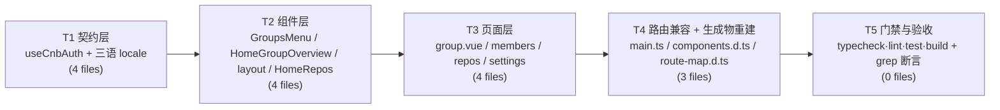
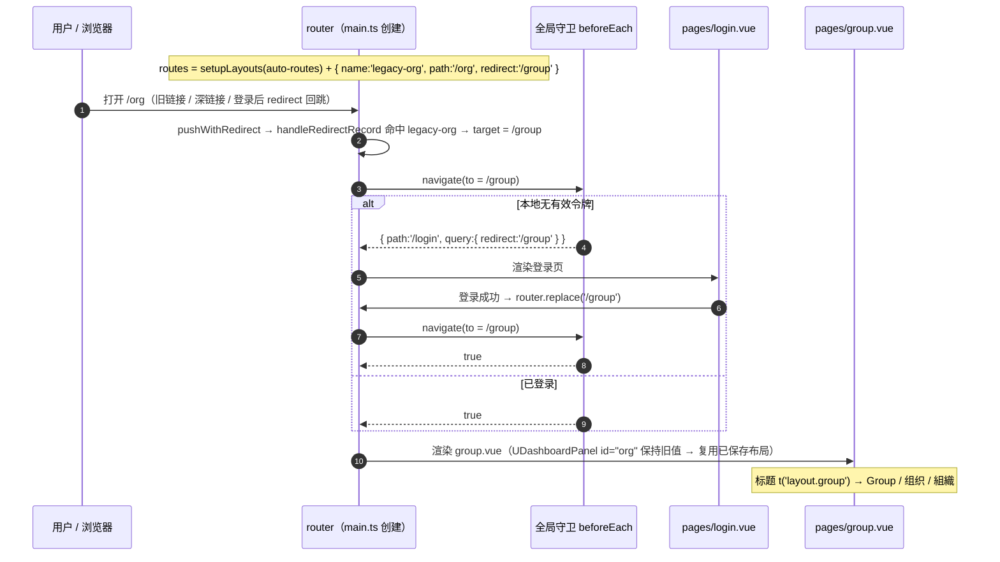
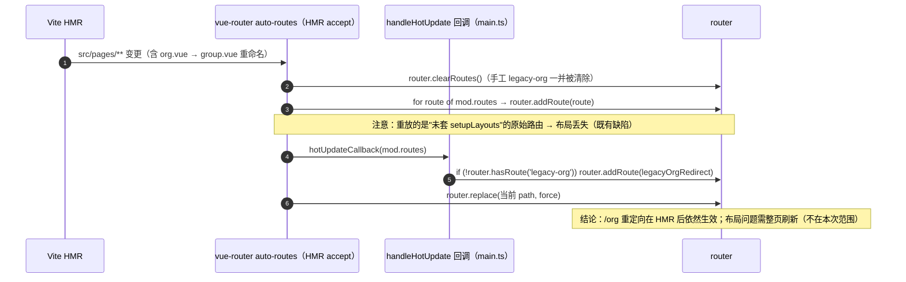

# 设计文档：Team / Organization 统一为 Group（增量改造）

> 对应 PRD：`docs/prd/group-terminology-prd.md`
> 本文件只给**实现方案**（改什么、按什么顺序、怎么验证），不重复 PRD 的背景与映射表。
> 文中所有行号、类型、插件行为均基于 2026-10-29 对当前工作区的实测（含 `node_modules` 内 vue-router 5.4.0 / unplugin-vue-components 32.1.0 / @nuxt/ui 4.12.0 源码核对）。

---

## 0. 结论摘要

| 项 | 结论 |
|---|---|
| 影响文件 | **15 个**（13 个手改，其中 3 个 `git mv`；2 个自动生成物重建）。⚠️ 两个生成物里**只有 `src/route-map.d.ts` 入库需提交**，`components.d.ts` 被 `.gitignore:28` 忽略、不进 PR |
| 手工改造行数 | 约 120 行（含 30 个 i18n 键改名、**33 条**三语值改动 = en 20 + zh-CN 6 + zh-TW 7（含 1 条 zh-TW 同义译文统一，见 §2.3 口径裁决）、3 个标识符、约 20 处注释） |
| 新增文件 | **0**（`docs/design/*` 与 PRD 属文档，不进源码） |
| 新增依赖 | **0** |
| 新增路由记录 | 1 条手工兜底 `{ name:'legacy-org', path:'/org', redirect:'/group' }`（`src/main.ts`） |
| 三语叶子键数 | 改造前后均 **416 / 416 / 416**（已用脚本实测确认当前基线为 416，与 PRD 一致） |
| 最高风险 | ① 自动生成物必须"重建而非手改"；② `handleHotUpdate` 会 `clearRoutes()` 清掉手工路由；③ PRD 验收项 C2（`redirect=/org`）与"路由记录重定向"方案在语义上不兼容（详见 §4.2、§7.1） |

---

## 1. 改造策略：为什么是这个顺序

改名的本质是"符号替换 + 依赖图重排"。唯一的目标是：**把中间态的编译错误压缩到最少、并且让每个中间态都只朝一个方向断（不会出现改完 A 又要回头改 B 的往返）**。

整体原则：**被依赖方先行，依赖方后行；生成物最后重建**。

```
useCnbAuth（类型/常量/函数）
        │  被谁依赖：HomeGroupOverview.vue（组件）→ group.vue（页面）→ 导航（layout）
        ▼
三语 locale（i18n 键）
        │  被谁依赖：GroupsMenu / HomeGroupOverview / group.vue / layout 的 t() 调用
        ▼
组件层（GroupsMenu / HomeGroupOverview / HomeRepos 注释 / layout 导航）
        ▼
页面层（group.vue / members / repos / settings 注释）
        ▼
路由与自动生成物（main.ts 手工重定向 → pnpm dev|build 重生成 components.d.ts、route-map.d.ts）
```

### 1.1 逐步理由

| 步 | 动作 | 为什么必须是这一步 | 如果调换会怎样 |
|---|---|---|---|
| S1 | `useCnbAuth.ts` 三个标识符 + 注释术语 | 它是**最底层被 import 的符号源**。改名后所有引用点会立刻在 `typecheck` 报 "has no exported member"，错误信息精确、可枚举（grep 即可列全）。 | 若先改组件，组件里写 `CnbGroupUsageItem` 而 types 还是旧名 → 同样报错，但你会被迫在"组件 + 类型"之间来回跑两趟。 |
| S2 | 三语 locale 30 键改名 + 33 条值改动 | i18n 键是**运行期解析**的（本项目 `src/i18n.ts` 只调 `createI18n`，**没有做键类型增强**，`t('teams.loading')` 在编译期完全合法）。因此键改名的失败模式是"界面显示裸键名"，编译器不会报错。→ 必须与调用点在同一批内改完，并用 grep 做门禁（§4.4）。 | 若把 locale 放到最后改，中间态界面上到处是裸键，人工验证会淹没真实回归。 |
| S3 | 组件文件名重命名 + 模板标签同步 | `unplugin-vue-components` 按**文件名**做自动注册（`TeamsMenu.vue` → `<TeamsMenu>`）。文件名一改，模板标签立刻失配；而 `components.d.ts` 是生成的，**不重建就不会有 `GroupsMenu` 的类型**，`vue-tsc` 会报 "Property 'GroupsMenu' does not exist"。所以"改名 + 标签同步"必须在同一批，**而重建留给 S5**（重建需要文件已经存在）。 | 若先重建再改名，会生成一份立刻过期的 dts。 |
| S4 | 页面文件 `org.vue` → `group.vue` | `/group` 路由**完全由文件名派生**（unplugin-vue-router），`route-map.d.ts` 也只是它的投影。所以页面改名是"新增路由记录"的唯一触发点，必须在 S5 之前。 | — |
| S5 | `main.ts` 手工重定向 + 重生成 + 门禁 | 重定向不依赖任何生成物（`RouteRecordRaw` 是手写常量）；但它**依赖 `/group` 已存在**（S4）。重生成必须在所有文件就位后跑一次 `pnpm dev` 或 `pnpm build`。 | 若先跑 `pnpm build`，`components.d.ts` 里会同时残留 `TeamsMenu` 与 `GroupsMenu` 两份（unplugin 只按扫描结果重写，旧文件已删则不会残留，但 `route-map.d.ts` 会仍含 `/org`）。 |

### 1.2 中间态可接受的红灯（工程师不要"顺手修复"）

- S1 完成后，`pnpm typecheck` 会报 `HomeOrgOverview.vue` 找不到 `CnbOrgUsageItem` / `fetchCnbOrgUsage`。**这是预期**，S3 完成后自动消失。不要把 T1 与 T2 拆成两个 PR 中间态去修。
- S3 完成后、S5 重生成前，`pnpm typecheck` 会报 `GroupsMenu` / `HomeGroupOverview` 未知组件。同样预期，**不要手改 `components.d.ts`**（见 §4.3）。

---

## 2. 文件级改造清单

### 2.1 总表（15 个文件）

> **表内行号为改造前的基线快照**（2026-10-29 实测）。文件一经改动，行号会漂移，请以"改动点描述"为准、用 grep 定位，不要按行号跳转。

| # | 文件路径 | 改动类型 | 具体改动点 | 依赖 | 任务 |
|---|---|---|---|---|---|
| 1 | `src/composables/useCnbAuth.ts` | 内容改 | ① L798 `export interface CnbOrgUsageItem` → `CnbGroupUsageItem`；② L812 `const ORG_USAGE_KEYS` → `GROUP_USAGE_KEYS`（内部私有，另 L844 使用点 1 处）；③ L837 `export async function fetchCnbOrgUsage` → `fetchCnbGroupUsage`（返回类型 `Promise<CnbGroupUsageItem[]>` 同步）；④ 注释术语：L116「组织（团队）图标」→「组织（group）图标」、L525「顶层组织（团队）列表」→「顶层组织（group）列表」、L537「侧边栏选中哪个团队、首页就展示哪个团队的仓库」→「…哪个组织、…哪个组织…」+ `TeamsMenu`→`GroupsMenu` | 无 | T1 |
| 2 | `src/locales/en.ts` | 内容改 | 30 键改名 + **20 条值改动**（明细见 §2.2/§2.3）+ 文件头注释 L5「teams 团队菜单」→「groups 组织菜单」+ L127「// —— Org overview ——」→「// —— Group overview ——」 | — | T1 |
| 3 | `src/locales/zh-CN.ts` | 内容改 | 30 键改名 + **6 条值改动**（全部集中在 `teams.*`） | — | T1 |
| 4 | `src/locales/zh-TW.ts` | 内容改 | 30 键改名 + **6 条值改动**（全部集中在 `teams.*`） | — | T1 |
| 5 | `src/components/TeamsMenu.vue` → **`src/components/GroupsMenu.vue`** | 改名 + 内容改 | ① `git mv` 保留历史；② 8 处 `t()` 调用换键（L98/100/132/150/163/169/212/221）；③ 头注释 L3「侧边栏顶部的团队（组织）菜单。」→「侧边栏顶部的组织（Group）菜单。」④ 头注释 L9/L10 的行内标签名 `Create team：`/`Manage teams：` 同步为 `Create group：`/`Manage groups：`（注释里引用了旧 UI 文案，属术语范围）；⑤ **L157 注释 `// Manage teams 是用户维度页面（/u/{username}/groups）…` → `// Manage groups 是…`**（PM 实测发现的残留，全仓**仅此一处**：`grep -rnE "team|Team" src/ --include=*.vue --include=*.ts | grep -v locales | grep -v __tests__` 只命中这一行；属"注释里引用旧 UI 文案"，与 ④ 同类，**不升级成门禁断言**、由 review 兜住） | 1,2,3,4 | T2 |
| 6 | `src/components/HomeOrgOverview.vue` → **`src/components/HomeGroupOverview.vue`** | 改名 + 内容改 | ① `git mv`；② 16 处 `home.org.*` → `home.group.*`（L67-73 ×7、L118 模板字符串 `home.org.res.${key}`、L181、L200、L232、L251、L252、L279、L282、L285）；③ 其中 L200 的 `visitOrg` → **`visit`**（键名变化，不是单纯前缀替换，**不要用全局 `home.org.` → `home.group.` 一把梭**）；④ 7 处 `CnbOrgUsageItem`（L29/122/127/132/137/142 + L23 import）；⑤ 2 处 `fetchCnbOrgUsage`（L20 import、L44 调用）；⑥ 注释 L8/L55 `TeamsMenu` → `GroupsMenu` | 1,2,3,4 | T2 |
| 7 | `src/layouts/default.vue` | 内容改 | ① L21/L29 注释 `TeamsMenu` → `GroupsMenu`；② L22 `t('layout.org')` → `t('layout.group')`；③ **L24 `to: '/org'` → `to: '/group'`**；④ L141 `<TeamsMenu :collapsed="collapsed" />` → `<GroupsMenu …>` | 1,2,3,4 | T2 |
| 8 | `src/components/HomeRepos.vue` | 内容改 | 仅注释：L7、L61 `TeamsMenu` → `GroupsMenu` | — | T2 |
| 9 | `src/pages/org.vue` → **`src/pages/group.vue`** | 改名 + 内容改 | ① `git mv`；② L20 `t('layout.org')` → `t('layout.group')`；③ L29 `<HomeOrgOverview />` → `<HomeGroupOverview />`；④ L5/L6 注释 `TeamsMenu`→`GroupsMenu`、`HomeOrgOverview`→`HomeGroupOverview`；⑤ L13 注释 `（layout.org）` → `（layout.group）`；⑥ **L18 `<UDashboardPanel id="org">` 保留 `"org"`，但必须补一行中文注释**说明原因（见 §4.5） | 1,2,3,4,5,6 | T3 |
| 10 | `src/pages/members.vue` | 内容改 | 仅注释：L150 `TeamsMenu` → `GroupsMenu` | — | T3 |
| 11 | `src/pages/repos/index.vue` | 内容改 | 仅注释：L5 `TeamsMenu` → `GroupsMenu` | — | T3 |
| 12 | `src/pages/settings/index.vue` | 内容改 | 仅注释：L56 `TeamsMenu` → `GroupsMenu` | — | T3 |
| 13 | `src/main.ts` | 内容改 | 追加 `/org` → `/group` 手工重定向路由 + `handleHotUpdate` 补挂回调 + 中文注释（代码骨架见 §3.1） | 9 | T4 |
| 14 | `components.d.ts`（仓库根） | **自动生成，禁止手改** | 重建后 L18 `HomeOrgOverview` → `HomeGroupOverview`、L41 `TeamsMenu` → `GroupsMenu` | 5,6 | T4 |
| 15 | `src/route-map.d.ts` | **自动生成，禁止手改** | 重建后 L55-61 `'/org'` → `'/group'`；L174-181 `'src/pages/org.vue'` → `'src/pages/group.vue'`；文件内不得再出现 `'/org'` | 9 | T4 |

> 实测确认**无需改动**的引用面：`auto-imports.d.ts`、`src/composables/__tests__/*`（12 个测试文件）、`src/utils/__tests__/*`、`index.html`、`src-tauri/tauri.conf.json`、`vercel.json`（均无 `TeamsMenu` / `home.org` / `teams.` / `'/org'` 引用）。

> **已批准增补（+2，task #9，等 QA 释放 dev server 后落盘）**：`src/router/legacy-org.ts`（抽取 `LEGACY_ORG_ROUTE_NAME` + `legacyOrgRedirect`，见 §3.1 末段）+ **`src/router/__tests__/legacy-org.test.ts`**（**5 条**用例：C1/C4 push 落 `/group`、`fullPath` 归一、C3 `hasRoute` + `getRoutes`（**含形状锁** `expect(legacyOrgRedirect.path).toBe('/org')` 全等，防有人改成 `:pathMatch(.*)*`）、`/group` 无环、HMR 补挂幂等；**不覆盖 C2**，C2 仍是人工判据）。**形状锁并入第 3 条、不新增第 6 条**——独立 `it()` 更细粒度，但要连锁改 §2.1 / 双重预期值（13 文件 174 用例）/ 验收清单三处，收益不抵成本。落盘后本次交付共 **17 个文件 / 16 条 `git add` 路径**（差的 1 条是 `components.d.ts`，不可 add）。**不要用 `git status --porcelain` 的行数去核对文件数**：未跟踪目录会折叠成一行——`?? src/locales/` 一行代表 en/zh-CN/zh-TW **三个**文件，`?? src/pages/repos/` 同理。所以 porcelain 行数会**小于**真实路径数，"少了"不代表漏了文件。R1 与附录 A 的提交清单同步加这两个路径。
>
> **测试文件路径为何是 `src/router/__tests__/`（不是 `composables/__tests__/`）**：仓库现有 12 个测试**全部与被测模块同目录共置**（`utils/__tests__/format.test.ts` 测 `utils/format.ts`，其余 11 个 composables 同理），被测模块在 `src/router/`，因此测试放 `src/router/__tests__/`——既符合约定，import 也简化为 `../legacy-org`（跨层写 `../../router/legacy-org` 更易错）。`vitest.config.ts` 的 `include: ['src/**/__tests__/**/*.test.ts']` 与 `tsconfig.app.json` 的 `include: ["src/**/*.ts"]` 都天然覆盖，**无需改任何配置**（§6.3 第 4 条约束）。
>
> **两条容易踩的构建事实（后人加测试前必须知道）**：
> 1. `tsconfig.app.json` 的 `src/**/*.ts` 覆盖测试代码，`strict: true` + `noUnusedLocals` + `noUnusedParameters` 全部生效 —— **测试里的类型错误会让 `pnpm typecheck` 红**。这是好事（多一道门禁），但意味着测试代码要按生产代码的标准写。
> 2. `types` 数组只有 `["vite-plugin-vue-layouts/client"]`，**不含 `vitest/globals`**，因此 `describe` / `it` / `expect` **必须显式 `import { describe, it, expect } from 'vitest'`**——写成全局可用会在 typecheck 阶段报 `Cannot find name 'describe'`。

### 2.2 三语 30 键改名（键名集合，三语完全一致）

| 分组 | 旧键（30） | 新键（30） |
|---|---|---|
| `teams` → `groups`（7） | `teams.loading` `teams.noTeam` `teams.loadFailedRetry` `teams.empty` `teams.createTeam` `teams.manageTeams` `teams.refresh` | `groups.loading` `groups.noGroup` `groups.loadFailedRetry` `groups.empty` `groups.create` `groups.manage` `groups.refresh` |
| `home.org` → `home.group`（22） | `home.org.{members, allMembers, subGroups, repos, missions, registries, follows, createdAt, visitOrg, monthlyUsage, noQuota, frozen, freeQuota, usageLoadFailedTitle, usageLoadFailedDesc}` + `home.org.res.{ci_in_sec, ci_gpu_in_sec, dev_in_sec, dev_gpu_in_sec, git_in_byte, object_in_byte, credit_in_milli}` | `home.group.{同名 15 个，其中 visitOrg→visit}` + `home.group.res.{同名 7 个}` |
| `layout`（1） | `layout.org` | `layout.group` |

⚠️ **两个"不是纯前缀替换"的键**（最容易漏）：
- `teams.noTeam` → `groups.noGroup`（`noTeam` 段名变化）
- `teams.createTeam` / `teams.manageTeams` → `groups.create` / `groups.manage`（删除了 `Team` 后缀）
- `home.org.visitOrg` → `home.group.visit`（`visitOrg` → `visit`）

### 2.3 en 的 20 条值改动（逐条，勿漏）

| # | 键（新） | 旧值 → 新值 |
|---|---|---|
| 1 | `groups.loading` | `Loading teams...` → `Loading groups...` |
| 2 | `groups.noGroup` | `No team selected` → `No group selected` |
| 3 | `groups.loadFailedRetry` | `Failed to load teams, click to retry` → `Failed to load groups, click to retry` |
| 4 | `groups.empty` | `You have not joined any team yet` → `You have not joined any group yet` |
| 5 | `groups.create` | `Create team` → `Create group` |
| 6 | `groups.manage` | `Manage teams` → `Manage groups` |
| 7 | `groups.refresh` | `Refresh teams` → `Refresh groups` |
| 8 | `home.group.subGroups` | `Sub-organizations` → `Sub-groups` |
| 9 | `home.group.visit` | `Org homepage` → `Group homepage` |
| 10 | `layout.group` | `Organization` → `Group`（**单数**，见 §6.3） |
| 11 | `home.reposTitle` | `Organization repositories` → `Group repositories` |
| 12 | `home.reposEmpty` | `No repositories in this organization` → `No repositories in this group` |
| 13 | `notifications.joinGroup` | `Joined an organization` → `Joined a group` |
| 14 | `state.forbiddenDesc` | `Contact your organization admin, …` → `Contact your group admin, …` |
| 15 | `buildWatch.settings.desc` | `…for the selected organization and notifies you…` → `…for the selected group and notifies you…` |
| 16 | `buildWatch.settings.followGroup` | `Follows all repositories of the organization selected in the sidebar ({group}).` → `…of the group selected in the sidebar ({group}).` |
| 17 | `settings.general.desc` | `Read-only summary of the signed-in account and current organization.` → `…and current group.` |
| 18 | `settings.general.group` | `Current organization` → `Current group` |
| 19 | `settings.general.groupDesc` | `The organization currently selected in the sidebar.` → `The group currently selected in the sidebar.` |
| 20 | `settings.general.noGroup` | `No organization selected` → `No group selected` |

**zh-CN（6 条）**：`groups.loading` 加载组织中… / `groups.noGroup` **未选中组织** / `groups.loadFailedRetry` 组织列表加载失败，点击重试 / `groups.empty` 还未加入任何组织 / `groups.create` 创建组织 / `groups.manage` 管理组织。`groups.refresh` 值不变（刷新组织）。
**zh-TW（7 条）**：`groups.loading` 載入組織中… / `groups.noGroup` **未選取組織** / `groups.loadFailedRetry` 組織列表載入失敗，點擊重試 / `groups.empty` 尚未加入任何組織 / `groups.create` 建立組織 / `groups.manage` 管理組織（`groups.refresh` 值不变：重新整理組織）；**第 7 条是同义译文统一**：`settings.general.noGroup` 未選中組織 → **未選取組織**（与 `groups.noGroup` 对齐，理由见下）。

> **口径裁决（zh-TW 同义必须唯一）**：英文 `No group selected` 同时出现在 `groups.noGroup`（侧边栏按钮占位）与 `settings.general.noGroup`（设置页当前组织占位）。两处英文同源，繁中不得出现两种写法——"同一概念多个词"正是本次需求要消灭的病根。统一方向：**旧值向 §2.1 的新定稿值收敛**（未選中組織 → 未選取組織），「選取」也与 CNB 繁中站用词一致。zh-CN 两处本来就都是「未选中组织」，**不动**。
> 可延续规则：**同一英文值在不同键下的 zh-TW 译文必须唯一**（校验脚本见 §4.4 ⑦，已限定在本次术语域内，避免误报）。
>
> `groups.noGroup` 采用「未选中组织 / 未選取組織」：该键在 `GroupsMenu.vue` 承载的是**按钮无选中项时的占位**（`buttonLabel`），与 `groups.empty`（空态）语义重复，改后语义更准。**不得**保留"团队/團隊"字样。

### 2.4 保持原样的键值（避免误改）

- `home.group.usageLoadFailedDesc` 中的 `group-resource:r`：CNB 权限 scope 名，**不是术语**。
- `home.group.res.*` 的 7 条值：中文已是「云原生构建（CI）」等，无术语。
- 中文 `home.*` / `settings.*` / `state.*` / `notifications.*` 值：现状已用「组织/組織」，**基本零改动**。
- **唯一例外**：zh-TW 的 `settings.general.noGroup` 需按 §2.3 的口径裁决改为「未選取組織」（1 行值，不动键名）。**不要按"中文零改动"判定通过**。

---

## 3. 关键实现方案

### 3.1 `/org` → `/group` 永久重定向（`src/main.ts`）

现状（L96-100）：

```ts
const head = createHead()
const router = createRouter({
  routes: setupLayouts(routes as RouteRecordRaw[]),
  history: createWebHistory()
})
```

目标实现：

```ts
// ——————————————————————————————————————————————————————————————
// 旧链接兼容：/org 永久重定向到 /group
// 背景：术语统一为 Group 后页面文件改为 pages/group.vue，正式路由随之变为
// /group；/org 作为已发布出去的旧链接必须长期可达（SPA 内 redirect 无 HTTP
// 状态码，"永久"体现为入口永不删除，不发 301）。
// 为什么放在这里而不是建一个 pages/org.vue：后者会生成一份真实页面记录、
// 多一次组件挂载再跳转，且 route-map.d.ts 里会残留两份页面条目。
// ——————————————————————————————————————————————————————————————
const LEGACY_ORG_ROUTE_NAME = 'legacy-org'
const legacyOrgRedirect: RouteRecordRaw = {
  name: LEGACY_ORG_ROUTE_NAME,
  path: '/org',
  redirect: '/group',
}

const appRoutes: RouteRecordRaw[] = [
  ...setupLayouts(routes as RouteRecordRaw[]),
  legacyOrgRedirect,
]

const router = createRouter({
  routes: appRoutes,
  history: createWebHistory(),
})
```

HMR 兜底（替换现有 L160-162 的 `handleHotUpdate(router)`）：

```ts
// 自动路由热更新兜底：
// vue-router 的 auto-routes HMR 回调内部会 router.clearRoutes() 然后逐条重放
// 「由文件生成的路由」，手工追加的 legacy-org 会被一并清除（该行为已在
// node_modules/vue-router/dist/unplugin-*.mjs 的 hot 代码块中核对）。
// handleHotUpdate 的第 2 个参数正是为此提供的补挂点，它在重放之后调用。
if (import.meta.hot) {
  handleHotUpdate(router, () => {
    if (!router.hasRoute(LEGACY_ORG_ROUTE_NAME)) {
      router.addRoute(legacyOrgRedirect)
    }
  })
}
```

**与登录守卫的关系（必须理解，否则会误判为 bug）**：`vue-router` 的 `pushWithRedirect` 在 `navigate()`（即全局 `beforeEach`）**之前**先做 `handleRedirectRecord`。因此守卫永远看不到 `to.path === '/org'`：

```
未登录访问 /org → [redirect 解析] /group → [beforeEach] 无令牌 → /login?redirect=/group
```

即最终落到 `/login?redirect=/group`，登录成功后到 `/group`——**链路正确、无环**，但与 PRD §7.3 C2 的字面断言（`redirect=/org`）不一致（见 §7.1）。

若产品坚持 `redirect=/org` 这一断言，则**不能**用路由记录重定向，须改为守卫内重定向（备选方案 B′）：

```ts
router.beforeEach((to) => {
  if (to.path === '/login') {
    return cnbToken.value ? { path: '/' } : true
  }
  if (!cnbToken.value) {
    return { path: '/login', query: { redirect: to.fullPath } }
  }
  // 旧链接兼容：登录态下把 /org 换成 /group（放在令牌校验之后，
  // 未登录时仍会把 /org 记进 redirect，登录后由 /group 承接）
  if (to.path === '/org') {
    return { path: '/group', replace: true }
  }
  return true
})
```

B′ 的优点：HMR 免疫、`redirect=/org` 字面成立、无需 `clearRoutes` 补挂；缺点：`/org` 不是一条登记在册的路由（无法从 `router.getRoutes()` 查到），且与"路由表 = 文件路由 + 少量手工兜底"的结构一致性弱一点。

> **建议**：按已拍板的方案 A（路由记录）+ HMR 补挂实现；同时**修订 PRD C2 的断言**为"未登录访问 `/org` → `/login?redirect=/group`，登录后落到 `/group`"。把选择交回产品确认（§7.1）。

> **实现态增补（已批准，task #9）**：上面 `LEGACY_ORG_ROUTE_NAME` / `legacyOrgRedirect` 的**定义**从 `main.ts` 内联抽取到新模块 `src/router/legacy-org.ts`，`main.ts` 改为 `import { LEGACY_ORG_ROUTE_NAME, legacyOrgRedirect } from './router/legacy-org'`（`appRoutes` 与 `handleHotUpdate` 逻辑一行不动，**净减 **29 行** = −24 行注释 −6 行定义 −1 空行 −1 旧 `appRoutes` 注释 +1 行 import +2 行指针注释（实测 211 → 182）。抽取目的不是"优雅"，而是**让单测能 import 真身**——若测试里复刻一份路由表，改 `main.ts` 忘改测试就会假绿。骨架语义与上文完全一致，只是载体换了文件。

> **落盘后的验收判据：用内容断言，不能用 `git diff`（本仓库 `git diff` 一律不可用，见 §4.6 坑 4）。** 原因见下：`git diff src/main.ts` 的基线是**上游模板**，diff 显示的是 `@@ -1,30 +1,182 @@`——把 i18n 初始化、外链拦截、build watcher 等**整个项目相对模板的全部新增**都算进来了，无法拆出"本次抽取"。改用内容断言（实测值已填）：
> ```bash
> grep -cF "from './router/legacy-org'" src/main.ts          # 期望 1（模块已接入）
> grep -cE "^const (LEGACY_ORG_ROUTE_NAME|legacyOrgRedirect)" src/main.ts   # 期望 0（本地定义已搬走）
> grep -cF "appRoutes"      src/main.ts                      # 期望 ≥1（装配逻辑仍在）
> grep -cF "setupLayouts"   src/main.ts                      # 期望 ≥1
> grep -cF "handleHotUpdate" src/main.ts                     # 期望 ≥1
> grep -cF "hasRoute"       src/main.ts                      # 期望 ≥1
> grep -cF "addRoute"       src/main.ts                      # 期望 ≥1
> ```
> **2026-10-29 落盘实测**：`1 / 0 / 2 / 3 / 3 / 1 / 1`，`wc -l` 由 211 → **182（净减 29）**。注意"期望 0"那条退出码是 `1`（§4.4 陷阱），只看数字。

> **共享可变对象的风险（已核源码，风险为零，附证据）**：抽成模块后 `legacyOrgRedirect` 会同时被 `main.ts` 的 `appRoutes` 与测试里的多个 router 实例引用，看上去像"共享可变状态"。实测源码：`vue-router@5.4.0` 的 `addRoute` 走 `normalizeRouteRecord()`，函数体是 `const normalized = { path: record.path, redirect: record.redirect, name: record.name, meta: record.meta || {}, … }`——**返回全新对象、标量字段按值复制、`children` / `meta` 按引用共享**（`dist/vue-router.js:758-776`）。我们的记录既无 `children` 也无 `meta`，因此**不存在被回写的可能**，也不需要改成 factory 函数。保留一条"多 router 复用同一记录对象后行为一致"的断言仍值得（成本近零，防未来给记录加 `children`/`meta` 后踩坑）——该断言已落地（`legacy-org.test.ts:95-113`：两个独立 router 复用同一 `const` 记录，行为一致且三标量字段未被回写）。同时"记录无 `children`"这个前提也不再靠人工维护：`legacy-org.test.ts:85` 的 `expect(legacyOrgRedirect.children).toBeUndefined()` 直读锁住了它（为什么必须直读、记录数断言为什么不够，见 §4.2 的四种写法实测表）。

### 3.2 自动生成物：结论是"不要手改，靠重建生成"

| 文件 | 生成者 | 是否入库 | 触发时机（实测） | 重生成机制 |
|---|---|---|---|---|
| `components.d.ts`（**仓库根目录**，不是 `src/`） | `unplugin-vue-components`（由 `@nuxt/ui/vite` 内置） | **否**（`.gitignore:28`，git 不跟踪） | `pnpm dev` 启动即扫；`pnpm build` 的 `buildStart` 阶段；dev 下新增/删除组件文件也会触发重写 | `dts` 未显式配置 → unplugin-vue-components 默认 `resolve(root, 'components.d.ts')`（已核对 `unplugin-vue-components/dist/src-*.mjs:229`）。**重建 = 跑一次 `pnpm dev` 或 `pnpm build`** |
| `src/route-map.d.ts` | `vue-router/vite`（`vite.config.ts` 的 `vueRouter({ dts: 'src/route-map.d.ts' })`） | **是**（唯一需提交的生成物） | `pnpm dev` 启动 / 监视 `src/pages/**` 变更；`pnpm build` | 同上 |

**两条硬规则**：
1. **禁止手改**这两个文件。它们带 `/* eslint-disable */`、`// @ts-nocheck`、`!! DO NOT MODIFY THIS FILE !!` 头；手改会在下一次 dev/build 被静默覆盖，且容易写出与生成器规则不一致的内容（如手工加 `'/org'` 路由类型，会让 `router.push('/org')` 在类型层"合法"，从而掩盖真实的旧链接残留）。
2. **重生成必须发生在所有文件就位之后**（T4）。注意入库状态不同：`src/route-map.d.ts` 是 tracked 文件，需随 PR 提交并在 `git status` 中体现；`components.d.ts` 被 `.gitignore:28` 忽略，**永远不会出现在 `git status` 里，也不该用 `git add -f` 塞进 PR**（PRD §3.4/§6/§7.5 写的"两者都提交"不成立，见 §7.6）。
3. `tsconfig.app.json` 的 `include` 同时包含 `components.d.ts` 与 `src/**/*.ts`，因此 `route-map.d.ts` 也在类型程序内 —— 这也是"改完必须重建再 typecheck"的原因。

### 3.3 校验脚本（可直接落 `.tmp-check-keys.mjs`，跑完即删，不入库）

```js
// 三语键集一致性校验：en / zh-CN / zh-TW 叶子键必须完全一致，且总数 = 416
import { readFileSync } from 'node:fs'

/** 粗略提取 TS 对象字面量的叶子键路径（跳过注释行） */
function flatKeys(src) {
  const text = src.split('\n')
    .filter(l => !/^\s*(\/\/|\/\*|\*)/.test(l))
    .join('\n')
  const keys = []
  const stack = []
  const re = /([A-Za-z_$][\w$]*|'[^']*')\s*:\s*(\{|'[^']*'|"[^"]*")|(\})/g
  let m
  while ((m = re.exec(text))) {
    if (m[3] === '}') { stack.pop(); continue }
    const k = m[1].replace(/^'|'$/g, '')
    if (m[2] === '{') { stack.push(k); continue }
    keys.push([...stack, k].join('.'))
  }
  return keys
}

const res = {}
for (const f of ['en', 'zh-CN', 'zh-TW']) {
  const keys = flatKeys(readFileSync(`src/locales/${f}.ts`, 'utf8'))
  res[f] = new Set(keys)
  console.log(f, '=', keys.length)
}
const base = res.en
const missing = [...base].filter(k => !res['zh-CN'].has(k) || !res['zh-TW'].has(k))
const extra = [...res['zh-CN'], ...res['zh-TW']].filter(k => !base.has(k))
console.log('missing =', missing)
console.log('extra   =', extra)
```

期望输出：`en = 416 / zh-CN = 416 / zh-TW = 416`，`missing = []`，`extra = []`。
（改造前已用同法实测：三语均 416，与 PRD §2 一致。）

---

## 4. 风险与验证点

### 4.1 `/org` 深链接与子路由

- **实测结论：`src/pages/org.vue` 是叶子页面，`src/pages/org/` 目录不存在**，因此**不存在** `/org/xxx` 这类深链接，`{ path:'/org', redirect:'/group' }` 精确匹配即可，**不要**加 `/org/:pathMatch(.*)*` 兜底——那会把 `/org/*` 本该 404 的路径（`/org/anything`、`/org/x/y/z`）**全部静默跳到 `/group`**，用户输错 URL 也察觉不到。**注意边界（PM 实测纠正过的夸大表述）**：`/org/:pathMatch(.*)*` 只吃 `/org/*`，**不会**让"任意乱路径"跳组织页——那得用根级 `/:pathMatch(.*)*`，是另一回事。对 `/group` 无误伤。
- 已核查全仓 `/org` 引用仅 3 处（`layouts/default.vue:24`、`route-map.d.ts:55,174`、`pages/org.vue` 文件名），与 PRD §4 一致；`src/main.ts` / `useDashboard.ts` / `GroupsMenu.vue` 内部均无 `/org` 跳转（菜单 4 个可点项是"切换选中组织"+ 2 条外链）。
- **长期约定（代码里守不住，只能靠 review + 一条形状锁）**：**不要恢复 `src/pages/org.vue`**。恢复后 `/org` 会同时存在"文件路由"与"重定向记录"两条候选，这是唯一能让 `/org` 出现歧义的现实路径，且 §4.2 的 `hasRoute('legacy-org')` guard **挡不住**（name 不同）。同理不要给 `/org` 加 `:pathMatch(.*)*` 兜底（理由见上一条）。**自动化覆盖状况**：单测里的**形状锁**（`expect(legacyOrgRedirect.path).toBe('/org')` 全等）能抓住"有人把模块里的记录改成 pathMatch"，但**抓不住"绕过模块、在 `main.ts` 的 `appRoutes` 里另加一条"**——保护范围表见 §4.2 末。

### 4.2 重定向环 / 守卫交互

| 场景 | 期望 | 机理 |
|---|---|---|
| 已登录访问 `/org` | 渲染 `/group`，地址栏变 `/group` | `handleRedirectRecord` → `/group`，守卫直接放行 |
| 未登录访问 `/org` | `/login?redirect=/group` | 重定向先发生，守卫看到的是 `/group`（**与 PRD C2 字面不同，功能等价**） |
| 未登录访问 `/group` | `/login?redirect=/group` | 常规守卫路径 |
| 登录成功 | `login.vue` 的 `router.replace(redirect)` → `/group` | `login.vue:44-47` 读取 `route.query.redirect`（string） |
| 环检测 | `/org → /group` 是**唯一一条边**，`/group` 无出边 | 静态可证无环；`/login` 与 `/` 互跳由既有守卫处理，不受影响 |
| 401 拦截 | `setUnauthorizedHandler` 用 `router.currentRoute.value.path` 判 `/login`，与 `/org` 无关 | 不受影响 |

**⚠️ 验证陷阱：不要用 `router.resolve('/org').path` 断言重定向（PRD C4 因此不成立）**

`resolve()` 只做 URL → location 的解析，**不经过 `pushWithRedirect` / `handleRedirectRecord`**，所以：

```ts
router.resolve('/org').path   // → '/org'   ❌ 永远是 /org，不能用于断言重定向
```

正确且可自动化的等价断言（与 C2 同一根因，必须走真实导航）：

```ts
await router.push('/org')
router.currentRoute.value.path   // → '/group'  ✅
```

**通用规则（本次两处断言翻车同根因）**：C2 的 `redirect=/org`、C4 的 `resolve().path` 都是"以为 redirect 在更早阶段被解析"。凡涉及 redirect 的断言，**一律走 `push` + `currentRoute`，或走行为验证**，不要用 `resolve()`、也不要假设守卫能看到原始路径。

配套的 6 条可自动化断言（已实测 PASS，见 §7.6）：已登录 `/org`→`/group`（`path` 与 `fullPath`）、未登录 `/org`→`/login` 且 `query.redirect === '/group'`、登录后 `replace(redirect)`→`/group`、`/group` 无出边（无环）、`hasRoute('legacy-org') === true`、`getRoutes()` 含 `/org`。

**关于 `if (!router.hasRoute(...))` 这个 guard：保留，不要删。** 实测已证明重复同名 `addRoute` 不抛错且按 name 替换（路由表里 `/org` 仍只 1 条），因此它在**功能层面不是必需**。但"非必需" ≠ "可删"：

| 它的真实价值 | 说明 |
|---|---|
| 减少路由表抖动 | 同名 `addRoute` 是"先移除再新增"，每次 HMR 重放都会触发一次记录替换；guard 让它只在实际缺失时补挂 |
| 代码里唯一承载"补挂必须幂等"这个意图 | 删掉后行为不变，但**意图消失**：将来若有人把 `legacyOrgRedirect` 改成传数组、或换 name 追加，没有 guard 就会真的叠加。它防的不是当前实现的重复，而是**未来改动的粗心** |
| 它挡不住的边界（必须知道） | guard 只认 name。若有人重新加回 `src/pages/org.vue`，`/org` 会同时存在"文件路由"与"重定向记录"两条候选，此时 `hasRoute('legacy-org')` 仍为 `false`，guard 完全无效。这一条只能靠 §4.1 的约定守住 |

> **这个盲区其实有一道更早的防线，但它只管一半**：同场景下 `grep -c "pages/org.vue" src/route-map.d.ts` 会从 `0` 变 `1`（unplugin 会为新出现的页面文件生成类型条目）。也就是说 PRD §7.5 已有的这条**内容断言，能在 guard 失效之前就抓到"有人加回了页面文件"**——它的用途不只是"确认改名成功"，还是"确认没人把老文件加回来"。建议把它固定进 T5 门禁（§4.4 第 ④ 组），别只在提交前跑一次。

**⚠️ 必须写清保护范围（PM + 工程师各自独立提出，两人都对）：`route-map.d.ts` 是 `unplugin-vue-router` 对 `src/pages/**` 的投影，手工路由不在它视野里。** 所以：

| 误改方式 | 谁抓得住 | 说明 |
|---|---|---|
| 恢复 `src/pages/org.vue` | ✅ `grep -c "pages/org.vue" src/route-map.d.ts` 期望 0 | 重建后必然变 1 |
| 把模块里的 `path` 改成 `/org/:pathMatch(.*)*` | ✅ 单测形状锁（`expect(legacyOrgRedirect.path).toBe('/org')` 全等断言） | 加 pathMatch 立刻红 |
| 改模块里的 `redirect` / `name` | ✅ 单测（`toBe` + `hasRoute`） | 同上 |
| 给模块记录加 `children` 造深链接 | ✅ **已锁死（断言已落地）**：`src/router/__tests__/legacy-org.test.ts:85` 的 `expect(legacyOrgRedirect.children).toBeUndefined()` 让**四种变异写法（`[]` / 相对 / 绝对 / 空路径）全部变红** | 记录数断言（`filter(startsWith('/org'))` = 1）只能抓一半（相对子路径 → 变 2；绝对子路径与 `children:[]` → 仍为 1），直读断言才闭合。**机理必须按源码说，不能按观察说**：`handleRedirectRecord()` 只看 `to.matched[to.matched.length - 1]`（`vue-router.js:1288-1289`，v5.4.0），即 **`redirect` 只在 `matched` 的最后一条记录上生效**。正常时 `matched=[父(/org)]`，父命中；`children:[{path:''}]` 让 `matched=[父, 子]`、最后一条变成**子**（无 redirect），**父的 redirect 根本没被读到**。详见下一段 |
| **绕过模块，直接在 `main.ts` 的 `appRoutes` 里另加一条 `/org/:pathMatch(.*)*`** | ❌ **无人抓** | 手工路由不进 `route-map.d.ts`；单测用的是自己的最小 router，看不见 `appRoutes` 的其它成员 |

**四种 `children` 写法的实测差异**（`createMemoryHistory` + 最小 router，`push('/org')` 后读 `currentRoute`；已在本机复现，非推断）：

| 写法 | `/org` 前缀记录数 | `children === undefined` | `push('/org')` 落点 | 后果 |
|---|---|---|---|---|
| 无 `children`（当前状态） | 1 | ✅ 绿 | `/group` | 正常 |
| `children: []` | 1 | 🔴 红 | `/group` | 行为不变，但形状锁红 —— 空数组无意义，红得合理 |
| `children: [{path:'x'}]`（相对） | **2**（`/org`、`/org/x`） | 🔴 红 | `/group` | 凭空多出活路由 `/org/x` |
| `children: [{path:'/x'}]`（绝对） | 1 | 🔴 红 | `/group` | 记录数抓不住，**只有直读断言能抓**；`/x` 另挂到根上 |
| `children: [{path:''}]`（空路径） | **2**（`/org`、`/org`） | 🔴 红 | **`/org`（不跳转）** | **旧链接静默失效**：用户停在空白页，且 `push` 返回 `undefined`（**无 NavigationFailure**，从 API 层看是"成功导航"） |

> **别把"redirect 优先于 children"当普遍结论**——本轮我和 PM 都基于这个错说法推过一轮，工程师找到反例后三条独立实测共同推翻了它。准确表述只有上一格那句：`redirect` 只认 `matched` 的最后一条。
>
> **一条 dev 排障线索**：空路径子记录会让 `createRouter()` 在控制台打 `[VUE_ROUTER_R0103]`（`The route named "legacy-org" has a child without a name, an empty path, and no children.`，判据在 `vue-router.js:842`：`parent && parent.record.name && !record.name && !record.path && !record.children.length`）。对用户完全静默，对 dev 控制台不静默——日后收到"旧链接打不开"的反馈，先翻启动日志里的 R0103。

**结论（写进 review 清单，不是自动化）**：`appRoutes` 层级的新增只能靠 code review。要覆盖它得把 `appRoutes` 抽成模块或对 `main.ts` 做文本断言，**代价大于收益**（把测试耦合到装配细节，改装配就假红），明确不做。**"有测试"不等于"路由语义已被完整保护"——保护范围说不清的门禁，比没有门禁更容易让人放松。**

### 4.3 catch-all 路由是否抢走 `/group` 或 `/org`（重点核查项）

**实测结论：不冲突。** 本项目唯一的 catch-all 是 `src/pages/repos/[...repoPath].vue`，生成的路由是 **`/repos/:repoPath(.*)`**（见 `route-map.d.ts:76-82`）。

- 它的前缀段是**静态段 `/repos`**，只能匹配 `/repos` 开头的路径，**不会**匹配 `/group`、`/org`。
- 顶层**没有** `src/pages/[...slug].vue`（`src/pages/` 下只有 `index/login/members/group/profile/settings/repos`，`org.vue` 已改名），因此不存在"顶层 catch-all 吞掉 `/group`"的可能。
- `/repos` 与 `/repos/<空>` 的既有兜底（`[...repoPath].vue` 内 `replace` 回 `/repos`）也不受影响。
- 手工路由 `{ path:'/org' }` 是**精确静态段**，评分高于任何参数段；此处也无参数段竞争者。

### 4.4 i18n 键改名遗漏 → 运行时裸键（门禁命令）

本项目 **未启用 i18n 键类型检查**（`src/i18n.ts` 仅 `createI18n({legacy:false, fallbackLocale:'en'})`），键拼错在编译期完全合法，只会在界面显示 `groups.loading` 这样的裸键。因此必须用 grep 做门禁。

> ⚠️ **先确认你手上的 `grep` 是哪一个 —— 本机有两个，取决于 `PATH`**（本仓已连续踩多次静默失败，根因是环境不一致，不是手滑）：
> ```bash
> which -a grep
> # /Applications/WorkBuddy.app/.../cli/vendor/shim/brokered-bin/grep   ← Agent/CLI 沙箱 shim
> # /usr/bin/grep
> /usr/bin/grep --version   → grep (BSD grep, GNU compatible) 2.6.0-FreeBSD
> grep        --version      → toybox 0.8.13 (is not GNU grep 9.0)
> ```
> | 写法 | Agent 沙箱 `grep`（toybox 0.8.13，`PATH` 前置） | `/usr/bin/grep`（BSD 2.6.0，GNU compatible） |
> |---|---|---|
> | `^\s*x` | ❌ 把 `\s` 当字面量 `s`，只命中列 0 行 | ✅ 正常 |
> | `\b` / `\d` / `\w` | ❌ 恒无匹配 | ✅ 正常 |
> | `a\|b`（BRE 交替） | ❌ 恒无匹配 | ✅ 正常 |
>
> **这才是真正的风险**：同一份命令，**人跑（普通终端）全绿、Agent 跑（沙箱）静默变成"无匹配"，而"检查通过"与"检查根本没生效"输出长得一模一样**。三个人在不同时间点各踩一次，就是这个原因。
>
> **纪律（两条都要）**：
> 1. **只用 POSIX 构造**：`grep -E`、`[[:space:]]` / `[[:alnum:]]`、`(a|b)`、`grep -w`、`grep -F`；**禁用一切 GNU 扩展**（`\s` / `\b` / `\d` / `\w` / BRE `\|`）。
> 2. **读数前置动作**：任何"期望无输出"的判定前先 `command -v grep` 自证；**同一批断言必须在同一个 shell 里跑完**（中途换环境 = 结果不可比）。
> 3. **验收标准（比"我测过能跑"强得多）**：**每条门禁断言必须在两种 grep 下输出一致**。PRD §7 的 14 条断言已按此验收（A4 拆出"文件级 4 / 全仓 5"两种作用域后由 13 增至 14）：`toybox` 与 `/usr/bin/grep` 各跑一遍、结果 **14/14 一致**（因为它们全部只用 POSIX 构造）。工程师另做了更强的一层：同一脚本在两个 grep 下**剥离工具身份行后 md5 完全一致**。**复算时还要看行号与内容是否自洽**——"有输出"也可能是假信号（错行、错文件），与"空输出被当成通过"是镜像。
> 4. **第三条路：`rg`（ripgrep 15.1.0，`/opt/homebrew/bin/rg`，未被 shim 拦截）** —— `\s` / `\b` 都正常，实测与 grep 13 条结论一致。**但它有自己的坑，且失败形态与 toybox 完全相同**：
>    **`rg` 默认遵守 `.gitignore`** —— 扫 `components.d.ts`（被 `.gitignore:28` 忽略）时会**扫不到 → 0 命中 → 看起来"没有残留"**。必须加 `rg -u`（`--no-ignore`）。**"被忽略的文件"和"文件不存在"在 `rg` 眼里是同一件事。**

> ⚠️ **退出码陷阱（两个方向都有，本节所有断言都受它影响）**
> - **"期望无输出"的断言，通过时退出码是 1**：`grep` 无命中返回 `1`。本节下面所有 `# 期望：无输出` 的检查，在**全部通过**的状态下 `exit=1`。
> - **"期望 0"的 `grep -c`，同样退出 1**：`grep -c "x" f` 输出 `0` 且返回 `1`，而 `0` 恰恰是我们要的通过值。
> - 因此：**判定只看输出文本/数字，不看退出码**。若必须塞进 `set -e` 脚本或 CI 步骤，写成 `! grep -q ...` / `grep -c ... || true`，否则会出现**"通过被读成失败"**的假红。前几轮踩的坑都是"失败被读成通过"，这一条方向相反、更反直觉——因为它只在"一切正常"时发作。
> - 同一原则的推论：不要把多条断言用 `&&` 串起来取 `$?`，那只会得到末条命令的结果（§4.4.1 同款）。
> - **为什么门禁①只扫 `src/locales/`、不扫全仓**：全仓 `grep -rnE "team|Team" src/` 会命中两类"合法残留"——① 注释里引用的旧 UI 文案（如 `GroupsMenu.vue:157` 的 `// Manage teams 是…`，属 `§2.1` 第 5 行⑤、由 review 兜住、**不入断言**）；② 测试夹具字符串（`'team/...'` 之类）。**门禁范围写窄是有意的**：宽扫会把"合法残留"变成红灯，最后人就开始忽略红灯。

> ✅ **正控要求（比"禁用 `\s`"更重要的一条纪律）**
> 「无输出 / 计数为 0」型断言有个结构缺陷：**工具静默失效时同样返回空，与"真的干净"完全同形**。所以"禁用危险语法"只是必要条件，防不了"语法合法但语义写错"（`home\.orgs`、少个转义点）以及"换环境后行为不同"（CI 是 GNU grep）。
> **规则：每个"无输出"型门禁必须附正控 —— 用同一模式去匹配一段确定含该词的输入，证明模式是活的。通过判据 = 正控命中 + 实测无输出；只有"无输出"不算通过。**
> 标准正控集（10 秒可复跑，工程师 T5 阶段实施并已全绿）：

| # | 门禁模式 | 正控输入 | 期望 |
|---|---|---|---|
| ① | `team\|Team` | 真实文件 `src/composables/__tests__/useCnbRepo.buildlogs.test.ts`（含 `'guroads/team/sub/repo'`，属 PRD §5.5 豁免、**未改**） | 命中 L64/L67 |
| ② | `home\.org\|layout\.org\|['\"\`]teams\.` | 合成串 `home.org.x` / `layout.org` / `'teams.loading'` | 3 行全中 |
| ③ | `TeamsMenu\|HomeOrgOverview\|CnbOrgUsageItem\|ORG_USAGE_KEYS\|fetchCnbOrgUsage` | 合成三个旧标识符 | 3 行全中 |
| ④ | `'/org'` | 合成 `'/org': A` + `'/group': B` | **只中 `/org`**（证明 `/group` 不被误伤） |
| ⑤ | `团队\|團隊` | 合成 `团队` + `組織` | 只中 `团队` |

这说明 T5 六组空输出是**真阴性**，不是模式失效——但工程师自己也指出：**这是运气好**（全程用了 `-E` + 字面别名而没碰 `\s`/`\b`/`\|`）。正控把"依赖工具可靠"从记忆变成流程内建。

```bash
# ① 文案层：英文不再出现 Team / Organization（含键名 teams）
grep -rnE "team|Team" src/locales/                              # 期望：无输出
grep -rnE "Organization|organization" src/locales/              # 期望：无输出
grep -rnE "团队|團隊" src/locales/                               # 期望：无输出

# ② 键名层：旧命名空间彻底消失（注意 t() 与模板字符串两种写法）
grep -rnE "home\.org|layout\.org|['\"\`]teams\." src/           # 期望：无输出

# ③ 标识符层：旧符号清零（--exclude-dir 排除测试夹具）
grep -rnE "TeamsMenu|HomeOrgOverview|CnbOrgUsageItem|ORG_USAGE_KEYS|fetchCnbOrgUsage" \
  src/ components.d.ts --exclude-dir=__tests__                  # 期望：无输出

# ④ 路由层：生成物里不再有 /org，且 /group 存在
grep -n "'/org'" src/route-map.d.ts                             # 期望：无输出
grep -n "'/group'" src/route-map.d.ts                           # 期望：有输出
grep -n "src/pages/org.vue" src/route-map.d.ts                  # 期望：无输出

# ⑤ 白名单：官方 DTO 注释必须保留（实测共 5 处，不是 PRD 写的 2 处）
grep -rn "dto.Organization" src/                                # 期望：5 行（全仓口径；文件级口径见下）
#   useCnbAuth.ts:119, :120, :471, :527 + HomeGroupOverview.vue 头注释 1 处

# ⑥ 允许残留的 org：仅 UDashboardPanel 的持久化 id（不可见，见 §4.5）
grep -rn 'id="org"' src/                                        # 期望：恰好 1 行（pages/group.vue）

# ⑦ zh-TW 同义译文唯一性（PRD B2 断言，见 §2.3 口径裁决）
grep -n "未選中組織" src/locales/zh-TW.ts                        # 期望：无输出
grep -c "未選取組織" src/locales/zh-TW.ts                        # 期望：2
```

### 4.4.1 B2b（**门禁**）：白名单式同位值脚本

`⑦` 的两条 grep 只覆盖 `No group selected` 这一句。为让"同义译文唯一"成为可执行判据而不引入噪声，**采用白名单式脚本**：只锁本次改动涉及的同义键组（当前就 1 组 2 键），不把既有分歧拉进本次门禁。

```bash
# B2b：本次范围内同义译文一致（白名单锁定，跑完不需留文件）
node -e '
const fs=require("fs"),vm=require("vm");
const load=p=>{const s=fs.readFileSync(p,"utf8").replace(/export\s+default/,"module.exports =");const sb={module:{exports:{}}};vm.createContext(sb);vm.runInContext(s,sb);return sb.module.exports.default??sb.module.exports};
const flat=(o,p="",r={})=>{for(const[k,v]of Object.entries(o)){const q=p?p+"."+k:k;if(v&&typeof v==="object"&&!Array.isArray(v))flat(v,q,r);else r[q]=v}return r};
const tw=flat(load("src/locales/zh-TW.ts"));
const must={ "groups.noGroup":"未選取組織", "settings.general.noGroup":"未選取組織" };
let bad=0; for(const[k,v]of Object.entries(must)) if(tw[k]!==v){console.log("FAIL",k,"实际值:",tw[k]);bad++}
console.log(bad?`FAILED: ${bad} 处`:"OK: zh-TW 同义译文一致"); process.exit(bad?1:0)'
```

- 期望输出：`OK: zh-TW 同义译文一致`，`echo $?` = **0**
- 修复前实测（zh-TW `:465` 未改时）：`FAIL settings.general.noGroup 实际值: 未選中組織` / `FAILED: 1 处`，退出码 **1**
- ⚠️ **易错点（已踩过）**：`load()` 里替换成 `module.exports =` 之后，取值必须写 `sb.module.exports.default ?? sb.module.exports`。**只写 `.default` 会抛 `TypeError: Cannot convert undefined or null to object`**（因为 `export default` 被替换后不再有 `.default` 字段）——脚本崩溃 ≠ 校验通过，必须显式断言退出码为 0。
- ⚠️ **更危险的坑：不要用管道包住被测命令再取 `$?`**。`node b2b.js | tail -3; echo $?` 拿到的是**管道末命令的退出码**，不是被测脚本的：
  - `| tail` / `| head` → 末命令正常退出为 **0**，于是"失败"被读成"通过"（方向性错误）
  - `| grep` → 无命中为 **1**、有命中为 **0**，表现随末命令而变
  所以**不是"恒为 0"，而是"取决于末命令"**——这正是它危险的地方：读数看起来有变化、但与被测脚本无关。两条规则：
  1. **判据锚定输出文本** `OK: zh-TW 同义译文一致`，而不是退出码（崩溃与失败都是非 0，无法区分）；
  2. 需要留日志就重定向而非管道：`node b2b.js > out.log 2>&1; echo $?`。

**判据优先级（三处结论不一致时的裁决规则）**：

| 判据 | 覆盖范围 | 效力 |
|---|---|---|
| `⑦` 两条 grep + `B2b` 白名单脚本 | 同一组 2 个键（`groups.noGroup` / `settings.general.noGroup`） | **两者互为交叉验证，必须同时通过**；若一个绿一个红 → 脚本崩溃或文件读错（`B2b` 崩溃也是非 0 退出码，以输出文本为准） |
| `§4.4.2` 术语域扫描（**21 键 × 2 语 = 42 条断言**） | 更宽的 `group` 值域 | **诊断用，不参与 T5 判定**。若它报出新的分歧，按"是否属本次术语域 + 是否同一英文语义"人工判定；确认属本次范围才扩白名单，否则登记为后续事项 |

### 4.4.2 辅助诊断（**非门禁**）：术语域内「同一英文值 → 译文唯一」扫描

**⚠️ 域定义原则（必须遵守，否则会出现"漏检真缺陷"）**：术语域**以源语言 `en` 的值划域**（`/group/i` → 21 个键），再逐目标语检查同义唯一性。**不要**按目标语关键词（如中文「组织/組織」）划域。

反例（本次真实发生过，正因为该键本次被改过，漏检就是真缺陷）：

| 键 | en 值 | zh-CN 值 | 中文里是否有「组织」 |
|---|---|---|---|
| `home.group.usageLoadFailedDesc` | `…lacks group-resource:r permission` | 「…令牌缺少 group-resource:r 权限」 | **否**（`group-resource:r` 是权限 scope 名，不是术语） |

统计口径也因此要对齐：`en` 值含 group = **21 个键**；`zh-CN` 值含「组织」= **20 个键**（21 的子集，差的就是上表这一行）；两者并集仍是 **21**，不是 42。**42 是断言条数**（21 键 × zh-CN/zh-TW 各一轮），不是键数——写文档时不要说"42 键"，否则核对的人会数出 21 个而怀疑脚本有漏。

白名单只能锁"已知的"同义组，抓不到新引入的。因此另留一个**诊断**脚本（不作为门禁、不进 T5 判定），用于发现潜在复发：

> **为什么不能全量扫（也不把术语域扫描当门禁）**：全量规则实测命中 **11 处**，其中只有 1 处是真缺陷，其余是**上下文合理的异译**或**既有未翻译**：

| 英文值 | 命中的键 | 判定 |
|---|---|---|
| `No group selected` | `groups.noGroup` / `settings.general.noGroup` | ❌ **真缺陷**（本次已裁决修复） |
| `Light` / `Dark` | `menu.light` / `settings.appearance.light` | ⚠️ 既有缺陷：`menu.*` 在中文包里仍是英文未翻译 |
| `Language` | `menu.language` / `layout.language` | ⚠️ 同上（既有） |
| `Feedback` | `layout.feedback`（使用反馈）/ `settings.about.feedback`（问题反馈） | ✅ 上下文合理，既有用词差异 |
| `Pending` | `pulls.reviewState`（待评审）/ `builds.status`（排队中）/ `builds.stageStatus`（等待中） | ✅ 上下文合理，三处语义本就不同，任何"同英文必须同译"规则都必须豁免它 |

```js
// .tmp-check-terms.mjs —— 诊断用，跑完即删（不作为 T5 门禁）
import { readFileSync } from 'node:fs'

function flat(src) {
  const text = src.split('\n').filter(l => !/^\s*(\/\/|\/\*|\*)/.test(l)).join('\n')
  const map = new Map(); const stack = []
  const re = /([A-Za-z_$][\w$]*|'[^']*')\s*:\s*(?:'((?:[^'\\]|\\.)*)'|"((?:[^"\\]|\\.)*)"|(\{))|(\})/g
  let m
  while ((m = re.exec(text))) {
    if (m[5] === '}') { stack.pop(); continue }
    const k = m[1].replace(/^'|'$/g, '')
    if (m[4] === '{') { stack.push(k); continue }
    map.set([...stack, k].join('.'), m[2] ?? m[3])
  }
  return map
}

const lang = {}
for (const f of ['en', 'zh-CN', 'zh-TW']) lang[f] = flat(readFileSync(`src/locales/${f}.ts`, 'utf8'))

const TERM = /group/i          // 限定本次术语域（21 个键；zh-CN/zh-TW 各扫一遍 = 42 条断言）
let bad = 0
for (const target of ['zh-CN', 'zh-TW']) {
  const byEn = new Map()
  for (const [k, enVal] of lang.en) {
    if (!TERM.test(enVal)) continue
    const v = lang[target].get(k)
    if (v === undefined) continue
    if (!byEn.has(enVal)) byEn.set(enVal, new Map())
    const m = byEn.get(enVal)
    if (!m.has(v)) m.set(v, [])
    m.get(v).push(k)
  }
  for (const [enVal, variants] of byEn) {
    if (variants.size > 1) {
      bad++
      console.log(`[${target}] "${enVal}" 有 ${variants.size} 种译文：`)
      for (const [v, ks] of variants) console.log(`   ${v}  <-  ${ks.join(', ')}`)
    }
  }
}
console.log(bad === 0 ? 'OK：术语域内同义译文唯一' : `FAIL：${bad} 处`)
```

诊断期望（改造完成后）：`OK：术语域内同义译文唯一`。修复前实测：

```
[zh-TW] "No group selected" 有 2 种译文：
   未選取組織  <-  groups.noGroup
   未選中組織  <-  settings.general.noGroup
校验 21 键 × 2 语 = 42 条断言；FAIL：1 处
```

> 若 ⑥ 出现多于 1 行，或 ① 有输出，即为改造不完整；若 ⑤ 少于 5 行，说明误改了 API 契约引用。

### 4.5 `UDashboardPanel id="org"` 保留（**拍板决定；PRD §3.1 已同步为"保持不变"**）

**技术依据（已读 @nuxt/ui 源码确认）**：`DashboardPanel.vue:27`

```js
const id = `${dashboardContext.storageKey}-panel-${props.id || useId()}`
```

该 `id` 是**面板尺寸持久化的 localStorage key 组成部分**（外层 `UDashboardGroup storage="local"`，见 `layouts/default.vue:131`）。把它从 `org` 改成 `group` 会让老用户已保存的面板宽度/折叠状态**全部失效、回落到默认值**（不报错，静默丢失）。

**结论**：保留 `id="org"`，并在 `pages/group.vue` 补一行中文注释（满足 ≥30% 注释覆盖红线）：

```html
<!-- 面板持久化 id 刻意保留旧值 "org"：UDashboardGroup 以 storage="local"
     持久化面板尺寸，key 形如 `<storageKey>-panel-org`；改成 "group" 会让
     老用户已保存的布局静默失效。该 id 仅用于 localStorage 与 aria-controls，
     不出现在用户可见文案中，故不属本次术语统一范围。 -->
<UDashboardPanel id="org">
```

副作用评估：`id` 同时被用作 DOM `id` 属性与 `aria-controls` 目标，均不受术语要求约束；无 CSS 选择器依赖该 id（`grep -rn 'panel-org' src/` 无输出）。

### 4.6 HMR / 自动生成物的坑（本设计提出，PRD §7.5 已同步为门禁）

> 编号是**稳定标识**，不是数量承诺：本轮从 4 条增到 6 条，第 6 条又降级并入第 1 条。引用时请写"§4.6 坑 N"，不要写"§4.6 的四个坑"。

| 坑 | 现象 | 处置 |
|---|---|---|
| **坑 1：`clearRoutes()` 清掉手工路由** | dev 下改任意 `src/pages/**` 文件后，`/org` 变成 404（控制台 `No match found for location with path "/org"`） | 用 §3.1 的 `handleHotUpdate(router, cb)` 补挂；验证方式：dev 下改一下 `pages/members.vue` 保存，再访问 `/org` |
| **坑 2：auto-routes HMR 重放的是"未套布局"的原始路由** | 页内 HMR 后页面**丢掉侧边栏布局**，看起来"页面错乱" | **既有缺陷**（`setupLayouts` 只在 `createRouter` 时执行一次，HMR 回调只重放 `mod.routes`），不在本次范围。**约定：凡改动/重命名 `src/pages/**` 文件名，改完全局刷新一次页面再验证**，不要凭 HMR 观感判断成败 |
| **坑 3：`components.d.ts` 生成时机** | 重命名组件后立刻 `pnpm typecheck` → 报 `GroupsMenu` 不存在（其实是 dts 过期） | 顺序固定为：改文件 → `pnpm dev`（Ctrl-C 即可）/ `pnpm build` → 再 `typecheck` |
| **坑 4：本仓库任何基于 `git diff` 的判据都失效**（落盘阶段实测） | 想用 diff 验证"本次只搬走了提取逻辑"，`git diff src/main.ts` 却显示 `@@ -1,30 +1,182 @@`，把 `i18n` 初始化、`watch` 语言热切换、外链拦截器、build watcher 全算成"本次新增" | 根因：**`HEAD` 是上游模板提交 `25858b2`，不是本项目的改造前基线**——本项目的绝大部分文件从未入库，所以 diff 永远是"空/模板 → 现状"。同一现象在 `route-map.d.ts`（+125/−31）也一样。**处置：判据一律改成内容断言**（`grep -cF` 精确串 + 计数，实测值见 §3.1），`wc -l` 只作参考。**推论**：本仓库里凡是写成"diff 应只含 X"的判据，都是不可执行的 |
| **坑 5：两个 vite 进程并发写坏 `components.d.ts`**（实现阶段实际踩到） | `typecheck` 突然报 `components.d.ts(80,3): error TS1128: Declaration or statement expected.`，文件里出现"`declare module` 块闭合后又拼接了一段残片"（两个写入者交织）。**不是手改、也不是改造不完整** | 生成物无任何写入锁（`unplugin-vue-components` 的 dev 写入与 `pnpm build` 的写入会撞车）。判据：`wc -l components.d.ts` = **79**、`grep -c 'declare module' components.d.ts` = **1**、`tail -3` 结尾正常闭合；不满足就**重跑 `pnpm build` 重建**，不要去看 diff 下结论。纪律：**同一时刻只允许一个 vite 进程**（要跑门禁/typecheck 时先确认没有 dev server；要开 dev 验 `/org` 时先确认门禁已跑完） |
| **坑 6（已降级，并入坑 1）：抽取是否引入"新风险"** | 落盘后 `src/router/legacy-org.ts` 是本次新增文件、被 `main.ts` 顶部 import，一度被怀疑"HMR 期间新模块未被 vite 重新纳入依赖图 → 接口调用异常 + `/org` 404"。**工程师否决了这个归因，我复核同意**：这个症状就是坑 1——`clearRoutes()` 清的是**路由表里的记录**，与记录定义在哪个文件**无关** | **由此一条结论要改**：原处置写的"回滚为 `main.ts` 内联"是**无效止损**（内联记录同样会被 `clearRoutes()` 清掉，只退回代码形态、不修复坑）。真正的最小修复是**确认 `handleHotUpdate` 的第二个参数（补挂回调）被调用**。本条保留的唯一价值：QA 回归 C2 时**数控制台 `No match found for location with path "/org"` 的条数**，出现即判坑 1 复现（不是新坑），不必再怀疑"抽取" |

### 4.7 其它风险

| # | 风险 | 说明与处置 |
|---|---|---|
| R1 | **工作区基线脏（交付期实测：67 条目，仅 ~15 属本次）** | 设计期记的是 32 个文件未提交，**实现完成后复核为 `git status --porcelain` 共 67 条**，其中属于本次改造的只有 15 条（3 改名 + 10 内容 + 2 生成物；task #9 的 +2 落盘后为 17 条）。其余 52 条与本次无关且**早于本次任务存在**：模板演示页删除（`pages/customers.vue`、`pages/inbox.vue`、`pages/settings/{members,notifications,security}.vue`、`components/{customers,inbox,home}/*`、`types/index.d.ts`）、`components/{UserMenu,NotificationsSlideover}.vue` 与 `pages/{index,settings}.vue`、`composables/useDashboard.ts`、`utils/index.ts`、`vite-env.d.ts` 共 633 行无关改动（已 grep 确认这些文件**零** `group/org/team` 术语）、以及 `package.json` / `pnpm-lock.yaml` / `eslint.config.ts` / `.gitignore`（新增 `.env.development`）。**⚠️ 本次交付的文件里有一半是"新增"而不是"修改"，别按 diff 核对**：`src/locales/en|zh-CN|zh-TW.ts`、`src/pages/group.vue`、`src/router/*`、大部分 `src/composables/*` 在本仓库**从未入库（untracked）**，提交后是 `A`（新增）而非 `M`；`src/components/GroupsMenu.vue` 是 tracked `TeamsMenu.vue` 的 rename；`src/route-map.d.ts` 才是 `M`。实测：`git ls-files --error-unmatch src/locales/en.ts` → `did not match any file(s)`、`git diff --stat src/locales/` → **空**（空输出不等于没问题，等于"文件不在索引里"）。
**处置：提交必须按路径 `git add`，禁用 `git add -A` / `git commit -a`。注意两个数字不要混：交付面是 17 个文件（15 + task #9 的 2），但 `git add` 只有 16 条路径——`components.d.ts` 被 `.gitignore:28` 挡住、不可 add；三个改名只需 add 新路径（旧路径的删除侧已被 `git mv` 暂存，porcelain 显示 `R`，重复 add 旧路径虽不报错但属噪音，并会让路径计数虚高到 17）**；`docs/` 整体未纳管需显式 `git add docs/`；如果要按 status 核对路径，用 `git status --porcelain -uall`（`-uall` 展开未跟踪目录，不折叠成一行）**（其中 `design/group-terminology-design.md`、`design/group-terminology-sequence.mermaid`、`prd/group-terminology-prd.md` 随本次 PR；`prd/P2-menu-i18n-backlog.md` 对应**未排期**工作，**team-lead 已拍板不进本次 PR**（评审看的是「改造 + PRD + 设计」三件套，未排期工单混进来会让"本次交付"边界模糊），文件保留在仓库但不 add）；`components.d.ts` 即使被显式提及也不得 `-f` 入库。若混进 `git add -A`，PR 会夹带 40+ 条删除与 633 行无关改动，review 不可行且可能误删功能 |
| R2 | **一把梭替换踩坑** | `home.org.` → `home.group.` 的全局替换会产出一个错误的 `home.group.visitOrg`（正确键是 `home.group.visit`）；`teams.` 的三个键段名有变化（§2.2 ⚠️）。**必须逐键对照 PRD 表**，不要用 sed 全量替换 |
| R3 | **「组织」与「group」在注释里混排** | 中文注释用「组织」，英文技术名词用 `Group`/`group`（例：「侧边栏顶部的组织（Group）菜单」）。避免「组织（团队）」这类新旧混写残留 |
| R4 | **注释覆盖率红线 ≥30%（统计口径见右）** | 本改造新增/修改的注释约 20 处，只增不减；`main.ts` 新增块与 `pages/group.vue` 的 `id="org"` 说明都必须带中文注释。**口径界定（避免"纯常量文件拉低覆盖率"的误判）**：30% 的统计对象是**含逻辑的文件**——组件、页面、`composables/`、工具函数、以及 `main.ts` 的路由装配块；**纯声明型文件不计入分子/分母**：`src/router/legacy-org.ts`（2 个常量的声明）、`src/locales/*.ts`（键值表）、生成物 `*.d.ts`、测试文件的 fixture。将来若 CI 按行数粗暴统计，需给 `src/router/` 加豁免并写在统计脚本里；本次**不新增任何统计配置**（§6.3 第 4 条：不新增依赖、不改 `vite.config.ts`）。**⚠️ 百分比本身不要再被写进文档或交付说明**（不是因为数字算不出，而是因为**测量工具不可靠**）：本文件此前出现过"46% → 41%"与"23.2%"两个互相矛盾的读数，根因是统计命令用了 `\s`（Agent 沙箱的 `grep` 是 toybox，`\s` 被当成字面量 `s`，只数到列 0 起始的注释行 49 行，漏掉全部缩进的 ` * ` 续行）。**用可靠口径重算并实测（落盘后）：`main.ts` 落盘前 211 行 / 注释 98 行 = 46.4%（非空 98/192 = 51.0%）；落盘后 182 行 / 注释 75 行 = 41.2%（非空 75/164 = 45.7%）**——两者都远高于 30%，红线不破。结论仍是：**红线按"本次新增/修改处必须带解释性注释"定性判定**；百分数只作背景，且每次引用必须附命令与"grep 身份"（见 §4.4 ⚠️ 块），否则下一个读到的人复现不出来。**统计口径只有一条定义（合并了原先两条规则，避免口径漂移）：只统计"整行注释"，行尾注释不计。** 即 `^[[:space:]]*(//|/\*|\*)`——**不要**换成 `\s`（本机有两个 grep，见 §4.4：Agent 沙箱的 toybox 会把 `\s` 当字面量 `s`）。混合行（`const x = 1 // note`）**既不计入注释行、也不算进分母之外的扣减**，一律跳过——否则口径会变成"谁把注释写在行尾谁覆盖率高" |
| R5 | **构建产物 `dist/` 残留旧路由** | 仅影响本地预览，`pnpm build` 后自动覆盖，无需处理（`dist/` 未入库） |
| R6 | **Tauri 打包后的旧 URL** | `createWebHistory` 在 Tauri Webview 中是 `tauri://localhost/org` 形态，重定向同样走 vue-router，行为一致；`src-tauri/*` 无需改动 |

---

## 5. 任务列表（T1–T5，按实现顺序）

> 分组原则：按"层"分组，不按单文件拆分；每个任务 ≥3 个文件（T5 为纯校验门禁，不产文件，见备注）。

### T1 — 契约层：类型/常量/函数 + 三语 i18n 键与值 【P0】

- **涉及文件（4）**：`src/composables/useCnbAuth.ts`、`src/locales/en.ts`、`src/locales/zh-CN.ts`、`src/locales/zh-TW.ts`
- **依赖**：无
- **要点**：3 个标识符改名（§2.1-1）；30 键改名（§2.2）；值改动 en 20 / zh-CN 6 / zh-TW **7**（§2.3，第 7 条为 zh-TW 同义译文统一）；注释术语 4 处 + locale 头注释 2 处（§2.1-1、§2.1-2）
- **完成判据**：
  1. §3.3 脚本输出 `416/416/416`、`missing=[]`、`extra=[]`
  2. `groups` 恰 7 键、`home.group` 恰 22 键、`layout.group` 存在；`teams`/`home.org`/`layout.org` 不存在
  3. §4.4 ①②⑤ → ①无输出、②无输出、⑤恰 5 行
  4. §4.4 ⑦ → `grep -n "未選中組織" src/locales/zh-TW.ts` 无输出；`grep -c "未選取組織" src/locales/zh-TW.ts` = **2**
  5. `grep -rnE "CnbOrgUsageItem|ORG_USAGE_KEYS|fetchCnbOrgUsage" src/composables/useCnbAuth.ts` 无输出
- **已知中间态**：`pnpm typecheck` 此时会红（`HomeOrgOverview.vue` 引用旧符号），**预期，不修**。

### T2 — 组件层：两个菜单/概览组件重命名 + 侧边栏导航接线 【P0】

- **涉及文件（4）**：`src/components/GroupsMenu.vue`（← `TeamsMenu.vue`）、`src/components/HomeGroupOverview.vue`（← `HomeOrgOverview.vue`）、`src/layouts/default.vue`、`src/components/HomeRepos.vue`
- **依赖**：T1
- **要点**：`git mv` 保历史；8 处 `groups.*` 调用；16 处 `home.group.*`（注意 `visit`）；7 处 `CnbGroupUsageItem`、2 处 `fetchCnbGroupUsage`；`layouts/default.vue` 的 `t('layout.group')`、`to:'/group'`、`<GroupsMenu>`
- **完成判据**：
  1. `grep -rnE "TeamsMenu|HomeOrgOverview|CnbOrgUsageItem|fetchCnbOrgUsage" src/ --exclude-dir=__tests__` → 无输出
  2. `grep -rnE "home\.org|layout\.org|['\"\`]teams\." src/` → 无输出
  3. 两个新文件名就位，旧文件名不存在（`ls src/components | grep -E "GroupsMenu|HomeGroupOverview"`）
  4. **不跑** typecheck（`components.d.ts` 还是旧的，会红）

### T3 — 页面层：`org.vue` → `group.vue` + 页面内注释引用同步 【P0】

- **涉及文件（4）**：`src/pages/group.vue`（← `org.vue`）、`src/pages/members.vue`、`src/pages/repos/index.vue`、`src/pages/settings/index.vue`
- **依赖**：T2（`group.vue` 引用 `<HomeGroupOverview>`）
- **要点**：`t('layout.group')`、`<HomeGroupOverview />`、`UDashboardPanel id="org"` **保留 + 补中文注释**（§4.5）、4 处注释 `TeamsMenu` → `GroupsMenu`
- **完成判据**：
  1. `ls src/pages` 无 `org.vue`、有 `group.vue`
  2. `grep -rn 'id="org"' src/` → 恰 1 行，且其上方 3 行内有中文说明注释
  3. `grep -rnE "TeamsMenu|HomeOrgOverview" src/pages/` → 无输出

### T4 — 路由兼容 + 自动生成物重建 【P0】

- **涉及文件（3）**：`src/main.ts`（手工改动）、`components.d.ts`（重建）、`src/route-map.d.ts`（重建）
- **依赖**：T3（`/group` 页面文件必须已存在）
- **要点**：§3.1 的两段代码（路由记录 + `handleHotUpdate` 补挂）；重建方式：`pnpm dev`（等 vite ready 后 Ctrl-C）或 `pnpm build`
- **完成判据**：
  1. `grep -n "'/group'" src/route-map.d.ts` 有输出；`grep -n "'/org'" src/route-map.d.ts` 无输出；`grep -n "src/pages/org.vue" src/route-map.d.ts` 无输出
  2. `grep -n "GroupsMenu\|HomeGroupOverview" components.d.ts` 各有 1 行；旧名 0 行
  3. dev 下访问 `/org` → 地址栏变 `/group`、渲染组织页、**控制台无路由 warning**
  4. dev 下热更新一次（改 `pages/members.vue` 存盘）后 `/org` 仍能重定向（验证 HMR 补挂）
  5. `src/route-map.d.ts` 随 PR 提交（`git status` 可见）；`components.d.ts` **不入库**（`.gitignore:28`），改为本地健康检查：`wc -l` = 79、`grep -c 'declare module'` = 1、`tail -3` 结尾正常闭合
  6. 路由登记可查（PRD C3）：`router.getRoutes()` 中能看到 `name: 'legacy-org'`。**注意本项目没有把 router 暴露到 `window`**，验证方式二选一：① 行为验证（访问 `/org` 落到 `/group`，最直接）；② 临时在 `main.ts` 的 dev 分支加 `console.log(router.getRoutes().map(r => r.name))` 打印后删掉（不要长期留在代码里）

### T5 — 门禁与验收（不改文件，仅执行校验）【P0】

- **涉及文件**：0（校验型任务；如需留存证据，把输出贴进 PR 描述，不新增仓库文件）
- **依赖**：T1–T4
- **完成判据**：
  1. `pnpm typecheck` / `pnpm lint` / `pnpm test` / `pnpm build` **四项全绿**
  2. §4.4 的 ①–⑦ 七组断言全部符合期望（⑦ = zh-TW 同义译文唯一性）
  3. §4.4.1 **B2b 白名单脚本**输出 `OK: zh-TW 同义译文一致` 且 `echo $?` = 0（修复前实测为 `FAILED: 1 处`、退出码 1；注意脚本崩溃也表现为非 0，必须看输出文本而非只看退出码）
  4. 三语键集脚本 416/416/416、missing/extra 为空
  5. 手动回归 R1–R8（PRD §7.4）：三语侧边栏下拉文案、外链（`/new/groups`、`/u/{username}/groups`）、组织页统计与用量、构建通知 `followGroup` 含当前组织名、语言热切换无裸键
  6. `git diff --stat package.json pnpm-lock.yaml` 为空（无新增依赖）

### 任务依赖图



> 依赖链是一条直线：这是**重命名型改造的固有形状**（被依赖方必须先行，无法并行）。若团队要求缩短 PR 长度，可把 T1+T2 合成一个提交（中间态 typecheck 仍红，但只需一次评审），T3 单独一次，T4 必须独立（生成物 diff 量大、需单独 review），T5 作为 PR 检查清单。

---

## 6. 共享知识 / 工程约定

### 6.1 命名规范

| 场景 | 规则 | 示例 |
|---|---|---|
| 单数 `Group` | 指**一个**组织实体：数据模型、类型、当前选中项、单实体页面 | `CnbGroup`、`selectedGroup`、`pages/group.vue`、`layout.group`（英文 `Group`）、`home.group.visit`（`Group homepage`） |
| 复数 `Groups` | 指**集合/列表/菜单**：列表组件、列表接口、菜单命名空间 | `GroupsMenu.vue`、`fetchCnbGroups`、`groups.*`（i18n 命名空间）、`Manage groups`、`Create group`（动作针对单个，但属菜单项，沿用官方页名 `Create group`） |
| 页面/文件 | 用**单数**（页面代表单实体概览） | `pages/group.vue`（不是 `groups.vue`） |
| 类型前缀 | `Cnb` + 名词 | `CnbGroupUsageItem`、`CnbGroup` |
| 常量 | 全大写 + 下划线 | `GROUP_USAGE_KEYS`、`CNB_GROUP_CREATE_URL` |
| 路由名（手工） | `legacy-` 前缀标记兼容路由 | `legacy-org` |

### 6.2 文案规则

- **句子开头大写，句中/形容词位置小写**：`Create group`、`Manage groups`、`Group repositories`、`Joined a group`、`No group selected`。
- 名词短语（导航项、卡片标题）**首字母大写**：`Group`、`Group homepage`、`Sub-groups`。
- 句中作普通名词一律小写 `group/groups`；**不得**出现 `Team`、`team`、`Organization`、`organization`、`Org`（含注释里的 UI 文案引用）。
- 中文：简「组织」、繁「組織」；**不得**出现「团队 / 團隊」。中文不加书名号/括号修饰。
- 中文注释提到英文概念时保持原形：`组织（Group）菜单`、`组织（group）图标`。
- 键名内 `group` 全小写；多词用 camelCase（`noGroup`、`subGroups`、`visit`）。

### 6.3 已定口径（写进代码注释备查）

1. `layout.group` 用**单数** `Group`：该导航项打开的是"当前选中组织"的单实体概览页，与 `Repositories`/`Members` 这类列表项语义不同（PRD Q1 建议，已采纳）。
2. `UDashboardPanel id="org"` 保留旧值，**仅**因持久化 key 兼容，不属文案（§4.5）。
3. **不改**：CNB Swagger DTO 名（`dto.OrganizationAccess` / `dto.OrganizationUnion`）、任何 API 端点与权限 scope（`group-resource:r` 等）、测试夹具字符串（`'org/repo'`、`'orgA'`）、`.workbuddy/memory/*`、`README.md`。
4. **不新增依赖、不改 `vite.config.ts`**（`vueRouter({dts})` 与 `@nuxt/ui/vite` 的默认 `components.d.ts` 已满足需要）。

### 6.4 提交与验证纪律

- 重命名统一用 `git mv`（保 blame 连续性）。
- 任何"生成物看起来不对"的情况，**重新跑一次 `pnpm dev` 或 `pnpm build`**，不要编辑生成物。
- 改完 `src/pages/**` 文件名后**整页刷新**再验证（HMR 会丢布局，§4.6 坑 2）。
- **落盘/重构类改动：动手前先留基线快照**（工程师提出，本次的实际教训）。本仓库 `git diff` 不可用（§4.6 坑 4），但**这不是"diff 判据没用"，而是"diff 的基线选错了"**：
  ```bash
  cp src/main.ts /tmp/main.baseline.ts        # 动第一行之前
  ...改...
  diff -u /tmp/main.baseline.ts src/main.ts   # 只含本次改动，hunk 判据在此完全可执行
  ```
  **本次没留快照**，所以只能退回"内容断言 + 行数账 + 现状实证"三重证据。下次同类改动请先 `cp`，成本一条命令。
- **提交前 `git add` 前先确认路径都存在**：`git add` 里只要混进一个**已不存在的路径**（如改名后的 `src/components/TeamsMenu.vue`、`src/pages/org.vue`），就会 `fatal: pathspec ... did not match any files`，**整条命令一条也不会加**（不是"跳过那条"）。旧路径的删除侧已被 `git mv` 暂存（porcelain 显示 `R`），**不需要也不应该再 add 旧路径**。
- **同一时刻只允许一个 vite 进程**：跑 `pnpm typecheck` / 门禁前先确认没有 dev server 在跑，反之亦然。两个进程会并发写同一个 `components.d.ts` 而无任何锁，产出的交织残片会让 typecheck 报 `TS1128`（§4.6 坑 5，实施阶段实际发生）。
- **生成物健康检查**（每次重建后可一眼判定是否被写坏）：`wc -l components.d.ts` = 79、`grep -c 'declare module' components.d.ts` = 1、`tail -3` 正常闭合。不满足就重跑 `pnpm build`，**不要看 diff 下结论**。
- **`grep` 用法全局约束（跑任何门禁前先读这条，两边文档同一纪律）**：本机有**两个** `grep`，`PATH` 前置的 Agent 沙箱 shim 是 **`toybox 0.8.13`（不支持 `\s`/`\b`/`\d`/`\w`/BRE `\|`，全部静默失效）**，`/usr/bin/grep` 是 **BSD grep 2.6.0-FreeBSD，GNU compatible（都支持）**。**同一份命令在人终端全绿、在 Agent 沙箱静默变"无匹配"，两者输出同形**，所以：① 只用 POSIX 构造（`grep -E`、`[[:space:]]`、`(a|b)`、`-w`、`-F`）；② 判定前 `command -v grep` 自证、同批断言同一 shell 跑完；③ **每条断言须在两种 grep 下输出一致**才算合格（PRD §7 十三条已验收 13/13 一致）。另：**`grep` 无命中退出码是 `1`**，所以"期望无输出"的门禁**通过时 `exit=1`**、`grep -c` 期望 `0` 时也是 `exit=1`——**只看输出，不看退出码**；进 CI 写 `! grep -q ...` 或 `|| true`。完整说明与最小复现见 §4.4 ⚠️ 块。

---

## 7. 待明确事项（PRD 偏差已全部闭环）

> **状态（2026-10-29 更新）**：本节原先提出的 3 处 PRD 偏差已由产品经理逐条独立核验后修订入 `docs/prd/group-terminology-prd.md`（286 行），PRD 与本设计在**键名、键值、路由方案、`id` 保留、门禁**五方面已无冲突。以下保留偏差记录与结论，供评审追溯；§7.5 仍为真正待拍板项。

### 7.1 PRD §7.3 C2 断言与"路由记录重定向"不兼容（**已闭环：采纳方案 A**）

- PRD 要求：未登录访问 `/org` → `/login?redirect=/org`。
- 实际机理：路由记录的 `redirect` 在 `beforeEach` **之前**解析，因此未登录时守卫收到的是 `/group`，最终 URL 为 `/login?redirect=/group`；登录后仍落 `/group`（**功能目标达成，字面断言不达成**）。
- 两个选项：
  - **A（已拍板，本设计采用）** 保持路由记录重定向 + HMR 补挂，**PRD C2 断言已同步修订**为"未登录访问 `/org` → `/login?redirect=/group`，登录后落到 `/group`"。
  - **B′（未采用，仅留档）** 改为守卫内重定向（§3.1 末段代码），字面断言成立，但 `/org` 不再是登记在册的路由。
- **结论**：按 A 实现，T5 验收时按修订后的 C2 断言判定。

### 7.2 PRD §7.1 A4 的期望值有误（**已闭环：改为 5**）

> **作用域口径（一次写清，别再混）**：**全仓 = 5**（`useCnbAuth.ts` **4** + `HomeGroupOverview.vue` **1**）；**单文件 `useCnbAuth.ts` = 4**。实测：`grep -rn "dto.Organization" src/ | wc -l` → 5；`grep -c ... src/composables/useCnbAuth.ts` → 4；`... src/components/HomeGroupOverview.vue` → 1。**"数值对、作用域错"的假绿正控抓不到**（正控只证明模式活着，不证明你数的是对的范围），只能靠口径写全。

PRD 原写"`grep -rn "dto.OrganizationAccess" src/` 期望仍有 2 处（useCnbAuth.ts:471,527）"，实测 **5 处**：`useCnbAuth.ts:119`、`:120`（`dto.OrganizationUnion`）、`:471`、`:527`，以及 `HomeGroupOverview.vue` 头注释 1 处。PRD §7.1 已改为 `grep -rn "dto.Organization" src/ | wc -l` → **5**，与本设计 §4.4 ⑤ 一致。

### 7.3 PRD §3.1 / §6 P1 的 `UDashboardPanel id="org" → "group"`（**已闭环：该 P1 项作废**）

本次按"保留 `id="org"` + 注释"执行（技术依据见 §4.5）。PRD 已将 §3.1 该行改为「保持不变，仅补一行中文注释」并附源码依据、§6 该项标注 `~~P1~~ **已作废**`（保留删除线避免评审误判）、§5 第 4 条与 §8 Q4 同步定稿。P1 现仅剩"注释清理"一项。

### 7.4 PRD 未覆盖的盲区：HMR 与自动生成物（**已闭环：PRD §7.5 已补门禁**）

§4.6 的坑表（`clearRoutes` 清手工路由 / HMR 丢布局 / dts 时机 / `git diff` 判据失效 / 双 vite 进程并发写坏生成物 / "抽取引入新风险"已降级并入第 1 条）PRD 完全未提，已建议把"生成物必须重建、改页面文件名后整页刷新、单进程纪律"写入 PRD §7.5 工程门禁。

### 7.5 待确认的小口径

| # | 问题 | 建议 |
|---|---|---|
| Q-a | `groups.manage` 的文案 `Manage groups` 与 `CNB_GROUP_CREATE_URL`（`/new/groups`）指向的是"用户维度的组织管理页"，是否需要区分"管理组织"与"管理成员"？ | 本次不改（口径是纯术语替换），保持 `Manage groups` |
| Q-b | `en` 的 `home.group.res.credit_in_milli: 'Credit'` 是否要译成 `Credits`？ | 不改，与 CNB 官方单位名一致 |
| Q-c | 是否需要在 `/group` 页面加"已迁移"提示？ | 不加，静默重定向（用户故事 4 只要求可用） |
| Q-d | 重命名后是否要保留 `docs/` 下既有设计文档里的 Team/Org 描述？ | 保留（历史档案，与 `.workbuddy/memory` 同口径） |

### 7.6 实施阶段新发现的两处 PRD 缺陷（需 PM 修订）

| # | PRD 位置 | 问题 | 正确表述 |
|---|---|---|---|
| C4 | §7.3 C4「断言 `router.resolve('/org').path === '/group'`」 | **断言不成立**。`resolve()` 不经过 `pushWithRedirect` / `handleRedirectRecord`，实测恒返回 `/org`（与 C2 同一根因）。照 C4 写自动化必红 | 改为 `await router.push('/org'); router.currentRoute.value.path === '/group'`；配套 6 条断言见 §4.2 |
| 生成物提交口径 | §3.4 标题「自动生成物（**必须重新生成并提交**）」、§6 P0「重新生成并提交 `components.d.ts`、`src/route-map.d.ts`」、§7.5「两者已重新生成且随 PR 提交（`git status` 无未提交的生成物）」 | **`components.d.ts` 被 `.gitignore:28` 忽略、git 不跟踪**（实测 `git ls-files --error-unmatch` 报 `did not match any file(s) known to git`），永远不可能出现在 `git status` 里，也不应 `git add -f` 塞进 PR | 只有 `src/route-map.d.ts` 需提交。`components.d.ts` 改为**本地健康检查**：`wc -l` = 79、`grep -c 'declare module'` = 1、结尾正常闭合（防 §4.6 坑 4 的并发写坏） |

---

## 8. 关键流程（重定向 + 守卫 + HMR）

### 8.1 `/org` → `/group` 的完整调用链



### 8.2 dev 下热更新后手工路由的存活情况（坑 1）



### 8.3 关于类图

本次为**增量重命名改造**：不新增类/模块，不改任何函数签名（除三个标识符改名），不改数据结构字段。`CnbGroupUsageItem` 与 `CnbOrgUsageItem` 的字段集完全相同（`key/used/frozen/total/free`），因此不产出 classDiagram——画一张与改造前完全同构的类图没有信息量。依赖变化以 §5 的任务依赖图 + §2.1 的依赖列表达。

---

## 附录 A：改造前后 git 预期 diff 形状

```
改名（git mv，内容同时修改）：
  src/components/TeamsMenu.vue        -> src/components/GroupsMenu.vue
  src/components/HomeOrgOverview.vue  -> src/components/HomeGroupOverview.vue
  src/pages/org.vue                   -> src/pages/group.vue

纯内容修改（10）：
  src/composables/useCnbAuth.ts
  src/locales/en.ts
  src/locales/zh-CN.ts
  src/locales/zh-TW.ts
  src/layouts/default.vue
  src/components/HomeRepos.vue
  src/pages/members.vue
  src/pages/repos/index.vue
  src/pages/settings/index.vue
  src/main.ts

生成物重建（2，不手改）：
  components.d.ts
  src/route-map.d.ts

已批准增补（+2，task #9）：
  src/router/legacy-org.ts                          （新增：路由记录真身，供 main.ts 与单测共用）
  src/router/__tests__/legacy-org.test.ts（新增：5 条用例，不覆盖 C2）

不应出现：
  package.json / pnpm-lock.yaml / vite.config.ts / src-tauri/**
```

> ⚠️ **上表是"概念形状"，不是 `git diff` 的可观测输出。** 本仓库 `HEAD` 是上游模板提交（`25858b2 feat: replace Unovis with UChart (#121)`），改造是在一个**大量未提交**的工作区上做的，因此：
> - 三个改名在 `git status` 里只显示 **1 R + 2 A**（`RM src/components/TeamsMenu.vue -> src/components/GroupsMenu.vue` + `?? src/components/HomeGroupOverview.vue` + `?? src/pages/group.vue`）—— 因为 `HomeOrgOverview.vue` / `org.vue` **从未入库**，没有删除侧可配对，git 结构上不可能识别为 rename。这是**预期**，不是漏改。
> - `src/route-map.d.ts` 的 diff 是 **+125/−31**，内容是「模板路由 → 当前路由」（`/customers`→`/group`、`/inbox`→`/login`、新增 `/members` `/profile` …），**整片与本次术语改造无关**。
> - 结论：**两个生成物一律用内容断言判定，禁止用 diff 判定**（实测：`route-map.d.ts` 中 `'/group'`=4、`'/org'`=0、`pages/org.vue`=0；`components.d.ts` 走 §4.6 健康检查 79/1/闭合）。提交亦须**按路径 `git add`**，禁用 `git add -A`（见 §4.7 R1）。

## 附录 B：本文档的技术事实来源（可复查）

| 事实 | 核对位置 |
|---|---|
| `redirect` 在 `beforeEach` 之前解析 | `vue-router` 运行时 `pushWithRedirect` → `handleRedirectRecord` 早于 `navigate()` |
| **`redirect` 只在 `matched` 的最后一条记录上生效**（本轮实测推翻"redirect 总优先于 children"） | `node_modules/vue-router/dist/vue-router.js:1288-1289`：`const lastMatched = to.matched[to.matched.length - 1]; if (lastMatched && lastMatched.redirect)`；反例与四种写法见 §4.2 |
| 空路径子记录在 dev 控制台打 `[VUE_ROUTER_R0103]` | `vue-router.js:842`（条件 `!record.name && !record.path && !record.children.length`）；实测 `push('/org')` 停 `/org`、`failure=undefined` |
| auto-routes HMR 会 `clearRoutes()` 再重放 | `node_modules/vue-router/dist/unplugin-pusDCilm.mjs:2741-2773` |
| `handleHotUpdate(router, cb)` 支持第二参数 | `node_modules/vue-router/vue-router-auto-routes.d.mts:28-31` |
| `components.d.ts` 默认生成在项目根 | `node_modules/.pnpm/unplugin-vue-components@32.1.0/.../src-*.mjs:229` |
| `UDashboardPanel` 的 `id` 参与持久化 key | `node_modules/@nuxt/ui/dist/runtime/components/DashboardPanel.vue:27` |
| 三语叶子键各 416 | §3.3 脚本实测输出 |
| 唯一 catch-all 是 `/repos/:repoPath(.*)` | `src/route-map.d.ts:76-82`、`src/pages/repos/[...repoPath].vue:1-15` |
| 无 i18n 键类型检查 | `src/i18n.ts`（仅 `createI18n`，无 `declare module 'vue-i18n'` 增强） |
| `dto.Organization*` 共 5 处 | `grep -rn "dto.Organization" src/` |
| 三个改名只显示 1 R + 2 A（结构性必然） | `git status --porcelain`：`RM TeamsMenu.vue -> GroupsMenu.vue` + `?? HomeGroupOverview.vue` + `?? group.vue`；`HomeOrgOverview.vue` / `org.vue` 从未入库，无删除侧可配对 |
| 生成物 diff 不可作判据（HEAD 是上游模板） | `git log --oneline -1` = `25858b2 feat: replace Unovis with UChart (#121)`；`git diff --stat src/route-map.d.ts` = `+125/−31`（模板路由 → 当前路由） |
| 生成物内容断言实测 | `grep -c "'/group'" src/route-map.d.ts` = 4；`grep -c "'/org'"` = 0；`grep -c "pages/org.vue"` = 0；`wc -l components.d.ts` = 79、`grep -c "declare module"` = 1、`tail -2` 正常闭合 |
| 工作区脏度 67 条目、本次仅占 15 | `git status --porcelain \| wc -l` = 67；无关改动含 633 行（`git diff --stat` 那 7 个文件） |
